[Regresar a Tesorería](../readme.md)

---

# 🏦 Archivo de pagos a banco

---

## 📋 Descripción

Use **Archivo de pagos a banco** para pagar a proveedores por el banco. Usted elige los egresos pendientes de enviar, revisa que sus datos bancarios estén completos y genera **un archivo plano** con el formato del banco. Ese archivo se sube después al portal del banco, que hace los pagos.

La pestaña **Generar archivo** tiene tres pasos, en la parte superior:

1. **Seleccionar**: elige la forma de pago y el rango de fechas, y marca los egresos que va a enviar.
2. **Validar**: revisa el informe de los egresos. Validar **no guarda nada**.
3. **Generar**: crea el archivo, lo descarga y marca esos egresos como exportados.

En la pestaña **Historial** queda la lista de los archivos generados, con su estado, quién los generó y, si hace falta, su anulación.

> ℹ️ Un egreso exportado en un archivo vigente no aparece otra vez para enviarse, salvo que marque **Incluir ya exportados**. Si el archivo se anula, sus egresos vuelven a la selección.

> 💡 Antes de empezar, revise que cada proveedor tenga su cuenta bancaria completa, que el banco tenga su **Banco PAB** (en [Bancos](../maestros/bancos.md)) y que la forma de pago tenga la cuenta de la empresa que paga.

---

## 🎯 Acceso

1. En el menú principal, haga clic en **Tesorería**.
2. En **Movimientos**, haga clic en **Archivo de pagos a banco**.

---

## 🔐 Permisos

Los permisos se dan sobre la opción **Archivo de pagos a banco**.

| Permiso | Qué habilita |
|---------|--------------|
| Consultar | Ver los egresos, validar la selección (informe en pantalla) y ver el historial. |
| Exportar | **Generar archivo**, **Descargar de nuevo** y **Exportar informe**. |
| Anular | **Anular** un archivo del historial. Para tenerlo, también debe tener **Exportar**. |

Qué ve según sus permisos:

- **Solo Consultar**: ve los egresos y el historial, pero no ve **Generar archivo**, **Descargar de nuevo** ni **Anular**.
- **Sin Anular**: en el historial no aparece el botón **Anular** de ninguna fila.

> ℹ️ Si su perfil no tiene **Consultar**, la pantalla le avisa: *No tienes permiso para ver Archivo de pagos a banco.* Pida a su administrador el permiso que necesite.

---

## 🖥️ Pantalla principal

### Seleccionar los egresos

1. Elija la **Forma de pago** (puede buscarla por nombre o código).
2. Elija **Fecha desde** y **Fecha hasta**. El rango no puede superar **92 días** y la fecha desde no puede ser posterior a la fecha hasta.
3. Haga clic en **Consultar**. Si lo necesita, active **Incluir ya exportados** para ver también los egresos que ya salieron en otro archivo.
4. Marque los egresos que va a pagar, o use **Seleccionar todo lo visible**. El pie muestra el **Total de la selección**.

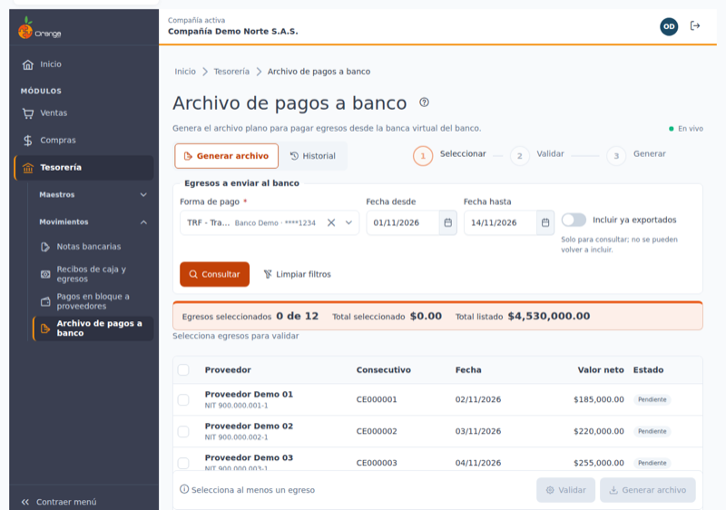

Un archivo puede tener hasta **1.000 egresos**. Si el rango no trae egresos, la pantalla lo dice y le sugiere incluir los ya exportados.

### Validar la selección

Haga clic en **Validar**. El informe separa:

- **Egresos válidos**: listos para el archivo.
- **Con errores**: no entran al archivo. Cada error dice qué falta (por ejemplo, la cuenta del proveedor o el banco sin Banco PAB) y enlaza con la ficha del proveedor para corregirlo.
- **Con advertencias**: entran al archivo, pero conviene revisarlos.

Puede filtrar el informe por hallazgos y exportarlo a Excel con **Exportar informe**.

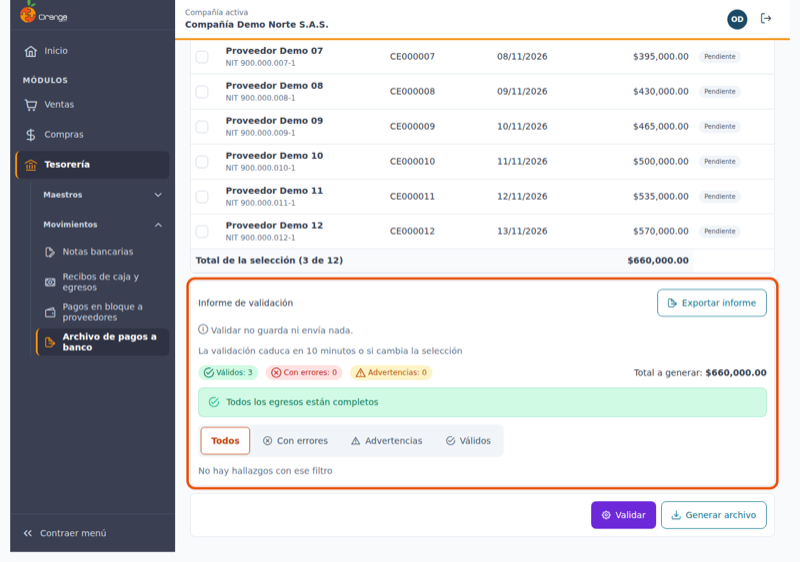

> ℹ️ Validar no escribe nada en la base de datos. Puede validar las veces que quiera.

### Generar el archivo

Haga clic en **Generar archivo**. Antes de generar, la pantalla pide confirmar las opciones del archivo:

- **Clase de transacción**: 220 (pago a proveedores) o 238 (pago a proveedores alterno).
- **Aplicación**: en blanco (la que tenga parametrizada el banco), I (inmediata), M (media jornada) o N (noche).
- **Propósito**: hasta 10 caracteres.
- **Fecha de aplicación**: entre hoy y 90 días después. Si la fecha ya pasó cuando el banco recibe el archivo, puede rechazarlo.

Si hay egresos con errores, la pantalla ofrece **Excluir las incompletas**. Los excluidos quedan sin marca y puede generarlos después. Con **Generar y descargar** se descarga el archivo y los egresos incluidos quedan marcados como exportados.

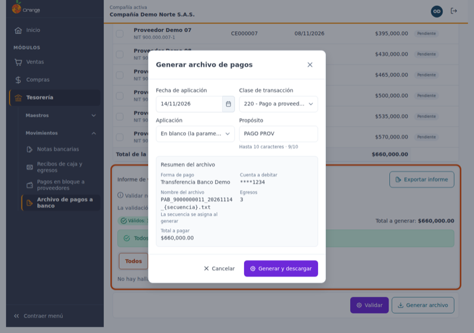

El nombre del archivo tiene la fecha del día y una secuencia (A1, A2… Z9). Cada día, por banco, hay hasta 234 archivos vigentes. Si se agotan, la pantalla avisa que se agotaron las secuencias del día.

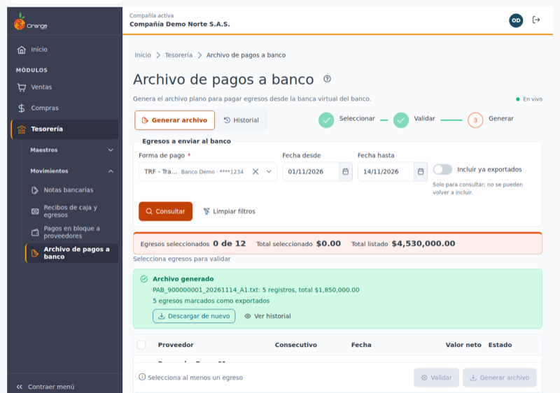

---

## 🕓 Historial de archivos

En la pestaña **Historial** cada fila muestra el archivo, la fecha, la secuencia, los registros, el total, el usuario que lo generó y el **Estado**.

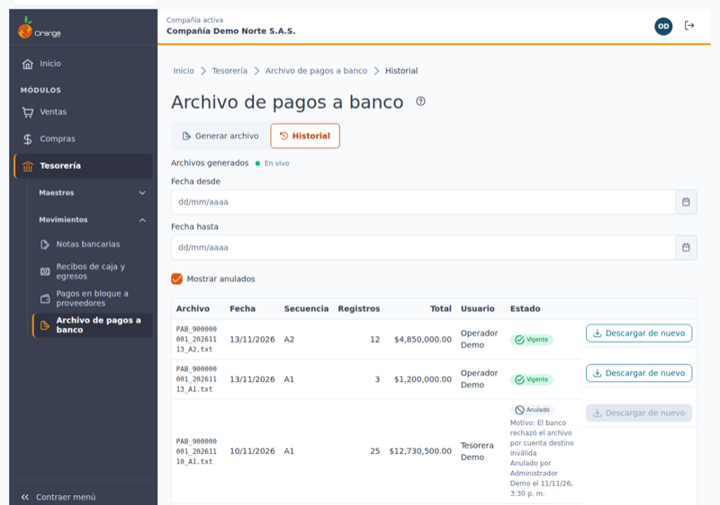

- **Descargar de nuevo** vuelve a bajar el archivo. El servidor lo regenera con los datos actuales y, si el contenido cambió (por ejemplo, porque editó la ficha de un proveedor), la pantalla lo avisa. Puede escribir un motivo opcional.
- **Mostrar anulados** (activado al abrir la pantalla): si lo desmarca, el historial oculta los archivos anulados.

---

## ⛔ Anular un archivo

Anular **da de baja un archivo** que no debe usarse. No se borra nada: el archivo queda en el historial como **Anulado**, con su motivo, y sus egresos vuelven a la selección para incluirse en un archivo nuevo.

### Cuándo anular

Anule un archivo **solo si el banco lo rechazó**. Si el banco ya recibió y procesó el archivo, anularlo en el sistema no cancela esos pagos en el banco: los egresos quedarían libres para enviarse otra vez y el proveedor podría cobrar dos veces.

> ⚠️ **Advertencia de pago doble.** Si ya subió el archivo al banco, anúlelo solo si el banco lo rechazó; si no, se puede pagar dos veces.

### Pasos

1. En la pestaña **Historial**, busque el archivo en la fila y haga clic en el botón **Anular** de esa fila.
2. Lea la advertencia y el texto de la consecuencia: los egresos quedarán libres para un archivo nuevo y la acción no se puede deshacer.
3. Escriba el **Motivo de la anulación**, de **1 a 200 caracteres**. Por ejemplo: *el banco rechazó el archivo*. El motivo es obligatorio.
4. Haga clic en **Anular archivo**. El botón se habilita solo cuando el motivo está escrito.

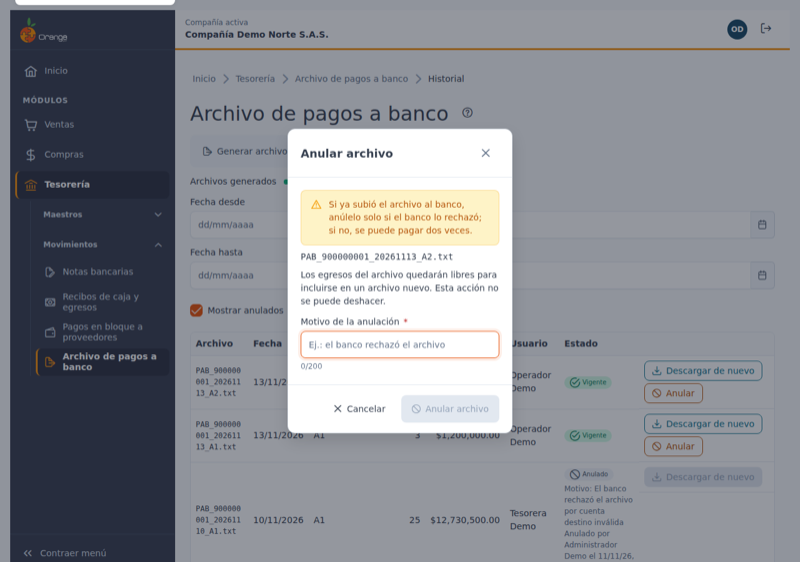

Mientras se anula, el botón muestra una carga y el diálogo no se puede cerrar. Al terminar, la pantalla confirma: *Archivo {nombre} anulado; sus egresos volvieron a la selección.*

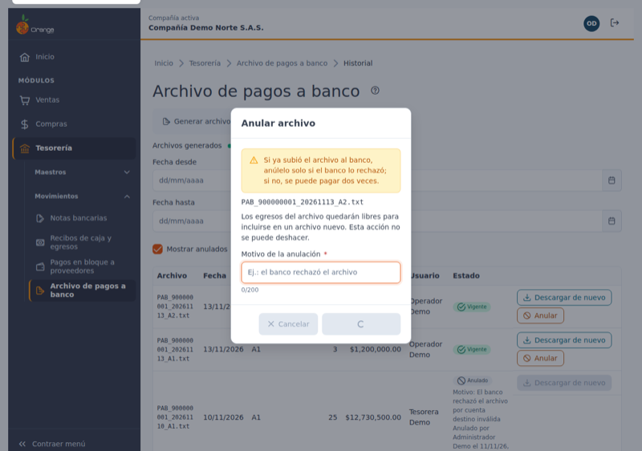

### Qué pasa con los egresos

- Los egresos del archivo anulado vuelven a aparecer en la **selección** y se pueden incluir en un archivo nuevo.
- El número de secuencia del día de ese archivo queda libre.
- Ningún egreso se borra ni cambia de valor.

### Cómo se ve un archivo anulado

En el historial, el archivo muestra la etiqueta **Anulado** en el **Estado** y debajo:

- **Motivo: …** con el texto que se escribió al anularlo.
- **Anulado por … el …**, con el usuario y la fecha y hora.

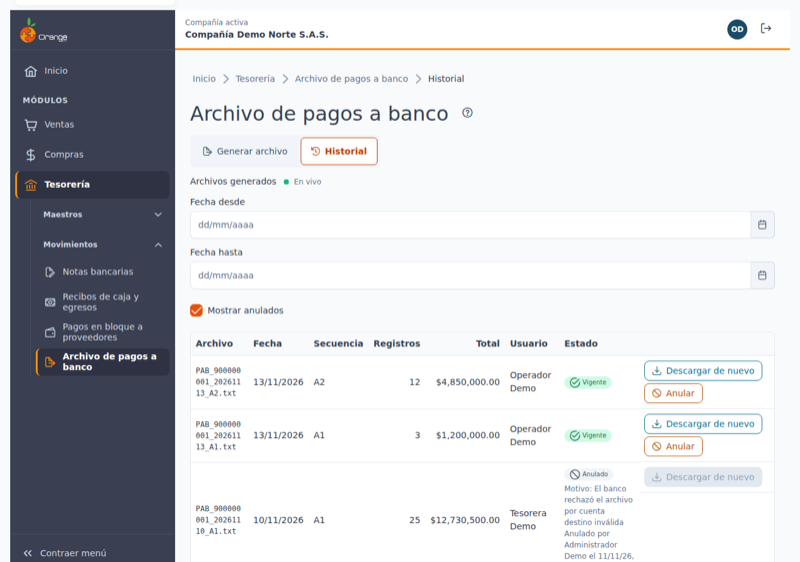

En un archivo anulado, **Descargar de nuevo** aparece deshabilitado. Si intenta bajarlo, la pantalla dice: *El archivo está anulado y no se puede descargar de nuevo.*

### Filtro «Mostrar anulados»

Con **Mostrar anulados** desmarcado, el historial deja solo los archivos vigentes. El filtro no cambia nada en el servidor: solo oculta la vista. Vuelva a marcarlo para ver los anulados.

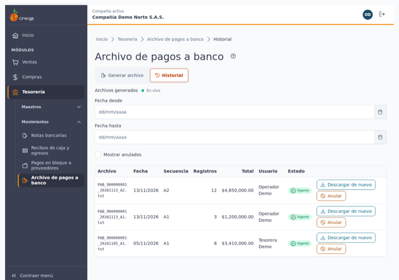

### Si otro usuario ya lo anuló

Si otra persona anuló el mismo archivo antes que usted, la pantalla le muestra: *El archivo {nombre} ya estaba anulado (otro usuario lo anuló). Se actualizó el historial.* No se anula dos veces.

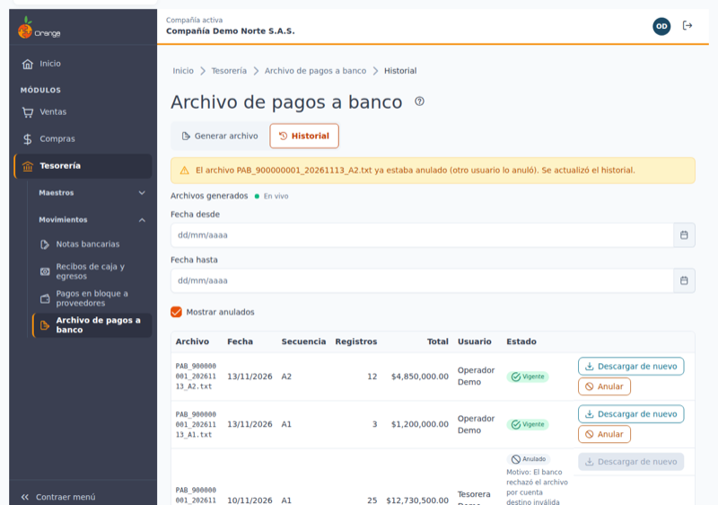

---

## ✏️ Corregir un archivo

El archivo generado **no se edita**. Es la evidencia de lo que se envió al banco, con su contenido y su huella (hash). Lo que se corrige es el **dato de origen** y luego se decide:

1. **Corrija el dato**:
   - el **tercero** (el proveedor): su cuenta bancaria, tipo de cuenta o banco, en la ficha del proveedor;
   - la **cuenta** de la empresa que paga, en la forma de pago;
   - el **Banco PAB** del banco, en [Bancos](../maestros/bancos.md).
2. **Y elija**:
   - **Descargar de nuevo** el mismo archivo, si el banco todavía no lo recibió. La pantalla lo regenera con el dato corregido y avisa si el contenido cambió.
   - **Anular** el archivo (con motivo) y **generar uno nuevo** con los egresos que quedaron libres, si el banco lo rechazó.

> ⚠️ Nunca suba al banco dos archivos con los mismos pagos. Si el original ya llegó al banco, no genere ni suba otro sin anularlo antes.

---

## 🔄 Cambios de otros usuarios (en vivo)

Cuando otro usuario genera o anula un archivo, el historial se actualiza solo. Verá el indicador **En vivo** arriba. Si se pierde la conexión, aparece **Reconectando…** hasta que vuelva.

Si otra persona anula el archivo que usted quiere anular, verá el aviso de que ya estaba anulado (vea arriba).

---

## ❔ Ayuda en pantalla

El botón **?** abre este manual en un panel a la derecha. Puede dejarlo abierto mientras trabaja en la pantalla.

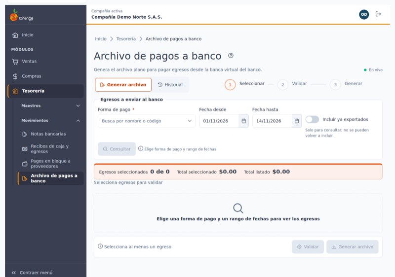

En un celular, la ayuda ocupa toda la pantalla y se cierra con la **✕**.

---

## ❓ Preguntas frecuentes

**¿Puedo borrar un archivo generado?**
No. Si el archivo está mal o el banco lo rechazó, anúlelo con un motivo. Queda en el historial como **Anulado**.

**¿Puedo cambiar el motivo de una anulación?**
No. El motivo queda guardado con la anulación.

**¿Puedo editar un archivo ya generado?**
No. Corrija el dato de origen (tercero, cuenta o banco PAB) y luego descargue de nuevo o anule y genere uno nuevo. Vea la sección *Corregir un archivo* de este manual.

**¿Por qué no veo el botón Anular?**
Porque su perfil no tiene el permiso **Anular**, o no tiene **Exportar**, que es necesario para anular. Pida a su administrador el permiso.

**¿Por qué no veo un archivo anulado en el historial?**
Porque el filtro **Mostrar anulados** está desmarcado. Vuelva a marcarlo.

**¿Por qué un egreso anulado no aparece en la selección?**
Revise la forma de pago y el rango de fechas, y haga clic en **Consultar** de nuevo. Si el egreso sigue sin aparecer, es posible que esté en otro archivo vigente.

**¿Puedo anular un archivo que el banco ya aceptó?**
Anularlo en el sistema no cancela los pagos que el banco ya procesó. Si el banco ya lo recibió, no lo anule: los egresos quedarían libres y podrían pagarse dos veces. Vea la sección *Cuándo anular*.

---

## ⚠️ Mensajes frecuentes

| Mensaje | Qué hacer |
|---------|-----------|
| *Escribe el motivo de la anulación (1 a 200 caracteres)* | Escriba el motivo. No puede quedar vacío ni tener más de 200 caracteres. |
| *El archivo ya estaba anulado (otro usuario lo anuló). Se actualizó el historial.* | No hace falta anular otra vez. Revise el historial. |
| *El archivo está anulado y no se puede descargar de nuevo.* | Si necesita enviar esos pagos, genere un archivo nuevo con los egresos que quedaron libres. |
| *El rango no puede superar 92 días* | Reduzca el rango de fechas. |
| *Máximo 1.000 egresos por archivo* | Divida la selección en dos archivos. |
| *No tienes permiso para esta acción.* | Pida a su administrador el permiso que necesite. |
| *Sin conexión con el servidor. Reintenta.* | Revise la conexión y haga clic en **Reintentar**. |
