[Regresar a Tesorería](../readme.md)

---

# 🏦 Archivo de pagos a banco

---

## 📋 Descripción

Use **Archivo de pagos a banco** cuando quiera pagar a sus proveedores desde la banca virtual del banco, sin digitar cada pago. La pantalla toma los **egresos a proveedores** de una forma de pago y de un rango de fechas que todavía no se han enviado al banco, revisa que cada proveedor tenga completos sus datos bancarios y genera un **archivo plano** que usted sube a la banca virtual.

El trabajo se hace en tres pasos, que se ven arriba de la pantalla:

1. **Seleccionar**: elija la forma de pago y las fechas, y marque los egresos que quiere enviar.
2. **Validar**: revise el informe. Validar **no guarda ni envía nada**.
3. **Generar**: confirme las opciones del archivo y descárguelo. Los egresos incluidos quedan marcados como exportados.

> ℹ️ Generar el archivo **no crea ni cambia egresos ni asientos**. Solo registra que ese egreso ya se envió al banco.

> ⚠️ Un egreso marcado como exportado **no se vuelve a incluir** en otro archivo. Si necesita el mismo archivo otra vez, use **Descargar de nuevo** en el historial (ver [Historial y Descargar de nuevo](#-historial-y-descargar-de-nuevo)).

> 💡 Antes de empezar, revise que la **forma de pago** tenga su cuenta bancaria de la empresa (ver [Requisitos](#-requisitos)). Si no la tiene, la pantalla le dice qué falta.

---

## 🎯 Acceso

1. En el menú principal, haga clic en **Tesorería**.
2. En **Movimientos**, haga clic en **Archivo de pagos a banco**.

La pantalla tiene dos pestañas en la parte superior:

- **Generar archivo**: la pantalla de trabajo, donde selecciona, valida y genera.
- **Historial**: los archivos que ya se generaron, con la opción de descargarlos de nuevo.

---

## ✅ Requisitos

Antes de generar un archivo, revise estos cuatro puntos. La pantalla le avisa si alguno falta.

| Requisito | Dónde se revisa | Qué debe tener |
|-----------|-----------------|----------------|
| **Permisos** | Su perfil | **Consultar** para ver y validar. **Exportar** para generar, descargar y exportar el informe. Ver [Permisos](#-permisos). |
| **Cuenta bancaria de la empresa** | [Formas de pago](../maestros/formas-pago.md#-cuenta-bancaria-de-la-empresa) | Número de cuenta (solo dígitos, hasta 11), tipo de cuenta (**Ahorros** o **Corriente**) y **Banco de la cuenta**. Los tres van juntos. |
| **Banco PAB** | [Bancos](../maestros/bancos.md#-banco-pab-archivo-de-pagos-a-banco) | Cada banco en el que tiene proveedores debe tener su **Banco PAB**, el código del banco en el archivo. Sin él, esos proveedores salen con error. |
| **Datos bancarios completos del proveedor** | Ficha del proveedor | Tipo de cuenta (ahorros o corriente), número de cuenta, banco, tipo y número de documento, y nombre. |

> 📌 El **NIT de la empresa** también se usa en el archivo. Si la compañía no lo tiene configurado, verá *Configura el NIT en la empresa*. Lo configura el administrador de la compañía.

> ℹ️ Los egresos que se envían son los de **proveedores**. Si un egreso es para un tercero que no es proveedor, la validación lo marca como *El beneficiario no es proveedor* y no sale en el archivo.

---

## 🔐 Permisos

Cada acción depende de los permisos de su perfil sobre la opción **Archivo de pagos a banco**.

| Permiso | Qué habilita |
|---------|--------------|
| Consultar | Ver la pantalla, buscar egresos, **Validar**, ver el informe y el **Historial**. |
| Exportar | **Generar archivo**, **Generar y descargar**, **Descargar de nuevo** y **Exportar informe**. |

Qué ve según sus permisos:

- **Solo Consultar**: puede buscar y validar. No ve **Generar archivo**, **Descargar de nuevo** ni **Exportar informe**. Verá el aviso *Solo puedes consultar y validar; generar requiere el permiso de exportar.*
- **Sin acceso a la opción**: la pantalla muestra *No tienes permiso para ver Archivo de pagos a banco*, y la opción no aparece en el menú.

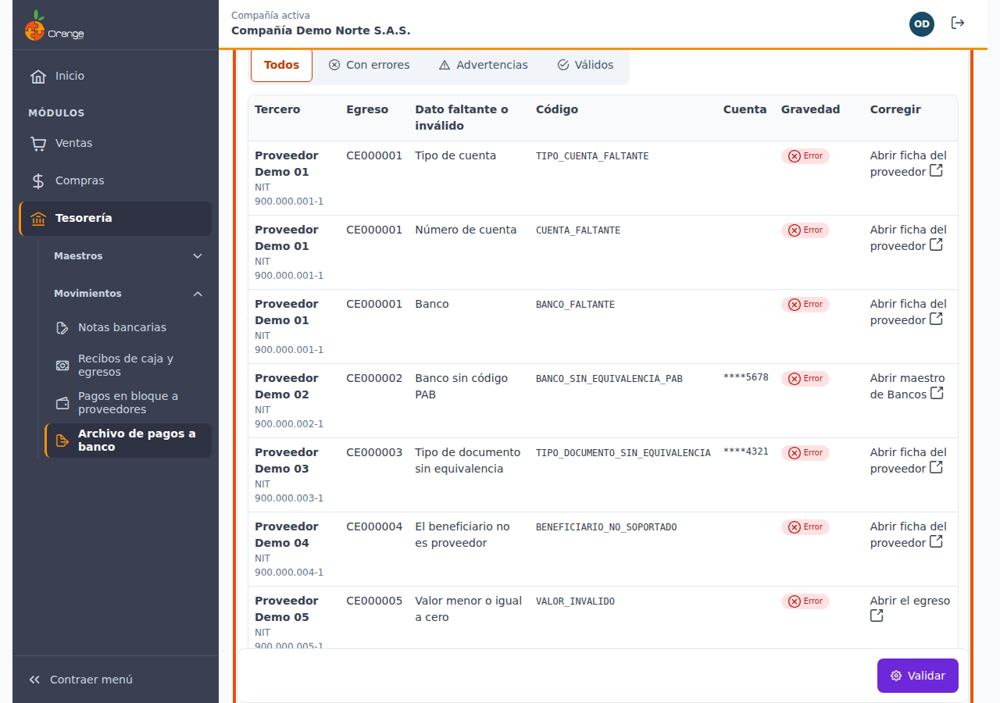

---

## 🖥️ Pantalla de trabajo

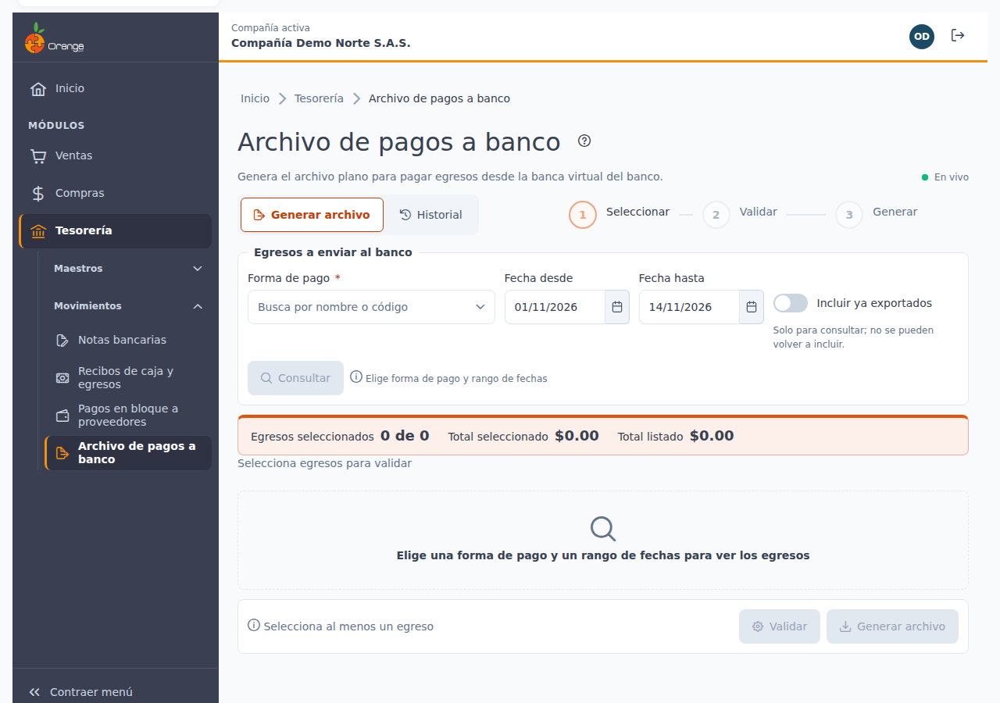

De arriba abajo, la pantalla tiene estas partes:

| Elemento | Para qué sirve |
|----------|----------------|
| **?** (junto al título) | Abre esta ayuda en un panel lateral, sin salir de la pantalla. |
| **En vivo** | La pantalla está conectada: los cambios de otros usuarios aparecen solos. Ver [Cambios de otros usuarios](#-cambios-de-otros-usuarios-en-vivo). |
| **Generar archivo / Historial** | Cambia entre la pantalla de trabajo y los archivos ya generados. |
| **Pasos** | Muestra en qué paso va: Seleccionar, Validar o Generar. Los pasos no se pueden saltar con clics. |
| **Egresos a enviar al banco** | Los filtros: forma de pago, fechas, **Incluir ya exportados**, **Consultar** y **Limpiar filtros**. |
| **Resumen de la selección** | Egresos seleccionados (*n de m*), **Total seleccionado** y **Total listado**. |
| **Tabla de egresos** | Los egresos encontrados, con una casilla para marcarlos. |
| **Barra de acciones** | Abajo, con el motivo si algo impide validar o generar, **Validar** y **Generar archivo**. |

---

## 🔍 Seleccionar egresos

### Filtros

1. Elija la **Forma de pago**. Es obligatoria: busque por nombre o código.
2. Indique **Fecha desde** y **Fecha hasta**. Son obligatorias. El rango no puede superar **92 días**, y la fecha *desde* no puede ser mayor que la fecha *hasta*.
3. Haga clic en **Consultar**.

Por defecto, las fechas van desde el primer día del mes hasta hoy.

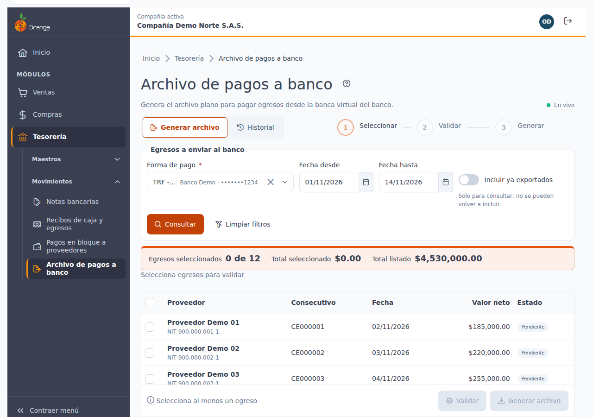

| Mensaje | Qué hacer |
|---------|-----------|
| *Elige forma de pago y rango de fechas* | Complete los dos filtros. |
| *El rango no puede superar 92 días* | Acorte las fechas. |
| *Desde no puede ser mayor que hasta* | Corrija el orden de las fechas. |

> ℹ️ Solo se listan egresos **vigentes** (no anulados) de su compañía, de la forma de pago elegida, que todavía **no se hayan enviado** en un archivo.

### Marcar egresos

- Marque la casilla de cada egreso que quiere enviar.
- Use la casilla de la cabecera para **seleccionar todo lo visible**.
- El **Resumen de la selección** muestra cuántos egresos lleva marcados y el total.

Cada egreso tiene uno de estos estados:

| Estado | Significado |
|--------|-------------|
| **Pendiente** | Listo para seleccionar. Todavía no se ha validado. |
| **Exportado** | Ya se envió en un archivo. No se puede seleccionar. Solo aparece si activa **Incluir ya exportados**, y es solo para consulta. |
| **Válido**, **Con errores** o **Advertencia** | Resultado de la última validación. |

> 💡 La selección admite hasta **1.000 egresos** por archivo. Si necesita más, divida el rango de fechas en dos consultas.

Si no encuentra egresos, la pantalla dice *No hay egresos pendientes de enviar al banco en este rango*. Pruebe con **Incluir ya exportados** para ver si ya se enviaron.

> ⚠️ Al marcar o desmarcar egresos, o al cambiar los filtros, **la validación anterior se descarta** y verá el aviso *La selección cambió; vuelve a validar*.

---

## ✔️ Validar

**Validar** revisa los datos bancarios de cada proveedor de la selección. **No guarda, no envía y no cambia nada**: puede validar cuantas veces quiera.

Antes de validar, marque al menos un egreso. Si no lo hace, **Validar** está deshabilitado y la barra le indica *Selecciona al menos un egreso*.

### Leer el informe

Al terminar aparece el **Informe de validación**, debajo de la tabla. Arriba verá:

- **Válidos**: egresos listos para enviar.
- **Con errores**: egresos que no pueden salir en el archivo hasta que se corrijan o se excluyan.
- **Advertencias**: egresos que sí salen, con un ajuste (por ejemplo, un nombre cortado).
- **Total a generar**: suma de los válidos.

Según el resultado, verá una de estas alertas: *Todos los egresos están completos*, *n egresos tienen errores; corrígelos y vuelve a validar, o exclúyelos* o *Ningún egreso es válido*.

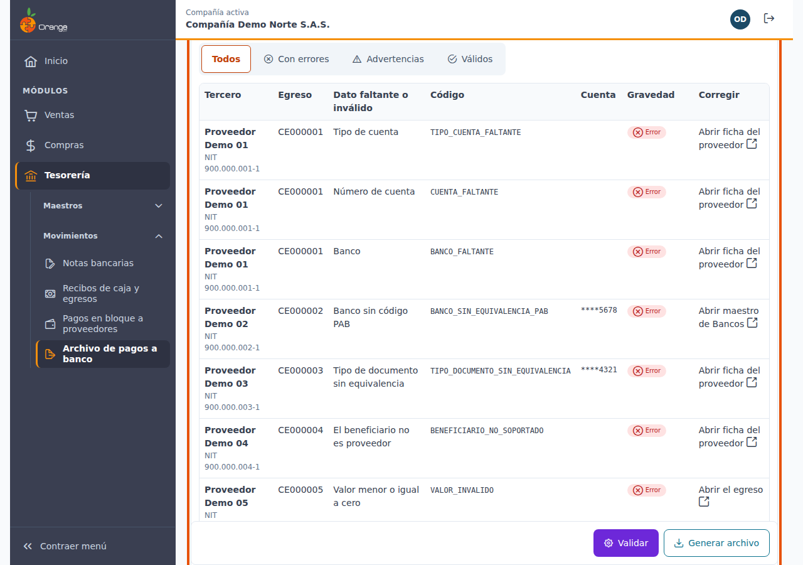

Debajo está la tabla de hallazgos, con una fila por egreso que tiene algún problema. Use el filtro **Todos**, **Con errores**, **Advertencias** o **Válidos** para verlos por grupo.

| Columna | Qué muestra |
|---------|-------------|
| **Tercero** | Nombre y NIT del proveedor. |
| **Egreso** | El consecutivo del egreso. |
| **Dato faltante o inválido** | Lo que hay que corregir, con texto claro. |
| **Código** | El código del error, el mismo que aparece en la sección Mensajes frecuentes. Sirve para referencia y para su soporte. |
| **Cuenta** | El número de cuenta **enmascarado**: solo los últimos 4 dígitos. |
| **Gravedad** | **Error** o **Advertencia**. |
| **Corregir** | Enlace que abre en una pestaña nueva la ficha del proveedor, el maestro de Bancos o el egreso. |

### Corregir y volver a validar

1. Use el enlace de **Corregir** de la fila. Se abre la ficha en otra pestaña y el informe se queda en esta.
2. Corrija el dato en la ficha y guárdela.
3. Vuelva a esta pestaña y haga clic en **Validar**. El informe se actualiza.

> ℹ️ La pantalla no corrige datos en masa. Cada proveedor se corrige en su ficha.

**La validación caduca** a los 10 minutos o si cambia la selección. Cuando caduca, verá *La validación caducó. Vuelve a validar.* y **Generar archivo** queda bloqueado hasta que valide de nuevo.

Con el permiso **Exportar**, el botón **Exportar informe** descarga el informe a Excel: tercero, NIT, egreso, dato, código, cuenta enmascarada y gravedad. Nunca incluye la cuenta completa.

---

## 📄 Generar el archivo

Cuando el informe tiene al menos un egreso válido, puede generar el archivo. Haga clic en **Generar archivo**. Se abre la ventana **Generar archivo de pagos**.

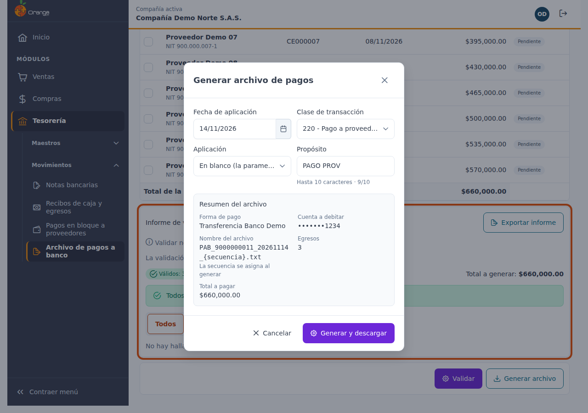

### Opciones del archivo

| Campo | Qué elegir | Valor por defecto |
|-------|------------|-------------------|
| **Fecha de aplicación** | La fecha en que el banco debe aplicar los pagos. Entre hoy y 90 días después. | Hoy |
| **Clase de transacción** | **220 - Pago a proveedores** o **238 - Pago a proveedores (alterna)**. | 220 |
| **Aplicación** | **En blanco** (la que tenga parametrizada el banco), **I - Inmediata**, **M - Media jornada** o **N - Noche**. | En blanco |
| **Propósito** | Texto de hasta 10 caracteres. | PAGO PROV |

Estas opciones solo aplican a **este** archivo. La pantalla no las guarda para la próxima vez.

Debajo verá el **Resumen del archivo**: egresos, total a pagar, cuenta a debitar, nombre del archivo (la secuencia se asigna al generar) y, si hay, advertencias.

| Mensaje | Qué hacer |
|---------|-----------|
| *Elige una fecha entre hoy y …* | Elija una fecha dentro del rango. |
| *Hasta 10 caracteres ASCII imprimibles* | Acorte el propósito y use solo letras, números y signos comunes. |

### Si hay egresos con errores

Si el informe tiene egresos con errores, no se genera el archivo con esos egresos. Tiene dos caminos:

- **Corregir** los datos y volver a validar.
- **Excluir las incompletas**: marque la casilla. Se abre la ventana **Excluir egresos incompletos**, que dice cuántos egresos se excluirán y por qué, por ejemplo *Tipo de cuenta: 8* o *Banco sin código PAB: 3*.

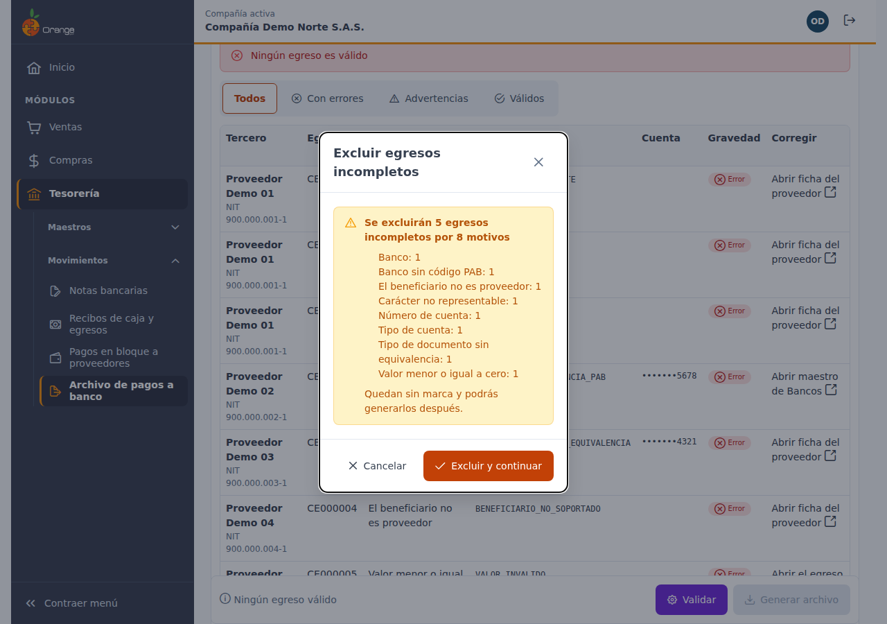

Al confirmar con **Excluir y continuar**, el resumen muestra solo los egresos válidos, y el botón cambia a **Excluir las incompletas y generar**. Los excluidos **quedan sin marca**: puede generarlos después, cuando los corrija.

> ⚠️ Si hay errores y no excluye las incompletas, el archivo **no se genera**. Ningún egreso queda marcado.

### Generar y descargar

1. Revise las opciones y el resumen.
2. Haga clic en **Generar y descargar**.
3. Espere a que termine. No cierre la ventana ni haga clic de nuevo.

El archivo se descarga con un nombre como **PAB_NIT_AAAAMMDD_secuencia.txt**: el NIT de su empresa, la fecha de generación y la secuencia del día para ese banco.

Al terminar verá **Archivo generado**, con el nombre, la secuencia, el número de registros, el total y cuántos egresos se marcaron como exportados.

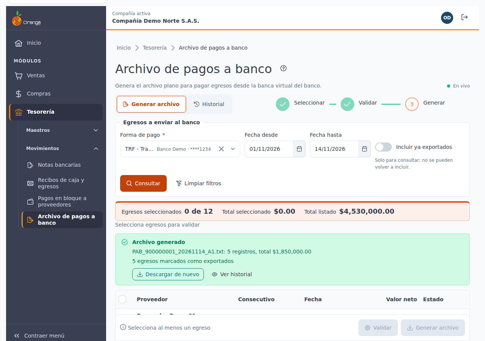

En ese resultado tiene tres opciones:

- **Descargar de nuevo**: si el navegador no descargó el archivo, lo vuelve a bajar.
- **Ver historial**: lleva a la pestaña **Historial**.
- Los egresos generados salen de la tabla. Los excluidos siguen seleccionables.

> ⚠️ La generación es **todo o nada**. Si ocurre un error antes de guardar, verá *No se generó el archivo; no se marcó ningún egreso.* con **Reintentar**. Nunca quedan egresos marcados sin archivo.

### Mensajes al generar

| Mensaje | Qué pasó y qué hacer |
|---------|----------------------|
| *Algunos egresos ya se exportaron en otro archivo. Vuelve a validar.* | Otro usuario ya envió uno de los egresos. Valide de nuevo; ese egreso ya no aparecerá. |
| *Los datos cambiaron desde la validación. Vuelve a validar.* | Algún dato cambió después de validar. Valide de nuevo antes de generar. |
| *Se agotaron las secuencias del día para este banco* | Ya se generaron todos los archivos posibles de ese día para ese banco. Genere el archivo al día siguiente. |
| *No hay egresos válidos para generar* | Todos los egresos tienen errores. Corrija la selección o los datos. |
| *Esta solicitud ya se usó con otro contenido. Vuelve a empezar.* | Cierre la ventana y empiece desde **Validar**. |
| *Sin conexión con el servidor. Reintenta.* | Verifique su conexión y use **Reintentar**. Sus filtros y su selección se conservan. |

---

## 🏦 Subir el archivo a la banca virtual

El archivo es **plano**: no lo abra ni lo edite en Excel ni en un editor de texto, porque puede cambiar sus espacios y su longitud. Súbalo tal como se descargó, en la banca virtual de su banco, según el procedimiento de pagos a proveedores que tenga habilitado su empresa.

> ⚠️ Si el banco rechaza el archivo, no lo corrija a mano. Los egresos ya quedaron marcados como exportados y reenviarlos requiere un ajuste de la compañía: consulte con su administrador de OrangeERP.

> 📌 Antes de usar esta herramienta para pagos reales, coordine con su banco una prueba con un archivo de ejemplo, para confirmar que lo acepta.

---

## 🕘 Historial y Descargar de nuevo

La pestaña **Historial** lista los archivos generados por su compañía.

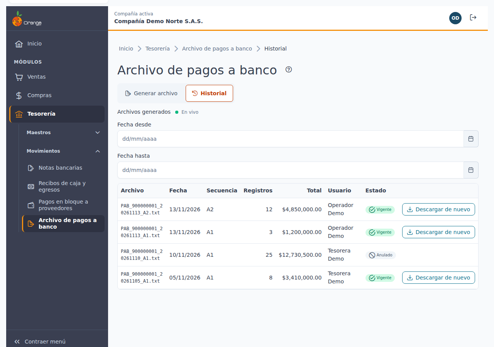

| Columna | Qué muestra |
|---------|-------------|
| **Archivo** | El nombre del archivo. |
| **Fecha** | El día en que se generó. |
| **Secuencia** | La secuencia del día para ese banco. |
| **Registros** | Cuántos pagos tiene el archivo. |
| **Total** | Suma de los pagos. |
| **Usuario** | Quién lo generó. |
| **Estado** | **Vigente**, o **Anulado** si se anuló (solo lectura). |

Puede filtrar por **Fecha desde** y **Fecha hasta**, y limpiar el filtro con **Limpiar filtros**. Si no hay archivos, verá *Aún no se han generado archivos*. Si el rango no tiene archivos, verá *No hay archivos en ese rango*.

### Descargar de nuevo

Use **Descargar de nuevo** cuando necesite el mismo archivo otra vez, por ejemplo si perdió el original.

1. En la fila del archivo, haga clic en **Descargar de nuevo**.
2. Opcionalmente, escriba el **Motivo**, de hasta 200 caracteres (por ejemplo, *Pérdida del archivo*).
3. Haga clic en **Descargar**.

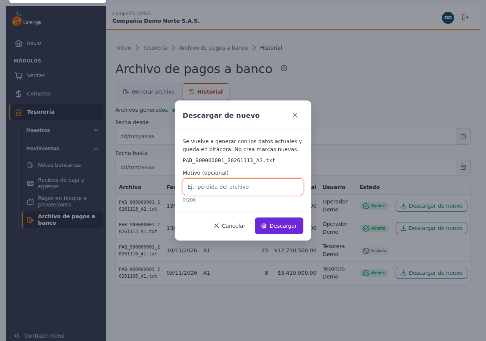

El archivo se vuelve a generar con los datos **actuales** y queda registrado en la bitácora con su usuario y su motivo. **No marca egresos nuevos** y no cambia los que ya estaban marcados.

Hay dos resultados:

- **Archivo descargado, idéntico al original**: los datos no cambiaron.
- **Los datos de un tercero cambiaron desde que se generó …; el archivo descargado no es idéntico al original.** Pasa si editó la ficha de un proveedor después de generar el archivo. Revise el cambio antes de subir el archivo al banco.

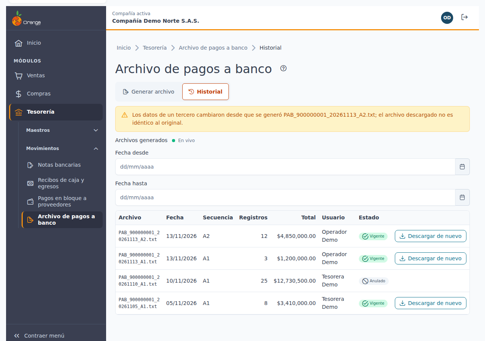

> ℹ️ Si la fecha de aplicación del archivo ya pasó, la pantalla avisa que el banco puede rechazarlo.

Sin el permiso **Exportar**, el **Historial** se ve, pero no aparece **Descargar de nuevo**.

---

## ⚙️ Configuración que falta

Si la forma de pago no está lista para generar el archivo, la pantalla no muestra el informe. En su lugar verá una alerta con el dato que falta:

- *Falta el número de cuenta* o *Número de cuenta inválido*.
- *Falta el tipo de cuenta*.
- *Falta el banco de la cuenta*.
- *Falta el NIT de la empresa; configúralo en la empresa*.

Use el enlace **Ir a Formas de pago** para completar la cuenta en el maestro de [Formas de pago](../maestros/formas-pago.md#-cuenta-bancaria-de-la-empresa). El NIT de la empresa se configura en la compañía: esta pantalla solo lo indica.

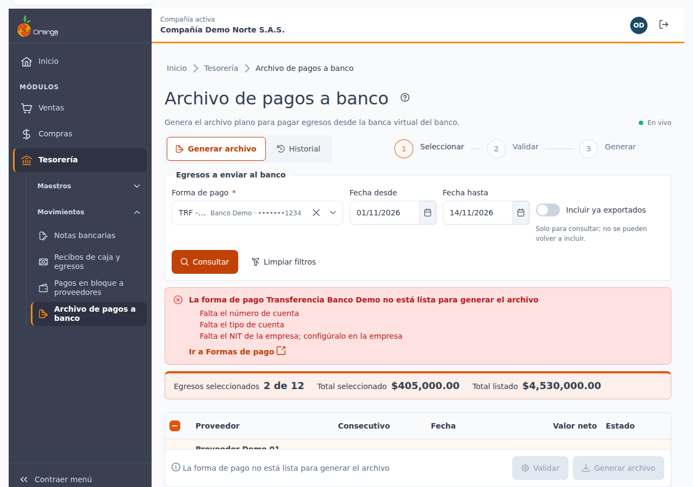

Si el banco de la cuenta todavía no tiene generador de archivo, verá *El banco de la cuenta (…) aún no tiene generador de archivo. Hoy solo está disponible Bancolombia.* En ese caso, use una forma de pago cuya cuenta sea de Bancolombia.

---

## 🔄 Cambios de otros usuarios (en vivo)

Si otra persona genera un archivo mientras usted tiene esta pantalla abierta, **no tiene que recargar**. Los egresos enviados salen de su tabla. Si los tenía marcados, se desmarcan solos, y verá el aviso *Otro usuario generó un archivo: se quitaron n egresos de la selección*.

La validación anterior también se descarta, así que debe validar de nuevo. El **Historial** suma el nuevo archivo.

Junto a la descripción verá **En vivo** mientras la conexión esté activa. Si se interrumpe, dice **Reconectando…**; al volver, la pantalla se actualiza sola.

---

## 🔒 Privacidad de los datos bancarios

- Las cuentas se muestran siempre **enmascaradas**: asteriscos y los últimos 4 dígitos, por ejemplo `****1234`. Esto aplica a la pantalla, al informe y al Excel.
- El archivo que descarga sí contiene la cuenta completa, porque el banco la necesita. Guárdelo en un lugar seguro y compártalo solo con quien procesa los pagos.
- El nombre del archivo lleva el NIT de su empresa, nunca un número de cuenta.

---

## 📱 Uso en el celular

En pantallas angostas, cada egreso y cada hallazgo del informe se muestran como tarjeta, con la casilla, el proveedor, el valor y el estado. Los botones y las casillas son más grandes para tocarlos con facilidad. Las ventanas de confirmación ocupan casi toda la pantalla.

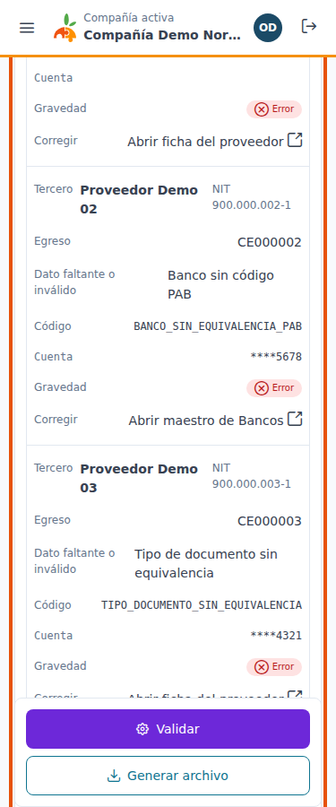

---

## ❔ Ayuda en pantalla

El botón **?** abre este manual en un panel a la derecha. Puede dejarlo abierto mientras trabaja en la pantalla.

---

## ⚠️ Mensajes frecuentes

En el informe de validación, cada hallazgo trae un **Código**. Es el código técnico del error: no hace falta traducirlo, pero conviene anotarlo si necesita ayuda de soporte.

| Dato faltante o inválido | Código | Qué hacer |
|--------------------------|--------|-----------|
| Tipo de cuenta | `TIPO_CUENTA_FALTANTE` | Abra la ficha del proveedor y elija **Ahorros** o **Corriente**. |
| Número de cuenta | `CUENTA_FALTANTE` | Complete el número de cuenta en la ficha del proveedor. |
| Número de cuenta inválido | `CUENTA_INVALIDA` | Deje solo dígitos, sin letras, guiones ni espacios, con no más de 17. |
| Banco | `BANCO_FALTANTE` | Asigne el banco en la ficha del proveedor. |
| Banco sin código PAB | `BANCO_SIN_EQUIVALENCIA_PAB` | Abra el maestro de **Bancos** y complete el campo **Banco PAB** de ese banco. |
| Documento del tercero | `DOCUMENTO_FALTANTE` | Complete el número de documento en la ficha del proveedor. |
| Tipo de documento sin equivalencia | `TIPO_DOCUMENTO_SIN_EQUIVALENCIA` | Revise el tipo de documento en la ficha. Si el tipo no tiene equivalencia para el banco, consulte a su administrador. |
| Nombre | `NOMBRE_FALTANTE` | Complete el nombre del proveedor. |
| El beneficiario no es proveedor | `BENEFICIARIO_NO_SOPORTADO` | Este archivo solo paga a proveedores. El egreso se queda sin marca. |
| Valor menor o igual a cero | `VALOR_INVALIDO` | Revise el egreso: el valor neto debe ser mayor que cero. |
| Carácter no representable | `CARACTER_NO_REPRESENTABLE` | Corrija el nombre o la referencia, sin símbolos especiales ni caracteres de otro idioma. |
| Nombre truncado a 30 caracteres (advertencia) | `NOMBRE_TRUNCADO` | El archivo sale con los primeros 30 caracteres. Si prefiere otro texto, corrija el nombre. |
| Referencia truncada a 21 caracteres (advertencia) | `REFERENCIA_TRUNCADA` | El archivo sale con los primeros 21 caracteres de la referencia. |
| Carácter sustituido por un espacio (advertencia) | `CARACTER_SUSTITUIDO` | Un símbolo se cambió por un espacio. Revise que el texto siga siendo reconocible. |

Los egresos con **advertencia** salen en el archivo. Los egresos con **error** no salen hasta que se corrijan o se excluyan.

---

## ❓ Preguntas frecuentes

**¿Por qué no aparece un egreso que sí hice?**
Puede estar ya exportado en otro archivo, ser de un tercero que no es proveedor, o estar fuera del rango de fechas o de la forma de pago elegida. Revise los filtros y use **Incluir ya exportados** para verificarlo.

**¿Puedo enviar dos veces el mismo egreso?**
No. Un egreso exportado queda marcado y no vuelve a aparecer para seleccionar. Si necesita el mismo archivo, use **Descargar de nuevo**.

**¿Qué pasa si hago doble clic en Generar?**
No se crean dos archivos. El segundo intento usa la misma solicitud y devuelve el mismo resultado.

**¿Validar cambia algo en el sistema?**
No. Validar no guarda, no marca egresos y no avisa a otros usuarios. Sirve para revisar.

**¿Puedo corregir un proveedor desde esta pantalla?**
No. Use el enlace **Corregir** del informe: se abre la ficha del proveedor en otra pestaña. Después vuelva a **Validar**.

**¿Puedo generar más de un archivo el mismo día?**
Sí. Cada archivo del día tiene su propia secuencia (A1, A2 y así sucesivamente) para ese banco. Hay un máximo de archivos por día; si se agota, genere al día siguiente.

**¿Qué hago si el banco rechaza el archivo?**
No lo corrija a mano. Consulte el motivo con su banco y con su administrador de OrangeERP, porque los egresos ya quedaron marcados como exportados.

**¿Puedo anular un archivo para volver a enviar sus egresos?**
Por ahora no desde esta pantalla. Consulte con su administrador de OrangeERP.

**¿Por qué las cuentas aparecen con asteriscos?**
Por privacidad. En pantalla, en el informe y en el Excel solo se muestran los últimos 4 dígitos.

**No veo "En vivo".**
La conexión en vivo no está disponible en este momento (por ejemplo, por la red de su empresa). La pantalla funciona igual; para ver cambios de otros usuarios, recargue la página.

**No veo el botón Generar archivo.**
Su perfil no tiene el permiso **Exportar** sobre la opción Archivo de pagos a banco. Consulte con el administrador de OrangeERP.

---

[Regresar a Tesorería](../readme.md)
