[Regresar a Tesorería](../readme.md)

---

# 🏦 Notas bancarias

---

## 📋 Descripción

Una **nota bancaria** registra lo que el banco hizo por su cuenta y que usted todavía no tiene en sus registros: el **GMF (4 x 1000)**, las **comisiones**, el **IVA de la comisión**, los **intereses** y **rendimientos** que el banco le abonó, la **retención** sobre rendimientos y las **devoluciones**.

Cada nota tiene una **fecha**, una **cuenta de banco** y una o varias **líneas**, una por cada concepto. Al **cerrarla**, OrangeERP registra los asientos contables que cuadran el libro del banco con el extracto.

Use una nota cuando el banco le cobró o le abonó algo que no ha registrado. Si lo que hace es pagar a un proveedor o cobrar a un cliente, use los documentos de Compras o de Ventas, no esta pantalla.

> 📘 La búsqueda, el orden, la paginación, la exportación y la ayuda funcionan igual en todas las tablas: ver [Manejo general de la información](../../Generales/manejo-general-informacion.md).

> 💡 Cada pestaña del navegador trabaja con **una compañía**. El nombre de la compañía se ve en el título de la pestaña y en la barra superior.

> ℹ️ Las notas **no se eliminan**. Si una nota está mal, **anúlela** con un motivo: queda en el listado con su historia.

Antes de empezar, revise que la cuenta de banco y los conceptos existan. Los conceptos se mantienen en [Conceptos de nota bancaria](../maestros/conceptos-nota-bancaria.md).

---

## 🎯 Acceso

1. En el menú principal, haga clic en **Tesorería**.
2. En **Movimientos**, haga clic en **Notas bancarias**.

---

## 🔐 Permisos

Cada acción depende de los permisos de su perfil sobre la opción **Notas bancarias**:

| Permiso | Qué habilita |
|---------|--------------|
| Consultar | Ver el listado, abrir las notas y descargar sus adjuntos. |
| Crear | **Nueva nota**, **Guardar borrador**, editar un borrador y adjuntar soportes a un borrador. |
| Actualizar | **Cerrar nota** y **Guardar y cerrar**. Para importar con **Cerrar al importar**, también. |
| Anular | **Anular nota**. |
| Exportar | **Exportar a Excel**. Con **Crear**, también permite **Importar**. |
| Editar documentos cerrados | Permiso especial. Permite corregir una nota **cerrada** (ver [Editar una nota cerrada](#-editar-una-nota-cerrada)) y cambiar sus adjuntos. |

> ℹ️ Si su perfil no tiene **Consultar**, la pantalla le avisa: *No tienes permiso para ver las notas bancarias.* Pida a su administrador el permiso que necesite.

---

## 🖥️ Pantalla principal

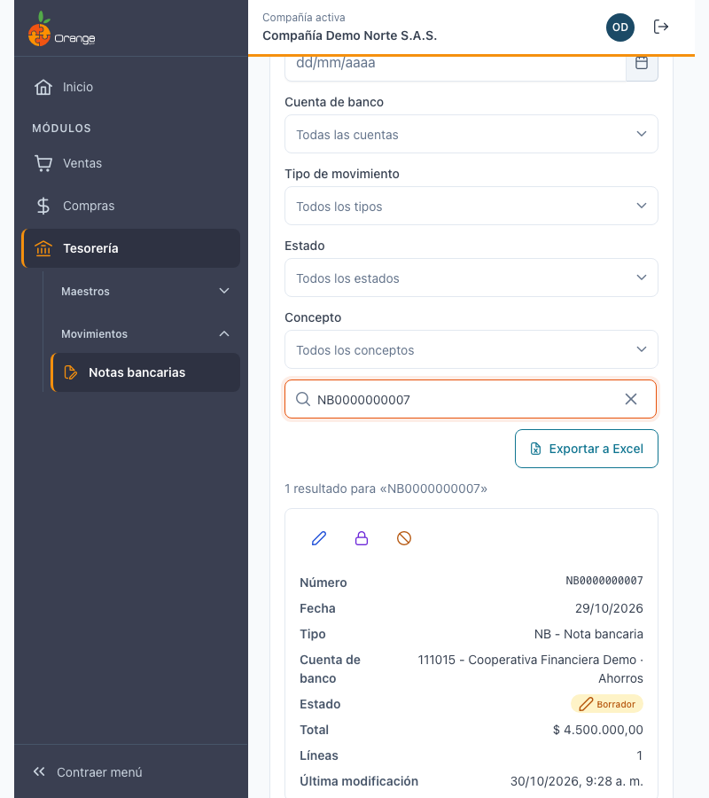

| Elemento | Para qué sirve |
|----------|----------------|
| **?** (junto al título) | Abre esta ayuda en un panel lateral, sin salir de la pantalla. |
| **En vivo** | La pantalla está conectada: los cambios de otros usuarios aparecen solos. Ver *Cambios de otros usuarios* más abajo. |
| **Importar** | Carga varias notas desde un archivo de Excel. Ver [Importar desde Excel](#-importar-desde-excel). |
| **Nueva nota** | Crea una nota. |
| **Filtros** | Reducen el listado por fecha, cuenta de banco, tipo de movimiento, estado y concepto. Ver *Filtros*. |
| **Buscar por número u observaciones** | Filtra mientras escribe. |
| **Exportar a Excel** | Descarga el listado con los filtros y el orden que tenga en pantalla, incluidas todas sus páginas. |
| **Encabezados** | Un clic ordena de forma ascendente, el segundo descendente y el tercero quita el orden. |
| **Filas por página** y paginación | Cambian cuántas notas ve y la página. |

Las columnas son:

| Columna | Qué muestra |
|---------|-------------|
| **Acciones** | Los botones de la nota (ver y, según el caso, editar, cerrar o anular). Siempre están en la **primera columna**. |
| **Número** | El número de la nota, por ejemplo `NB0000000002`. |
| **Fecha** | La fecha de la nota. |
| **Cuenta de banco** | La cuenta, como *código - nombre*. |
| **Tipo** | El tipo de movimiento de la nota. |
| **Estado** | **Borrador**, **Cerrada** o **Anulada**, con su icono. |
| **Total** | El **neto en el banco** de la nota: lo que entra al banco menos lo que sale. Si sale más de lo que entra, el valor tiene signo negativo. |
| **Líneas** | Cuántas líneas tiene la nota. |
| **Última modificación** | Cuándo se cambió por última vez. |

Los estados se distinguen por icono y texto:

- **Borrador** (lápiz): se puede editar. Todavía no tiene asientos.
- **Cerrada** (candado): registró sus asientos contables.
- **Anulada** (prohibido): no se borró; quedó con su motivo, su usuario y su hora.

### 🔎 Filtros

Los filtros están sobre la tabla y se pueden combinar:

- **Fecha desde** y **Fecha hasta**. Si la fecha inicial es posterior a la final, verá: *La fecha inicial no puede ser posterior a la final.* y el listado no muestra notas hasta corregirla.
- **Cuenta de banco**: solo las notas de esa cuenta.
- **Tipo de movimiento**: solo las notas de ese tipo.
- **Estado**: puede elegir uno o varios (Borrador, Cerrada, Anulada).
- **Concepto**: solo las notas que tengan una línea con ese concepto.
- **Limpiar filtros**: quita todos los filtros. Aparece solo cuando hay filtros aplicados.

Al cambiar un filtro, el listado vuelve a la primera página. Los filtros quedan en la dirección de la página, así que puede compartir el enlace con sus filtros.

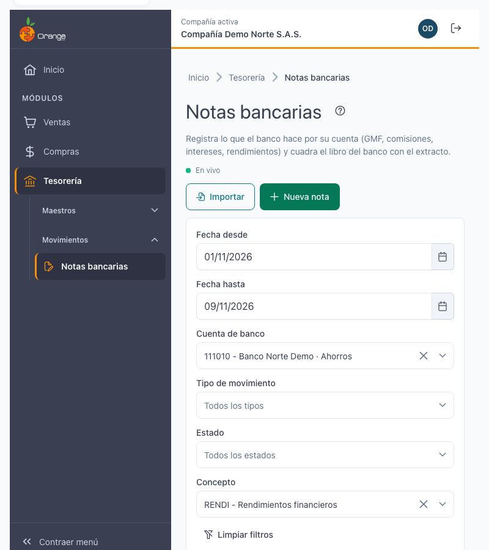

**Exportar a Excel** descarga todas las notas que cumplen los filtros, no solo la página visible. Si el filtro trae más de 50.000 notas, no se descarga nada: reduzca el rango de fechas o los filtros.

### Estados vacíos y errores del listado

| Mensaje | Qué significa | Qué hacer |
|---------|---------------|-----------|
| *Aún no hay notas bancarias* | La compañía no tiene notas todavía. | Haga clic en **Nueva nota** (si tiene el permiso de crear). |
| *Sin notas con estos filtros* | Ninguna nota cumple los filtros. | Cambie o limpie los filtros. |
| *No se pudieron cargar las notas* | Falló la consulta. | Revise su conexión y haga clic en **Reintentar**. |

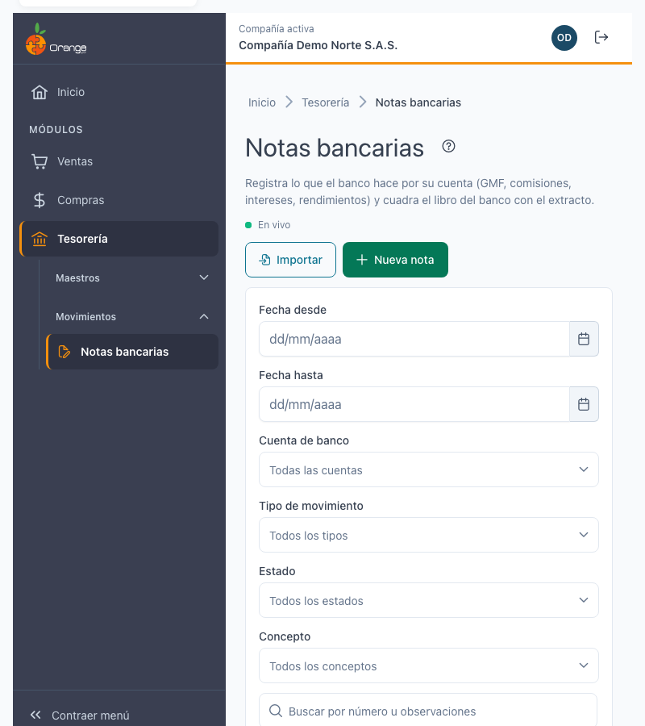

> 📱 En el celular, o en una ventana angosta, cada nota se muestra como una tarjeta, con sus acciones visibles.

---

## ➕ Crear una nota

1. En el listado, haga clic en **Nueva nota**. El cursor queda en **Cuenta de banco**.
2. Complete el **encabezado** (ver la tabla siguiente).
3. En la pestaña **Detalle**, agregue las **líneas** de la nota.
4. Revise el **Neto en el banco** en la parte inferior de la pantalla.
5. Haga clic en **Guardar borrador**, o en **Guardar y cerrar** si la nota ya está lista.

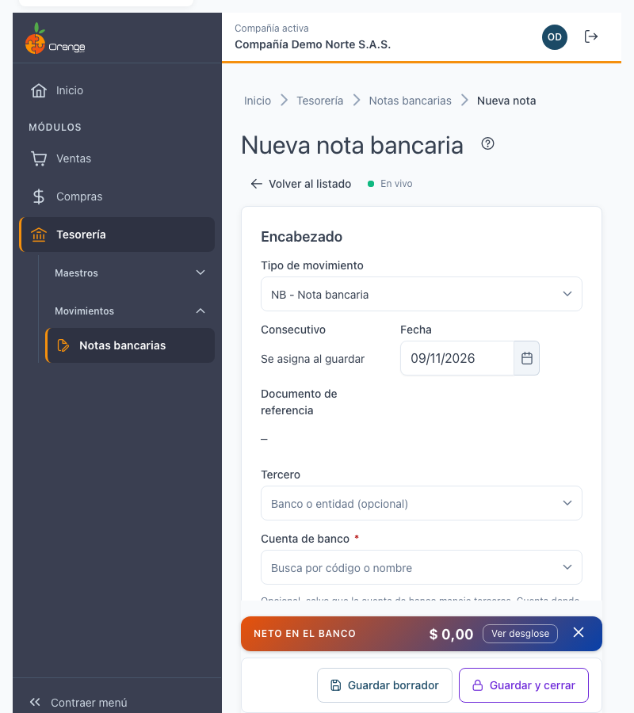

### Encabezado

| Campo | Obligatorio | Qué poner |
|-------|:-----------:|-----------|
| **Tipo de movimiento** | ✅ si hay varios | Solo ve los tipos que su perfil tiene autorizados. Si tiene uno solo, queda elegido. |
| **Consecutivo** | | Lo asigna el sistema al guardar. |
| **Fecha** | ✅ | La fecha de la nota. Se propone hoy. No puede ser posterior a hoy. |
| **Documento de referencia** | | El número de la nota (por ejemplo `NB0000000002`). Aparece después de guardar. |
| **Tercero** | Solo si la cuenta lo exige | El banco o entidad. Es obligatorio si la cuenta de banco maneja terceros. |
| **Cuenta de banco** | ✅ | La cuenta contable de banco donde el banco hizo el movimiento. Todas las líneas se registran en ella. |
| **Observaciones** | | Hasta 200 caracteres. Por ejemplo: *Extracto de octubre*. |

Si elige una cuenta de banco que maneja terceros y no pone tercero, verá: *Esta cuenta de banco maneja terceros: elige el tercero.*

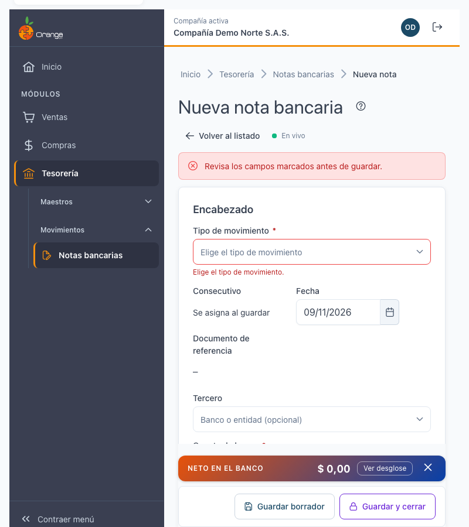

Si tiene varios tipos de movimiento, el sistema le pide elegir uno antes de guardar: *Elige el tipo de movimiento.*

### Líneas de la nota

Cada línea es un cobro o un abono del banco. En la pestaña **Detalle**, la **fila de captura** queda arriba y la **tabla de líneas** debajo.

| Campo de la línea | Obligatorio | Reglas |
|-------------------|:-----------:|--------|
| **Concepto** | ✅ | Solo conceptos activos. Al elegirlo, verá su efecto: **Entra dinero al banco** o **Sale dinero del banco**. |
| **Valor** | ✅ | Mayor que cero, con máximo dos decimales. |
| **Tercero de la línea** | Según el concepto | Sale por defecto del concepto. Puede cambiarlo. Es obligatorio si el concepto lo exige. |
| **Centro de costos** | Según la cuenta | Aparece y es obligatorio solo si la cuenta de contrapartida del concepto lo exige. |
| **Observaciones de la línea** | | Hasta 100 caracteres. |

Haga clic en **Agregar línea**. La nota admite entre 1 y 200 líneas.

Para trabajar más rápido, use el teclado (estas indicaciones aparecen bajo la fila de captura):

| Tecla | Qué hace |
|-------|----------|
| **Enter** | Pasa al siguiente campo. En el último campo, agrega la línea. |
| **Esc** | Limpia la fila de captura. |
| **↑** / **↓** | Elige una línea de la tabla. |
| **F2** | Carga la línea elegida en la fila de captura para editarla. |
| **Supr** | Quita la línea elegida. |

Para **editar** o **quitar** una línea, use los botones de la tabla:

- **Lápiz**: carga la línea en la fila de captura. Cambie lo que necesite y haga clic en **Guardar cambios de la línea**. Para salir sin cambios, haga clic en **Cancelar edición**.
- **Basurero**: quita la línea de la nota.

Estos cambios se hacen en la pantalla; la nota se guarda cuando hace clic en **Guardar borrador** o en **Guardar y cerrar**.

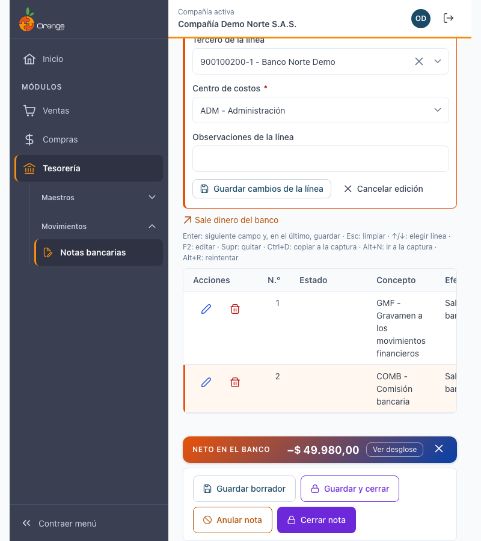

Si deja una línea a medias en la fila de captura y pulsa **Guardar**, verá: *Hay una línea sin agregar. Agrégala o cancélala antes de guardar la nota.*

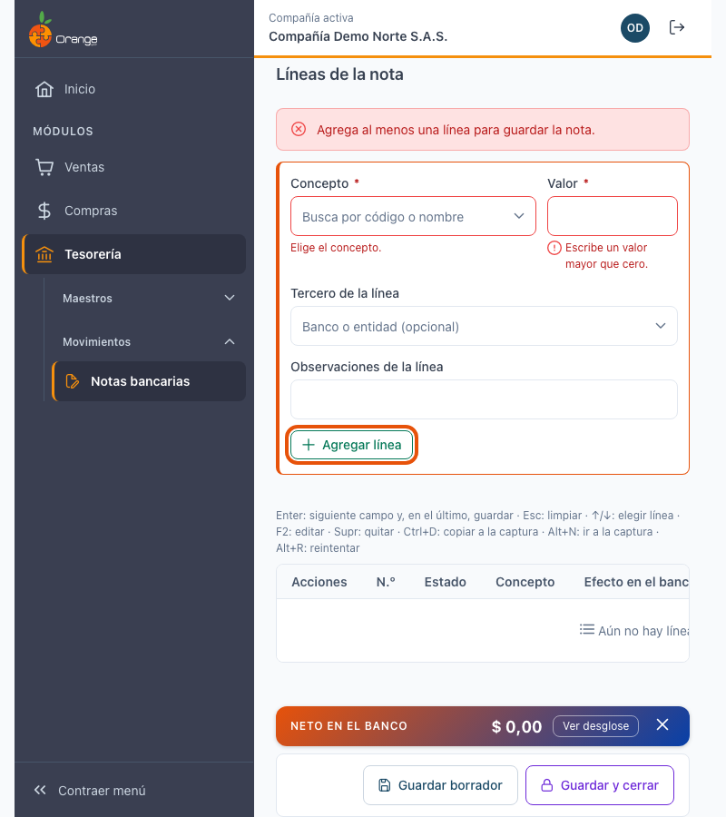

### Terceros y centros de costos exigidos

Algunas cuentas exigen datos extra. Si no los pone, la pantalla le indica qué falta:

- *Este concepto exige tercero.* (en la línea)
- *La cuenta de este concepto exige centro de costos.* (en la línea)

### El total: Neto en el banco

Mientras escribe, la parte inferior de la pantalla muestra el **Neto en el banco**:

- **Entra al banco**: la suma de las líneas cuyo concepto hace entrar dinero.
- **Sale del banco**: la suma de las líneas cuyo concepto hace salir dinero.
- **Neto en el banco**: **Entra al banco** menos **Sale del banco**.

Haga clic en **Ver desglose** para ver también el número de líneas. Si el neto es negativo, el banco tendrá menos dinero después de la nota.

### Guardar borrador, guardar y cerrar

| Botón | Qué hace | Permiso |
|-------|----------|---------|
| **Guardar borrador** | Crea la nota (o guarda sus cambios) como **Borrador**. Todavía no registra asientos. | Crear |
| **Guardar y cerrar** | Guarda la nota y la cierra en un solo paso. Pide confirmación. | Crear y Actualizar |

Al guardar verá el aviso **Nota NB… creada** (o **actualizada**), con el número de la nota.

Si el sistema no puede guardar, no se guarda nada y la nota queda como estaba. Vea [Mensajes de error frecuentes](#-mensajes-de-error-frecuentes).

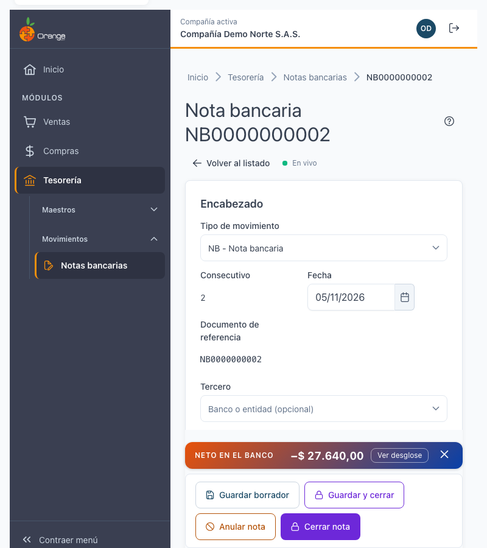

---

## ✏️ Editar un borrador

1. En el listado, haga clic en el **lápiz** de la nota, o ábrala desde el número.
2. Cambie el encabezado o las líneas.
3. Haga clic en **Guardar borrador** (o en **Guardar y cerrar**).

Un borrador se puede editar tantas veces como haga falta, siempre que nadie más lo haya cambiado en el mismo momento (ver [Cambios de otros usuarios](#-cambios-de-otros-usuarios-en-vivo)).

> ℹ️ Si no cambió nada y hace clic en **Guardar borrador**, la nota no cambia.

---

## ✅ Cerrar una nota

Cerrar es **registrar los asientos contables** de la nota. Solo se pueden cerrar borradores guardados.

1. En el listado, haga clic en **Cerrar** de la nota, o ábrala y haga clic en **Cerrar nota**.
2. Lea el diálogo y confirme con **Cerrar nota**.

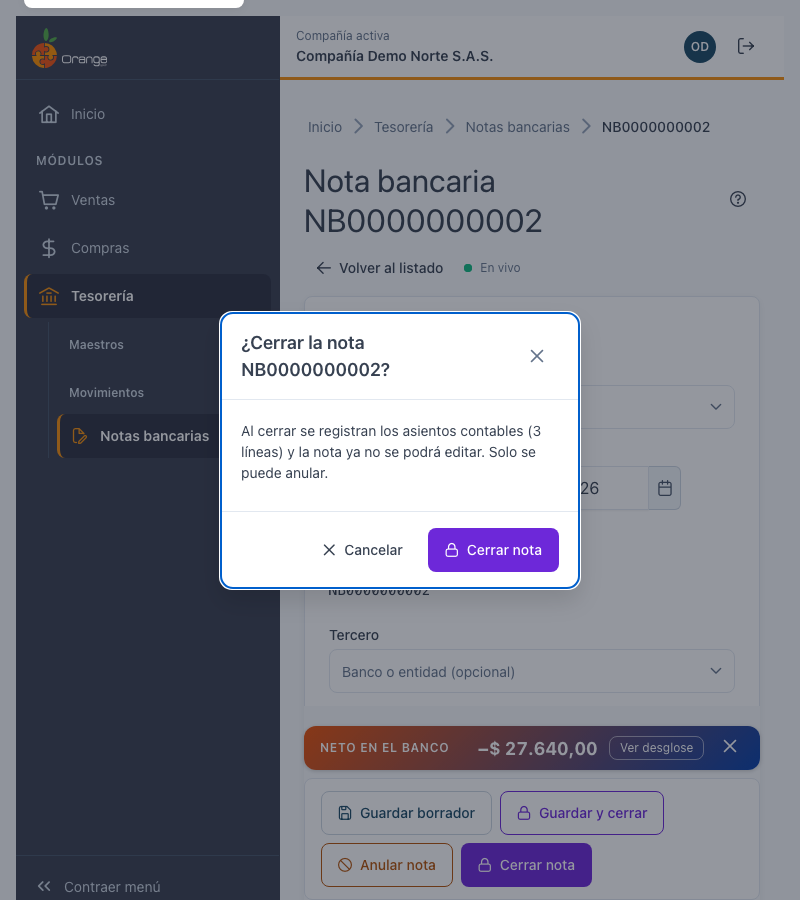

El diálogo dice: *Al cerrar se registran los asientos contables (n líneas) y la nota ya no se podrá editar. Solo se puede anular.* Una nota cerrada cambia a **Cerrada** y ya no puede modificarse, salvo por quien tenga el permiso especial **Editar documentos cerrados** (ver la siguiente sección).

Si el cierre falla (por ejemplo, por un descuadre, un periodo cerrado o un error del servidor), el diálogo se queda abierto con el mensaje. No se escribe nada: la nota sigue como borrador.

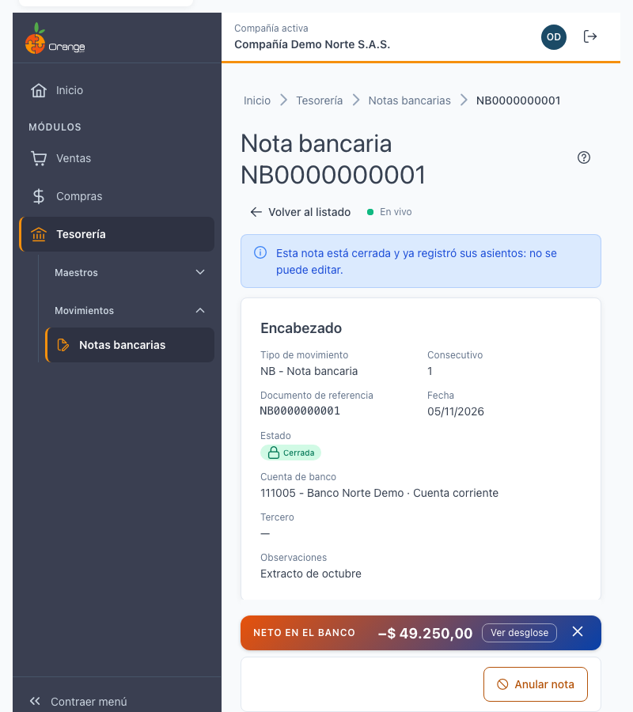

Una nota cerrada muestra el aviso *Esta nota está cerrada y ya registró sus asientos: no se puede editar.* y su encabezado en modo de solo lectura.

### Qué asientos se generan

Al cerrar, el sistema crea **una fila por cuenta**: suma todas las líneas que afectan a la misma cuenta y registra el neto. Así no quedan débitos y créditos de una misma cuenta al mismo tiempo.

- La **cuenta de banco** de la nota recibe el neto de todas sus líneas.
- Cada **contrapartida** (la cuenta de cada concepto) recibe lo que le corresponde.
- El total de débitos siempre es igual al total de créditos.

**Ejemplo simulado** (las cifras y los nombres de cuenta son de ejemplo; los suyos dependen de sus conceptos):

Una nota con tres líneas: **GMF** por 1.250,00 (sale del banco), **Comisión bancaria** por 8.000,00 (sale del banco) y **Rendimientos financieros** por 6.300,00 (entra al banco). El neto es 6.300,00 − 9.250,00 = **−2.950,00**.

| Cuenta | Débito | Crédito |
|--------|-------:|--------:|
| Cuenta de banco de la nota | | 2.950,00 |
| Gastos bancarios: GMF | 1.250,00 | |
| Gastos bancarios: comisiones | 8.000,00 | |
| Rendimientos financieros | | 6.300,00 |
| **Totales** | **9.250,00** | **9.250,00** |

---

## 🔁 Editar una nota cerrada

Una nota cerrada no se edita. Solo quien tiene el permiso especial **Editar documentos cerrados**, además del permiso de **Actualizar**, puede corregirla. Se cumplen estas reglas:

- La nota **sigue cerrada**: no vuelve a borrador.
- El periodo de la fecha vieja y el de la fecha nueva deben estar **abiertos**.
- La nota no puede estar **anulada**.
- Al guardar, el sistema **recalcula sus asientos contables**: borra los anteriores y registra los nuevos, con la misma regla de una fila por cuenta.
- El cambio queda en la **bitácora** como una edición de nota cerrada.

Si tiene el permiso, la nota se abre en modo de edición: cambie el encabezado o las líneas y haga clic en **Guardar cambios**. Verá el aviso *Esta nota está cerrada: al guardar se recalculan sus asientos contables.* El tipo de movimiento no se cambia en una nota cerrada.

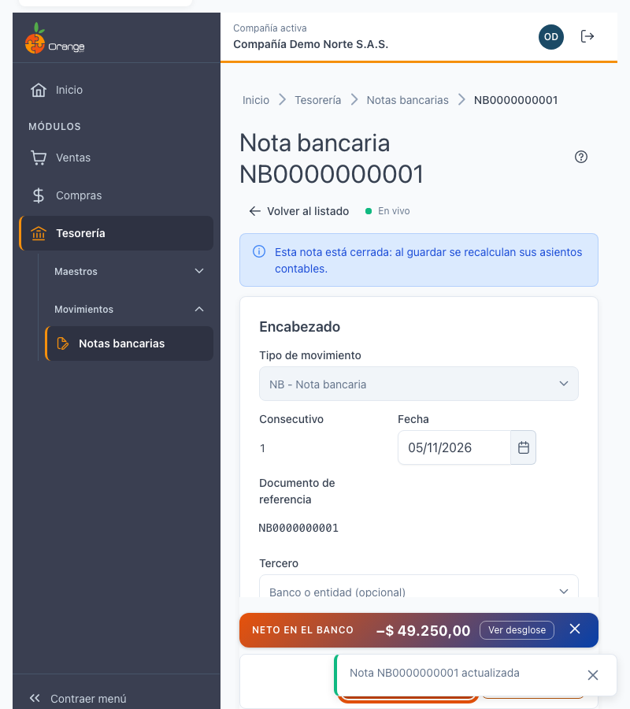

Si no tiene el permiso especial, la nota cerrada es de solo lectura y no verá los botones de edición.

> ⚠️ Si la nota usó una cuenta con **certificado de retención**, el aviso de anulación y el de edición le recordarán revisar los certificados (ver [Anular una nota](#-anular-una-nota)).

---

## ⛔ Anular una nota

Anular es **invalidar** una nota que no debió registrarse. No se borra nada: la nota queda en el listado como **Anulada**, con el motivo, su usuario y la hora.

Puede anular un borrador o una nota cerrada si tiene el permiso **Anular**.

1. Haga clic en **Anular nota** (en la nota o en el listado).
2. Escriba el **Motivo de la anulación**: entre 5 y 200 caracteres.
3. Confirme con **Anular nota**.

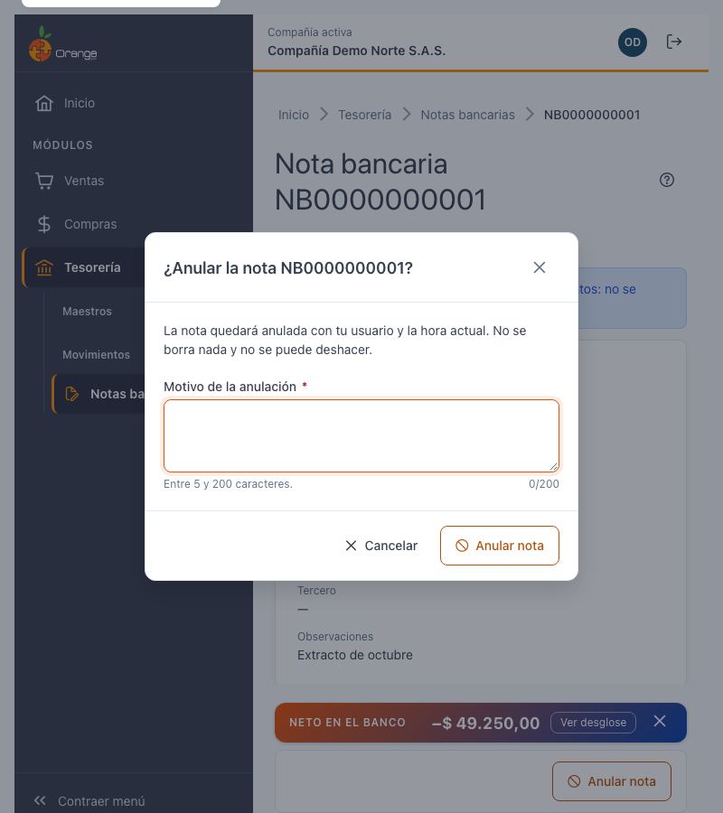

El diálogo dice: *La nota quedará anulada con tu usuario y la hora actual. No se borra nada y no se puede deshacer.*

Una nota anulada se muestra con este aviso: *Nota anulada el … por … Motivo: …* Sus adjuntos solo se pueden descargar y no se pueden editar sus líneas.

### Aviso de certificado de retención

Si la nota usó cuentas con **certificado de retención**, después de anularla verá este aviso, que queda visible en la nota:

> Aviso: esta nota usó cuentas con certificado de retención. El certificado de retefuente del sistema anterior la seguirá sumando aunque esté anulada; revísalo antes de emitir certificados.

Revise el certificado antes de emitirlo: el sistema anterior puede seguir sumando la nota.

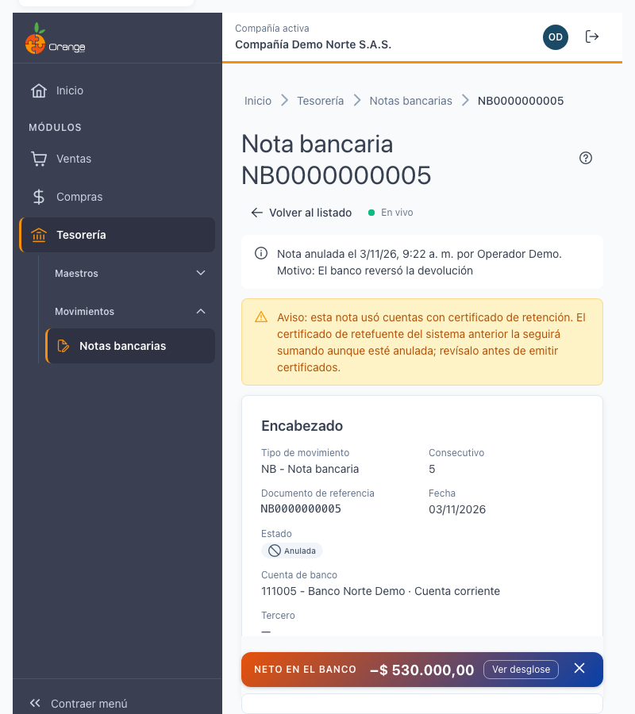

### No se puede anular

| Mensaje | Qué hacer |
|---------|-----------|
| *El periodo de la fecha está cerrado para notas bancarias.* | Contabilidad debe abrir el periodo, o la nota queda como está. |
| *La nota ya está conciliada y no se puede anular.* | La nota ya fue conciliada con el extracto y no puede anularse. |
| *La nota ya estaba anulada.* | Revise el listado: ya no hay nada que anular. |
| *No tienes permiso para esta acción.* | Pida el permiso de **Anular** a su administrador. |

---

## 📎 Adjuntos

En la pestaña **Adjuntos** puede guardar el soporte del banco (por ejemplo, el extracto o la certificación del cobro).

- Hasta **5 archivos** por nota.
- Formatos: **PDF**, **PNG** o **JPG**, de hasta **5 MB** cada uno.
- Escriba una descripción y haga clic en **Subir adjunto**. Sobre cada archivo puede usar **Descargar** o **Quitar**.
- Cada adjunto queda registrado en la bitácora.

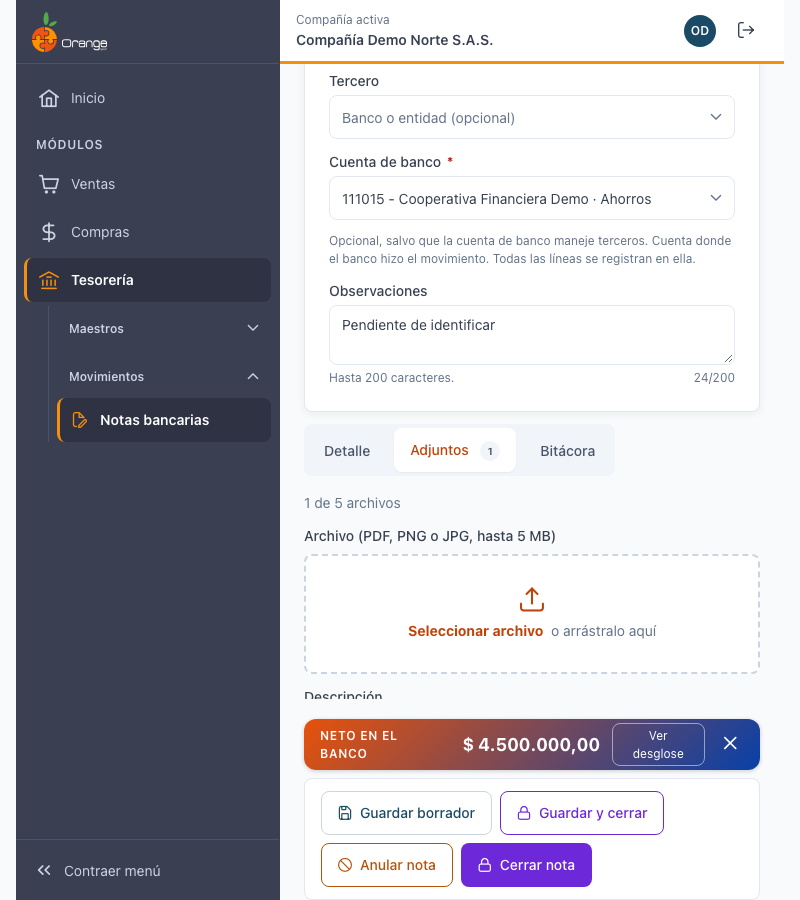

| Situación | Qué ve |
|-----------|--------|
| Nota nueva, sin guardar | *Guarda la nota para poder adjuntar soportes del banco.* |
| Nota cerrada, sin el permiso especial | *La nota está cerrada: cambiar adjuntos exige un permiso especial.* Solo puede descargar. |
| Nota anulada | *La nota está anulada: los adjuntos solo se pueden descargar.* |
| Ya hay 5 archivos | *5 de 5 archivos*: no puede subir más; quite uno para subir otro. |

Si el archivo no es PDF, PNG o JPG, o pesa más de 5 MB, no se sube y el sistema le dice por qué.

---

## 📜 Bitácora

La pestaña **Bitácora** muestra cada cambio de la nota, del más reciente al más antiguo: **fecha y hora**, **usuario**, **acción** y **sobre qué** cambió (**Nota**, **Cierre**, **Anulación** o **Adjunto**). En cada cambio puede ver los campos que cambiaron.

Puede filtrar por periodo (último mes, últimos 3 meses o todo), por acción, por sobre qué y por usuario. La bitácora es de solo lectura. La propia pantalla indica que estos registros de cambios los ven solo los administradores.

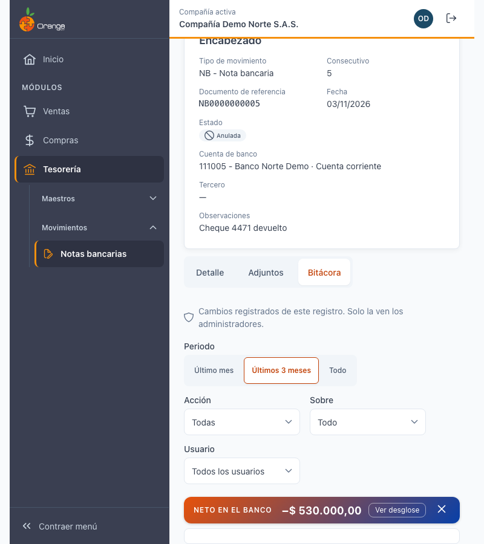

---

## 📥 Importar desde Excel

Use **Importar** para cargar varias notas desde un archivo de Excel. Necesita los permisos **Crear** y **Exportar**. Para elegir **Cerrar al importar**, necesita además **Actualizar**.

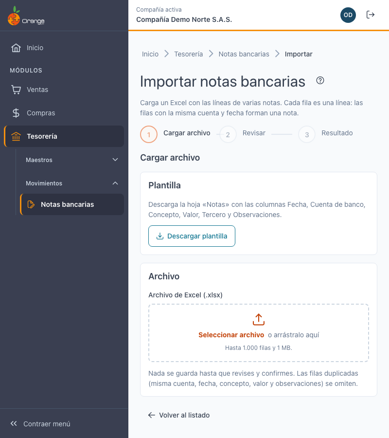

### Paso 1. Cargar archivo

1. Haga clic en **Descargar plantilla**. La hoja **Notas** tiene las columnas **Fecha**, **Cuenta de banco**, **Concepto**, **Valor**, **Tercero** y **Observaciones**.
2. Llene una fila por cada línea. **Las filas con la misma cuenta de banco y la misma fecha forman una sola nota.**
3. Haga clic en **Seleccionar archivo** (o arrastre el archivo) y elija el Excel `.xlsx`.

Reglas del archivo:

- Hasta **1.000 filas** y **1 MB**.
- Si el archivo no es un Excel `.xlsx`, le faltan columnas, está vacío, tiene más de 1.000 filas o pesa más de 1 MB, verá el motivo y no se carga nada. Use la plantilla.

### Paso 2. Revisar

La pantalla muestra cuatro cifras: **Notas**, **Líneas nuevas**, **Líneas duplicadas** y **Líneas con error**. Cada fila tiene una **revisión**:

| Revisión | Qué significa |
|----------|---------------|
| **Se crea** | La fila se importará. |
| **Duplicada** | Ya existe una nota con la misma cuenta, fecha, concepto, valor y observaciones. Se omite. |
| **Con error** | La fila tiene un problema. Se muestra el motivo. |

Filas repetidas dentro del mismo archivo también se marcan como duplicadas. Las filas vacías se omiten y se informa cuántas.

Elija el **Estado de las notas al importar**:

- **Dejar como borrador**: las notas se crean como borradores. Puede revisarlas y cerrarlas después.
- **Cerrar al importar**: las notas se crean cerradas. Requiere el permiso **Actualizar**.

Filtre las filas por **Todas**, **Se crean**, **Duplicadas** o **Con error**. Nada se guarda todavía.

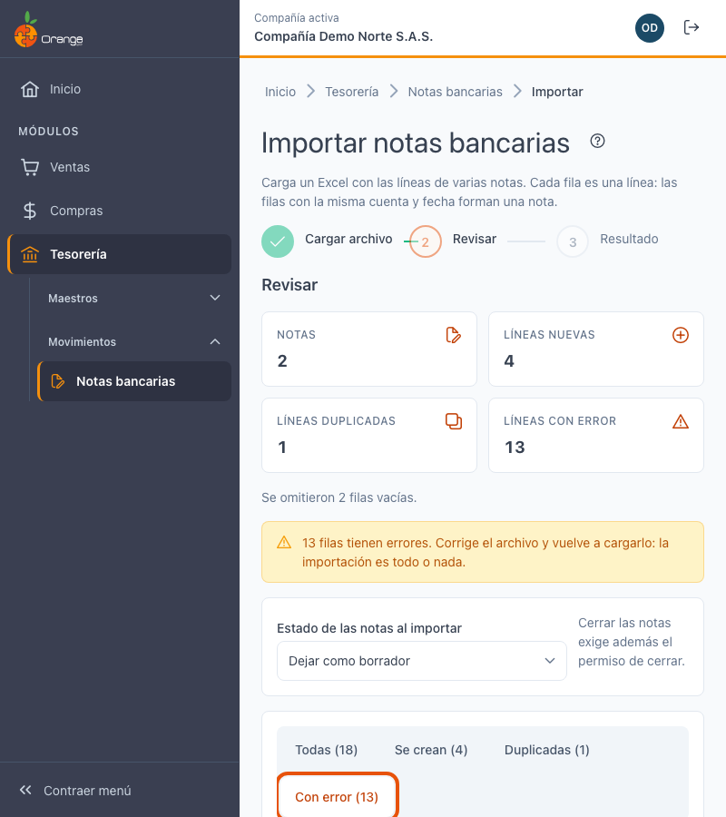

Motivos de error más comunes:

| Motivo | Qué hacer |
|--------|-----------|
| *La fecha no es válida (usa dd/mm/aaaa).* | Corrija la fecha. |
| *La fecha es posterior a hoy.* | Use una fecha de hoy o anterior. |
| *No existe la cuenta …* / *La cuenta … no es una cuenta de banco.* | Use el código de una cuenta de banco de la compañía. |
| *No existe el concepto …* / *El concepto … está inactivo.* | Use un concepto activo de la lista de conceptos. |
| *El valor debe ser mayor que cero y con máximo dos decimales.* | Corrija el valor. |
| *Esta fila necesita tercero.* / *No existe el tercero …* | Ponga un tercero válido. |
| *Este concepto exige centro de costos y la importación no lo trae: crea la nota a mano.* | Cree esa nota desde la pantalla. |
| *El periodo de esa fecha está cerrado.* | Use una fecha de un periodo abierto. |

**Importar** solo se activa cuando no hay filas con error. Si hay errores, corrija el archivo y vuelva a cargarlo: la importación es **todo o nada**. Puede hacer clic en **Descargar filas con error** para revisarlas.

### Paso 3. Resultado

Al terminar verá el resultado, por ejemplo: *2 notas importadas (0 cerradas, 2 borradores, 1 omitidas por duplicado).* Con **Ver el listado** va a las notas, y con **Importar otro archivo** empieza de nuevo.

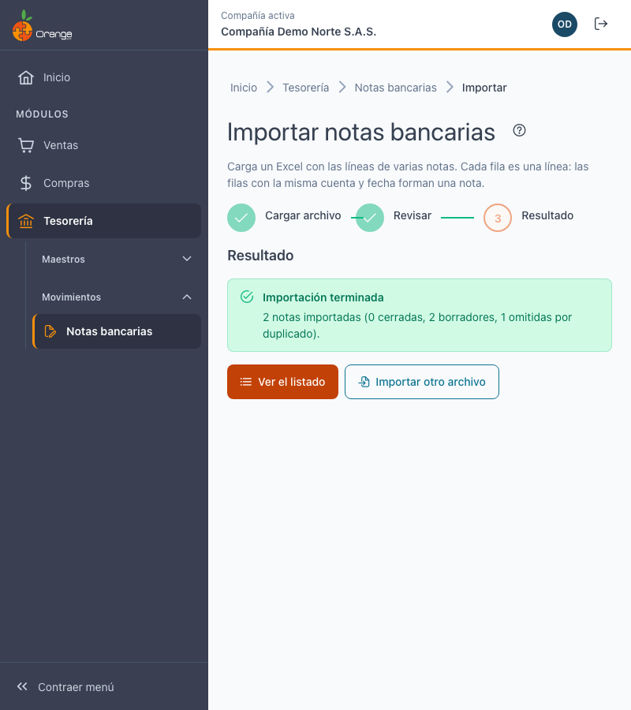

Si mientras revisaba otro usuario cambió los datos (por ejemplo, un periodo se cerró), verá: *Los datos cambiaron mientras revisabas (por ejemplo, un periodo se cerró). Vuelve a validar el archivo.* Haga clic en **Volver a validar**.

Si el servidor falla, verá *No se pudo importar* y *No se guardó ninguna nota. Intenta de nuevo.* Haga clic en **Reintentar**.

---

## 🔄 Cambios de otros usuarios (en vivo)

Si otra persona crea, cierra, anula, modifica o importa notas mientras usted tiene abierta esta pantalla, **no tiene que recargar**: el listado se pone al día solo, sin perder lo que buscó, el orden ni la página.

- Las filas nuevas o modificadas se **resaltan** unos segundos.
- Abajo a la derecha aparece un aviso con el nombre de quien hizo el cambio, por ejemplo *[nombre] creó la nota NB0000000015.*
- Junto a la descripción verá **En vivo** mientras la conexión esté activa. Si se interrumpe, dice **Reconectando…**; al volver, la pantalla se actualiza sola.

**Si tiene abierta una nota que otro usuario cambia:**

| Qué hizo el otro usuario | Qué verá | Qué puede hacer |
|--------------------------|----------|-----------------|
| La modificó | *Otro usuario modificó esta nota mientras la editabas.* | **Ver sus cambios** para cargar lo que guardó. Revise sus cambios antes de guardar los suyos. |
| La cerró | *Otro usuario cerró esta nota mientras la editabas. Ya no se puede modificar.* | Revise la nota: ya está cerrada. |

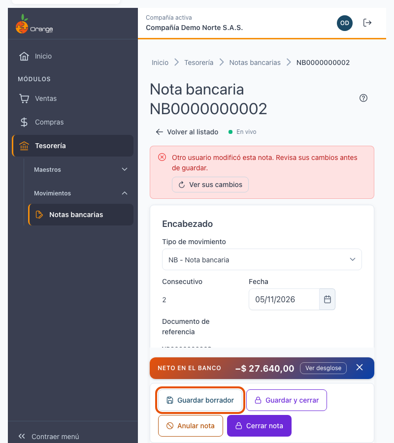

> ℹ️ Los cambios que usted hace en esta misma pestaña no generan avisos.

---

## ⚠️ Mensajes de error frecuentes

| Mensaje | Qué significa | Qué hacer |
|---------|---------------|-----------|
| *Falta configurar el tipo de movimiento de notas bancarias. Avisa al administrador.* | La compañía no tiene un tipo de movimiento configurado para notas bancarias. No se guardó nada. | Avise al administrador. No intente guardar de nuevo hasta que lo configuren. |
| *El periodo de la fecha está cerrado para notas bancarias.* | La fecha cae en un periodo cerrado. | Cambie la fecha a un periodo abierto o pida a contabilidad que abra el periodo. |
| *La nota no cuadra; no se guardó nada.* | Los débitos y los créditos no coinciden. | Revise las líneas y las cuentas de los conceptos. Si persiste, avise al administrador. |
| *El concepto de la línea n está inactivo.* | Un concepto fue desactivado después de agregar la línea. | Cambie el concepto de esa línea por uno activo. |
| *Esa cuenta no sirve: debe ser una cuenta de banco de movimiento, vigente y de esta compañía.* | La cuenta de banco ya no sirve. | Elija otra cuenta de banco. |
| *Otra persona está guardando una nota en este momento. Intenta de nuevo en unos segundos.* | Alguien más guarda una nota al mismo tiempo. | Espere unos segundos y vuelva a guardar. |
| *No se pudo asignar el número de la nota. Intenta de nuevo; si se repite, avisa al administrador.* | Falló la asignación del número. | Intente de nuevo. Si se repite, avise al administrador. |
| *La nota ya estaba cerrada.* / *La nota ya estaba anulada.* | Otra persona cambió el estado de la nota antes que usted. | Recargue la nota para ver su estado actual. |
| *Esta nota no se puede editar: ya no es un borrador y no tienes permiso para editar notas cerradas, o su periodo está cerrado.* | La nota ya está cerrada o su periodo está cerrado. | Revise el estado. Para corregir una nota cerrada necesita el permiso especial. |
| *Otro usuario modificó esta nota. Revisa sus cambios antes de guardar.* | Otro usuario cambió la nota mientras usted la editaba. | Haga clic en **Ver sus cambios**, revise, y vuelva a guardar sus cambios. |
| *No tienes permiso para esta acción.* | Su perfil no tiene el permiso para esa acción. | Pida el permiso a su administrador. |
| *No se pudo completar la acción. Reintenta.* | Error del servidor. No se guardó nada. | Haga clic en **Reintentar**. Si se repite, avise al administrador. |
| *La nota ya no existe.* | La nota ya no está disponible o no pertenece a esta compañía. | Vuelva al listado. |

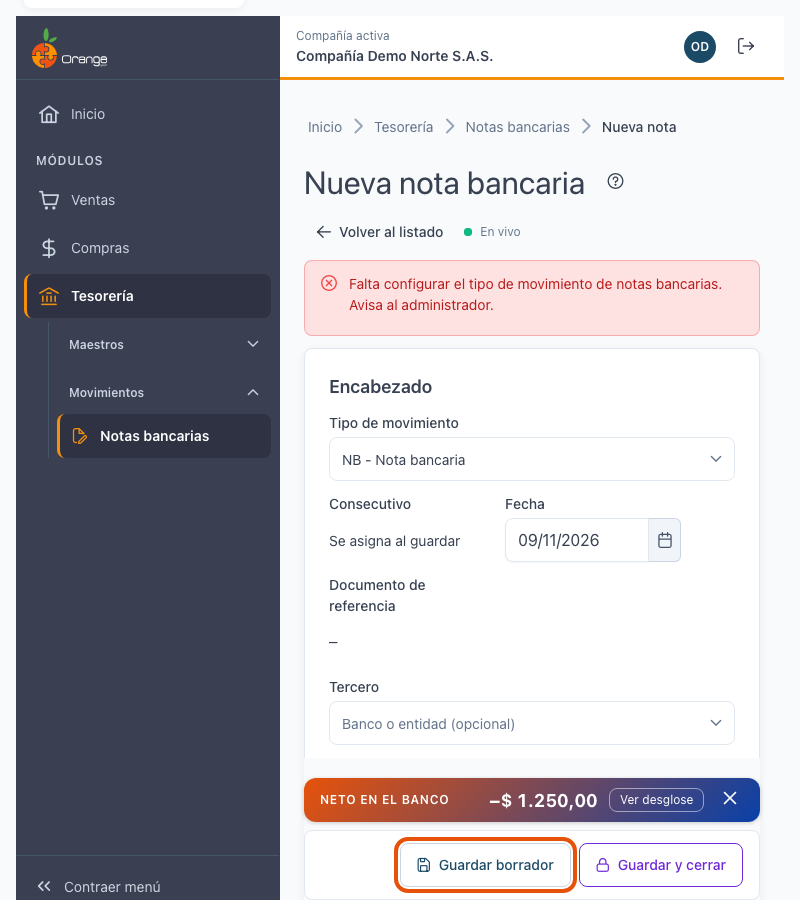

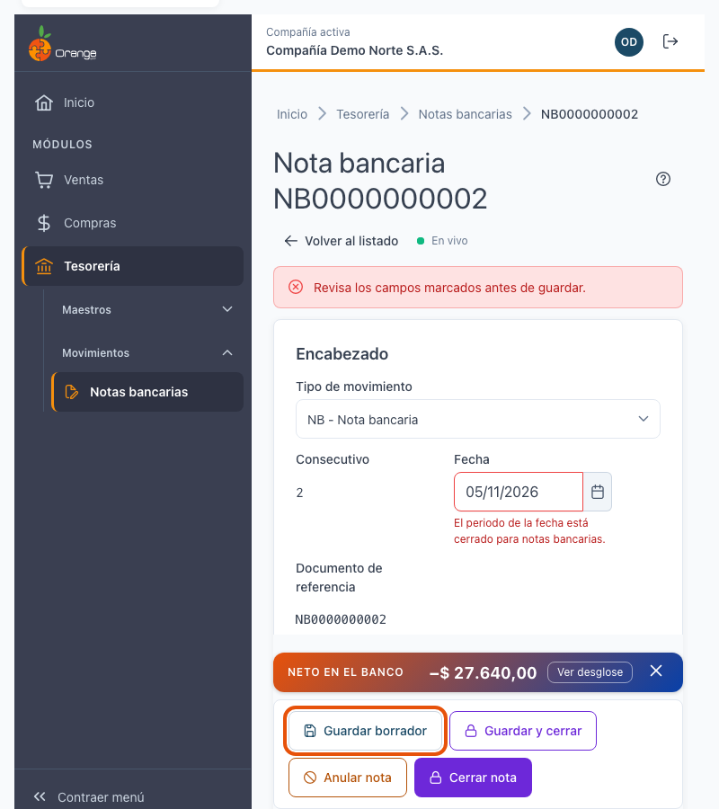

---

## ❔ Ayuda en pantalla

El botón **?** abre este manual en un panel a la derecha. Puede dejarlo abierto mientras trabaja en el listado, en la nota o en la importación.

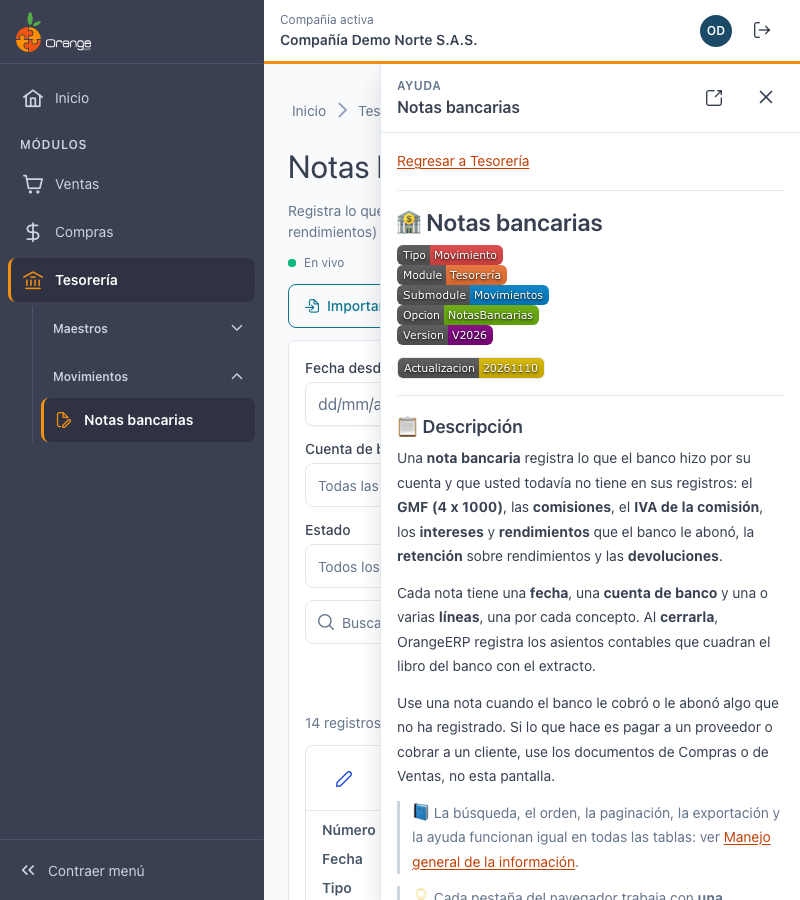

En un celular, la ayuda ocupa toda la pantalla y se cierra con la **✕**.

---

## ❓ Preguntas frecuentes

**¿Puedo eliminar una nota?**
No. Anúlela con un motivo: queda en el listado como **Anulada**, con su historia.

**¿Qué diferencia hay entre borrador y nota cerrada?**
El borrador se puede editar y todavía no tiene asientos. La nota cerrada ya registró sus asientos contables y no se edita, salvo con el permiso especial.

**¿Por qué no aparece el botón Cerrar nota?**
Porque necesita un borrador ya guardado y el permiso **Actualizar**. Guarde primero la nota.

**¿Por qué el neto sale negativo?**
Porque sale más dinero del banco de lo que entra. Es normal en notas de GMF o comisiones.

**¿Puedo poner una fecha de mañana?**
No. La fecha no puede ser posterior a hoy.

**¿Por qué no veo Importar o Exportar a Excel?**
Su perfil no tiene el permiso **Crear** o **Exportar** sobre la opción Notas bancarias. Consulte con el administrador de OrangeERP.

**Me equivoqué en una nota cerrada. ¿Qué hago?**
Si tiene el permiso especial **Editar documentos cerrados**, corríjala (ver [Editar una nota cerrada](#-editar-una-nota-cerrada)). Si no, anúlela con un motivo y registre la nota correcta.

**¿Por qué no encuentro una nota que sí existe?**
Revise que esté en la compañía correcta (título de la pestaña), que los filtros de fecha, cuenta, tipo, estado y concepto no la oculten, y borre el texto del buscador.

**No veo "En vivo".**
La conexión en vivo no está disponible en este momento (por ejemplo, por la red de su empresa). La pantalla funciona igual; para ver cambios de otros usuarios, recargue la página.

**No veo los botones Nueva nota, Editar o Anular.**
Su perfil no tiene ese permiso sobre la opción Notas bancarias. Consulte con el administrador de OrangeERP.
