[Regresar a Tesorería](../readme.md)

---

# 💸 Pagos en bloque a proveedores

---

## 📋 Descripción

Use **Pagos en bloque a proveedores** cuando tenga que pagar a varios proveedores a la vez. Usted ve las facturas pendientes de pago, marca las que quiere pagar (completas o parciales), fija opcionalmente cuánto dinero tiene disponible y ve en vivo cuánto le queda. Antes de pagar, revisa una **vista previa**, que no guarda nada. Al generar, la compañía crea **un egreso por proveedor**.

Si algo falla con un proveedor, el **informe** le dice qué pasó y le permite **reintentar solo los que fallaron**.

Todo ocurre en una sola pantalla. Las facturas, la configuración del lote y el resumen están juntos; el resumen queda fijo arriba mientras se desplaza la lista.

> ℹ️ Cada egreso que se genera es un egreso normal. Si uno está mal, se anula desde [Recibos de caja y egresos](recibos-egresos.md). Esta pantalla no anula lotes completos.

> 💡 Antes de empezar, revise que los proveedores tengan facturas pendientes, que la **forma de pago** exista (en [Formas de pago](../maestros/formas-pago.md)) y que su perfil esté autorizado para el tipo de movimiento que va a usar.

---

## 🎯 Acceso

1. En el menú principal, haga clic en **Tesorería**.
2. En **Movimientos**, haga clic en **Pagos en bloque a proveedores**.

La pantalla tiene dos pestañas en la parte superior:

- **Nuevo pago en bloque**: la pantalla de trabajo, donde prepara y genera un pago.
- **Lotes de pago**: el listado de los pagos que ya generó, con su informe.

---

## 🔐 Permisos

Cada acción depende de los permisos de su perfil sobre la opción **Pagos en bloque a proveedores**. Además, el **tipo de movimiento** del egreso debe estar autorizado para su usuario.

| Permiso | Qué habilita |
|---------|--------------|
| Consultar | Ver la cartera por pagar, los tipos de movimiento y el listado de lotes con su detalle e informe. |
| Crear | **Vista previa**, **Generar egresos** y **Reintentar fallidos**. |
| Exportar | **Exportar selección** (en la pantalla de trabajo) y **Exportar informe** (en el informe y en el detalle del lote). |

Qué ve según sus permisos:

- **Solo Consultar**: ve la cartera, los lotes y sus informes. No ve las casillas para marcar facturas, ni **Vista previa**, ni **Generar egresos**. Verá el aviso de que la pantalla es solo de consulta.
- **Sin Exportar**: los botones de exportar no aparecen.
- **Tipos de movimiento**: aunque tenga **Crear**, solo puede elegir los tipos que tiene autorizados. Si no tiene ninguno, no puede generar un lote.

> ℹ️ Si su perfil no tiene **Consultar**, la pantalla le avisa: *No tienes acceso a esta pantalla.* Pida a su administrador el permiso que necesite.

---

## 🖥️ Pantalla de trabajo

De arriba abajo, la pantalla tiene estas partes:

| Elemento | Para qué sirve |
|----------|----------------|
| **?** (junto al título) | Abre esta ayuda en un panel lateral, sin salir de la pantalla. Ver [Ayuda en pantalla](#-ayuda-en-pantalla). |
| **En vivo** | La pantalla está conectada: los cambios de otros usuarios aparecen solos. Ver [Cambios de otros usuarios](#-cambios-de-otros-usuarios-en-vivo). |
| **Resumen del lote** | Muestra el total seleccionado, el valor base, la diferencia, la barra de progreso y los contadores. Ver [Valor base, total y diferencia](#-valor-base-total-y-diferencia). |
| **Configuración del lote** | Tipo de movimiento, forma de pago, cuenta de banco, fecha, documento de referencia y valor base. Ver [Configurar el lote](#-configurar-el-lote). |
| **Filtros** | Búsqueda, proveedor, vencimiento, valor mínimo, centro de costos, comprador, orden y agrupación. Ver [Encontrar facturas](#-encontrar-facturas). |
| **Herramientas de selección** | Seleccionar todo lo visible, **Sugerir selección**, **Quitar selección** y, si agrupa, **Expandir todo** y **Colapsar todo**. |
| **Cartera por pagar** | La lista de facturas pendientes. Marque las que va a pagar. |
| **Pie fijo** | Muestra por qué la **Vista previa** está bloqueada (si lo está), **Exportar selección** y **Vista previa**. |

---

## ⚙️ Configurar el lote

Complete la **Configuración del lote** antes de generar:

| Campo | Qué debe tener |
|-------|----------------|
| **Tipo de movimiento del egreso** | Obligatorio. Solo verá los tipos de egreso a proveedores que tiene autorizados. Viene elegido el primero de la lista; puede cambiarlo. Todos los egresos del lote usarán el tipo que elija aquí. |
| **Forma de pago** | Obligatorio. Es el medio con el que sale el dinero (efectivo, transferencia, cheque u otra que tenga configurada). |
| **Cuenta de banco** | Solo de lectura. **No se elige aquí**: sale de la forma de pago. Si la forma de pago es efectivo, verá *Sin cuenta de banco (efectivo)*. |
| **Fecha** | La fecha de los egresos. No puede ser una fecha futura. |
| **Documento de referencia** | Opcional. Hasta 20 caracteres, sin comas ni punto y coma. Aparecerá en el lote para identificarlo. |
| **Valor base de pago** | Opcional. Es el dinero que tiene disponible para este pago. Debe ser mayor que 0. Ver [Valor base, total y diferencia](#-valor-base-total-y-diferencia). |

> ℹ️ Si cambia la forma de pago, la cuenta de banco cambia con ella. Revise la forma de pago antes de generar.

---

## 📊 Valor base, total y diferencia

En el **Resumen del lote** verá tres datos:

- **Total seleccionado (neto)**: lo que suman las facturas marcadas, con sus descuentos, retenciones e intereses ya aplicados. Se actualiza en vivo al marcar, quitar o cambiar un valor.
- **Valor base de pago**: el dinero disponible que usted fijó en la configuración.
- **Diferencia (base − total)**: lo que queda de la base después de pagar lo seleccionado.

Así se calcula: **diferencia = valor base − total seleccionado**. Por ejemplo, con una base de $5.000.000 y un total seleccionado de $4.250.000, la diferencia es $750.000.

**Sin valor base**, solo ve el total seleccionado. No hay diferencia, barra de progreso ni insignia de estado, y **Sugerir selección** no está disponible.

### Colores y estados de la diferencia

Cada estado se distingue por el **color**, por un **ícono** y por un **texto**. Si no distingue los colores, lea el texto.

| Color | Ícono y texto | Cuándo aparece | Qué puede hacer |
|-------|---------------|----------------|-----------------|
| **Verde** (éxito) | Círculo con visto: **Con margen** | La diferencia es igual o mayor al 10 % de la base. | Puede revisar la vista previa y generar. |
| **Amarillo** (aviso) | Triángulo con admiración: **Cerca de agotar** | La diferencia es cero o positiva, pero menor al 10 % de la base. | Puede revisar la vista previa y generar. Queda poco disponible. |
| **Rojo** (error) | Círculo con X: **Base excedida** y el texto *El total supera el valor base: ajústalo para continuar.* | El total es mayor que la base (la diferencia es negativa). | **La vista previa y Generar quedan bloqueadas.** Suba la base, bórrela o quite facturas hasta que el total no supere la base. |
| **Sin color** | Sin insignia; solo el texto *Sin valor base* | No fijó valor base. | Puede revisar la vista previa y generar. |

> ⚠️ Con base excedida, el botón **Vista previa** queda deshabilitado y el pie muestra el motivo. Tampoco puede generar, aunque algunas facturas parezcan correctas: el total completo debe caber en la base.

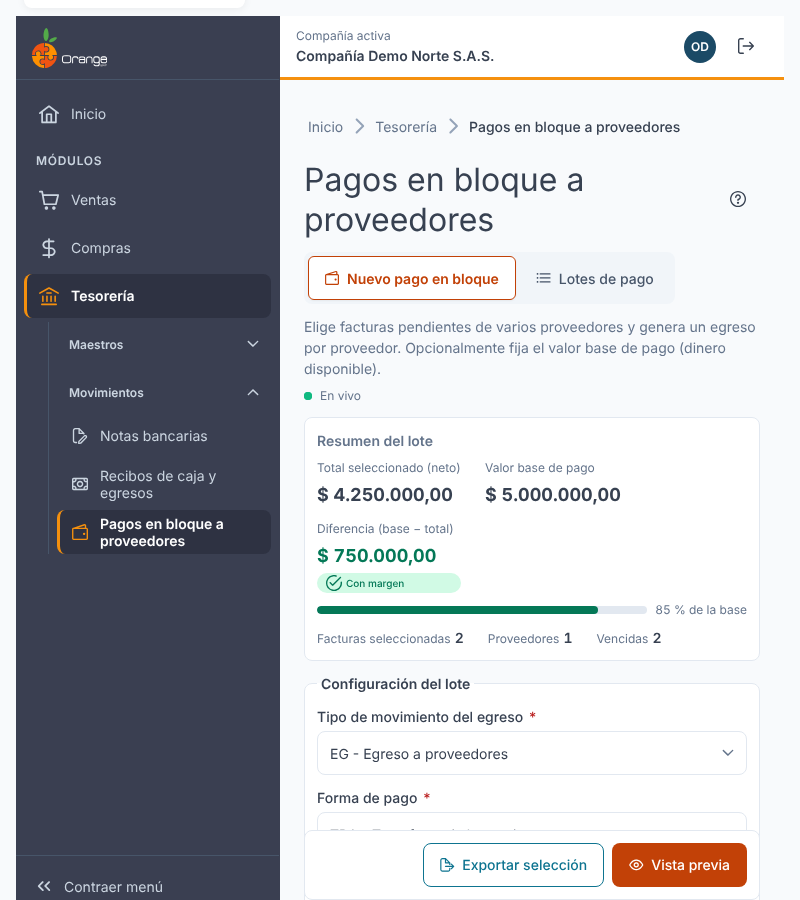

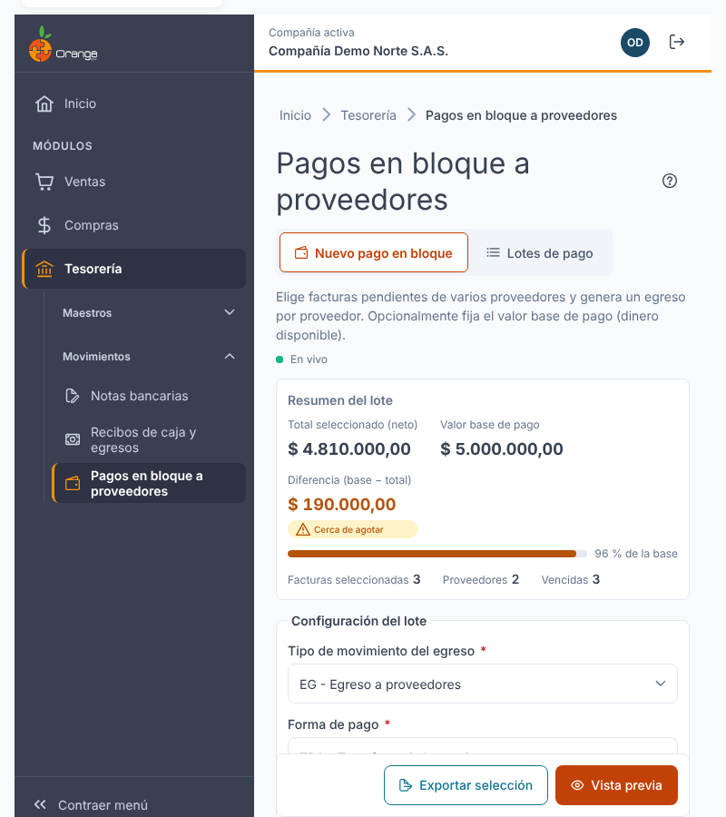

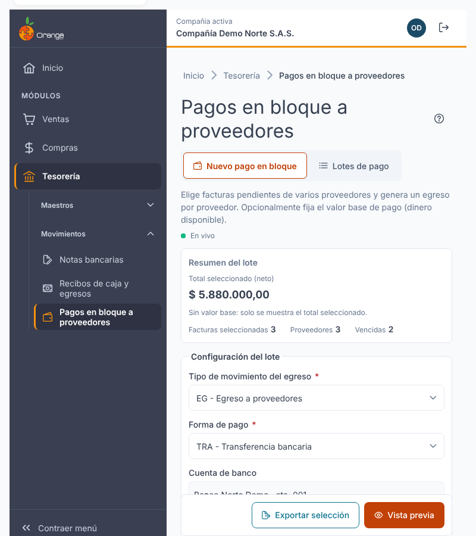

### Barra de progreso

Con valor base fijado, una barra muestra qué parte de la base ocupa el total seleccionado, con el texto *n % de la base*. El color de la barra sigue el mismo estado de la diferencia (verde, amarillo o rojo).

---

## 🔍 Encontrar facturas

La lista muestra las facturas pendientes de pago de su compañía, con su saldo.

### Contadores

Encima de la lista verá:

- **Facturas seleccionadas**, **Proveedores** y **Vencidas** en el resumen.
- El texto *n de m facturas · x vencidas*, con el total de facturas y las que coinciden con los filtros.

Los contadores cambian al filtrar o al marcar facturas.

### Filtros

Los filtros se combinan y se calculan en el servidor:

- **Búsqueda**: escriba un NIT, parte del nombre del proveedor o un número de factura.
- **Proveedor**: elija uno. Para quitarlo, use la **X** del campo.
- **Vence desde** y **Vence hasta**. Si la fecha inicial es mayor que la final, verá: *La fecha inicial no puede ser mayor que la final.*
- **Vencimiento**: *Todas*, *Solo vencidas*, o *Por vencer en 7, 15 o 30 días*.
- **Valor mínimo del saldo**, **Centro de costos** y **Comprador**.
- **Limpiar filtros**: aparece cuando hay filtros activos. Quita todos. Las facturas que ya marcó **siguen seleccionadas**.

Si tiene facturas seleccionadas que quedan fuera del filtro, verá un aviso. Esas facturas siguen sumando en el total.

### Chips de antigüedad

Bajo los filtros hay chips por tramo de antigüedad: **Por vencer**, **1-30 días**, **31-60 días**, **61-90 días** y **Más de 90 días**. Cada chip muestra cuántas facturas tiene y su saldo.

- Toque un chip para ver solo ese tramo.
- Toque el mismo chip otra vez para quitar el filtro.

### Orden

En **Ordenar por** elija **Vencimiento**, **Proveedor** o **Saldo**. Con **Ascendente** o **Descendente** cambia el sentido. El servidor devuelve la lista ya ordenada.

### Agrupar por proveedor

Active **Agrupar por proveedor** para ver una fila por proveedor, con:

- sus subtotales: número de facturas, saldo, facturas seleccionadas y su valor;
- **Seleccionar todas** y **Quitar todas** para ese proveedor;
- un botón para expandir o colapsar el grupo.

Con **Expandir todo** y **Colapsar todo** abre o cierra todos los grupos a la vez. Colapsar no quita la selección.

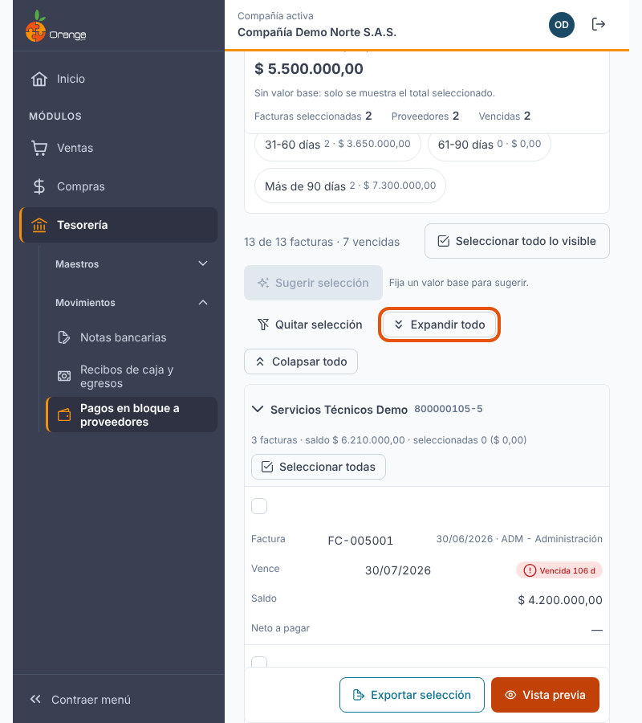

### Badges de vencimiento

Cada factura muestra un badge con su estado de vencimiento. Siempre tiene ícono y texto:

| Badge | Significado |
|-------|-------------|
| **Vencida n d** (rojo, con admiración en círculo) | La factura venció hace *n* días. |
| **Vence en n d** o **Vence hoy** (amarillo, con reloj) | Vence dentro de los próximos 7 días. |
| **Al día** (verde, con visto) | Vence después de los próximos 7 días. |

### Filas seleccionadas

La fila marcada se resalta y tiene una barra de color a la izquierda. Debajo se abre la subfila de edición (ver [Marcar facturas y ajustar valores](#-marcar-facturas-y-ajustar-valores)).

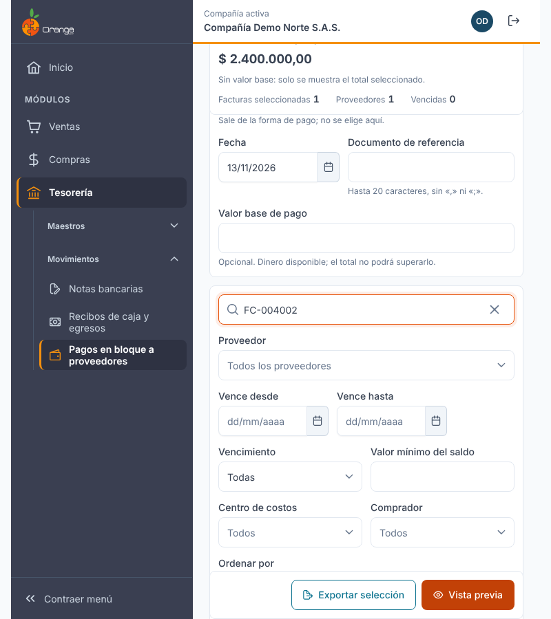

---

## ✅ Marcar facturas y ajustar valores

### Marcar una factura

Marque la casilla de la factura. Al marcarla, su **Neto a pagar** aparece en la columna correspondiente y el total se actualiza. Para desmarcarla, desmarque la casilla.

### Seleccionar varias

- **Seleccionar todo lo visible** marca todas las facturas de la página que ve, con su saldo completo. Si lo vuelve a pulsar, las quita. Con el botón **Quitar lo visible** también puede deseleccionarlas.
- **Seleccionar todas** (en un grupo de proveedor) marca **todas** sus pendientes del conjunto filtrado, aunque estén en otras páginas.
- **Quitar selección** deja el lote sin facturas.

Si el total supera la base al marcar en bloque, la diferencia pasa a **Base excedida** (ver [Colores y estados](#colores-y-estados-de-la-diferencia)).

### Pagar total o parcial

En la subfila de la factura marcada:

- **Pagar total** deja el valor en el saldo vigente de la factura.
- **Pagar parcial** deja el campo del valor enfocado y editable. Escriba cuánto va a pagar. Debe ser mayor que 0 y no puede superar el saldo. La factura queda marcada como **Pago parcial**.

### Editar los valores de la factura

Cada factura marcada tiene estos campos:

| Campo | Qué es |
|-------|--------|
| **Valor a pagar** | Lo que se paga de la factura. Tope: su saldo. Debajo verá *Máximo* y el saldo. |
| **Descuento** | Descuento que se aplica a la factura. |
| **Retefuente** | Retención en la fuente. |
| **ReteICA** | Retención de ICA. |
| **ReteIVA** | Retención de IVA. |
| **Intereses** | Intereses que se suman. |

El **neto a pagar** de la factura se calcula así: **valor a pagar − descuento − retenciones + intereses**. Las retenciones son la retefuente, la ReteICA y la ReteIVA. El neto se actualiza mientras escribe y es el que suma el total seleccionado.

Mensajes que puede ver al editar:

| Mensaje | Qué hacer |
|---------|-----------|
| *El valor no puede ser negativo.* | Escriba un valor igual o mayor que 0. |
| *El valor a pagar debe ser mayor que 0.* | Escriba un valor mayor que 0, o quite la factura. |
| *No puede superar el saldo de la factura.* | Baje el valor hasta el saldo. |
| *El neto de la factura no puede ser negativo.* | Revise los descuentos y las retenciones: no pueden ser más que el valor a pagar. |

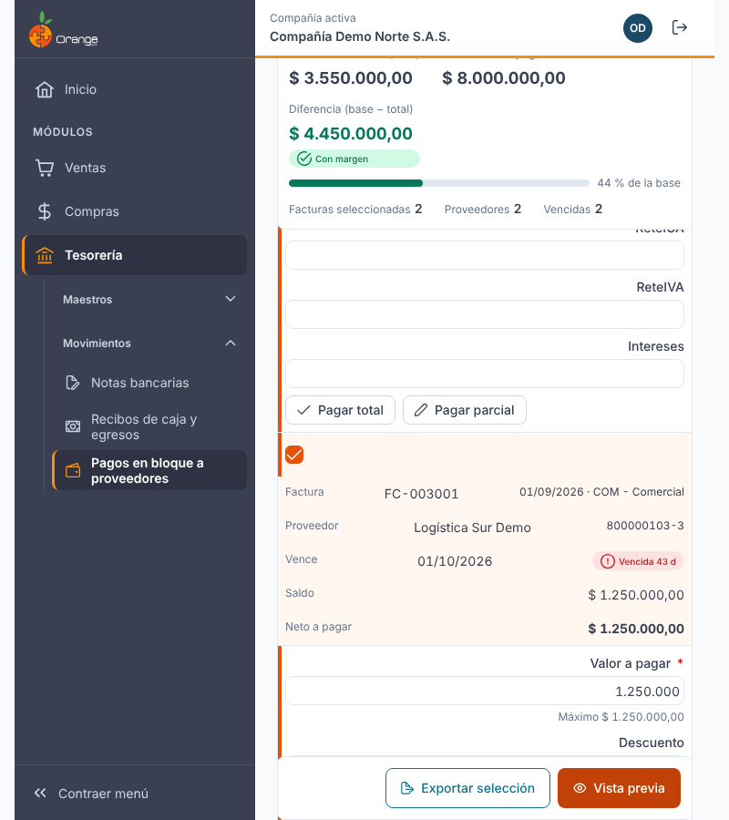

---

## ✨ Sugerir selección

**Sugerir selección** marca las facturas de la más antigua a la más nueva, sin pasarse de la base.

Así funciona:

1. Toma las facturas pendientes visibles, ordenadas por vencimiento (luego por fecha y número).
2. Marca completa cada factura que cabe en lo que queda de la base.
3. La primera factura que **no cabe completa** queda con **pago parcial** por el dinero que sobra, y el recorrido se detiene.

Ejemplo, con una base de $1.000.000 y tres facturas de $400.000, $500.000 y $300.000: se marcan las dos primeras completas ($900.000), y la tercera queda con pago parcial de $100.000. El total queda igual a la base y la diferencia es 0. El sistema nunca supera la base.

Tenga en cuenta:

- **Sugerir selección reemplaza la selección que tenga.** Si ya marcó facturas, revise la lista después.
- Sin valor base, el botón está deshabilitado y muestra *Fija un valor base para sugerir.*
- Puede ajustar cualquier valor después de sugerir.

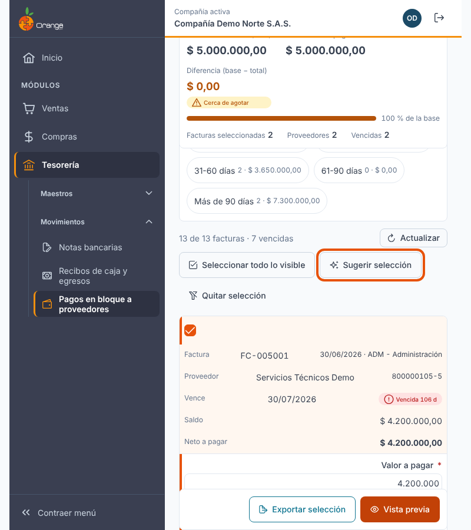

---

## 👀 Vista previa

La **Vista previa** muestra los egresos que se crearían, **sin guardar nada**. Puede abrirla tantas veces como quiera.

1. Revise el **Valor base** y la diferencia, si los fijó.
2. Haga clic en **Vista previa**.
3. En el diálogo verá una fila por proveedor, con su **consecutivo estimado**, sus facturas, el valor, el descuento, las retenciones, los intereses y el neto, y un pie con los totales.

El aviso *Solo vista previa: no se escribe nada* recuerda que todavía no se crea ningún egreso.

- **Volver a la selección** cierra el diálogo y conserva lo que tenía marcado.
- **Generar egresos** crea los egresos (ver la siguiente sección).

El consecutivo es **estimado**: el número definitivo se asigna al generar. La vista previa caduca a los **10 minutos**, o antes si cambian los saldos. Si caduca, verá *La vista previa caducó. Ábrela de nuevo.* y debe abrirla otra vez.

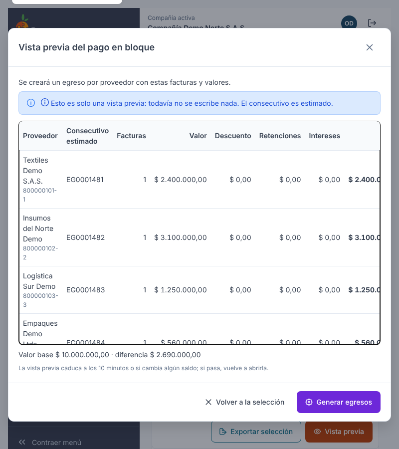

---

## 🚀 Generar los egresos

1. En la vista previa, haga clic en **Generar egresos**.
2. Mientras se genera, el botón dice *Generando…* y el diálogo no se cierra.
3. Al terminar, se abre el **informe del lote**.

Se crea **un egreso por proveedor**. Cada proveedor es independiente: si uno falla, los demás igual se crean.

Al generar, el sistema **vuelve a revisar los saldos** de cada factura. Si una factura ya no tiene el saldo que usted vio, ese proveedor no se crea con esa factura (ver [Saldo cambiado en una factura](#saldo-cambiado-en-una-factura)).

> ℹ️ Hacer doble clic en **Generar egresos** **no duplica** los egresos. El lote se procesa una sola vez.

### Lotes grandes en segundo plano

Si el lote tiene **más de 20 proveedores**, se procesa en **segundo plano**:

- En la vista previa verá el aviso de que el lote se procesará en segundo plano.
- En el informe verá el estado **En segundo plano**, sin tabla de resultados.
- Puede seguir trabajando en otras pantallas. Al terminar, recibirá una **notificación** con un enlace al lote.
- Revise el resultado en [Lotes de pago](#-lotes-de-pago), en el detalle del lote.

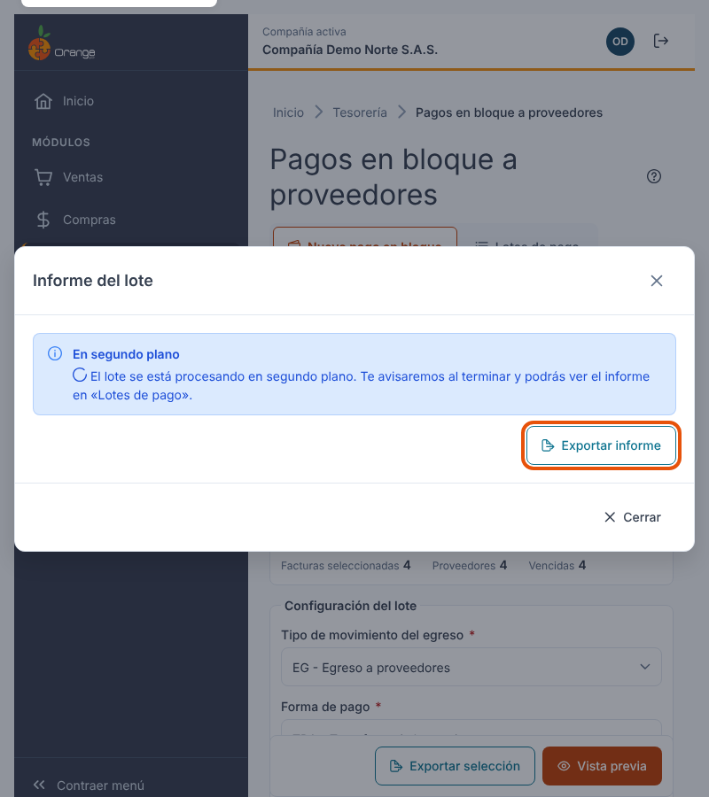

---

## 📑 Informe del lote

El informe muestra qué pasó con cada proveedor.

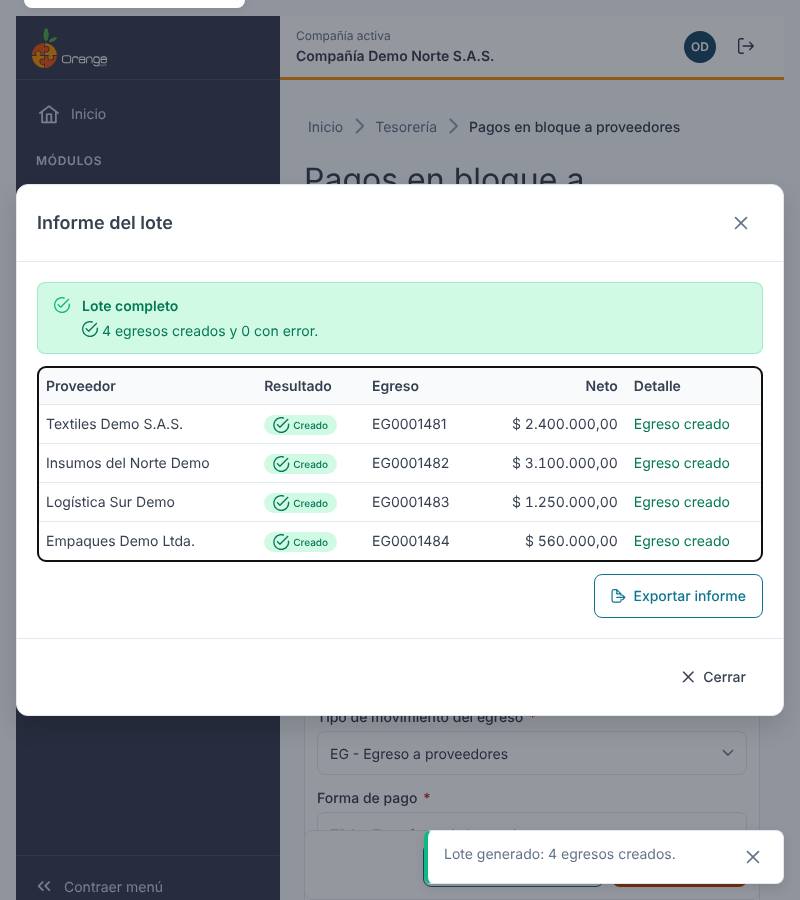

### Estado del lote

| Estado | Ícono y texto | Qué significa |
|--------|---------------|---------------|
| **Lote completo** | Visto, en verde | Todos los egresos se crearon. |
| **Lote con fallos** | Triángulo, en amarillo | Algunos egresos se crearon y otros fallaron. |
| **Ningún egreso creado** | X, en rojo | Ningún egreso se pudo crear. |
| **En segundo plano** | Información | El lote sigue procesándose. El resultado final llega por notificación. |

El texto debajo resume el resultado, por ejemplo: *3 egresos creados y 1 con error.*

### Tabla por proveedor

| Columna | Qué muestra |
|---------|-------------|
| **Proveedor** | El nombre del proveedor. |
| **Resultado** | **Creado** (visto) o **Fallido** (X). |
| **Egreso** | El número del egreso creado. |
| **Neto** | El neto del egreso. |
| **Detalle** | Para un fallo, el motivo en palabras. Para facturas con saldo cambiado, la lista de esas facturas. |

### Informe parcial y Reintentar fallidos

Si algunos proveedores fallaron, verá **Lote con fallos**. Corrija la causa y use **Reintentar fallidos**.

- El reintento solo procesa los proveedores que fallaron. Los que ya se crearon no se tocan.
- Usa los **saldos vigentes**: nunca paga más de lo que la factura debe hoy.
- Si una factura cambió, verá el nuevo neto antes de confirmar. Puede quitar esa factura y confirmar.

Algunas causas comunes de fallo, con su mensaje:

| Mensaje | Qué hacer |
|---------|-----------|
| *No hay un periodo abierto para registrar los egresos.* | Pida a su administrador que abra el periodo contable, y luego reintente. |
| *La forma de pago no es válida.* | Cambie la forma de pago en la configuración del lote o revise la forma en su maestro. |
| *El tipo de movimiento exige centro de costos.* | Revise el tipo de movimiento con su administrador. |
| *El proveedor no es válido.* | Revise el proveedor en su maestro y vuelva a intentarlo. |
| *El documento está en uso. Reintenta en unos segundos.* | Espere unos segundos y haga clic en **Reintentar fallidos**. |
| *No se pudo crear el egreso. Se puede reintentar.* | Haga clic en **Reintentar fallidos**. |

### Saldo cambiado en una factura

Verá **Facturas con saldo cambiado** cuando el saldo de una factura cambió después de la vista previa. Por ejemplo, otra persona registró un pago de esa factura, o la factura se ajustó.

Qué pasa:

- El egreso de ese proveedor **no se crea** con esa factura.
- En el informe verá el valor que usted pidió y el saldo actual de la factura.
- Para continuar, use **Reintentar fallidos**. Verá el neto nuevo, puede quitar la factura y confirmar.

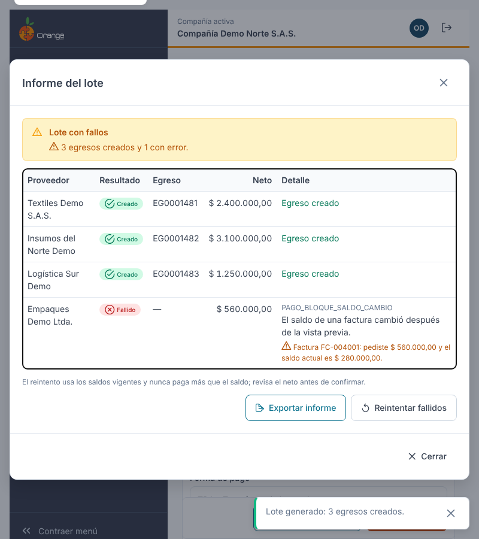

### Exportar el informe

Con el permiso **Exportar**, haga clic en **Exportar informe**. Se descarga un Excel con:

- el resultado de cada proveedor: el número del egreso creado, o el fallo con su motivo;
- el estado del lote.

> ℹ️ El mensaje *Se descargó el Excel del informe.* confirma la descarga.

---

## 🧭 Advertencia al salir

Si tiene facturas seleccionadas y sale de la pantalla sin generar, el sistema le avisa con el título *Hay una selección sin generar*. Verá:

- **Quedarme**: vuelve a la pantalla y conserva la selección.
- **Salir sin generar**: sale y **pierde** la selección y los valores editados.

Si intenta cerrar la pestaña del navegador con una selección sin generar, el navegador también le pedirá confirmación.

---

## 📚 Lotes de pago

En la pestaña **Lotes de pago** ve los lotes que ha generado la compañía.

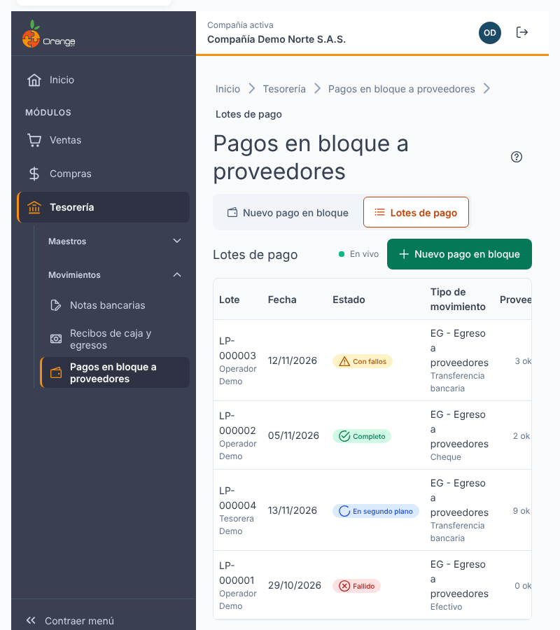

| Columna | Qué muestra |
|---------|-------------|
| **Lote** | El número del lote y el usuario que lo generó. |
| **Fecha** | La fecha del lote. |
| **Estado** | **Completo**, **Con fallos**, **En segundo plano** o **Fallido**, con ícono y texto. |
| **Tipo de movimiento** | El tipo y la forma de pago. |
| **Proveedores** | Cuántos quedaron bien y cuántos con error (por ejemplo, *4 ok · 1 con error*). |
| **Neto** | El total del lote. |
| **Valor base** | El valor base que se fijó, si existe. |
| **Acciones** | **Ver**, para abrir el detalle. |

Para generar un lote nuevo, haga clic en **Nuevo pago en bloque**.

### Detalle del lote

Al hacer clic en **Ver**, verá:

- los datos del lote: fecha, tipo de movimiento, forma de pago, documento de referencia, valor base, neto y usuario que lo generó (*Generado por*);
- el informe, con el reintento de fallidos y la exportación (si tiene los permisos);
- el botón **Volver a los lotes**.

Un egreso del lote se anula desde [Recibos de caja y egresos](recibos-egresos.md), como cualquier otro egreso.

---

## 📤 Exportar la selección

Con el permiso **Exportar** y facturas marcadas, haga clic en **Exportar selección**. Se descarga un Excel con:

- las facturas seleccionadas y sus valores;
- las retenciones, el neto y el total;
- el valor base, si lo fijó.

Si la selección es demasiado grande para exportarla, verá *La selección es demasiado grande para exportarla.* En ese caso, filtre la lista y exporte por partes.

---

## 🔄 Cambios de otros usuarios (en vivo)

La pantalla está conectada en vivo. El indicador **En vivo** aparece junto a la descripción.

- En **Lotes de pago**, cuando otro usuario genera o cambia un lote, la lista se actualiza sola.
- Si la conexión se corta, el indicador dice **Reconectando…**. La pantalla sigue funcionando; cuando vuelva la conexión, se actualiza.
- Si otra persona cambia las facturas mientras usted trabaja, el sistema revisa los saldos al generar. Si un saldo cambió, verá el aviso de [Saldo cambiado en una factura](#saldo-cambiado-en-una-factura).

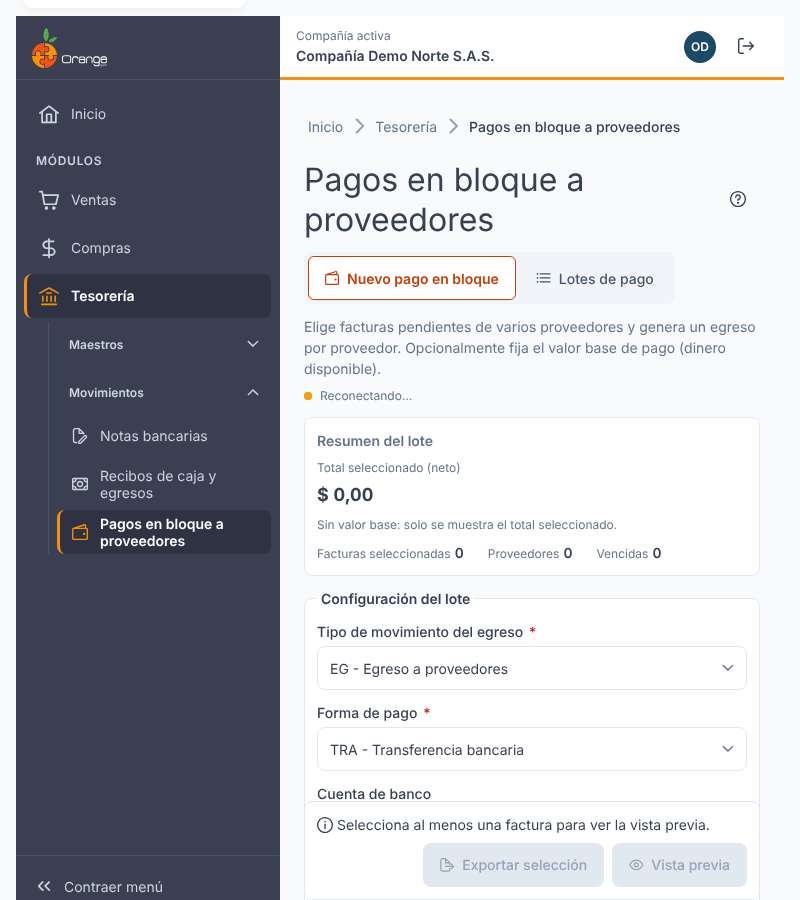

---

## ❔ Ayuda en pantalla

El botón **?** abre este manual en un panel a la derecha. Puede dejarlo abierto mientras trabaja en la pantalla.

En un celular, la ayuda ocupa toda la pantalla y se cierra con la **✕**.

---

## 📱 Uso en el celular

En una pantalla de 480 px o menos, cada factura se muestra como una tarjeta. El resumen, la configuración del lote, los filtros y el pie se apilan en una sola columna. Puede marcar facturas, editar sus valores y generar igual que en el computador.

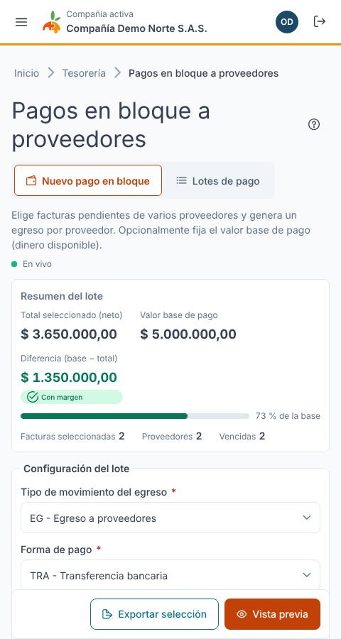

---

## ⚠️ Mensajes frecuentes

| Mensaje | Qué significa | Qué hacer |
|---------|---------------|-----------|
| *Selecciona al menos una factura para ver la vista previa.* | No hay facturas marcadas. | Marque al menos una factura. |
| *El total supera el valor base: ajústalo para continuar.* | Base excedida. | Suba la base, bórrela o quite facturas. |
| *Fija un valor base para sugerir.* | **Sugerir selección** necesita una base. | Fije un valor base o marque las facturas a mano. |
| *El saldo de una factura cambió. Revisa los saldos actuales.* | Una factura ya no tiene el saldo que usted vio. | Revise los saldos y use **Reintentar fallidos**. |
| *La vista previa caducó. Ábrela de nuevo.* | Pasaron 10 minutos o cambiaron los saldos. | Abra la vista previa otra vez. |
| *Este lote no se puede reintentar en su estado actual.* | El lote no tiene fallos que reintentar. | Revise el informe y el detalle del lote. |
| *El lote no existe o no pertenece a esta compañía.* | El enlace no corresponde a un lote de su compañía. | Vuelva a **Lotes de pago**. |
| *No hay conexión con el servidor. Intenta de nuevo.* | Se perdió la conexión. | Revise su red y haga clic en **Reintentar**. |
| *No tienes permiso para esta acción.* | Su perfil no tiene el permiso necesario. | Pida el permiso a su administrador. |

Si la cartera no carga, verá *No se pudo cargar la cartera*. Haga clic en **Reintentar**. Su selección y la configuración del lote no se pierden.

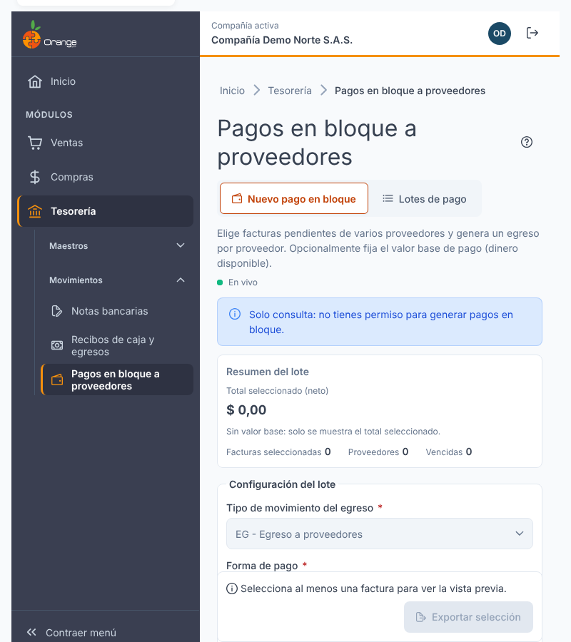

---

## ❓ Preguntas frecuentes

**¿Puedo anular un lote completo?**
No. Cada egreso del lote se anula por separado desde [Recibos de caja y egresos](recibos-egresos.md), con su motivo.

**¿Por qué no puedo generar?**
Revise el pie de la pantalla, que indica el motivo. Las causas más comunes son:

- la base está excedida: el total supera el valor base;
- no tiene el permiso **Crear**;
- no hay periodo abierto para la fecha del lote;
- el tipo de movimiento no está autorizado para su usuario;
- no hay facturas marcadas;
- la vista previa caducó: ábrala de nuevo.

**¿Se duplican los egresos si hago doble clic en Generar?**
No. El lote se procesa una sola vez, aunque haga doble clic.

**¿Por qué la diferencia está en amarillo si todavía me alcanza?**
Porque queda menos del 10 % de la base. El amarillo avisa que queda poco disponible. Puede generar igual.

**¿Por qué no puedo usar Sugerir selección?**
Porque no fijó un valor base. Sin base, el botón está deshabilitado.

**¿Cómo elijo la cuenta de banco?**
No la elige. La cuenta de banco sale de la forma de pago. Si quiere pagar desde otra cuenta, use otra forma de pago.

**¿Puedo cruzar notas crédito o anticipos del proveedor?**
Por ahora no. Los documentos con saldo a favor de la compañía no aparecen como pagables en esta pantalla.

**¿Por qué no veo una factura que sí existe?**
Revise los filtros: proveedor, vencimiento, valor mínimo, centro de costos o comprador. Limpie los filtros y borre el texto de la búsqueda. Si la factura no tiene saldo pendiente, tampoco aparece.

**¿Qué pasa si cierro la pantalla con facturas marcadas?**
Verá la advertencia de [Advertencia al salir](#-advertencia-al-salir). Si sale, la selección se pierde.

**¿Cómo sé si un egreso se creó?**
En el informe, cada proveedor dice **Creado** y muestra el número del egreso. También puede verlo en [Recibos de caja y egresos](recibos-egresos.md).

---

[Regresar a Tesorería](../readme.md)
