[Regresar a Tesorería](../readme.md)

---

# 🧾 Recibos de caja y egresos

---

## 📋 Descripción

Un **recibo de caja** registra el dinero que **entra** a la compañía por un cobro a un cliente: a qué **facturas** se aplica y con qué **formas de pago** (efectivo, transferencia, cheque, tarjeta u otra que tenga configurada).

Un **egreso** registra el dinero que **sale** de la compañía por un pago a un proveedor: a qué **compras por pagar** se aplica y de qué **forma de pago** sale el dinero.

Cada documento tiene una **fecha**, un **tercero** (cliente o proveedor), las **facturas que cruza** (una fila por factura, con sus valores) y uno o varios **pagos**. El total de los pagos debe ser igual al total de las líneas. Al **cerrarlo**, OrangeERP registra los asientos contables del cobro o del pago, y el documento ya no se edita (salvo con la marca especial que se describe en [Editar un recibo cerrado](#-editar-un-recibo-cerrado)).

Use esta pantalla cuando un cliente le pagó (recibo de caja) o cuando usted le paga a un proveedor (egreso). El banco que se mueve por su cuenta se registra en [Notas bancarias](notas-bancarias.md).

> 📘 La búsqueda, el orden, la paginación y la ayuda funcionan igual en todas las tablas: ver [Manejo general de la información](../../Generales/manejo-general-informacion.md).

> 💡 Cada pestaña del navegador trabaja con **una compañía**. El nombre de la compañía se ve en el título de la pestaña y en la barra superior.

> ℹ️ Si un documento está mal y solo necesita corregirse, **anúlelo** con un motivo: queda en el listado con su historia. **Eliminar** borra el documento por completo; solo se ofrece con el permiso correspondiente. Vea [Eliminar un documento](#-eliminar-un-documento).

Antes de empezar, revise que el cliente, las formas de pago y los bancos existan. Las formas de pago se mantienen en [Formas de pago](../maestros/formas-pago.md) y los bancos en [Bancos](../maestros/bancos.md).

---

## 🎯 Acceso

1. En el menú principal, haga clic en **Tesorería**.
2. En **Movimientos**, haga clic en **Recibos de caja y egresos**.

---

## 🔐 Permisos

Cada acción depende de los permisos de su perfil sobre la opción **Recibos de caja y egresos**. Además, el **tipo de movimiento** del recibo debe estar autorizado para su usuario.

| Permiso | Qué habilita |
|---------|--------------|
| Consultar | Ver el listado, abrir los recibos, descargar sus adjuntos y ver la bitácora. |
| Crear | **Nuevo documento**, **Guardar** de un documento nuevo y subir adjuntos a un documento guardado. |
| Actualizar | **Guardar** de un documento abierto y **Cerrar transacción**. Con la marca **Editar documentos cerrados**, también **Guardar** de un documento cerrado (ver [Editar un recibo cerrado](#-editar-un-recibo-cerrado)). |
| Anular | **Anular documento**. |
| Eliminar | **Eliminar documento**, en el documento y en la fila del listado. Ver [Eliminar un documento](#-eliminar-un-documento). |
| Imprimir | **Imprimir**, en el recibo y en la fila del listado. |

> ℹ️ Si su perfil no tiene **Consultar**, la pantalla le avisa: *No tienes acceso a esta pantalla.* Pida a su administrador el permiso que necesite.

---

## 🖥️ Pantalla principal

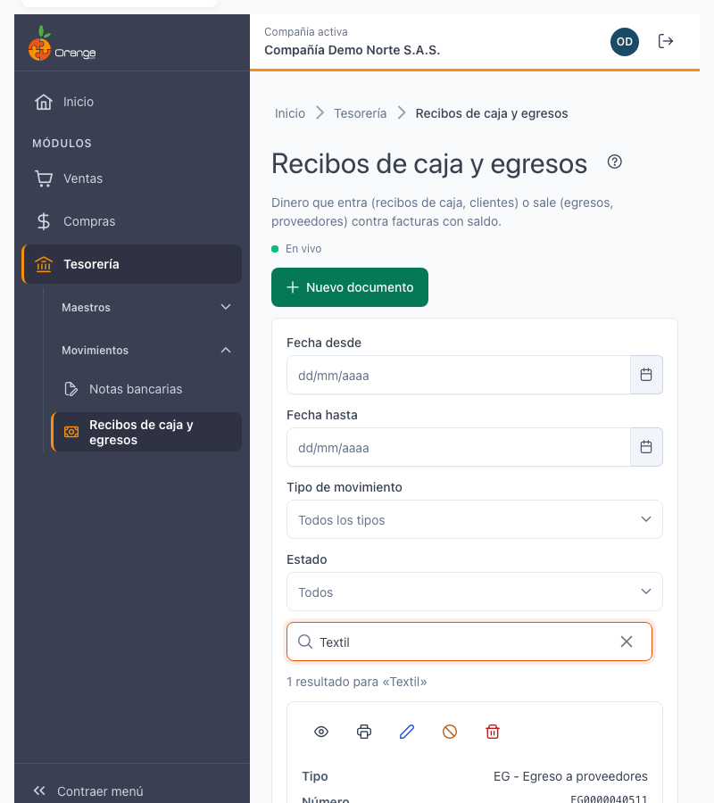

| Elemento | Para qué sirve |
|----------|----------------|
| **?** (junto al título) | Abre esta ayuda en un panel lateral, sin salir de la pantalla. Ver [Ayuda en pantalla](#-ayuda-en-pantalla). |
| **En vivo** | La pantalla está conectada: los cambios de otros usuarios aparecen solos. Ver [Cambios de otros usuarios](#-cambios-de-otros-usuarios-en-vivo). |
| **Nuevo documento** | Crea un recibo. |
| **Filtros** | Reducen el listado por fecha, tipo de movimiento y estado. Ver *Filtros*. |
| **Buscar** | Busca por tipo, número, documento de referencia o tercero. |
| **Encabezados** | Un clic ordena de forma ascendente, el segundo descendente y el tercero quita el orden. Por defecto, el listado va de la fecha más reciente a la más antigua. |
| **Filas por página** y paginación | Cambian cuántos recibos ve y la página. |

Las columnas son:

| Columna | Qué muestra |
|---------|-------------|
| **Acciones** | Los botones del documento (ver, imprimir, editar, anular, eliminar, según el caso). Siempre están en la **primera columna**. |
| **Tipo** | El tipo de movimiento del recibo. |
| **Número** | El número del recibo. |
| **Fecha** | La fecha del recibo. |
| **Fecha efectiva** | La fecha con la que queda registrado. Normalmente es igual a la fecha. |
| **Doc. referencia** | El documento de referencia que escribió al crear el recibo. |
| **Tercero** | El cliente del recibo. |
| **Valor** | El total del recibo. |
| **Estado** | **Abierto**, **Cerrado** o **Anulado**, con su icono. |

Los estados se distinguen por icono y texto:

- **Abierto** (lápiz): se puede editar. Todavía no está cerrado.
- **Cerrado** (candado): registró sus asientos contables y ya no se edita.
- **Anulado** (prohibido): no se borró; quedó con su motivo, su usuario y su hora.

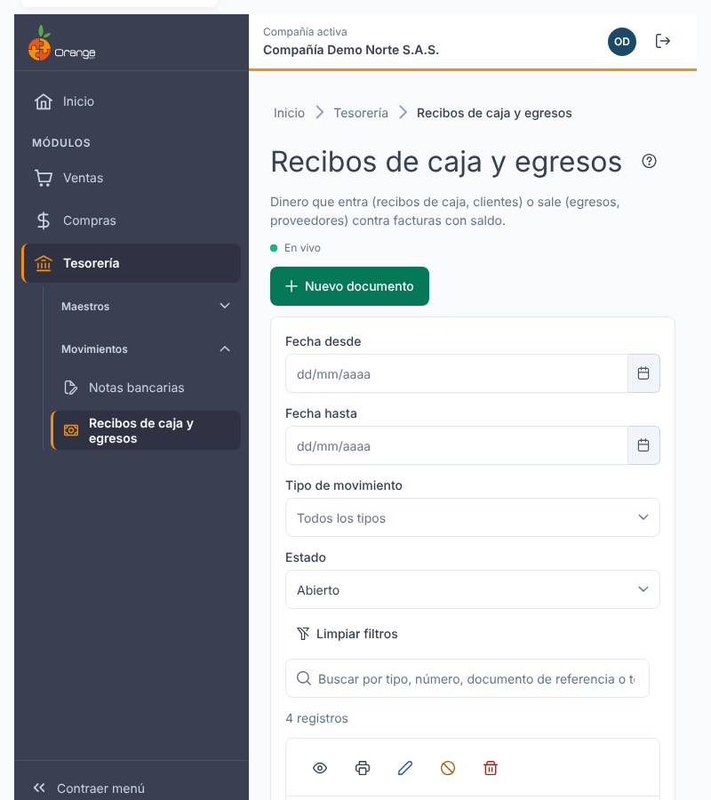

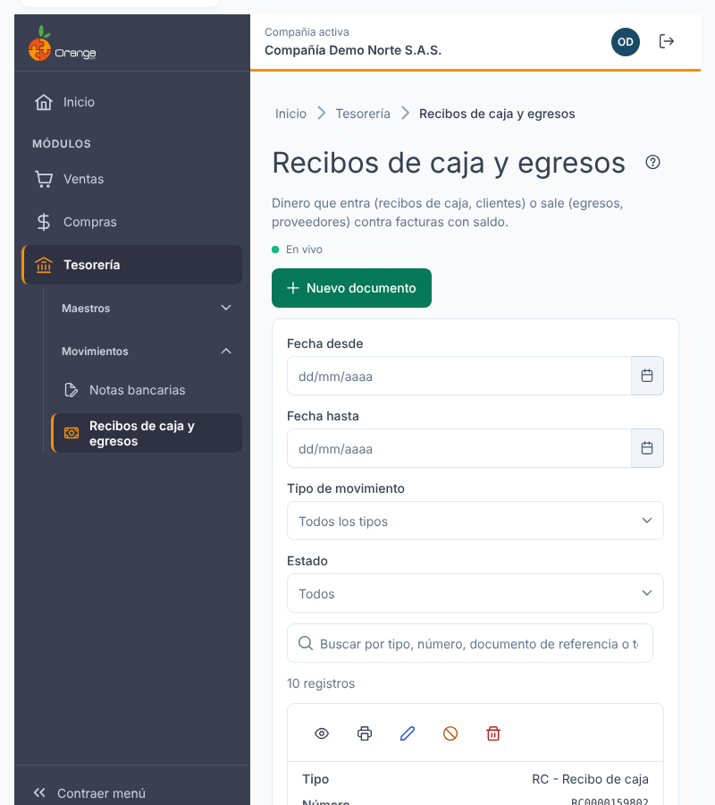

### 🔎 Filtros

Los filtros están sobre la tabla y se pueden combinar:

- **Fecha desde** y **Fecha hasta**. Si la fecha inicial es posterior a la final, verá: *La fecha desde no puede ser posterior a la fecha hasta.* y el listado no muestra recibos hasta corregirla.
- **Tipo de movimiento**: solo los recibos de ese tipo. Por defecto, *Todos los tipos*.
- **Estado**: *Todos*, o uno de los estados (Abierto, Cerrado, Anulado).
- **Limpiar filtros**: quita todos los filtros.

**Exportar a Excel** no está disponible en esta pantalla.

### Estados vacíos y errores del listado

| Mensaje | Qué significa | Qué hacer |
|---------|---------------|-----------|
| *Aún no hay recibos ni egresos.* | La compañía no tiene documentos todavía. | Haga clic en **Nuevo documento** (si tiene el permiso de crear). |
| *Sin resultados.* | Ningún recibo coincide con la búsqueda o los filtros. | Cambie o limpie los filtros, o borre el texto del buscador. |
| *No se pudo cargar.* | Falló la consulta. | Revise su conexión y haga clic en **Reintentar**. |
| *No tienes acceso a esta pantalla.* | Su perfil no tiene **Consultar**. | Pida el permiso a su administrador. |

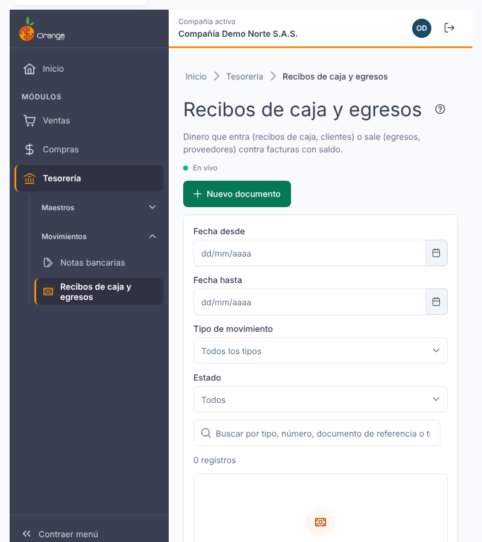

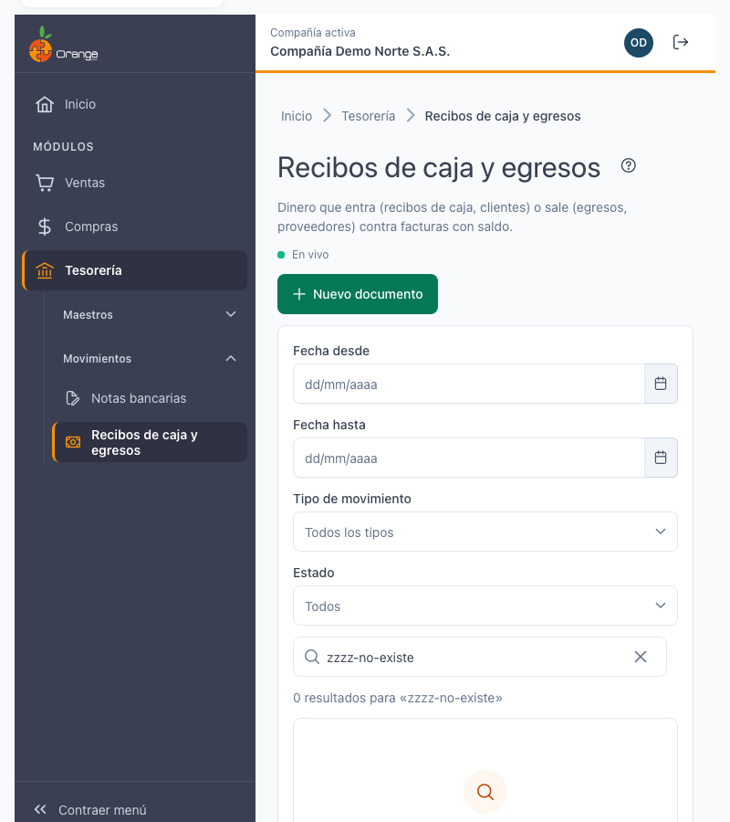

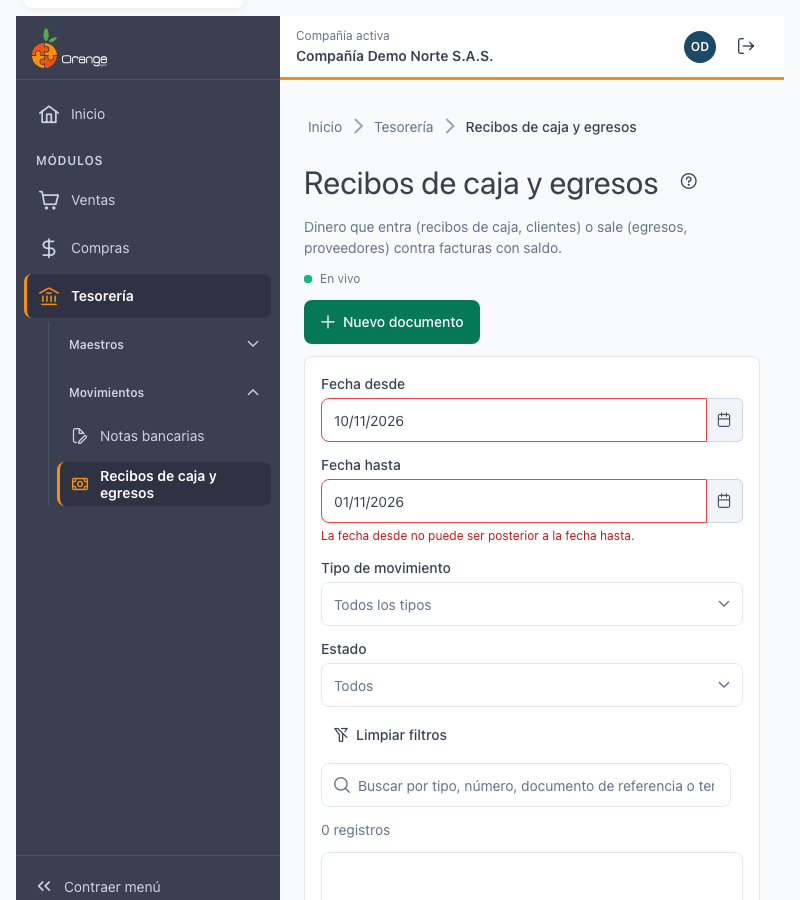

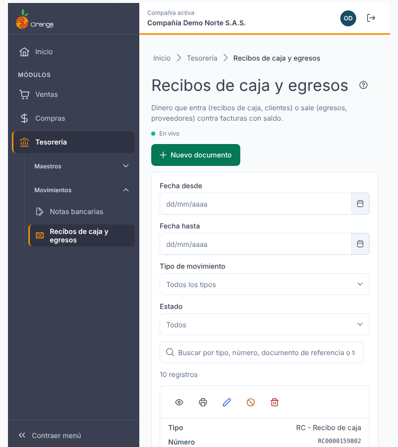

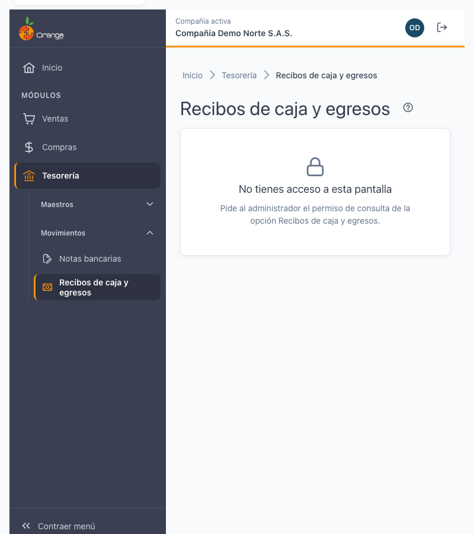

> 📱 En el celular, o en una ventana angosta, cada recibo se muestra como una tarjeta, con sus acciones visibles.

---

## ➕ Crear un recibo

1. En el listado, haga clic en **Nuevo documento**.
2. Elija el **Tipo de movimiento**. Solo verá los tipos autorizados para su usuario. Para un pago a proveedores, vea [Egreso a proveedores](#-egreso-a-proveedores).
3. Complete el **encabezado** (ver la tabla siguiente). Si el documento es un anticipo, marque la casilla **Anticipo** (vea [Anticipos y saldos a favor](#-anticipos-y-saldos-a-favor)).
4. En **Facturas que se cruzan**, cruce las facturas de una de estas dos formas:
   - haga clic en **Seleccionar facturas**, marque las que cubre el cobro y ajuste sus valores ahí mismo; o
   - escriba el **Valor total del recibo** y haga clic en **Distribuir** (vea [Valor total del recibo y Distribuir](#valor-total-del-recibo-y-distribuir)).
5. Revise las **Formas de pago** y el **total**.
6. Haga clic en **Guardar**.

### Encabezado

| Campo | Qué debe tener |
|-------|----------------|
| **Tipo de movimiento** | El tipo del documento: recibo de caja o egreso. Define la cartera (clientes o proveedores) y si el consecutivo se puede escribir. Si cambia el tipo de recibo a egreso, se limpian las facturas que ya estaban cruzadas. |
| **Consecutivo** | Se asigna al guardar. Si el tipo permite escribirlo, puede digitar un número; si lo deja vacío, se usa el siguiente libre. Si el número ya está usado, verá: *Ese consecutivo ya está usado. Elige otro o déjalo vacío.* |
| **Fecha** | La fecha del recibo. Por defecto es hoy; si ya pasó la hora de cierre de la compañía, es mañana. |
| **Fecha efectiva** | Igual a la fecha por defecto. No puede ser posterior a la fecha: *La fecha efectiva no puede ser posterior a la fecha.* |
| **Documento de referencia** | Hasta 20 caracteres, sin «,» ni «;». Si lo deja vacío, se usa el código del tipo y el consecutivo. |
| **Centro de costos** | Obligatorio solo si el tipo lo exige: *Este tipo exige centro de costos.* |
| **Cliente (tercero)** | Busque por documento o por nombre. Un cliente inactivo no se puede usar: *Tercero inactivo.* En un egreso el campo se llama **Proveedor (tercero)**. |
| **Anticipo (sin facturas, un solo pago)** | Casilla de un documento nuevo. Oculta el cruce de facturas y admite un solo pago. Ver [Anticipos y saldos a favor](#-anticipos-y-saldos-a-favor). |
| **Observaciones** | Hasta 200 caracteres, sin «,» ni «;». |

Si el cliente tiene una alerta en sus observaciones, la verá en el recuadro **Alerta del tercero**, con su texto. Puede continuar con el recibo; la alerta solo informa.

> ℹ️ La fecha define el periodo. Si el periodo de la fecha está cerrado para recibos y egresos, verá: *El periodo de la fecha está cerrado para recibos y egresos.* y no se puede guardar. Pida a Contabilidad que abra el periodo o cambie la fecha.

### Facturas que se cruzan

Este bloque dice a qué facturas del cliente aplica el cobro (o, en un egreso, a qué compras del proveedor se aplica el pago). Hay dos formas de cruzar: **Seleccionar facturas**, para elegir factura por factura y ajustar sus valores, y **Valor total del recibo** con **Distribuir**, para repartir un valor total entre las facturas.

1. Elija primero el **Cliente** (o el **Proveedor**, en un egreso) y la **Fecha**. Sin ellos, **Seleccionar facturas** y **Distribuir** están deshabilitados.
2. Haga clic en **Seleccionar facturas**. Verá las facturas del tercero con saldo a esa fecha, ordenadas por fecha. Si quiere ver también las que tienen saldo cero, marque **Mostrar facturas sin saldo**. Si las oculta de nuevo, se desmarcan las que estaban marcadas.

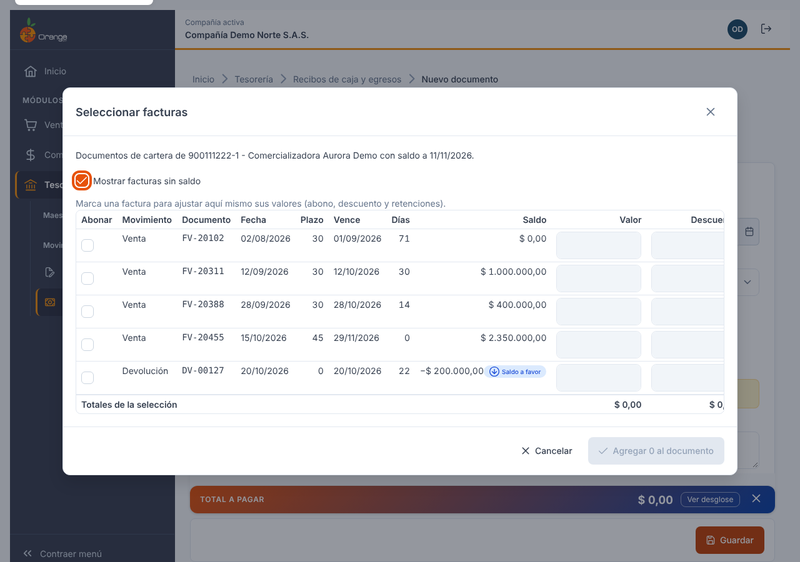

3. Marque la casilla **Abonar** de cada factura que cubre el cobro. Al marcarla, el **Valor** propone el saldo de la factura, y puede ajustar ahí mismo el descuento, el IVA, las retenciones y los demás valores.

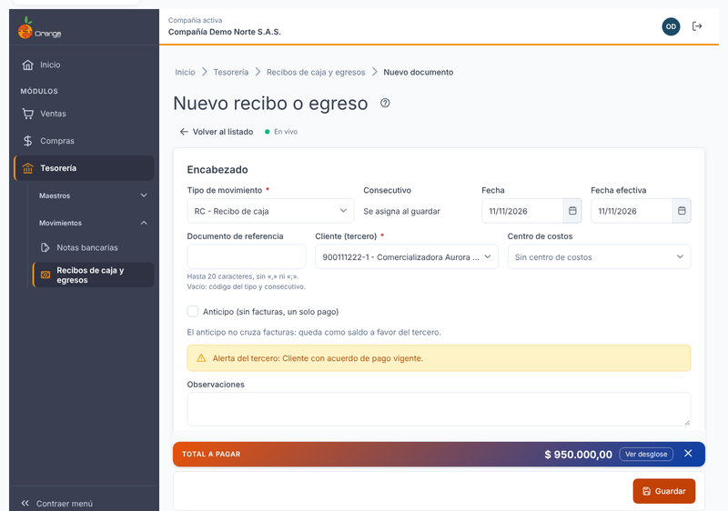

Los campos de una factura están deshabilitados hasta que la marca. El **total de la fila** lleva signo, y abajo verá los **Totales de la selección**. Si el **Valor** de una factura marcada queda vacío o inválido, no deja agregar y le avisa.

4. Revise la selección y haga clic en **Agregar … al documento**. Cada factura marcada queda como una **línea** de la tabla **Facturas que se cruzan**.

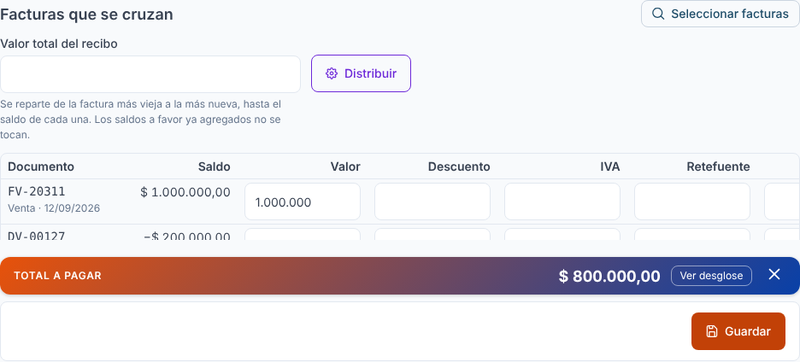

Las líneas se editan directamente en la tabla. Cada factura es una **fila** y cada valor, una **columna**:

| Columna | Para qué sirve |
|---------|----------------|
| **Documento** | El documento afectado, con su movimiento y su fecha. Si la factura tiene saldo negativo, aparece la insignia **Saldo a favor**. |
| **Saldo** | El saldo vigente de la factura. |
| **Valor** | Lo que se abona de la factura. |
| **Descuento**, **IVA**, **Retefuente**, **ReteIVA**, **ReteICA**, **Segufletes**, **Intereses** | Los valores que acompañan el cobro, según corresponda. |
| **Otros valores** | Otros conceptos. Es el único campo que admite negativos (por ejemplo, -5000). |
| **Neto de la línea** | El resultado de la línea con sus conceptos. Lo calcula el sistema. |
| **Quitar la línea** | Quita esa factura del documento. |

Escriba directamente en las celdas: el **neto de la línea** y los **totales** del pie (fila **Totales**) se actualizan mientras escribe.

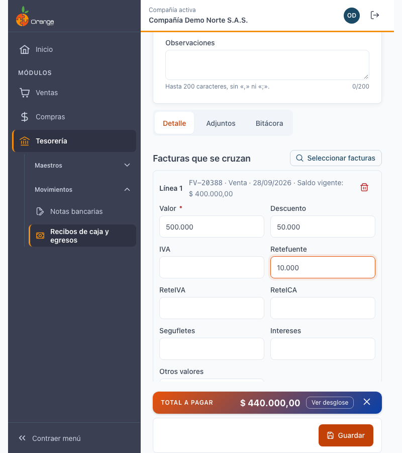

> ⚠️ Si abona más que el saldo de la factura, verá: *Abonas más que el saldo (…). Se permite y quedará un saldo a favor.* Puede guardar; el sistema deja el saldo a favor del cliente.

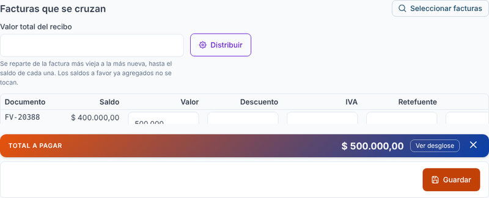

Si una factura tiene saldo negativo, aparece marcada como **Saldo a favor**. Sus valores se suman con signo: el neto del documento puede ser menor. Vea [Anticipos y saldos a favor](#-anticipos-y-saldos-a-favor).

### Valor total del recibo y Distribuir

Use esta opción si el cliente le entregó un valor global y no quiere elegir factura por factura. En un egreso el campo se llama **Valor total del egreso**.

1. Escriba en **Valor total del recibo** el valor total. Es el **Total a pagar** neto, es decir, lo que sumarán los pagos. Distribuir está deshabilitado sin tercero.

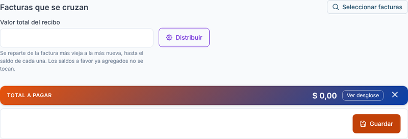

2. Haga clic en **Distribuir**. El sistema reparte el valor de la factura más vieja a la más nueva (por fecha, luego por vencimiento y número), hasta el saldo de cada una:
   - la última factura con abono puede quedar **parcial**;
   - las facturas sin abono no generan línea;
   - los saldos a favor que ya estén agregados se conservan y restan del total.
3. El resultado son **líneas normales** de la tabla. Puede editarlas como cualquier otra.

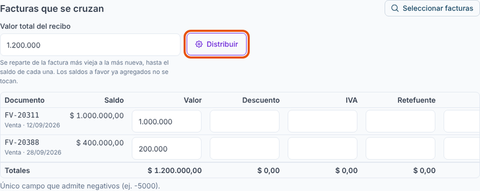

Mensajes de Distribuir:

| Mensaje | Qué hacer |
|---------|-----------|
| *Escribe un valor mayor que cero para distribuir.* | Escriba el valor total y vuelva a hacer clic en **Distribuir**. |
| *El tercero no tiene facturas con saldo para distribuir.* | Revise el tercero y la fecha. Si no tiene saldo, no hay nada que repartir. |

#### Si el valor supera las facturas con saldo

Si el valor total es mayor que la suma de las facturas con saldo, **Distribuir** no aplica nada y pregunta en el diálogo *El valor supera las facturas con saldo*. El diálogo le dice cuánto sobra y ofrece dos opciones:

- **Sí, colocar la diferencia**: la última factura (la más nueva) queda con su saldo más la diferencia. Es un mayor valor abonado que deja un **saldo a favor** del tercero. El sistema muestra la advertencia de abono mayor al saldo, pero no bloquea el documento.
- **No, solo lo que cubren las facturas**: se aplican solo las facturas, y el campo **Valor total del recibo** se ajusta al valor que cubren.

Cerrar el diálogo con **Escape** no cambia nada.

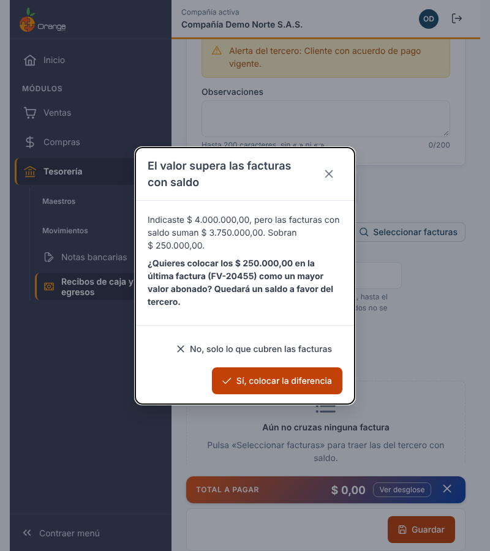

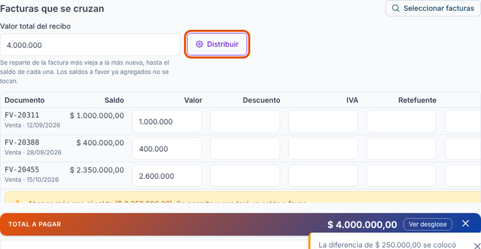

### Formas de pago

En **Formas de pago** registre cómo entró el dinero. En un egreso, registre de dónde sale: el dinero sale de la forma de pago elegida, y la cuenta de banco se toma de esa forma de pago.

1. Haga clic en **Agregar forma de pago**.
2. Elija la **Forma de pago** (obligatoria).
3. Si la forma de pago pide banco o referencia, complete **Banco** y **Documento de referencia** (hasta 20 caracteres, sin «,» ni «;»). Si no los pide, verá: *Esta forma de pago no pide banco ni referencia.* y esos campos quedan vacíos.
4. Escriba el **Valor** del pago.
5. Para quitar un pago, haga clic en **Quitar el pago n**.

No puede repetir la misma combinación de forma de pago, banco y referencia: *Ya hay un pago con la misma forma, banco y referencia.*

Debajo de los pagos está la línea de cuadre:

- *Los pagos cuadran con el total.*
- *Los pagos no suman el total: faltan …* o *Los pagos superan el total en …*

### El total: Total a pagar

En la parte inferior, el **Total a pagar** se ve siempre. Con **Ver desglose** puede ver los totales por concepto (valores, descuentos, IVA, retefuente, reteIVA, reteICA, segufletes, intereses y otros valores), la **Suma de pagos** y la **Diferencia**.

> ℹ️ Si el total sale negativo (saldo a favor), los pagos se registran por el valor absoluto.

### Guardar

**Guardar** guarda el recibo completo: encabezado, facturas, pagos y adjuntos. Todo se guarda junto o no se guarda nada. Si hace doble clic en **Guardar**, el recibo se guarda una sola vez.

Si los pagos no suman el total, el sistema no guarda y muestra: *Los pagos no suman el total; no se guardó nada.* También verá *Revisa los campos marcados: hay datos por corregir.* y los campos con error quedan señalados.

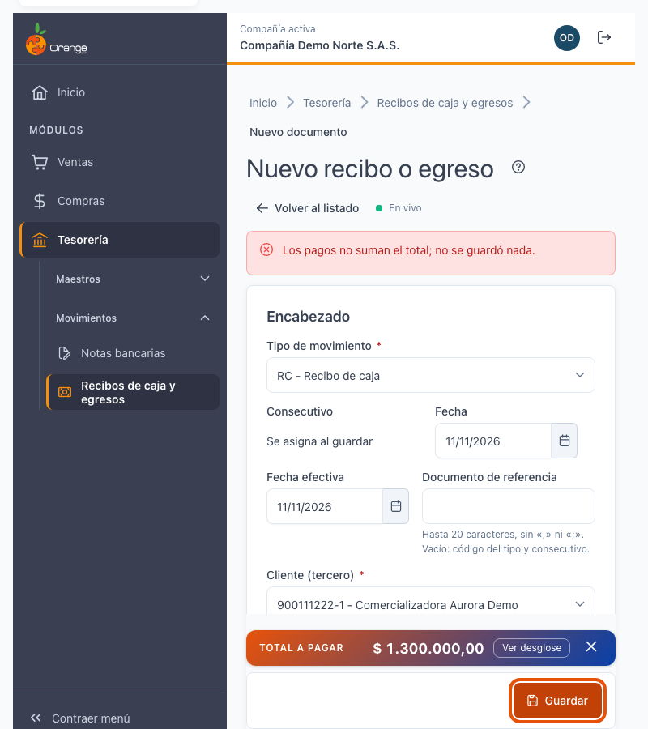

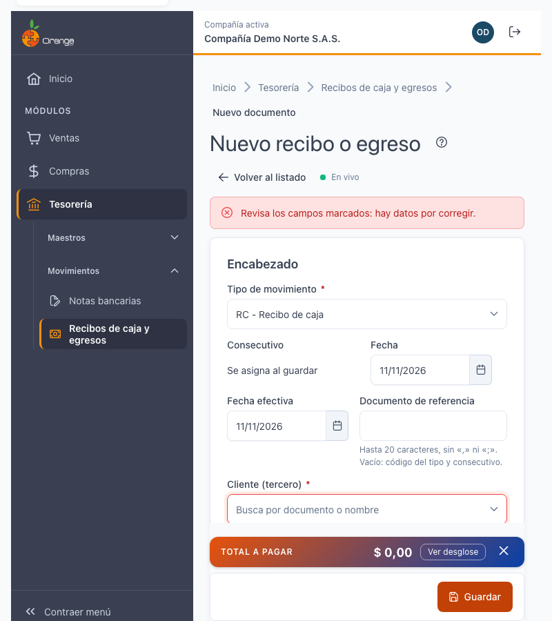

Un recibo guardado queda **Abierto**. Puede volver a editarlo, o cerrarlo cuando esté listo.

---

## 💸 Egreso a proveedores

Un **egreso** es el pago que la compañía hace a un proveedor. Se crea en la misma pantalla que los recibos, con **Nuevo documento**: en **Tipo de movimiento**, elija un tipo de egreso (por ejemplo, *EG - Egreso a proveedores*). Solo verá los tipos autorizados para su usuario.

En un egreso cambian estos puntos:

- El campo del tercero se llama **Proveedor (tercero)**. Busque por documento o por nombre.
- El selector de **Seleccionar facturas** trae las **compras por pagar** de ese proveedor, con su saldo a la fecha.
- Si el tipo de egreso lo exige, el **Centro de costos** es obligatorio: *Este tipo exige centro de costos.*
- El **neto** de cada línea incluye retenciones e intereses:

  > **Valor** − **Descuento** + **IVA** − **Retefuente** − **ReteIVA** − **ReteICA** + **Segufletes** + **Intereses** + **Otros valores**

- El campo de valor total se llama **Valor total del egreso**, y **Distribuir** funciona igual que en un recibo.
- El dinero sale de la **forma de pago** elegida. La cuenta de banco se toma de esa forma de pago.

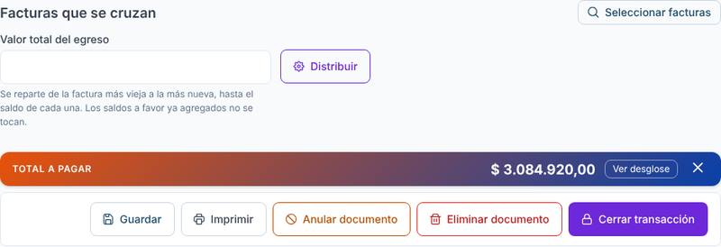

Pasos para un egreso:

1. En **Nuevo documento**, elija el tipo de egreso y complete el encabezado con el **Proveedor (tercero)**.
2. En **Facturas que se cruzan**, use **Seleccionar facturas** o **Distribuir** con el **Valor total del egreso**.
3. En **Formas de pago**, elija de dónde sale el dinero y el valor de cada pago.
4. Haga clic en **Guardar**.

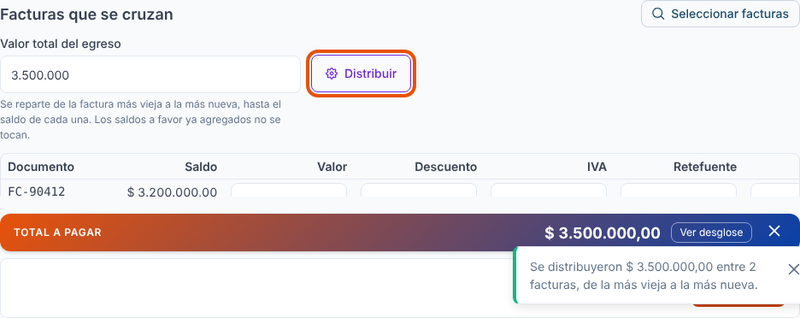

> ℹ️ Si cambia el tipo de un recibo a egreso después de cruzar facturas, el sistema limpia las facturas cruzadas. Vuelva a seleccionarlas.

---

## 💰 Anticipos y saldos a favor

Un **saldo a favor** es un valor que queda a favor del tercero. Aparece cuando se abona más que el saldo de una factura, o cuando el documento es un **anticipo**.

### Anticipo (sin facturas, un solo pago)

En el encabezado de un documento **nuevo**, marque la casilla **Anticipo (sin facturas, un solo pago)**. Entonces:

- Se oculta el cruce de facturas: el documento no lleva facturas.
- Admite **exactamente un pago**. El aviso dice: *Un anticipo no lleva facturas: registra su pago abajo.*
- El documento queda como **saldo a favor** del tercero, y luego ese saldo se puede cruzar en otro recibo.

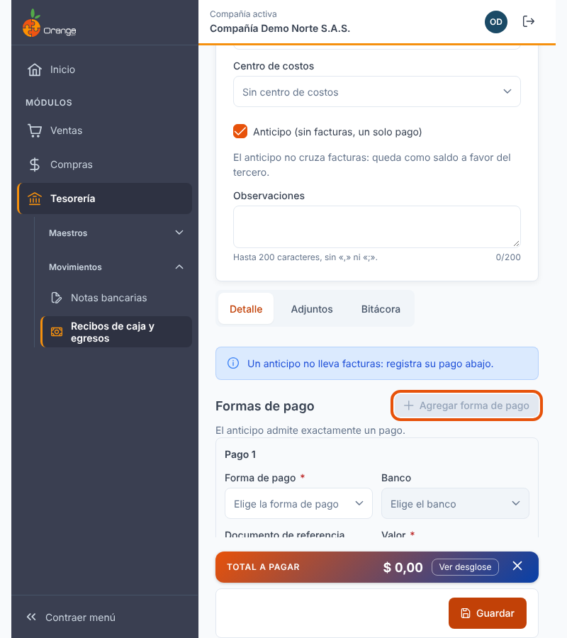

Un anticipo cerrado se ve así: sin facturas, con su pago y solo las acciones de impresión y anulación.

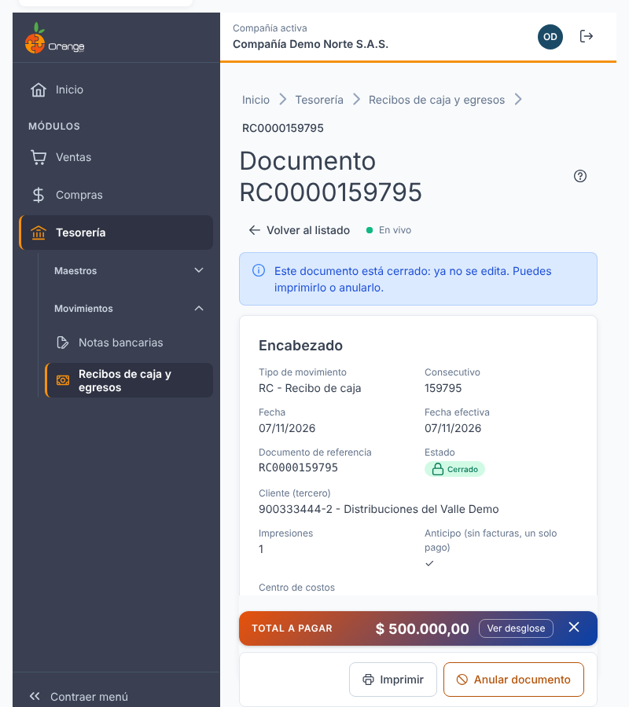

### Saldo a favor cruzado con facturas

Cuando un documento con saldo a favor se cruza con facturas, su valor se **suma con signo**, por eso el neto puede ser menor que la suma de las facturas. Si el total sale negativo, los pagos se registran por el valor absoluto (vea [El total: Total a pagar](#el-total-total-a-pagar)).

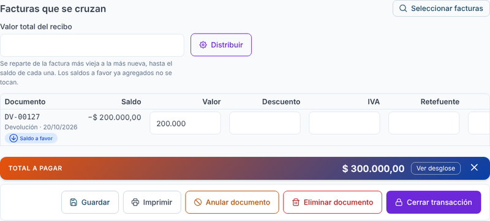

> ⚠️ Si otro documento activo ya cruzó el anticipo o el saldo a favor de este, ese otro documento depende de él, y este no se puede eliminar (vea [Eliminar un documento](#-eliminar-un-documento)).

---

## ✏️ Editar un recibo abierto

1. En el listado, haga clic en **Editar el documento** de la fila, o abra el recibo con **Ver**.
2. Cambie lo que necesite y haga clic en **Guardar**.

Después de guardar, el encabezado no cambia. Se pueden cambiar las **observaciones**, el **centro de costos**, las **líneas** y los **pagos**. Al guardar, los asientos contables se recalculan; si quita una línea o un pago, sus asientos se quitan con él.

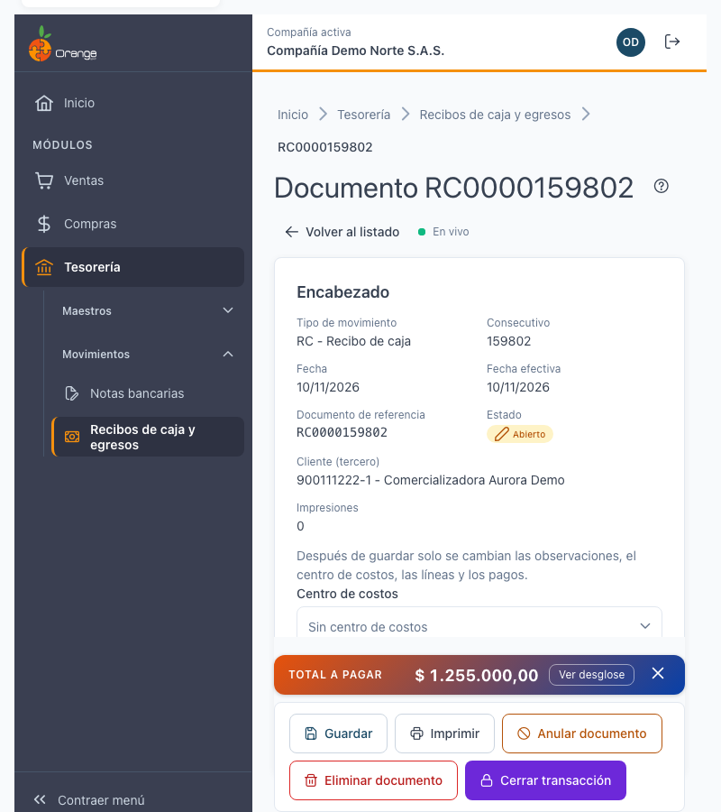

Si otro usuario cambió el recibo mientras lo edita, no se pierde su trabajo, pero no se guarda sobre el cambio ajeno. Vea [Cambios de otros usuarios](#-cambios-de-otros-usuarios-en-vivo).

> ℹ️ Un recibo **anulado** o de un **periodo cerrado** no se edita. Un recibo **cerrado** tampoco, salvo con la marca especial que se describe en [Editar un recibo cerrado](#-editar-un-recibo-cerrado). Si no se puede editar, lo verá con su aviso: *Este documento está cerrado: ya no se edita. Puedes imprimirlo o anularlo.*

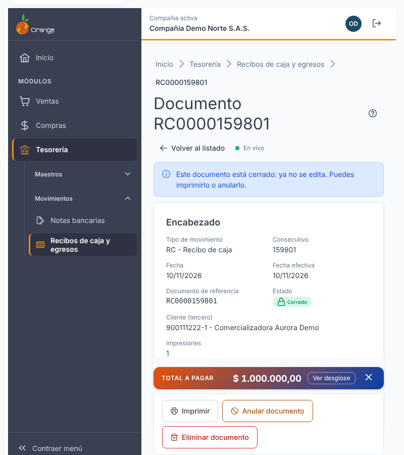

---

## ✅ Cerrar un recibo

Cerrar es el paso que registra los asientos contables del cobro. Es una acción aparte de guardar.

1. Abra el recibo abierto y guarde sus últimos cambios. Si tiene cambios sin guardar, verá: *Guarda los cambios antes de cerrar.*
2. Haga clic en **Cerrar transacción**.
3. Lea el diálogo y haga clic en **Cerrar transacción** para confirmar.

El diálogo dice: *Al cerrar, el documento ya no se podrá editar ni adjuntarle archivos. Solo se puede imprimir o anular. Se revisa otra vez que los pagos sumen el total.*

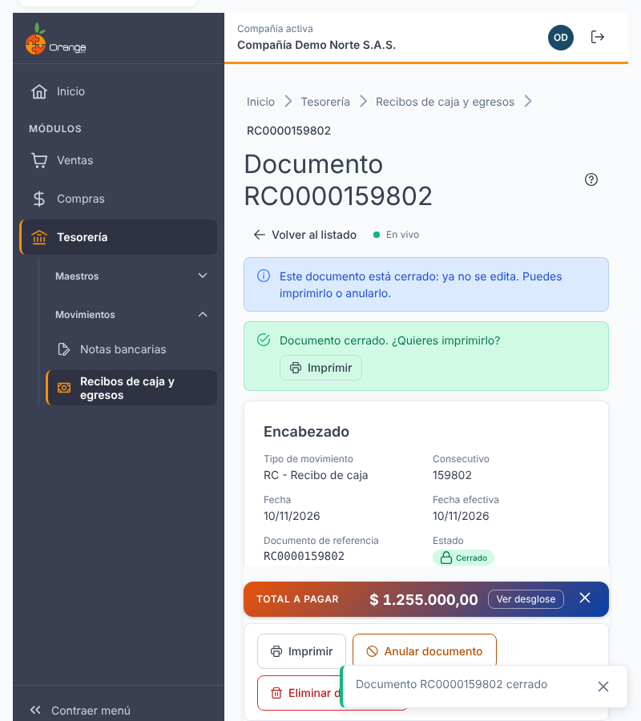

Al cerrar, el recibo queda **Cerrado** con su usuario y su hora, y el sistema le pregunta: *Documento cerrado. ¿Quieres imprimirlo?*

Si el cierre no se puede hacer, verá el motivo y el recibo sigue abierto:

| Mensaje | Qué hacer |
|---------|-----------|
| *Los pagos no suman el total; no se guardó nada.* | Revise los pagos y guarde de nuevo. |
| *El periodo de la fecha está cerrado para recibos y egresos.* | Pida a Contabilidad que abra el periodo. |
| *El documento ya está cerrado.* | Recargue el recibo para ver su estado. |

Si el servidor rechaza el cierre, el motivo aparece dentro del mismo diálogo, que queda abierto.

---

## ✏️ Editar un recibo cerrado

Un recibo cerrado solo se puede editar si se cumplen **las tres** condiciones:

1. Su perfil tiene el permiso **Actualizar**.
2. Su usuario tiene la marca especial **Editar documentos cerrados**.
3. El periodo de la fecha del recibo está **abierto**.

Al guardar los cambios, los asientos contables se **recalculan** y el recibo **sigue cerrado**. El aviso lo dice: *Este documento está cerrado: al guardar se recalculan sus asientos contables y sigue cerrado.*

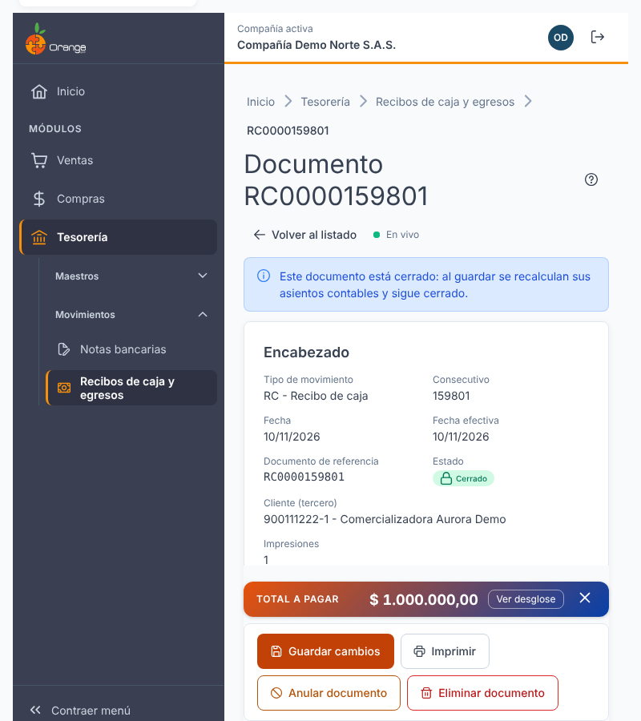

Sin la marca, o si el periodo está cerrado, el recibo cerrado es de **solo lectura**: puede imprimirlo o anularlo, pero no cambiarlo.

---

## ⛔ Anular un recibo

Anular es **invalidar** un recibo que no debió registrarse. No se borra nada: el recibo queda en el listado como **Anulado**, con el motivo, su usuario y la hora. Los saldos de las facturas afectadas vuelven a su valor.

Puede anular un recibo abierto o cerrado si tiene el permiso **Anular**.

1. Haga clic en **Anular documento** (en el recibo o en la fila del listado).
2. Escriba el **Motivo de la anulación**: entre 5 y 200 caracteres.
3. Confirme con **Anular documento**.

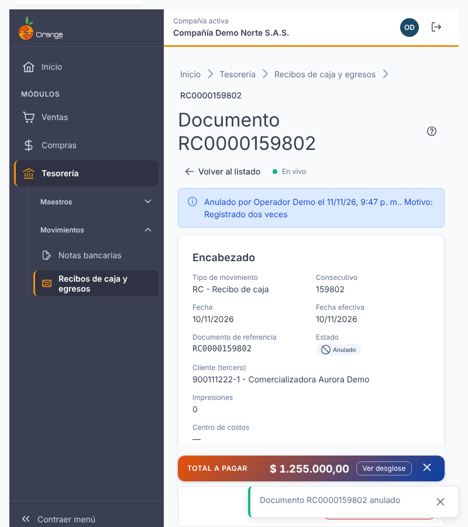

El diálogo dice: *No se borra nada: el documento queda anulado con su motivo, usuario y hora, y los saldos de las facturas afectadas vuelven a su valor.*

Un recibo anulado se muestra con este aviso: *Anulado por … el … Motivo: …* Sus adjuntos solo se pueden descargar y ya no se puede imprimir.

### Aviso de certificado de retención

Si el recibo usó cuentas con **certificado de retención**, el diálogo de anulación muestra este aviso, que también queda visible en el recibo:

> Aviso: este documento usó cuentas con certificado de retención. El certificado de retefuente del sistema anterior lo seguirá sumando aunque esté anulado; revísalo antes de emitir certificados.

Revise el certificado antes de emitirlo: el sistema anterior puede seguir sumando el recibo.

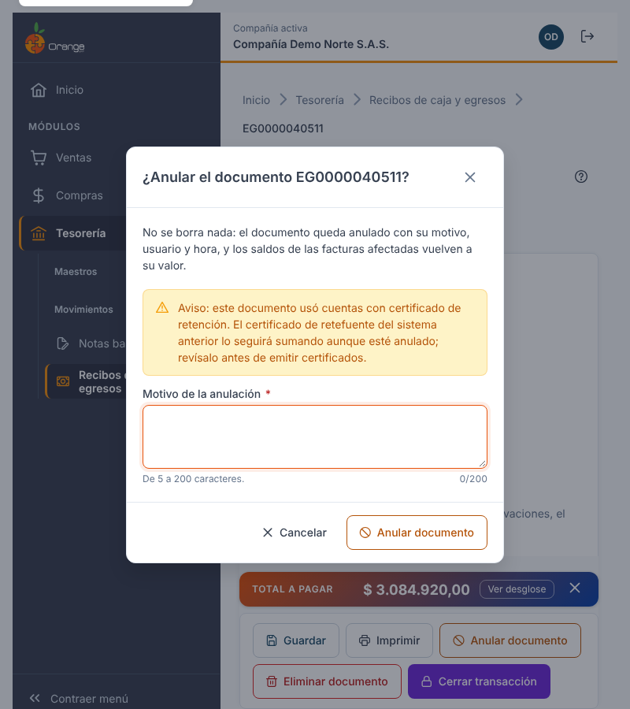

### Aviso de facturas ya cruzadas

Si el recibo ya fue cruzado por otros recibos, el diálogo lo advierte: *Este documento ya fue cruzado por otros recibos. Se puede anular, pero sus saldos cambiarán.* Puede anularlo, pero revise antes los saldos de esas facturas.

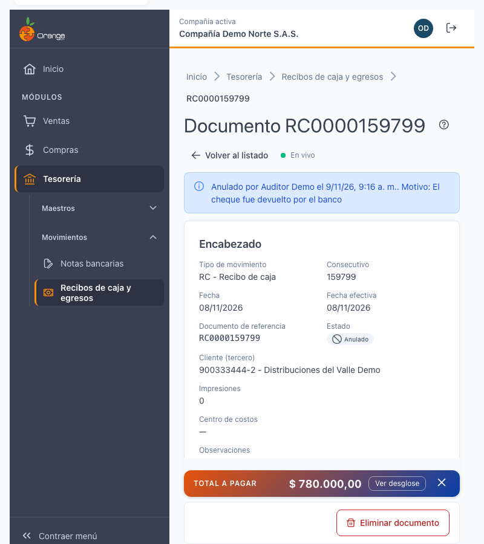

### No se puede anular

| Mensaje | Qué hacer |
|---------|-----------|
| *El periodo de la fecha está cerrado para recibos y egresos.* | Contabilidad debe abrir el periodo, o el recibo queda como está. |
| *El documento ya está anulado.* | Revise el listado: ya no hay nada que anular. |
| *No tienes permiso para esta acción.* | Pida el permiso de **Anular** a su administrador. |

Igual que en el cierre, si el servidor rechaza la anulación, el motivo aparece dentro del diálogo, que no se cierra.

---

## 🗑️ Eliminar un documento

**Eliminar documento** borra el documento **completo**: su encabezado, sus facturas, sus pagos, sus asientos contables y sus adjuntos. **No se puede deshacer.**

> ⚠️ Si solo quiere corregir un documento, **anúlelo** en lugar de eliminarlo. La anulación conserva la historia en el listado.

Para eliminar necesita el permiso **Eliminar**, y el documento debe cumplir estas condiciones:

- No está **anulado**.
- No tiene **dependientes**: ningún otro documento activo cruzó su anticipo o su saldo a favor.
- El periodo de su fecha está **abierto**.

1. Abra el documento y haga clic en **Eliminar documento**, o en la fila del listado, en la acción **Eliminar el documento …**.
2. En el diálogo *¿Eliminar el documento …?* lea el aviso: se borran el documento completo, con sus facturas, pagos, asientos y adjuntos, y no se puede deshacer.
3. Confirme con **Eliminar documento**.

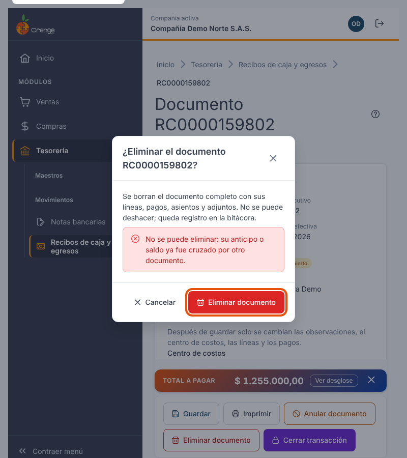

Si el servidor rechaza la eliminación porque el documento tiene dependientes, el diálogo lo muestra: *No se puede eliminar: su anticipo o saldo ya fue cruzado por otro documento.* El documento no se borra. Si solo quiere corregirlo, anúlelo.

Cuando la eliminación se completa, la pantalla vuelve al listado con el aviso *Documento … eliminado*.

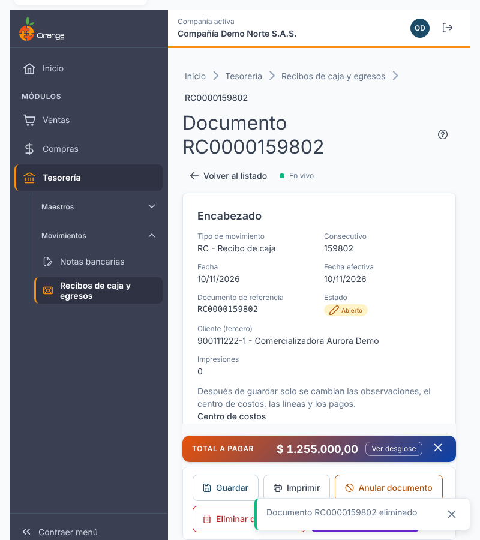

Si el documento no ofrece **Eliminar documento**, no cumple alguna de las condiciones de arriba: está anulado, tiene dependientes, su periodo está cerrado o su perfil no tiene el permiso **Eliminar**.

---

## 🖨️ Imprimir

**Imprimir** genera el documento en PDF tamaño carta. Lo puede usar en un recibo abierto o cerrado, y también desde la fila del listado, con la acción **Imprimir el documento** de esa fila.

El documento trae la empresa, el cliente, su saldo a la fecha, las facturas cruzadas (o el anticipo), los totales con el valor en letras, las formas de pago, el detalle contable con débitos y créditos, y quién lo elaboró e imprimió.

Cada impresión suma uno al contador **Impresiones** del recibo, con su usuario y su hora. Un recibo anulado no se imprime.

---

## 📎 Adjuntos

En la pestaña **Adjuntos** puede guardar el soporte del cobro (por ejemplo, la consignación o la certificación del pago).

- **Espacio en uso**: cada recibo puede tener hasta **10 MB** de adjuntos en total.
- Formatos: **PDF**, **PNG** y **JPG**.
- **Descripción** obligatoria, de hasta 200 caracteres.
- Haga clic en **Subir adjunto**. Para bajar un archivo, use **Descargar**; para quitarlo, **Quitar**.

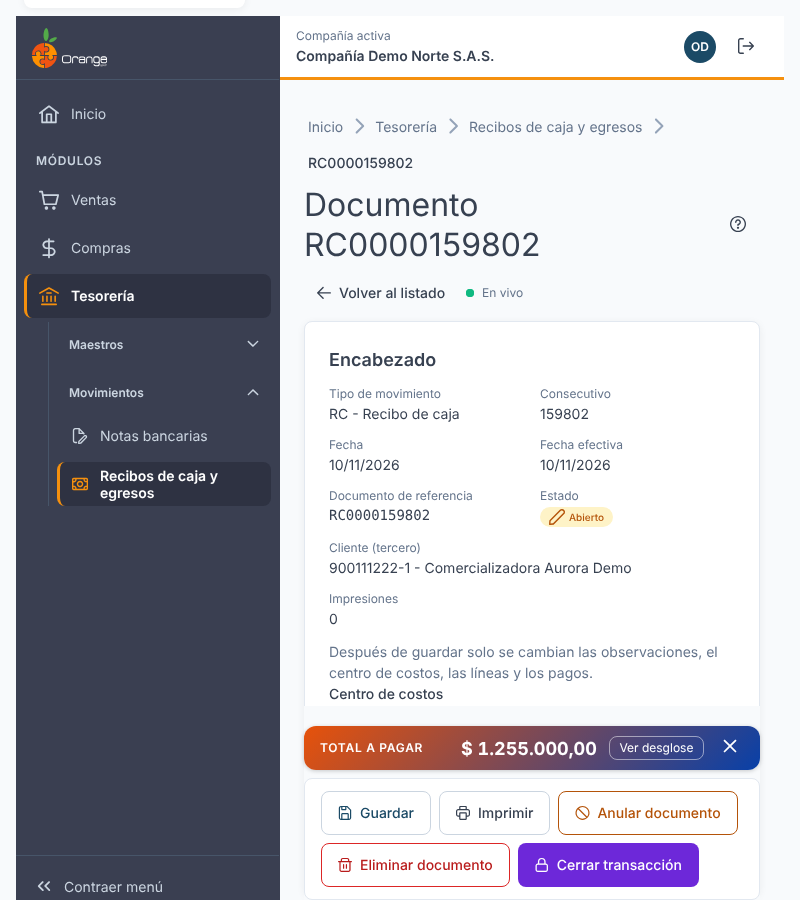

Reglas:

- Si el recibo todavía no está guardado, verá: *Guarda el documento para poder adjuntar soportes.*
- Si el recibo está **cerrado** o **anulado**, no se pueden cambiar sus adjuntos. Puede descargarlos.
- Si el archivo haría pasar el recibo de 10 MB, o si ya llegó al cupo, quite un adjunto antes de subir otro.

---

## 📜 Bitácora

En la pestaña **Bitácora** queda el historial del recibo, de solo lectura, con lo más reciente primero: creación, cambios, cierre, anulación, impresión y adjuntos, con el usuario y la hora de cada evento.

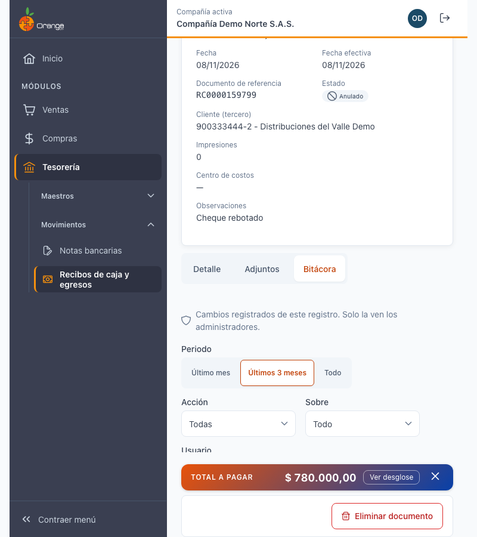

---

## ⚠️ Mensajes de error frecuentes

| Mensaje | Qué significa | Qué hacer |
|---------|---------------|-----------|
| *Los pagos no suman el total; no se guardó nada.* | Los pagos no igualan el total de las líneas. | Revise los pagos y las facturas. Guarde de nuevo. |
| *Tercero inactivo.* | El cliente fue desactivado. | Elija otro cliente. |
| *Ese tipo de movimiento no está autorizado para tu usuario.* | Su usuario no puede usar ese tipo. | Elija otro tipo o pida el permiso a su administrador. |
| *Una de las facturas ya no es válida para este tercero (anulada, de otro tercero o de otra cartera).* | Una factura cambió después de elegirla. | Quite la línea, seleccione las facturas de nuevo y guarde. |
| *Ya hay un pago con la misma forma, banco y referencia.* | Hay dos pagos iguales. | Cambie la referencia o quite uno de los pagos. |
| *No se pudo asignar el número. Intenta de nuevo; si se repite, avisa al administrador.* | Falló la asignación del número. | Intente de nuevo. Si se repite, avise al administrador. |
| *Otro usuario modificó este documento. Revisa sus cambios antes de guardar.* | Otra persona cambió el recibo mientras usted lo editaba. | Haga clic en **Ver sus cambios**, revise, y vuelva a guardar sus cambios. |
| *El documento ya no se puede editar (cerrado, anulado o periodo cerrado).* | El recibo ya no es editable. | Recargue el recibo para ver su estado actual. |
| *Este documento no existe.* | El recibo ya no está disponible o no pertenece a esta compañía. | Vuelva al listado. |
| *No se puede eliminar: su anticipo o saldo ya fue cruzado por otro documento.* | Otro documento activo depende de este. | Revise el otro documento. Si solo quiere corregir este, anúlelo. |
| *No se pudo completar la acción. Reintenta.* | Error del servidor. No se guardó nada. | Haga clic en **Reintentar**. Si se repite, avise al administrador. |

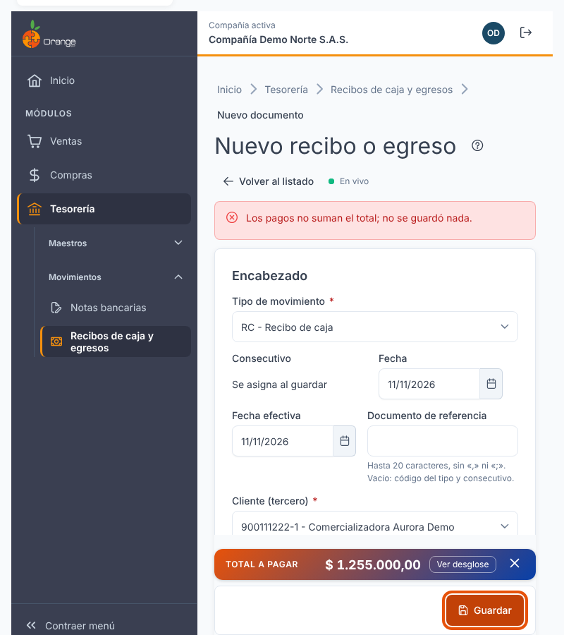

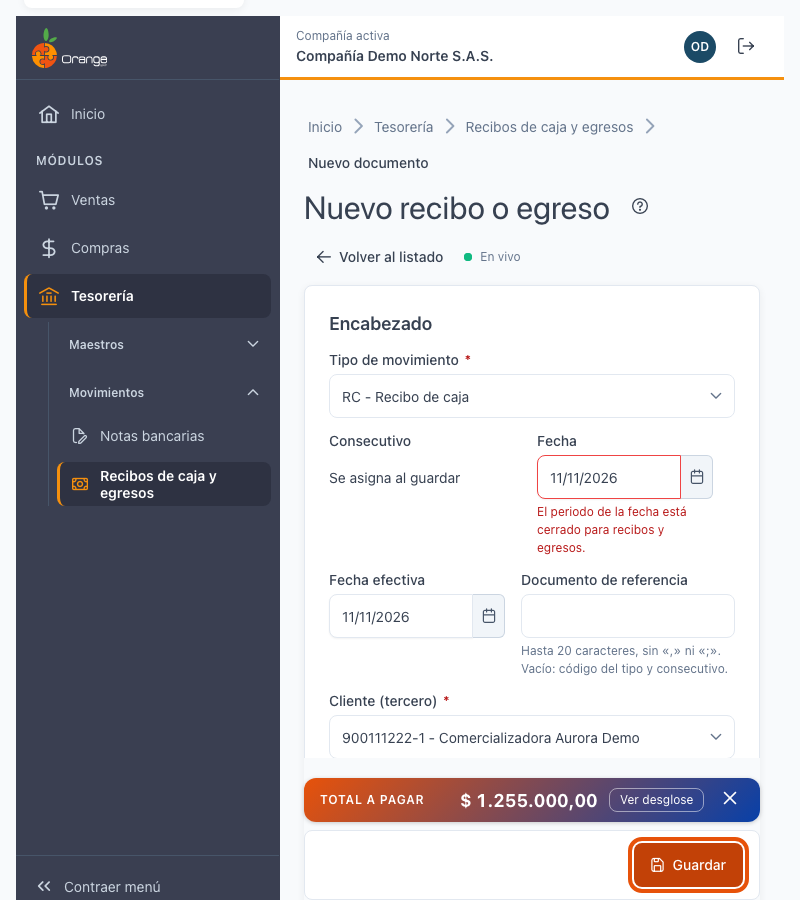

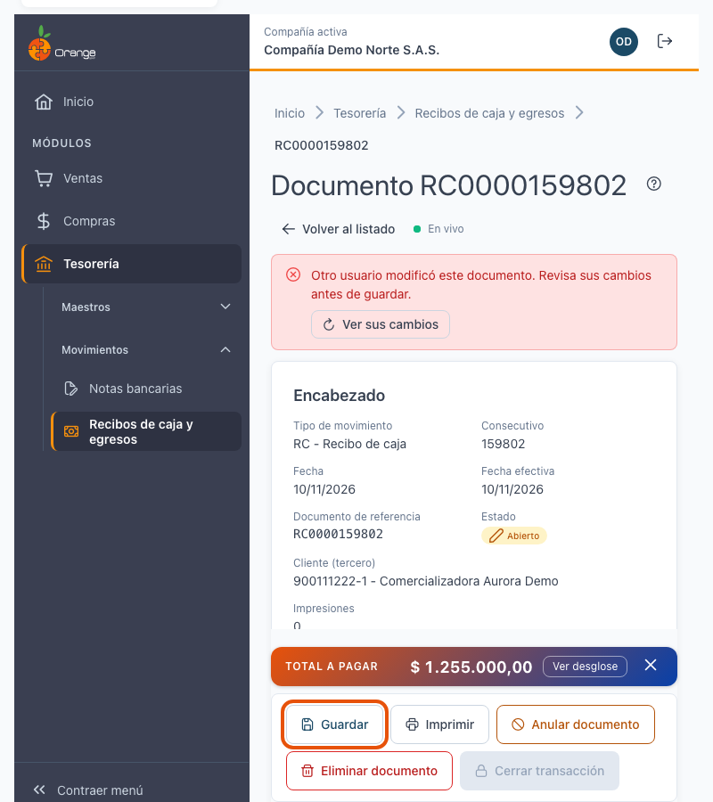

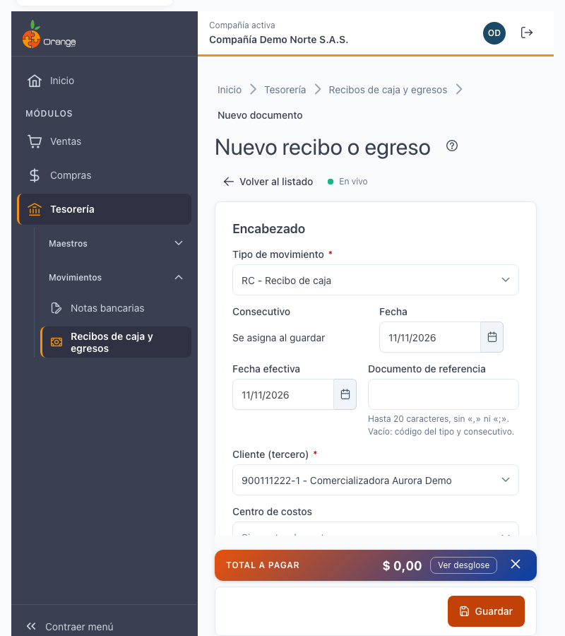

---

## 🔄 Cambios de otros usuarios (en vivo)

Si otra persona crea, modifica, cierra o anula recibos mientras usted tiene abierta esta pantalla, **no tiene que recargar**: el listado se pone al día solo, sin perder lo que buscó, el orden ni la página.

- Las filas nuevas o modificadas se **resaltan** unos segundos.
- Abajo a la derecha aparece un aviso con el nombre de quien hizo el cambio, por ejemplo *[nombre] creó el documento RC000000015.*
- Junto al título verá **En vivo** mientras la conexión esté activa. Si se interrumpe, dice **Reconectando…**; al volver, la pantalla se actualiza sola.

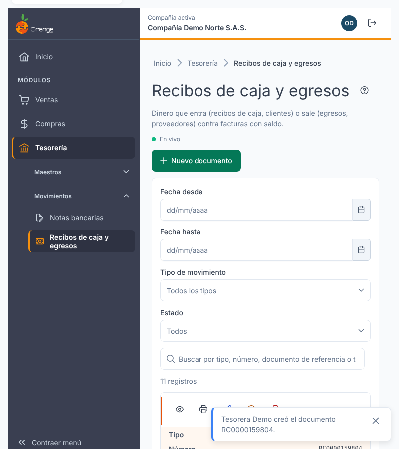

**Si tiene abierto un recibo que otro usuario cambia:**

| Qué hizo el otro usuario | Qué verá | Qué puede hacer |
|--------------------------|----------|-----------------|
| Lo modificó | *Otro usuario modificó este documento. Revisa sus cambios antes de guardar.* | **Ver sus cambios** para cargar lo que guardó. Revise sus cambios antes de guardar los suyos. |
| Lo cerró | *Otro usuario cerró este documento mientras lo editabas.* | Revise el recibo: ya está cerrado y no se edita. |

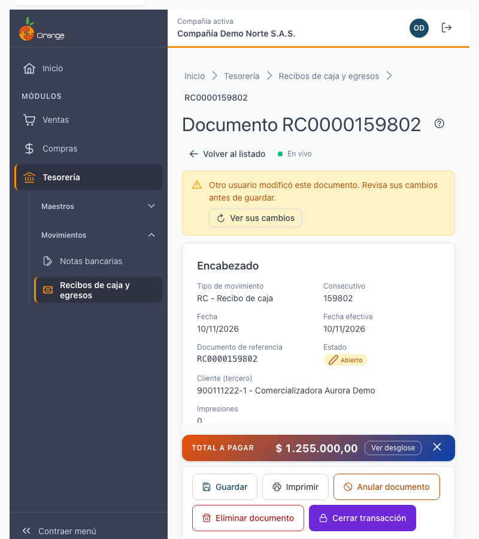

> ℹ️ Los cambios que usted hace en esta misma pestaña no generan avisos.

---

## ❔ Ayuda en pantalla

El botón **?** abre este manual en un panel a la derecha. Puede dejarlo abierto mientras trabaja en el listado o en el recibo.

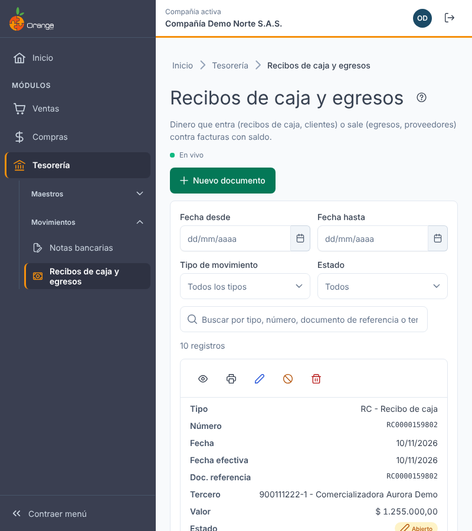

En un celular, la ayuda ocupa toda la pantalla y se cierra con la **✕**.

---

## ❓ Preguntas frecuentes

**¿Puedo eliminar un recibo?**
Sí, si su perfil tiene el permiso **Eliminar**, el documento no está anulado, no tiene dependientes y su periodo está abierto. Eliminar borra el documento por completo y no se puede deshacer. Si solo quiere corregirlo, anúlelo con un motivo: queda en el listado como **Anulado**, con su historia. Vea [Eliminar un documento](#-eliminar-un-documento).

**¿Por qué no veo Eliminar documento?**
Porque el documento está anulado, tiene dependientes, su periodo está cerrado o su perfil no tiene el permiso **Eliminar**.

**¿Por qué no puedo editar un recibo cerrado?**
Porque para editarlo necesita el permiso **Actualizar**, la marca **Editar documentos cerrados** y que el periodo esté abierto. Vea [Editar un recibo cerrado](#-editar-un-recibo-cerrado).

**¿Qué diferencia hay entre abierto y cerrado?**
El recibo abierto se puede editar y todavía no registró sus asientos contables. El recibo cerrado ya los registró y no se edita.

**¿Por qué no aparece el botón Cerrar transacción?**
Porque el recibo debe estar guardado, sin cambios pendientes, y su perfil necesita el permiso **Actualizar**. Guarde primero el recibo.

**¿Por qué no aparece Seleccionar facturas?**
Porque falta el **Cliente** (o el **Proveedor**, en un egreso) o la **Fecha**. Elíjalos primero. Lo mismo pasa con **Distribuir**.

**¿Por qué el total sale negativo?**
Porque el cliente tiene saldo a favor y sus valores se restan del total. Los pagos se registran por el valor absoluto.

**¿Por qué no veo Nuevo documento, Imprimir o Anular?**
Su perfil no tiene ese permiso sobre la opción Recibos de caja y egresos. Consulte con el administrador de OrangeERP.

**¿Por qué no encuentro un recibo que sí existe?**
Revise que esté en la compañía correcta (título de la pestaña), que los filtros de fecha, tipo y estado no lo oculten, y borre el texto del buscador.

**¿Qué pasa si el número del recibo ya está usado?**
Si el tipo permite escribir el consecutivo, déjelo vacío para que se use el siguiente libre, o elija otro número.

**No veo "En vivo".**
La conexión en vivo no está disponible en este momento (por ejemplo, por la red de su empresa). La pantalla funciona igual; para ver cambios de otros usuarios, recargue la página.
