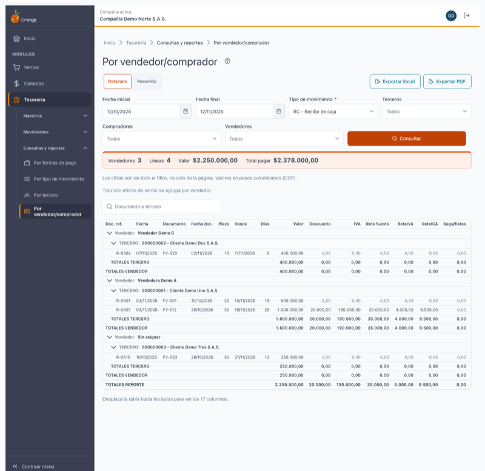
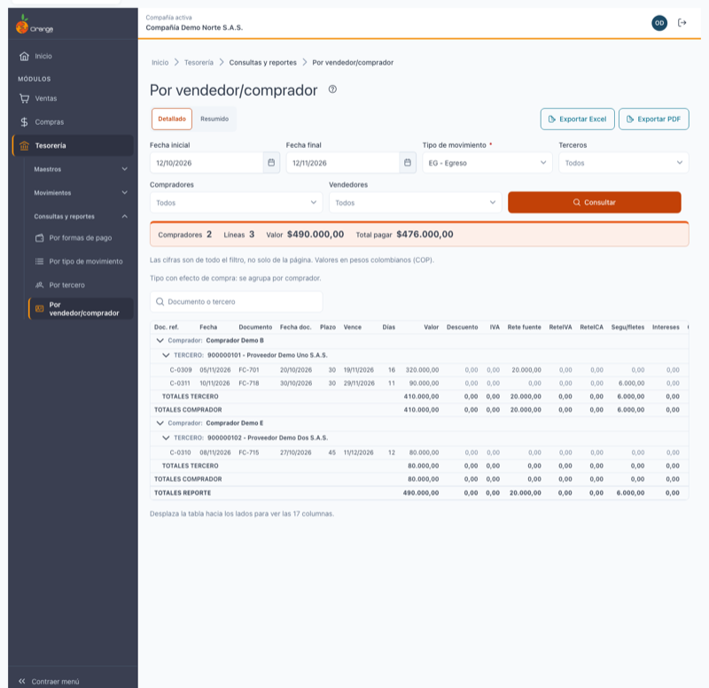
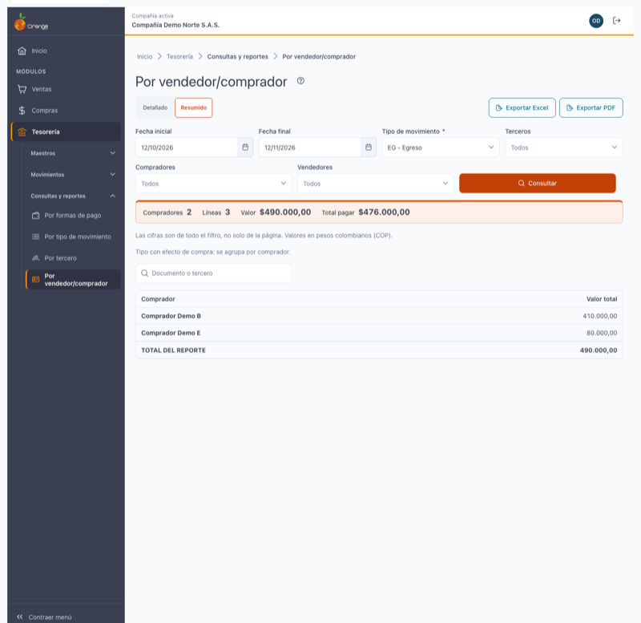
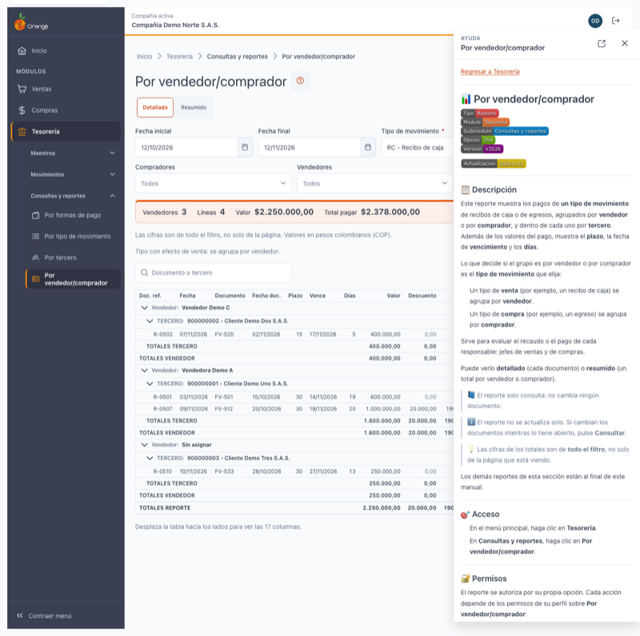

[Regresar a Tesorería](../readme.md)

---

# 📊 Por vendedor/comprador

---

## 📋 Descripción

Este reporte muestra los pagos de **un tipo de movimiento** de recibos de caja o de egresos, agrupados por **vendedor** o por **comprador**, y dentro de cada uno por **tercero**. Además de los valores del pago, muestra el **plazo**, la fecha de **vencimiento** y los **días**.

Lo que decide si el grupo es por vendedor o por comprador es el **tipo de movimiento** que elija:

- Un tipo de **venta** (por ejemplo, un recibo de caja) se agrupa por **vendedor**.
- Un tipo de **compra** (por ejemplo, un egreso) se agrupa por **comprador**.

Sirve para evaluar el recaudo o el pago de cada responsable: jefes de ventas y de compras.

Puede verlo **detallado** (cada documento) o **resumido** (un total por vendedor o comprador).

> 📘 El reporte solo consulta: no cambia ningún documento.

> ℹ️ El reporte no se actualiza solo. Si cambian los documentos mientras lo tiene abierto, pulse **Consultar**.

> 💡 Las cifras de los totales son de **todo el filtro**, no solo de la página que está viendo.

Los demás reportes de esta sección están al final de este manual.

---

## 🎯 Acceso

1. En el menú principal, haga clic en **Tesorería**.
2. En **Consultas y reportes**, haga clic en **Por vendedor/comprador**.

---

## 🔐 Permisos

El reporte se autoriza por su propia opción. Cada acción depende de los permisos de su perfil sobre **Por vendedor/comprador**:

| Permiso | Qué habilita |
|---------|--------------|
| Consultar | Abrir el reporte, consultarlo, ver los totales y buscar dentro del resultado. |
| Exportar | Los botones **Exportar Excel** y **Exportar PDF**. |

> ℹ️ Tener acceso a este reporte no da acceso a **Por formas de pago**, **Por tipo de movimiento** ni **Por tercero**. Cada uno tiene su propio permiso.

> ℹ️ Si su perfil no tiene **Consultar**, la pantalla le muestra *No tienes acceso a este reporte* y no hace ninguna consulta. Si no ve los botones de exportar, su perfil no tiene **Exportar**. Consulte con su administrador.

---

## 🖥️ Pantalla principal

| Elemento | Para qué sirve |
|----------|----------------|
| **?** (junto al título) | Abre esta ayuda en un panel lateral, sin salir de la pantalla. |
| **Detallado / Resumido** | Cambia la vista. El reporte se vuelve a leer con los filtros que ya tiene. |
| **Exportar Excel** y **Exportar PDF** | Descargan el resultado con los mismos filtros. Ver [Exportar a Excel y a PDF](#-exportar-a-excel-y-a-pdf). |
| **Tipo de movimiento** | El tipo que se consulta. Es obligatorio y define si el grupo es por vendedor o por comprador. |
| **Consultar** | Ejecuta el reporte. Cambiar un filtro no lo ejecuta hasta que pulse **Consultar**. |
| **Franja de resumen** | Vendedores (o compradores), líneas, valor y total a pagar, del filtro completo. |
| **Buscar en el reporte** | Filtra las líneas por documento o tercero. Ver [Buscar en el reporte](#-buscar-en-el-reporte). |

---

## 🔎 Filtros

| Filtro | Qué hace |
|--------|----------|
| **Fecha inicial** y **Fecha final** | Rango del reporte. Las dos son obligatorias. |
| **Tipo de movimiento** | **Obligatorio y de una sola elección.** Solo aparecen los tipos de recibos y egresos que su perfil tiene autorizados. |
| **Terceros** | Solo los documentos de esos terceros. Vacío = todos. |
| **Compradores** | Solo los documentos de esos compradores. Vacío = todos. |
| **Vendedores** | Solo los documentos de esos vendedores. Vacío = todos. |

En cada filtro de selección puede elegir hasta **50** elementos.

> 💡 Use el filtro que corresponde al tipo elegido: con un tipo de venta, **Vendedores**; con un tipo de compra, **Compradores**.

> ⚠️ Si no elige un tipo de movimiento, verá *Elige un tipo de movimiento para consultar.* y el reporte no se consulta.

### 📅 Fechas

- Al entrar, el reporte propone **desde el mismo día del mes anterior hasta hoy**.
- El rango no puede superar **366 días**. Si lo supera, verá: *El rango no puede superar 366 días.* El reporte no se consulta y sus demás filtros se conservan.
- La fecha inicial no puede ser posterior a la final. Si lo es, verá: *La fecha inicial no puede ser posterior a la final.*

---

## 📑 Vistas

### Detallada

Agrupa por **vendedor** (tipo de venta) o por **comprador** (tipo de compra) y, bajo cada uno, por **tercero**. Las líneas de cada tercero muestran:

| Columna | Qué muestra |
|---------|-------------|
| **Doc. ref.** | El documento de referencia del recibo o del egreso. |
| **Fecha** | La fecha del recibo o del egreso. |
| **Documento** | El documento afectado (por ejemplo, la factura que se cruza). |
| **Fecha doc.** | La fecha del documento afectado. |
| **Plazo** | El plazo del documento. |
| **Vence** | La fecha de vencimiento. |
| **Días** | Los días que el sistema calcula para la línea. |
| **Valor**, **Descuento**, **IVA**, **Rete fuente**, **ReteIVA**, **ReteICA**, **Segu/fletes**, **Intereses** y **Otros valores** | Cada concepto del pago. |
| **Total pagar** | Lo que se paga en esa línea, después de descuentos y retenciones, más IVA, seguros, intereses y otros valores. |

En pantalla **no aparece la columna Tercero**, porque el encabezado de cada tercero ya lo muestra. Excel y PDF sí la incluyen.

Debajo de cada tercero aparecen sus **TOTALES TERCERO**. Después de cada vendedor o comprador aparece su total (**TOTALES VENDEDOR** o **TOTALES COMPRADOR**). Al final de la tabla está el **TOTALES REPORTE**.

Los documentos sin vendedor o sin comprador aparecen en el grupo **Sin asignar**, al final de la tabla. Se suman en los totales del reporte.

La tabla es ancha. Si no ve todas las columnas, **desplácela hacia los lados**. La pantalla lo indica debajo de la tabla.

### Resumida

Muestra una fila por vendedor (o comprador), con su **Valor total**, y al final el **TOTAL DEL REPORTE**.

---

## 🧮 Totales

- Los totales son del **filtro completo**, no de la página.
- Cada columna suma **su propio valor**. ReteIVA suma solo ReteIVA y ReteICA suma solo ReteICA.
- Un valor negativo aparece con **−** y en rojo.
- Los valores están en pesos colombianos (COP).

---

## 📄 Ver más pagos

Cuando un tercero tiene muchas líneas, la tabla muestra una parte y la leyenda *Mostrando N de T pagos de este grupo.*

Pulse **Ver más pagos** para cargar las siguientes. Los totales no cambian.

Si no se pueden cargar las líneas de un grupo, verá *No se pudieron cargar los pagos de este grupo.* con el botón **Reintentar**. Los demás grupos, los filtros y el resumen se conservan.

---

## 🔍 Buscar en el reporte

Escriba al menos **2 caracteres** en **Buscar en el reporte** (*Documento o tercero*). La búsqueda espera un momento después de escribir.

Los totales siguen siendo los del filtro completo, aunque la búsqueda muestre menos líneas. Si ninguna línea coincide, verá *Sin resultados para la búsqueda*. Borre la búsqueda para ver todo el reporte.

---

## 📤 Exportar a Excel y a PDF

Los botones **Exportar Excel** y **Exportar PDF** necesitan el permiso **Exportar** de este reporte. Están deshabilitados mientras no hay un resultado cargado.

- El archivo sale con los **mismos filtros**, la misma vista y la misma búsqueda que tiene en pantalla.
- Las cifras del archivo son las mismas de la pantalla.
- **Excel**: hasta **50.000** filas. Incluye las **18 columnas**, con la columna Tercero.
- **PDF**: hasta **4.000** filas, en hoja carta horizontal. Lleva **17 columnas**: las de pantalla con la columna Tercero y sin la fecha del recibo, como en el sistema anterior.
- El PDF incluye el nombre de la compañía, el NIT, los filtros usados, el usuario y la fecha y hora de generación.
- Las cifras del PDF se redondean según la configuración de cada tipo de movimiento, por lo que pueden no mostrar centavos.

Si el reporte supera el máximo, OrangeERP no genera el archivo: filtre más o exporte a Excel.

| Aviso | Qué significa |
|-------|---------------|
| *Generando el archivo…* | El archivo se está preparando. Espere. |
| *Archivo generado: …* | El archivo está listo y se descargó. |
| *El reporte supera el máximo de 4.000 filas para PDF…* | Filtre más o exporte a Excel. |
| *No se pudo generar el archivo. Inténtelo de nuevo.* | Vuelva a intentarlo. Si sigue igual, consulte con su administrador. |

---

## 📊 Estados de la pantalla

| Estado | Qué verá |
|--------|----------|
| **Inicial** | *Elija los filtros y pulse Consultar.* Los botones de exportar están deshabilitados. |
| **Tipo obligatorio** | *Elige un tipo de movimiento para consultar.* No se hace ninguna consulta. |
| **Cargando** | *Consultando…* |
| **Sin movimientos** | *Sin movimientos en el rango.* Pruebe con otro rango o quite un filtro. |
| **Error** | *No se pudo cargar el reporte.* Sus filtros se conservan. Pulse **Reintentar**. |
| **Sin permiso** | *No tienes acceso a este reporte.* No se hace ninguna consulta. |

---

## 🔁 Diferencias con el sistema anterior

- **Resumido por comprador**: cada comprador aparece como *documento - nombre*. En el sistema anterior, el documento se repetía en lugar del nombre.
- **ReteIVA y ReteICA**: en los totales de cada grupo y del reporte, cada columna suma su propio valor. En el sistema anterior estos totales aparecían cruzados.
- **Documentos anulados**: no aparecen en el detalle.
- **Columna Tercero**: no aparece en pantalla, porque el encabezado de cada tercero ya lo muestra. Excel y PDF la conservan.
- **Sin asignar**: los documentos sin vendedor o comprador tienen su propio grupo, al final, y se suman en el total.
- **Rango máximo de 366 días**: el sistema anterior no tenía límite.
- **Exportar**: los archivos respetan los filtros de la pantalla y exigen el permiso **Exportar**. Antes, el archivo podía mostrar el último resultado consultado, aunque fuera de otra consulta.
- **Anticipos sin aplicar**: no aparecen en este reporte, como antes.

---

## ❓ Preguntas frecuentes

**¿Por qué el grupo dice Vendedor y en otro caso dice Comprador?**
Lo decide el tipo de movimiento que elige. Un tipo de venta agrupa por vendedor y uno de compra, por comprador.

**¿Qué significa Sin asignar?**
Son documentos que no tienen vendedor (o comprador, según el tipo). Aparecen en su propio grupo, al final, y cuentan en el total.

**¿Por qué no veo la columna Tercero?**
Porque en pantalla el nombre del tercero ya aparece en el encabezado de cada grupo. Está en el Excel y en el PDF.

**¿Por qué no veo todas las columnas?**
La tabla es ancha. Desplácela hacia los lados.

**¿Por qué no aparece un recibo anulado?**
Porque los documentos anulados no aparecen en el detalle de este reporte.

**¿El reporte se actualiza solo si otra persona registra un recibo?**
No. Pulse **Consultar** para ver los cambios.

**¿Por qué no veo Exportar Excel ni Exportar PDF?**
Su perfil no tiene el permiso **Exportar** sobre este reporte. Consulte con su administrador.

---

## 🔗 Otros reportes de Tesorería

- [Por formas de pago](formas-pago.md)
- [Por tipo de movimiento](tipo-movimiento.md)
- [Por tercero](tercero.md)
- [Recibos de caja y egresos](../movimientos/recibos-egresos.md): donde se registran los pagos que aparecen en estos reportes.
