[Regresar a Tesorería](../readme.md)

---

# 📊 Por formas de pago

---

## 📋 Descripción

Este reporte muestra el dinero que **entró** por los recibos de caja y el que **salió** por los egresos, agrupado por **forma de pago** (efectivo, transferencia, etc.) y por **tipo de movimiento**. Sirve para cuadrar cuánto se recibió y cuánto se pagó por cada medio de pago.

Puede verlo **detallado** (cada pago) o **resumido** (un total por forma de pago).

> 📘 El reporte solo consulta: no cambia ningún documento.

> ℹ️ El reporte no se actualiza solo. Si cambian los recibos o los egresos mientras lo tiene abierto, pulse **Consultar**.

> 💡 Las cifras de los totales son de **todo el filtro**, no solo de la página que está viendo.

Los demás reportes de esta sección están al final de este manual.

---

## 🎯 Acceso

1. En el menú principal, haga clic en **Tesorería**.
2. En **Consultas y reportes**, haga clic en **Por formas de pago**.

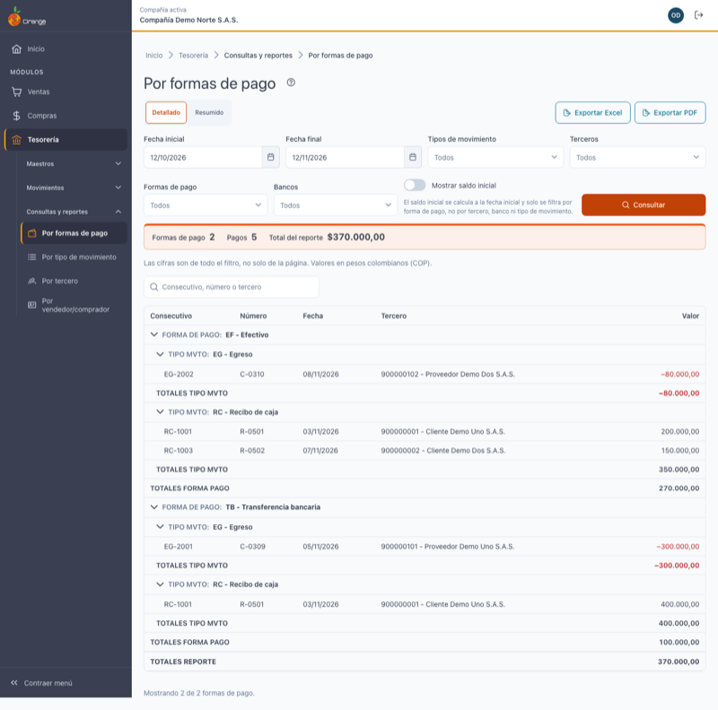

---

## 🔐 Permisos

El reporte se autoriza por su propia opción. Cada acción depende de los permisos de su perfil sobre **Por formas de pago**:

| Permiso | Qué habilita |
|---------|--------------|
| Consultar | Abrir el reporte, consultarlo, ver los totales y buscar dentro del resultado. |
| Exportar | Los botones **Exportar Excel** y **Exportar PDF**. |

> ℹ️ Si su perfil no tiene **Consultar**, la pantalla le muestra *No tienes acceso a este reporte* y no hace ninguna consulta. Pida a su administrador el permiso que necesite.

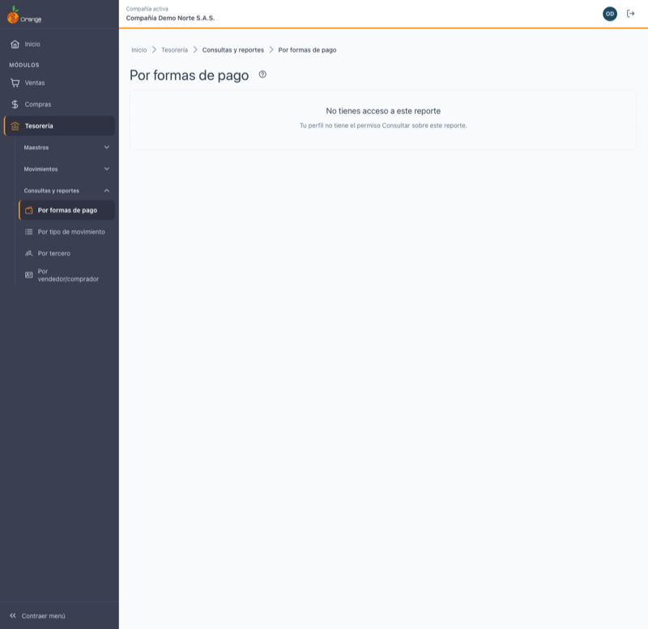

> ℹ️ Si ve el reporte pero no los botones de exportar, su perfil no tiene **Exportar**. Consulte con su administrador.

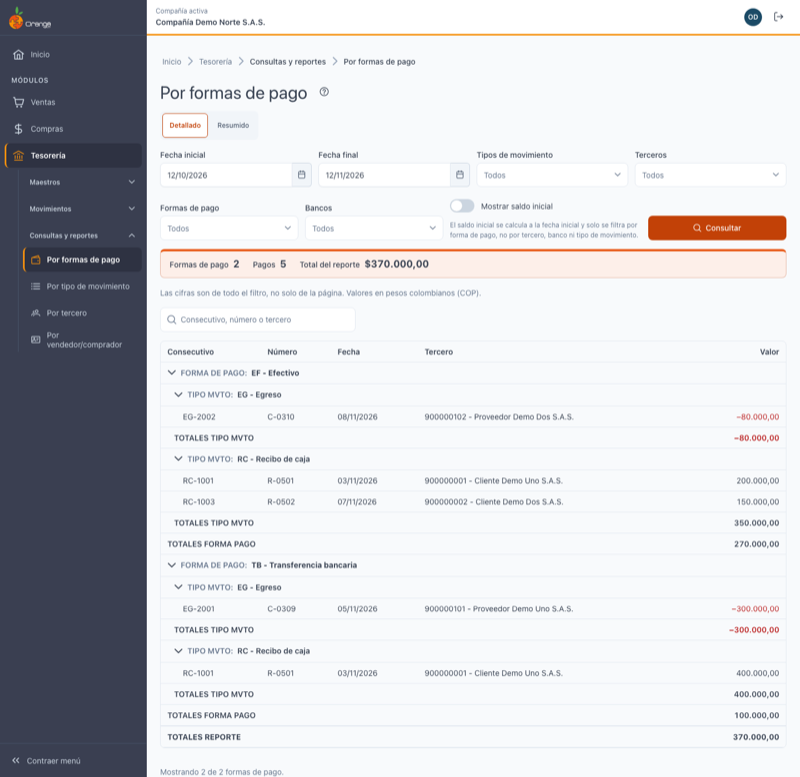

---

## 🖥️ Pantalla principal

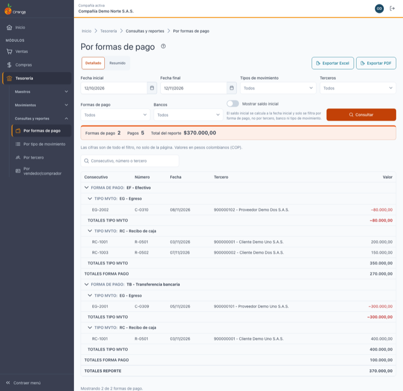

| Elemento | Para qué sirve |
|----------|----------------|
| **?** (junto al título) | Abre esta ayuda en un panel lateral, sin salir de la pantalla. |
| **Detallado / Resumido** | Cambia la vista. El reporte se vuelve a leer con los filtros que ya tiene. |
| **Exportar Excel** y **Exportar PDF** | Descargan el resultado con los mismos filtros. Ver [Exportar a Excel y a PDF](#-exportar-a-excel-y-a-pdf). |
| **Filtros** | Fechas, tipos de movimiento, terceros, formas de pago y bancos. Ver [Filtros](#-filtros). |
| **Mostrar saldo inicial** | Agrega el saldo de cada forma de pago al inicio del rango. Ver [Saldo inicial](#-saldo-inicial). |
| **Consultar** | Ejecuta el reporte. Cambiar un filtro no lo ejecuta hasta que pulse **Consultar**. |
| **Franja de resumen** | Formas de pago, pagos y total del reporte, del filtro completo. |
| **Buscar en el reporte** | Filtra las líneas por consecutivo, número o tercero. Ver [Buscar en el reporte](#-buscar-en-el-reporte). |

---

## 🔎 Filtros

| Filtro | Qué hace |
|--------|----------|
| **Fecha inicial** y **Fecha final** | Rango del reporte. Las dos son obligatorias. |
| **Tipos de movimiento** | Solo aparecen los tipos de recibos y egresos que su perfil tiene autorizados. Vacío = todos. |
| **Terceros** | Solo los documentos de esos terceros. Vacío = todos. |
| **Formas de pago** | Solo esas formas de pago. Vacío = todas. |
| **Bancos** | Solo los pagos de esos bancos. El banco es un filtro: no aparece como columna en el reporte. |
| **Mostrar saldo inicial** | Interruptor. Ver [Saldo inicial](#-saldo-inicial). |

En cada filtro de selección puede elegir hasta **50** elementos.

### 📅 Fechas

- Al entrar, el reporte propone **desde el mismo día del mes anterior hasta hoy**. Por ejemplo, si hoy es 12/11/2026, propone del 12/10/2026 al 12/11/2026.
- El rango no puede superar **366 días**. Si lo supera, verá: *El rango no puede superar 366 días.* El reporte no se consulta y sus demás filtros se conservan.
- La fecha inicial no puede ser posterior a la final. Si lo es, verá: *La fecha inicial no puede ser posterior a la final.*

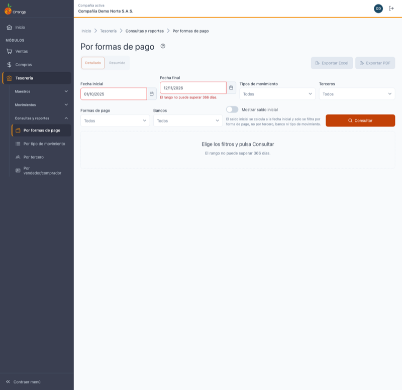

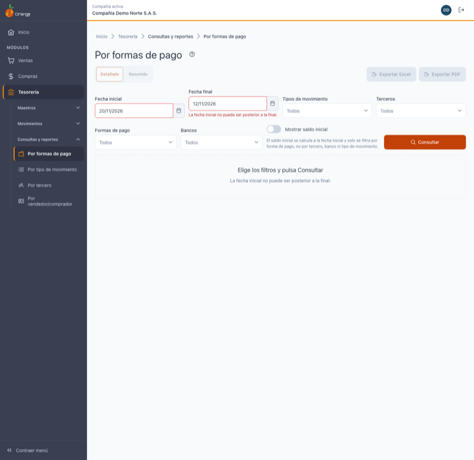

---

## 📑 Vistas

### Detallada

Agrupa en este orden: **forma de pago**, luego **tipo de movimiento** y, bajo cada tipo, las líneas de los pagos.

| Columna | Qué muestra |
|---------|-------------|
| **Consecutivo** | El número del recibo o del egreso. |
| **Número** | El documento de referencia del pago. |
| **Fecha** | La fecha del recibo o del egreso. |
| **Tercero** | El documento y el nombre del tercero, como *documento - nombre*. |
| **Valor** | El valor del pago. Los egresos aparecen con signo **−** y en rojo. |

Debajo de cada grupo aparecen sus totales:

- **TOTALES TIPO MVTO**: el total de un tipo de movimiento dentro de la forma de pago.
- **TOTALES FORMA PAGO**: el total de la forma de pago, con su saldo inicial si lo mostró.
- **TOTALES REPORTE**: el total de todo el reporte, al final de la tabla.

### Resumida

Muestra una fila por forma de pago, con su total, y al final el **TOTAL DEL REPORTE**. El total de cada forma coincide con su **TOTALES FORMA PAGO** de la vista detallada.

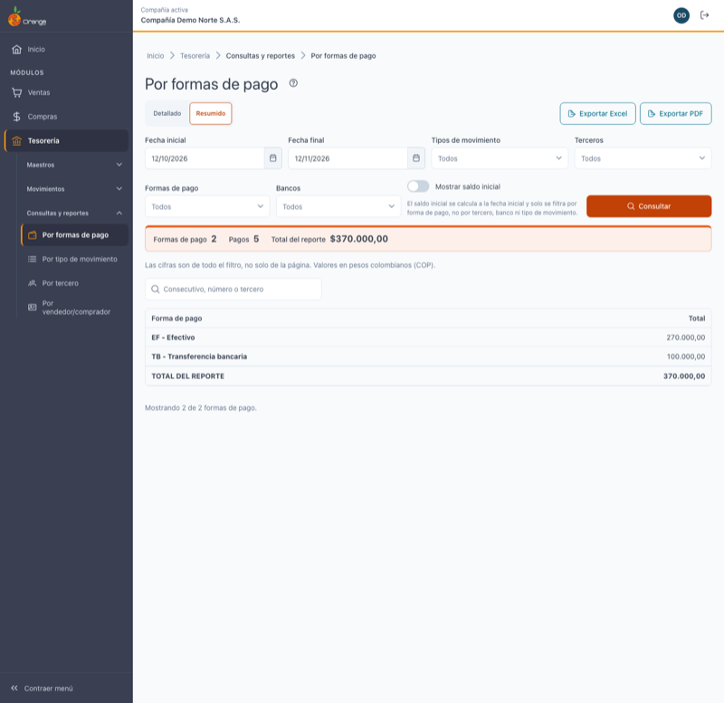

---

## 🧾 Saldo inicial

El interruptor **Mostrar saldo inicial** viene **apagado**.

Al encenderlo:

- Aparece la fila **SALDO INICIAL** en cada forma de pago, a la fecha inicial del rango.
- El saldo se suma al **TOTALES FORMA PAGO** y al total del reporte. En la vista resumida, se suma al total de la forma.
- Una forma de pago con saldo inicial aparece aunque no tenga movimientos en el rango. Su total se cuenta en el reporte.

> ⚠️ El saldo inicial **solo se filtra por forma de pago**. No cambia con el tercero, el banco ni el tipo de movimiento que elija. Por eso el texto junto al interruptor lo dice.

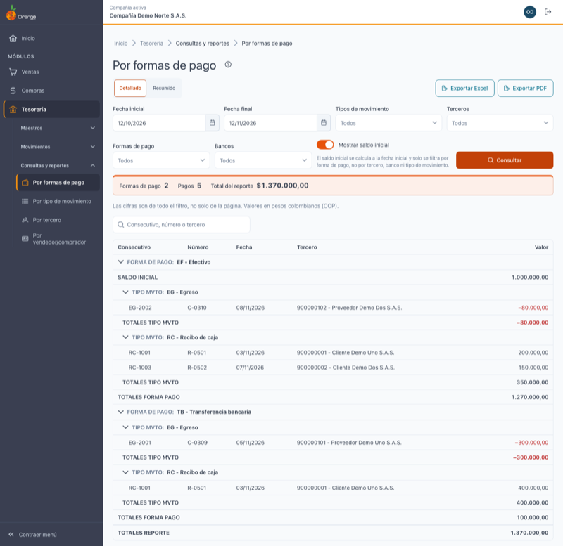

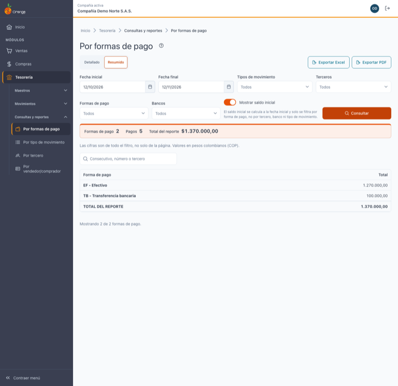

---

## 🧮 Totales

- Los totales son del **filtro completo**: el total de la franja de resumen y de cada grupo cuadra con el archivo que exporte.
- Un valor negativo aparece con **−** y en rojo. Es lo que sale de la compañía (egresos).
- Los valores están en pesos colombianos (COP).

---

## 📄 Ver más pagos

Cuando un grupo tiene muchos pagos, la tabla muestra una parte y la leyenda *Mostrando N de T pagos de este grupo.*

Pulse **Ver más pagos** para cargar los siguientes. Los totales del grupo no cambian.

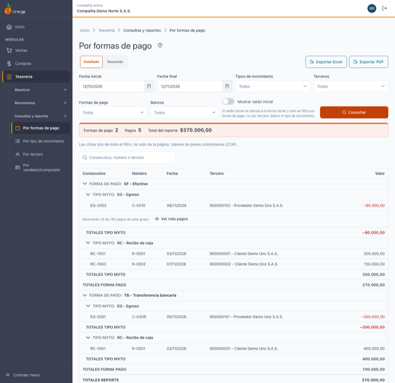

Si no se pueden cargar los pagos de un grupo, verá *No se pudieron cargar los pagos de este grupo.* con el botón **Reintentar**. Los demás grupos, los filtros y el resumen se conservan.

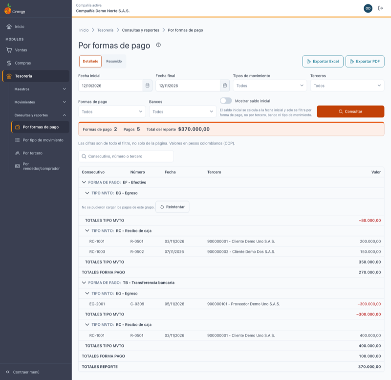

Si hay más formas de pago de las que caben en una página, aparece la paginación de grupos.

---

## 🔍 Buscar en el reporte

Escriba al menos **2 caracteres** en **Buscar en el reporte** para filtrar las líneas por consecutivo, número o tercero. La búsqueda espera un momento después de escribir.

Los totales siguen siendo los del filtro completo, aunque la búsqueda muestre menos líneas.

Si ninguna línea coincide, verá *Sin resultados para la búsqueda* y el texto de la búsqueda. Borre la búsqueda para ver todo el reporte.

---

## 📤 Exportar a Excel y a PDF

Los botones **Exportar Excel** y **Exportar PDF** necesitan el permiso **Exportar** de este reporte. Están deshabilitados mientras no hay un resultado cargado.

- El archivo sale con los **mismos filtros**, la misma vista y la misma búsqueda que tiene en pantalla.
- Las cifras del archivo son las mismas de la pantalla.
- **Excel**: hasta **50.000** filas.
- **PDF**: hasta **4.000** filas, en hoja carta horizontal, con el nombre de la compañía, el NIT, los filtros usados, el usuario y la fecha y hora de generación.
- Las cifras del PDF se redondean según la configuración de cada tipo de movimiento, por lo que pueden no mostrar centavos.

Si el reporte supera el máximo, OrangeERP no genera el archivo y le indica qué hacer: filtre más o exporte a Excel.

| Aviso | Qué significa |
|-------|---------------|
| *Generando el archivo…* | El archivo se está preparando. Espere. |
| *Archivo generado: …* | El archivo está listo y se descargó. |
| *El reporte supera el máximo de 4.000 filas para PDF…* | Filtre más o exporte a Excel. |
| *No se pudo generar el archivo. Inténtelo de nuevo.* | Vuelva a intentarlo. Si sigue igual, consulte con su administrador. |

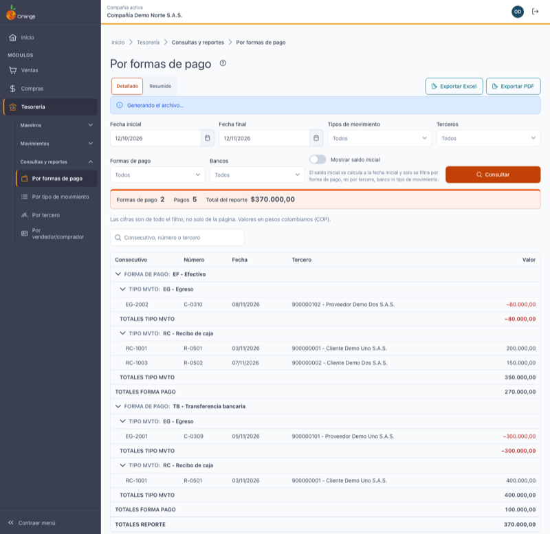

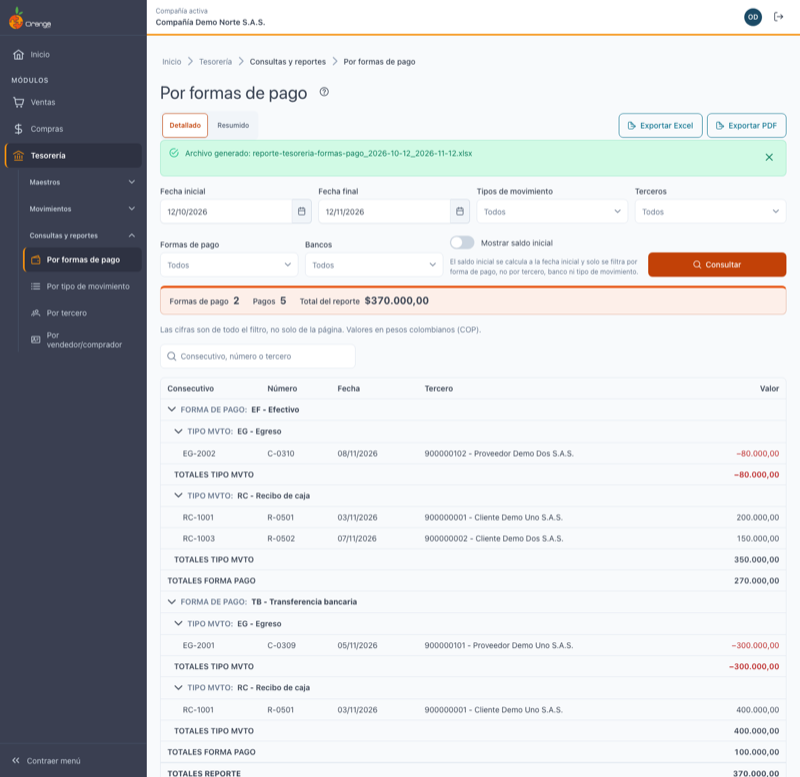

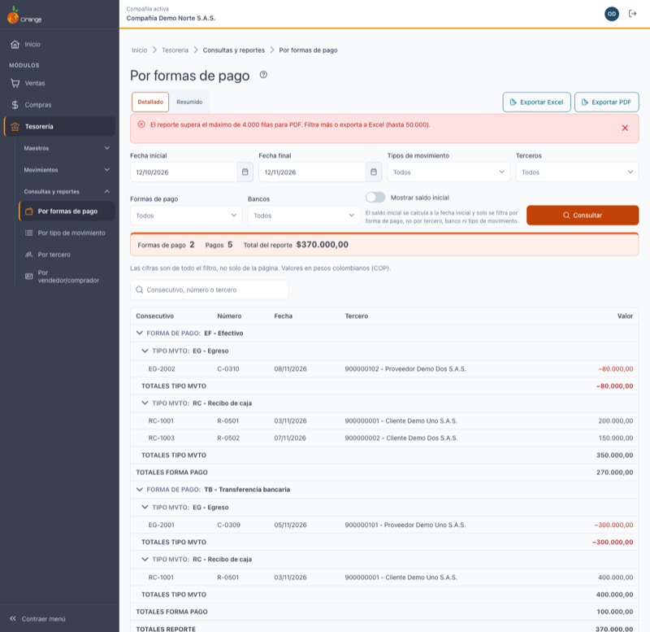

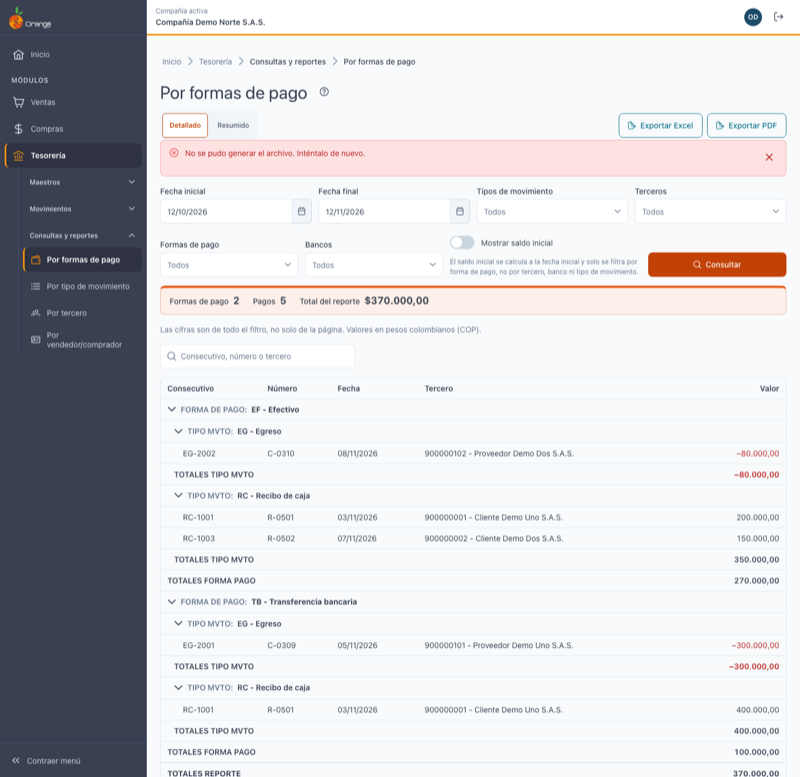

---

## 📊 Estados de la pantalla

| Estado | Qué verá |
|--------|----------|
| **Inicial** | *Elija los filtros y pulse Consultar.* Los botones de exportar están deshabilitados. |
| **Cargando** | *Consultando…* |
| **Sin movimientos** | *Sin movimientos en el rango.* Pruebe con otro rango o quite un filtro. |
| **Error** | *No se pudo cargar el reporte.* Sus filtros se conservan. Pulse **Reintentar**. |
| **Sin permiso** | *No tienes acceso a este reporte.* No se hace ninguna consulta. |

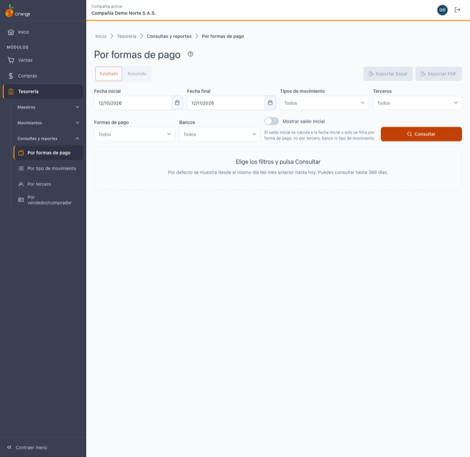

---

## 🔁 Diferencias con el sistema anterior

- **Forma de pago y tipo que cambian a la vez**: cada forma de pago muestra su encabezado, su saldo inicial y su **TOTALES FORMA PAGO**. En el sistema anterior, en ese caso una forma quedaba sin su total.
- **Saldo inicial sin movimientos**: una forma de pago con saldo inicial aparece aunque no tenga movimientos en el rango, y su total se cuenta. Antes se ocultaba y su total no la contaba.
- **Anticipos sin aplicar**: siguen incluidos, como antes.
- **Rango máximo de 366 días**: el sistema anterior no tenía límite.
- **Exportar**: los archivos respetan los filtros de la pantalla y exigen el permiso **Exportar**. Antes, el archivo podía mostrar el último resultado consultado, aunque fuera de otra consulta.

---

## ❓ Preguntas frecuentes

**¿Por qué una forma de pago no aparece?**
Porque no tiene movimientos en el rango. Si necesita verla con su saldo inicial, active **Mostrar saldo inicial**.

**¿Por qué el saldo inicial no cambia cuando filtro por tercero?**
Porque el saldo inicial solo se filtra por forma de pago. Así está definido en el reporte.

**¿Por qué el total no coincide con la suma de lo que veo?**
Porque la búsqueda o la página pueden ocultar líneas. Los totales siempre son del filtro completo.

**¿Por qué no veo Exportar Excel ni Exportar PDF?**
Su perfil no tiene el permiso **Exportar** sobre este reporte. Consulte con su administrador.

**¿Por qué algunos valores aparecen en rojo con signo −?**
Son egresos: dinero que salió de la compañía.

**¿Por qué el PDF no tiene centavos?**
Porque el redondeo del tipo de movimiento se aplica en el PDF. Vea la sección [Exportar a Excel y a PDF](#-exportar-a-excel-y-a-pdf).

**¿El reporte se actualiza solo si otra persona registra un recibo?**
No. Pulse **Consultar** para ver los cambios.

**¿Para qué sirve el botón ?**
Abre esta ayuda en un panel lateral, sin salir del reporte.

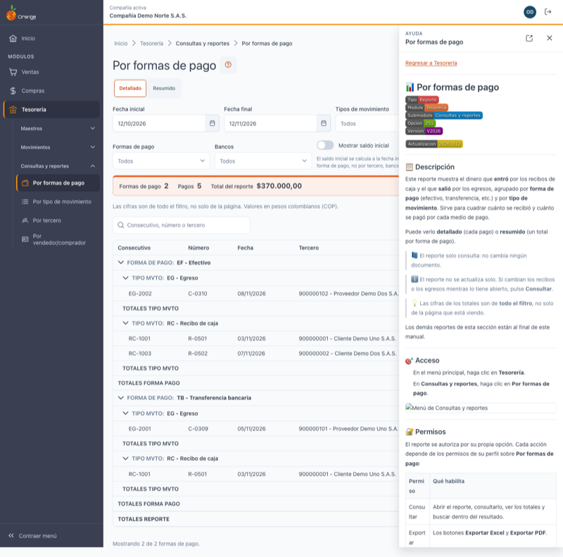

---

## 🔗 Otros reportes de Tesorería

- [Por tipo de movimiento](tipo-movimiento.md)
- [Por tercero](tercero.md)
- [Por vendedor/comprador](comprador-vendedor.md)
- [Recibos de caja y egresos](../movimientos/recibos-egresos.md): donde se registran los pagos que aparecen en estos reportes.
