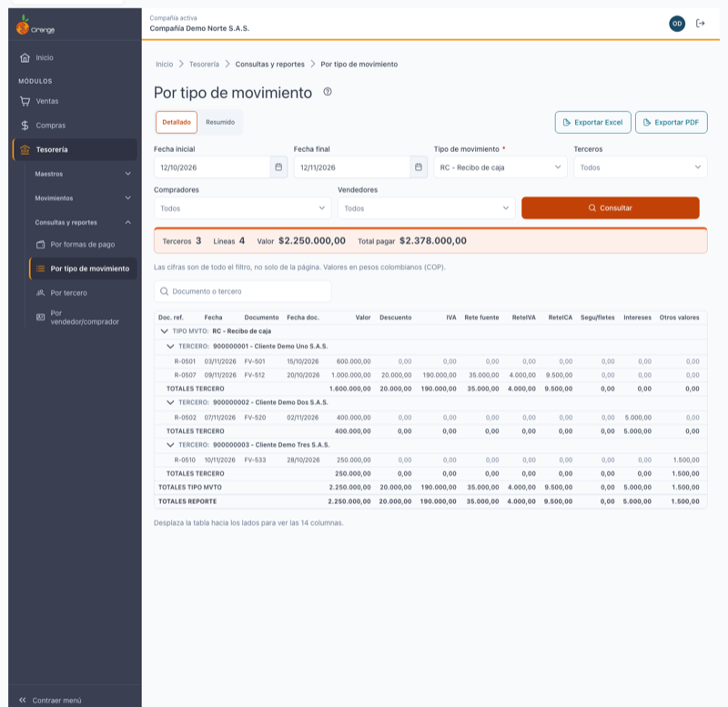
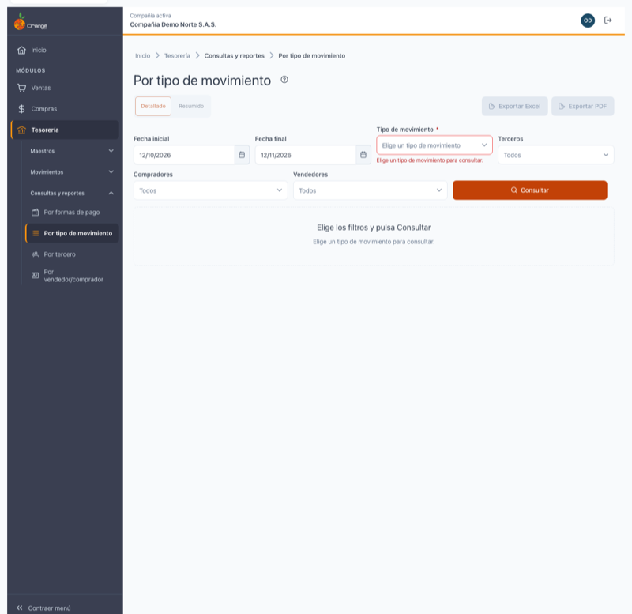
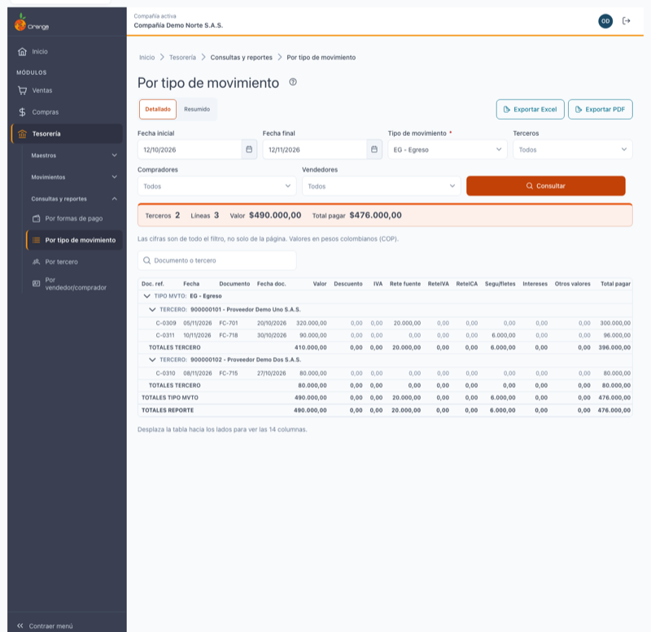
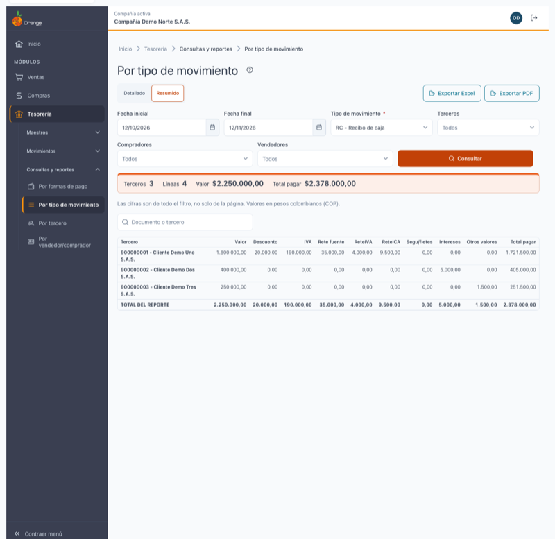
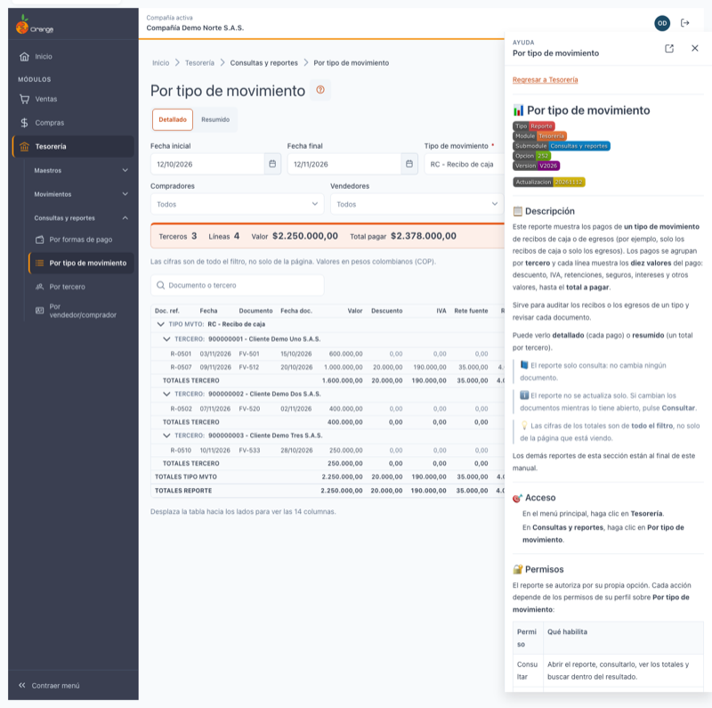

[Regresar a Tesorería](../readme.md)

---

# 📊 Por tipo de movimiento

---

## 📋 Descripción

Este reporte muestra los pagos de **un tipo de movimiento** de recibos de caja o de egresos (por ejemplo, solo los recibos de caja o solo los egresos). Los pagos se agrupan por **tercero** y cada línea muestra los **diez valores** del pago: descuento, IVA, retenciones, seguros, intereses y otros valores, hasta el **total a pagar**.

Sirve para auditar los recibos o los egresos de un tipo y revisar cada documento.

Puede verlo **detallado** (cada pago) o **resumido** (un total por tercero).

> 📘 El reporte solo consulta: no cambia ningún documento.

> ℹ️ El reporte no se actualiza solo. Si cambian los documentos mientras lo tiene abierto, pulse **Consultar**.

> 💡 Las cifras de los totales son de **todo el filtro**, no solo de la página que está viendo.

Los demás reportes de esta sección están al final de este manual.

---

## 🎯 Acceso

1. En el menú principal, haga clic en **Tesorería**.
2. En **Consultas y reportes**, haga clic en **Por tipo de movimiento**.

---

## 🔐 Permisos

El reporte se autoriza por su propia opción. Cada acción depende de los permisos de su perfil sobre **Por tipo de movimiento**:

| Permiso | Qué habilita |
|---------|--------------|
| Consultar | Abrir el reporte, consultarlo, ver los totales y buscar dentro del resultado. |
| Exportar | Los botones **Exportar Excel** y **Exportar PDF**. |

> ℹ️ Tener acceso a este reporte no da acceso a **Por tercero** ni a **Por vendedor/comprador**. Cada uno tiene su propio permiso. Si solo tiene **Consultar** en este reporte, en el menú verá solo esta opción.

> ℹ️ Si su perfil no tiene **Consultar**, la pantalla le muestra *No tienes acceso a este reporte* y no hace ninguna consulta. Si no ve los botones de exportar, su perfil no tiene **Exportar**. Consulte con su administrador.

---

## 🖥️ Pantalla principal

| Elemento | Para qué sirve |
|----------|----------------|
| **?** (junto al título) | Abre esta ayuda en un panel lateral, sin salir de la pantalla. |
| **Detallado / Resumido** | Cambia la vista. El reporte se vuelve a leer con los filtros que ya tiene. |
| **Exportar Excel** y **Exportar PDF** | Descargan el resultado con los mismos filtros. Ver [Exportar a Excel y a PDF](#-exportar-a-excel-y-a-pdf). |
| **Tipo de movimiento** | El tipo que se consulta. Es obligatorio. Ver [Filtros](#-filtros). |
| **Consultar** | Ejecuta el reporte. Cambiar un filtro no lo ejecuta hasta que pulse **Consultar**. |
| **Franja de resumen** | Terceros, líneas, valor y total a pagar, del filtro completo. |
| **Buscar en el reporte** | Filtra las líneas por documento o tercero. Ver [Buscar en el reporte](#-buscar-en-el-reporte). |

---

## 🔎 Filtros

| Filtro | Qué hace |
|--------|----------|
| **Fecha inicial** y **Fecha final** | Rango del reporte. Las dos son obligatorias. |
| **Tipo de movimiento** | **Obligatorio y de una sola elección.** Solo aparecen los tipos de recibos y egresos que su perfil tiene autorizados. |
| **Terceros** | Solo los documentos de esos terceros. Vacío = todos. |
| **Compradores** | Solo los documentos de esos compradores. Vacío = todos. |
| **Vendedores** | Solo los documentos de esos vendedores. Vacío = todos. |

En cada filtro de selección puede elegir hasta **50** elementos.

> ⚠️ Si no elige un tipo de movimiento, verá *Elige un tipo de movimiento para consultar.* y el reporte no se consulta.

### 📅 Fechas

- Al entrar, el reporte propone **desde el mismo día del mes anterior hasta hoy**.
- El rango no puede superar **366 días**. Si lo supera, verá: *El rango no puede superar 366 días.* El reporte no se consulta y sus demás filtros se conservan.
- La fecha inicial no puede ser posterior a la final. Si lo es, verá: *La fecha inicial no puede ser posterior a la final.*

---

## 📑 Vistas

### Detallada

Agrupa en este orden: **tipo de movimiento**, luego **tercero** y, bajo cada tercero, las líneas de sus documentos.

En pantalla, cada línea muestra:

| Columna | Qué muestra |
|---------|-------------|
| **Doc. ref.** | El documento de referencia del recibo o del egreso. |
| **Fecha** | La fecha del recibo o del egreso. |
| **Documento** | El documento afectado (por ejemplo, la factura que se cruza). |
| **Fecha doc.** | La fecha del documento afectado. |
| **Valor** | El valor del documento. |
| **Descuento**, **IVA**, **Rete fuente**, **ReteIVA**, **ReteICA**, **Segu/fletes**, **Intereses** y **Otros valores** | Cada concepto del pago. |
| **Total pagar** | Lo que se paga en esa línea, después de descuentos y retenciones, más IVA, seguros, intereses y otros valores. |

En pantalla **no aparece la columna Tercero**, porque el encabezado de cada grupo ya lo muestra. Excel y PDF sí la incluyen.

Debajo de cada grupo aparecen sus totales:

- **TOTALES TERCERO**: el total de un tercero.
- **TOTALES TIPO MVTO**: el total del tipo de movimiento.
- **TOTALES REPORTE**: el total de todo el reporte, al final de la tabla.

La tabla es ancha. Si no ve todas las columnas, **desplácela hacia los lados**. La pantalla lo indica debajo de la tabla.

### Resumida

Muestra una fila por tercero, con sus diez valores y el **Total pagar**, y al final el **TOTAL DEL REPORTE**. El total de cada columna coincide con la vista detallada.

---

## 🧮 Totales

- Los totales son del **filtro completo**, no de la página.
- Cada columna suma **su propio valor**. ReteIVA suma solo ReteIVA y ReteICA suma solo ReteICA.
- Un valor negativo aparece con **−** y en rojo.
- Los valores están en pesos colombianos (COP).

---

## 📄 Ver más pagos

Cuando un tercero o un grupo tiene muchas líneas, la tabla muestra una parte y la leyenda *Mostrando N de T pagos de este grupo.*

Pulse **Ver más pagos** para cargar las siguientes. Los totales del grupo no cambian.

Si no se pueden cargar las líneas de un grupo, verá *No se pudieron cargar los pagos de este grupo.* con el botón **Reintentar**. Los demás grupos, los filtros y el resumen se conservan.

---

## 🔍 Buscar en el reporte

Escriba al menos **2 caracteres** en **Buscar en el reporte** (*Documento o tercero*). La búsqueda espera un momento después de escribir.

Los totales siguen siendo los del filtro completo, aunque la búsqueda muestre menos líneas. Si ninguna línea coincide, verá *Sin resultados para la búsqueda*. Borre la búsqueda para ver todo el reporte.

---

## 📤 Exportar a Excel y a PDF

Los botones **Exportar Excel** y **Exportar PDF** necesitan el permiso **Exportar** de este reporte. Están deshabilitados mientras no hay un resultado cargado.

- El archivo sale con los **mismos filtros**, la misma vista y la misma búsqueda que tiene en pantalla.
- Las cifras del archivo son las mismas de la pantalla.
- **Excel**: hasta **50.000** filas. Incluye las **15 columnas**, con la columna Tercero.
- **PDF**: hasta **4.000** filas, en hoja carta horizontal. Lleva **14 columnas**: las de pantalla con la columna Tercero y sin la fecha del recibo, como en el sistema anterior.
- El PDF incluye el nombre de la compañía, el NIT, los filtros usados, el usuario y la fecha y hora de generación.
- Las cifras del PDF se redondean según la configuración de cada tipo de movimiento, por lo que pueden no mostrar centavos.

Si el reporte supera el máximo, OrangeERP no genera el archivo: filtre más o exporte a Excel.

| Aviso | Qué significa |
|-------|---------------|
| *Generando el archivo…* | El archivo se está preparando. Espere. |
| *Archivo generado: …* | El archivo está listo y se descargó. |
| *El reporte supera el máximo de 4.000 filas para PDF…* | Filtre más o exporte a Excel. |
| *No se pudo generar el archivo. Inténtelo de nuevo.* | Vuelva a intentarlo. Si sigue igual, consulte con su administrador. |

---

## 📊 Estados de la pantalla

| Estado | Qué verá |
|--------|----------|
| **Inicial** | *Elija los filtros y pulse Consultar.* Los botones de exportar están deshabilitados. |
| **Tipo obligatorio** | *Elige un tipo de movimiento para consultar.* No se hace ninguna consulta. |
| **Cargando** | *Consultando…* |
| **Sin movimientos** | *Sin movimientos en el rango.* Pruebe con otro rango o quite un filtro. |
| **Error** | *No se pudo cargar el reporte.* Sus filtros se conservan. Pulse **Reintentar**. |
| **Sin permiso** | *No tienes acceso a este reporte.* No se hace ninguna consulta. |

---

## 🔁 Diferencias con el sistema anterior

- **Resumido**: ahora existe en este reporte. En el sistema anterior, la opción *Resumido* mostraba una tabla vacía.
- **ReteIVA y ReteICA**: en los totales de tipo de movimiento y de reporte, cada columna suma su propio valor. En el sistema anterior estos dos totales aparecían cruzados.
- **Documentos anulados**: no aparecen en el detalle.
- **Columna Tercero**: no aparece en pantalla, porque el encabezado de cada grupo ya lo muestra. Excel y PDF la conservan.
- **Rango máximo de 366 días**: el sistema anterior no tenía límite.
- **Exportar**: los archivos respetan los filtros de la pantalla y exigen el permiso **Exportar**. Antes, el archivo podía mostrar el último resultado consultado, aunque fuera de otra consulta.
- **Anticipos sin aplicar**: no aparecen en este reporte, como antes.

---

## ❓ Preguntas frecuentes

**¿Por qué me pide un tipo de movimiento?**
Porque este reporte se consulta por un solo tipo. Elija el tipo en el filtro **Tipo de movimiento**.

**¿Por qué no veo un tipo de movimiento en la lista?**
Solo aparecen los tipos de recibos y egresos que su perfil tiene autorizados. Consulte con su administrador.

**¿Por qué no veo la columna Tercero?**
Porque en pantalla el nombre del tercero ya aparece en el encabezado de cada grupo. Está en el Excel y en el PDF.

**¿Por qué no veo todas las columnas?**
La tabla es ancha. Desplácela hacia los lados.

**¿Por qué no aparece un recibo anulado?**
Porque los documentos anulados no aparecen en el detalle de este reporte.

**¿El reporte se actualiza solo si otra persona registra un recibo?**
No. Pulse **Consultar** para ver los cambios.

**¿Por qué no veo Exportar Excel ni Exportar PDF?**
Su perfil no tiene el permiso **Exportar** sobre este reporte. Consulte con su administrador.

---

## 🔗 Otros reportes de Tesorería

- [Por formas de pago](formas-pago.md)
- [Por tercero](tercero.md)
- [Por vendedor/comprador](comprador-vendedor.md)
- [Recibos de caja y egresos](../movimientos/recibos-egresos.md): donde se registran los pagos que aparecen en estos reportes.
