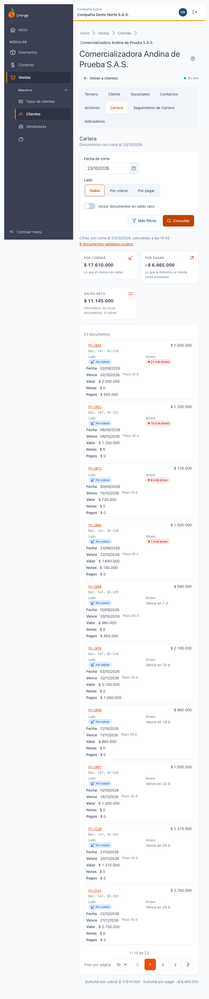
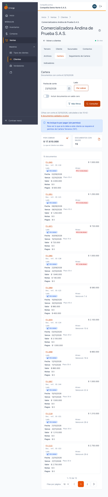
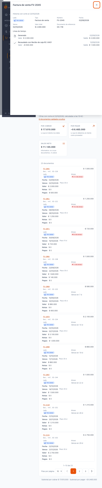
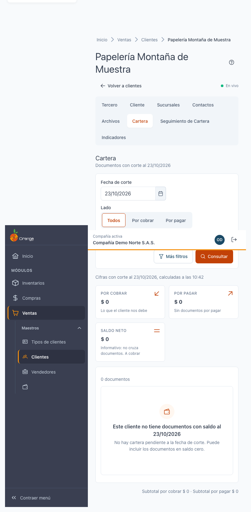

[Regresar a la documentación V2026](../../README.md)

---

# 💰 Ficha del cliente · Cartera

---

## 📋 Descripción

La pestaña **Cartera** muestra **lo que el cliente debe** a la compañía y, si además es proveedor, **lo que la compañía le debe**, a una **fecha de corte**. Cada documento trae su saldo, sus días de atraso y la historia de sus cruces (recibos, egresos y notas), sin salir de la ficha del cliente.

Es una pantalla de **consulta**: no registra cobros, pagos ni cruces. Para registrar la gestión de cobro use la pestaña **Seguimiento de Cartera**.

> 📘 Para el uso general de tablas (orden, paginación y exportación) vea [Manejo general de la información](../../Generales/manejo-general-informacion.md).

> 💡 Esta pestaña **no se actualiza sola**. Las cifras son las de la última vez que pulsó **Consultar**.

---

## 🎯 Acceso

1. En el menú principal, haga clic en **Ventas**.
2. En **Maestros**, haga clic en **Clientes**.
3. Busque el cliente y ábralo en **Editar** (ficha).
4. Haga clic en la pestaña **Cartera**.

---

## 🖥️ Pantalla principal

| Elemento | Para qué sirve |
|----------|----------------|
| **?** (junto al título) | Abre esta ayuda en un panel lateral, sin salir de la pantalla. |
| **Fecha de corte** | Día con el que se calcula el saldo. Por defecto es hoy. No puede ser una fecha futura. |
| **Lado** | **Todos**, **Por cobrar** o **Por pagar**. Cambia al instante. Ver [Lado y signo](#lado-y-signo). |
| **Incluir documentos en saldo cero** | Muestra también los documentos ya pagados por completo. Cambia al instante. |
| **Más filtros** | Abre **Rango de vencimiento**, **Tipo de movimiento** y **Centro de costo**. |
| **Consultar** | Aplica la fecha de corte y los filtros de **Más filtros**. La pantalla no se actualiza sola. |
| **Tarjetas de totales** | **Por cobrar**, **Por pagar** y **Saldo neto**, del conjunto filtrado. |
| **Tabla de documentos** | Un documento por fila. Puede ordenarla con los encabezados. |

Al abrir la pestaña, la lista va del documento **más atrasado al menos atrasado** (por vencimiento). Los documentos vencidos quedan arriba.

### Lado y signo

Un cliente también puede ser **proveedor** de la compañía. Por eso cada documento dice de qué lado es:

- **Por cobrar** (positivo): lo que el cliente debe a la compañía.
- **Por pagar** (negativo, con el signo **−**): lo que la compañía le debe al cliente como proveedor.
- Las **notas crédito** y los **anticipos** llevan el signo que les corresponde según su tipo de movimiento.

Cada fila muestra el texto **Por cobrar** o **Por pagar**; no depende solo del color.

### Totales

| Tarjeta | Qué significa |
|---------|---------------|
| **Por cobrar** | Suma de los saldos por cobrar. |
| **Por pagar** | Suma de los saldos por pagar, con signo negativo. |
| **Saldo neto** | Por cobrar menos por pagar. Dice **A cobrar** o **A pagar** según el signo. |

> ⚠️ El **saldo neto** es **informativo**: no cruza documentos. Un documento por cobrar no se descuenta automáticamente contra uno por pagar.

Cuando la compañía no le debe nada al cliente como proveedor, la tarjeta **Por pagar** dice **Sin documentos por pagar**.

### Lo que dice la tabla

| Columna | Qué muestra |
|---------|-------------|
| **Lado** | Por cobrar o Por pagar. |
| **Movimiento** | Número del documento. Al pulsarlo se abre su **historia** (ver abajo). Si no es factura, debajo aparece el tipo (por ejemplo, **Nota crédito** o **Anticipo de cliente**). |
| **Doc. ref.** | Documento de referencia que trae el movimiento, como texto. |
| **Fecha**, **Plazo**, **Vence** | Fecha del documento, días de plazo y fecha de vencimiento. |
| **Atraso** | **21 d de atraso** en rojo si ya venció; **Vence en 18 d** si todavía no; **Vence hoy**; o **—** si el saldo es cero. |
| **Valor**, **Notas**, **Pagos**, **Saldo** | Valor del documento, notas crédito aplicadas, pagos recibidos y saldo pendiente. |

Cuando el saldo de un documento invierte su sentido (por ejemplo, un cliente con un saldo a favor), aparece la etiqueta **A favor**. Los documentos saldados muestran **Saldo 0**.

Debajo de la tabla, el resumen indica cuántos documentos se muestran y su total, por ejemplo **Mostrando 12 documentos por cobrar, total $…**. Si ve **Saldo 0** ocultos, el texto le indica cuántos hay.

### Qué ve cada permiso

| Permiso | Qué ve |
|---------|--------|
| Consultar **Cartera** de clientes | Los documentos por cobrar, sus totales y la historia de cada documento. |
| Consultar **Cartera Terceros** (además del de Cartera) | Además, los documentos **por pagar** del cliente, el filtro **Por pagar** y el **saldo neto**. |

Si su perfil no tiene **Cartera Terceros**, verá el aviso **No incluye lo por pagar (sin permiso)**. Solo aparece la tarjeta **Por cobrar**, y **no se muestra el saldo neto**, porque un neto parcial sería engañoso.

---

## 🔎 Ver la historia de un documento

1. Haga clic en el número del documento (columna **Movimiento**).
2. Se abre un panel con la **Historia con corte al…** de ese documento.
3. La **línea de tiempo** muestra primero **Generado** y después cada cruce, con su fecha, su valor y el saldo que quedó:
   - Por cobrar: **Recaudado con Recibo de caja…**
   - Por pagar: **Pagado con Egreso…**
   - Notas: **Ajustado con…**
   - **Reverso**, si un cruce se deshizo.
4. Si el anticipo no se ha usado, aparece **Sin aplicar**. Si el documento no tiene cruces, aparece **Este documento no tiene cruces al…**.
5. Si el cruce es otro documento de cartera de este cliente, puede abrir **su historia** desde el mismo panel. Use **Atrás** para volver.
6. Para cerrar, haga clic en **Cerrar**.

Los documentos se muestran con su número, pero **no se abren desde aquí** en su pantalla de origen.

---

## 📅 Fecha de corte y filtros

- La **fecha de corte** define el saldo de cada documento a ese día. Si la cambia, pulse **Consultar**.
- Los documentos pagados **después** de la fecha de corte siguen apareciendo como pendientes a esa fecha, y la historia muestra solo los cruces hechos hasta el corte.
- **Rango de vencimiento** agrupa los documentos por tramos de días. Los tramos se ordenan por saldo vencido: la lista no se filtra por tramo, y así lo indica el aviso que aparece.
- **Tipo de movimiento** y **Centro de costo** limitan la lista a los documentos que cumplan esa condición.

Si cambia **Lado** o **Incluir documentos en saldo cero**, la lista se actualiza al instante. Si cambia la fecha o los filtros de **Más filtros**, pulse **Consultar**.

---

## 🧭 Saltos desde otras pestañas

- En **Indicadores**, al pulsar un tramo o **Ver documentos vencidos**, se abre esta pestaña con la fecha de corte y el rango elegidos, ordenada por saldo vencido.
- En **Facturas de Venta y sus Recibos de Caja**, el botón **Ver en Cartera** lleva a esta pestaña.

---

## 🔄 Cambios de otros usuarios (en vivo)

Esta pantalla **no se actualiza sola**. Si otro usuario registra un cobro o un pago mientras la mira, pulse **Consultar** para ver el cambio.

---

## ❓ Preguntas frecuentes

**¿Por qué el saldo neto no aparece?**
Su perfil no tiene el permiso de **Cartera Terceros**. Sin él no se muestran los documentos por pagar, y por eso tampoco el neto.

**¿Por qué un cliente aparece con documentos por pagar?**
Porque también es proveedor de la compañía. Esos documentos se muestran con el signo negativo y la etiqueta **Por pagar**.

**¿Por qué el saldo neto no descuenta una factura contra una nota?**
El neto es solo informativo: no cruza documentos. Cada documento conserva su propio saldo.

**¿Por qué no veo un documento que sé que existe?**
Revise la **fecha de corte** (el documento puede estar pagado a esa fecha), la casilla de **saldo cero** y los filtros de **Más filtros**.

**¿Qué es el aviso «No incluye lo por pagar (sin permiso)»?**
Es normal: significa que su perfil no tiene el permiso de **Cartera Terceros**. No es un error.

**¿Para qué sirve la fecha de corte si es hoy?**
Para ver cómo estaba la cartera en un día anterior. La historia de cada documento se calcula con esa misma fecha.

**¿Dónde registro una gestión de cobro?**
En la pestaña **Seguimiento de Cartera**, con [Registrar seguimiento](ficha-seguimiento-cartera.md).

---

## 🛠️ Errores comunes

| Mensaje | Qué hacer |
|---------|-----------|
| **No tiene permiso para ver esta información** | Su perfil no tiene el permiso de Cartera. Consulte con su administrador. |
| **No se pudo cargar la información** | Sus filtros se conservaron. Pulse **Reintentar**. |
| **La fecha de corte no puede ser posterior a hoy.** | Elija hoy o una fecha anterior. |
| **Este cliente no existe en su compañía** | El cliente es de otra compañía o fue eliminado. Vuelva a **Clientes**. |
| **Documento no disponible** | El documento es de otra compañía, está anulado o no existe. Cierre el panel. |
| **Sin permiso de Cartera Terceros** | Al abrir la historia de un documento por pagar, su perfil no tiene el permiso. |
| **Este cliente no tiene documentos con saldo al…** | No hay saldo pendiente a esa fecha. Pulse **Incluir documentos en saldo cero** o cambie la fecha de corte. |

---

## 🧷 Relacionado

- [Ficha del cliente · Seguimiento de Cartera](ficha-seguimiento-cartera.md)
- [Ficha del cliente · Indicadores](ficha-indicadores.md)
- [Ficha del cliente · Facturas de Venta y sus Recibos de Caja](ficha-facturas.md)
- [Ficha del cliente · Consultas que tardan](ficha-consultas-que-tardan.md)
