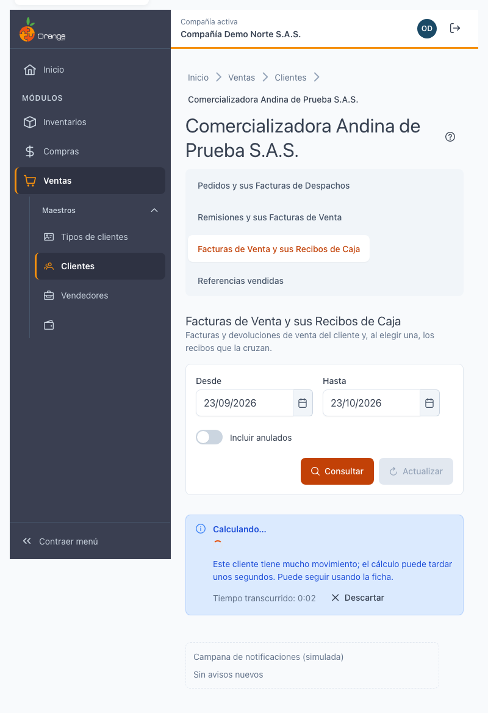
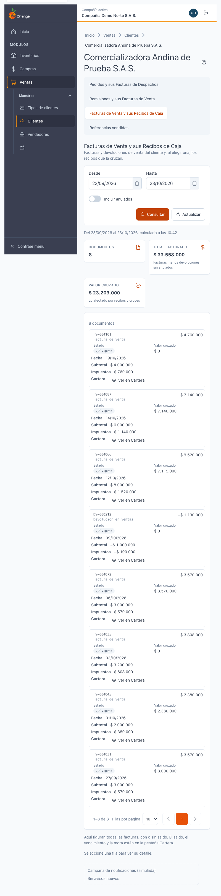
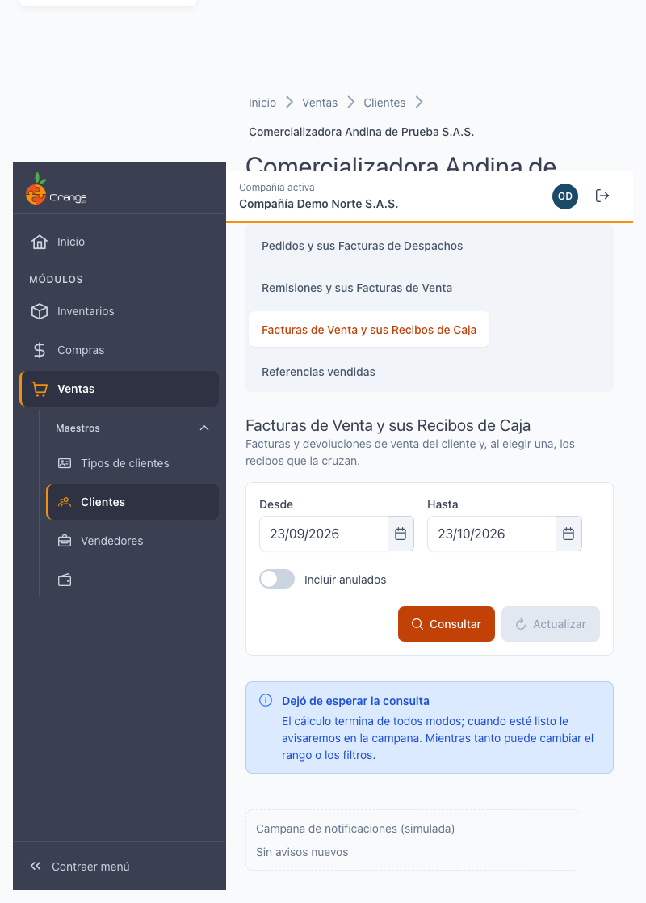
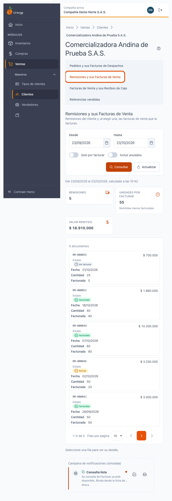
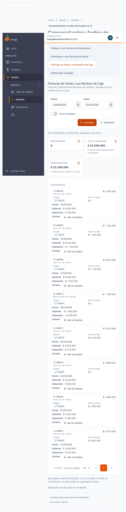

[Regresar a la documentación V2026](../../README.md)

---

# ⏳ Ficha del cliente · Consultas que tardan

---

## 📋 Descripción

Algunos clientes tienen **mucho movimiento**. En las pestañas **Pedidos y sus Facturas de Despachos**, **Remisiones y sus Facturas de Venta**, **Facturas de Venta y sus Recibos de Caja** y **Referencias vendidas**, la consulta puede tardar más de un momento.

Cuando pasa, la ficha **no se queda bloqueada**: muestra **Calculando…**, puede seguir usando la ficha y, si sale de la pestaña, la compañía le avisa en la **campana de notificaciones** cuando el resultado esté listo.

> 💡 Este manual explica el comportamiento común de esas cuatro pestañas. Para el contenido de cada una, vea sus manuales.

---

## 🎯 Acceso

Estos mensajes aparecen en las cuatro pestañas. Para llegar a ellas:

1. En el menú principal, haga clic en **Ventas**.
2. En **Maestros**, haga clic en **Clientes**.
3. Busque el cliente y ábralo en **Editar** (ficha).
4. Elija una de las pestañas de documentos o **Referencias vendidas**.

---

## ⏱️ Qué ve mientras se calcula

Mientras se calcula, aparece:

- el título **Calculando…** y el mensaje **Este cliente tiene mucho movimiento; el cálculo puede tardar unos segundos. Puede seguir usando la ficha.**;
- el **tiempo transcurrido**, por ejemplo **Tiempo transcurrido: 0:42**;
- el botón **Descartar**.

Mientras tanto, puede usar la ficha: cambiar de pestaña, abrir otra pestaña o revisar otros datos del cliente. **La pantalla no se bloquea.**

No aparece ninguna alerta de error mientras se calcula. El cálculo se revisa solo; no tiene que volver a pulsar nada.

Si el cálculo pasa de un minuto, aparece además **Sigue en proceso; puede salir de la pestaña y le avisamos.** Puede salir tranquilamente: le avisaremos.

---

## ✅ Cuando el resultado está listo

Al terminar, las tarjetas y la tabla aparecen en su lugar, sin que tenga que hacer nada más.

Si vuelve a abrir la misma pestaña con los mismos filtros poco después, el resultado aparece **al instante**: los resultados se guardan unos minutos.

Si el resultado ya venció, aparece **El resultado venció; calculando de nuevo…** con la nota **No es un error: volvemos a calcular con los mismos filtros.** Es normal y no pierde nada.

---

## 🛑 Descartar

**Descartar** significa que **deja de esperar**. Lo usa cuando no necesita el resultado ahora.

1. Pulse **Descartar**.
2. Aparece **Dejó de esperar la consulta**: el cálculo termina de todos modos y le avisaremos en la campana.
3. Mientras tanto, la pestaña queda editable: puede cambiar el rango o los filtros.

Cambiar el rango o los filtros también deja de esperar el cálculo anterior.

> ⚠️ **Descartar no cancela el cálculo** en el servidor. El cálculo termina y queda guardado unos minutos; si vuelve a la pestaña a tiempo, lo verá al instante.

---

## 🔔 Salir de la pestaña y recibir el aviso

Si sale de la pestaña (o de la ficha) mientras se calcula, o si pulsó **Descartar**, la campana le avisa **una sola vez** cuando el resultado esté listo:

- Título: **Consulta lista**.
- Texto: **Su consulta de [Pedidos, Remisiones, Facturas o Referencias vendidas] ya está disponible. Ábrala desde la ficha del cliente.**
- Al pulsar el aviso, se abre la **pestaña del cliente** donde estaba la consulta.

El aviso **no muestra el nombre del cliente**: abra la ficha desde el aviso para ver el resultado.

Si se queda en la pestaña esperando, **no recibe aviso**: el resultado aparece directamente en pantalla.

---

## 🔁 Cuando la consulta falla: Reintentar

Si el cálculo falla varias veces seguidas, aparece **No se pudo calcular la consulta**. El mensaje dice **El cálculo falló después de varios intentos. Puede reintentarlo una vez.**

1. Pulse **Reintentar**. La consulta vuelve a calcularse y verá **Calculando…** otra vez.
2. **Reintentar solo se puede usar una vez.** Si la segunda vez vuelve a fallar, aparece **Ya usó el reintento. Pruebe más tarde o con un rango menor.** y ya no hay botón.

Solo la persona que pidió la consulta puede reintentarla.

---

## 📦 Si la consulta es demasiado grande

Si el rango de fechas tiene **más documentos de los que se pueden calcular a la vez**, aparece **La consulta es demasiado grande**. No espera ni le avisa en la campana: hay que cambiar la consulta.

1. Pida un **rango de fechas menor** (por ejemplo, un mes en lugar de un año) y pulse **Consultar**.
2. Si ya lo redujo y sigue apareciendo, pulse **Actualizar**. Actualizar vuelve a pedir el cálculo; si el resultado anterior es muy reciente (menos de un minuto), se muestra el mismo.
3. Si el problema sigue, repita la consulta por periodos más cortos (por ejemplo, una semana o un mes a la vez).

---

## 🔄 Actualizar y rango por defecto

- **Actualizar** está junto a **Consultar**. Úselo cuando quiera la cifra más reciente sin cambiar los filtros. Solo se habilita cuando hay un resultado en pantalla.
- El **rango por defecto** de estas pestañas es el **último mes**: desde el mismo día del mes anterior hasta hoy. Con un rango amplio, la consulta tarda más. Pida solo el periodo que necesita.

---

## ❓ Preguntas frecuentes

**¿Por qué la pestaña dice «Calculando…» si no he hecho nada raro?**
Porque el cliente tiene mucho movimiento. No es un error. Espere, o salga y le avisaremos.

**¿Puedo cambiar de pestaña mientras calcula?**
Sí. El cálculo sigue, y si sale de la pestaña le avisa la campana.

**¿Qué hace Descartar?**
Deja de esperar el resultado en pantalla. El cálculo termina de todos modos y, si ya no está mirando, le avisa.

**¿Cuánto tiempo se guarda un resultado?**
Unos minutos. Después, al volver a abrir la pestaña, se calcula de nuevo.

**¿Por qué no me llegó el aviso «Consulta lista»?**
Si se quedó en la pestaña, el resultado se mostró directamente y no hace falta aviso. Si salió, revise la campana.

**¿Puedo reintentar muchas veces?**
No. Reintentar solo se usa una vez. Si vuelve a fallar, pruebe más tarde o con un rango menor.

**¿El aviso me dice qué cliente es?**
No. Pulse el aviso para abrir la ficha del cliente.

---

## 🛠️ Errores comunes

| Mensaje | Qué hacer |
|---------|-----------|
| **Calculando…** | Espere, o use la ficha. No hace falta hacer nada más. |
| **Sigue en proceso; puede salir de la pestaña y le avisamos.** | Puede salir: le avisaremos en la campana. |
| **El resultado venció; calculando de nuevo…** | Es normal. Se vuelve a calcular con los mismos filtros. |
| **No se pudo calcular la consulta** | Pulse **Reintentar** una vez. |
| **Ya usó el reintento. Pruebe más tarde o con un rango menor.** | Espere un rato o pida un rango más corto. |
| **La consulta es demasiado grande** | Pida un rango menor y pulse **Consultar**; si ya lo hizo, use **Actualizar**. |
| **Dejó de esperar la consulta** | El cálculo sigue y le avisaremos en la campana. |

---

## 🧷 Relacionado

- [Ficha del cliente · Pedidos y sus Facturas de Despachos](ficha-pedidos.md)
- [Ficha del cliente · Remisiones y sus Facturas de Venta](ficha-remisiones.md)
- [Ficha del cliente · Facturas de Venta y sus Recibos de Caja](ficha-facturas.md)
- [Ficha del cliente · Referencias vendidas](ficha-referencias-vendidas.md)
