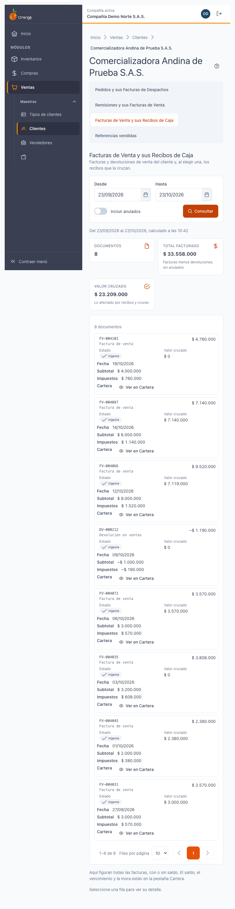
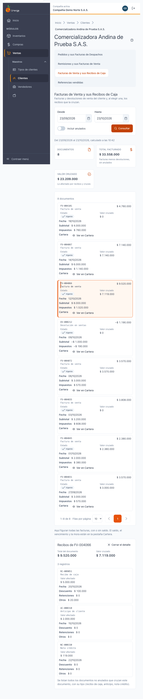
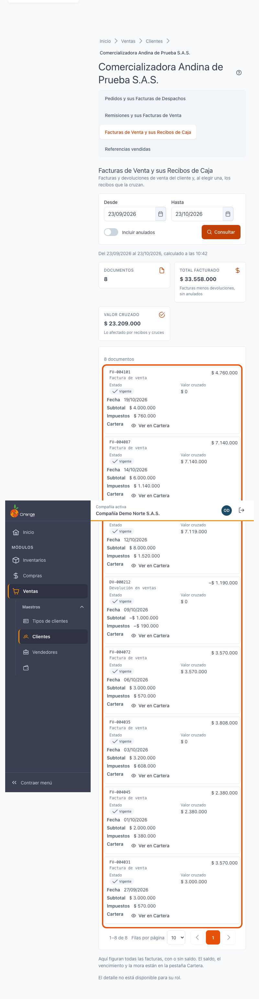
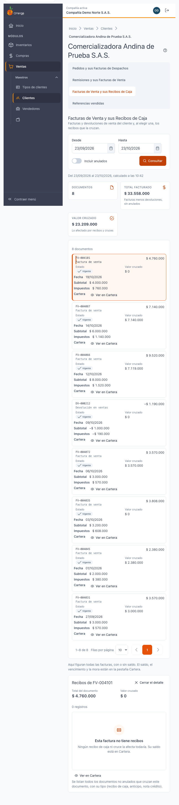
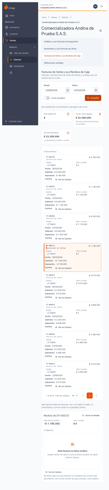

[Regresar a la documentación V2026](../../README.md)

---

# 🧾 Ficha del cliente · Facturas de Venta y sus Recibos de Caja

---

## 📋 Descripción

La pestaña **Facturas de Venta y sus Recibos de Caja** muestra las **facturas y devoluciones de venta** del cliente. Al elegir una, ve los **recibos y cruces** que la afectan: recibos de caja, anticipos y notas crédito.

Es una pantalla de **consulta**: no crea, no edita ni elimina facturas ni recibos.

> 📘 Para el uso general de tablas (orden, paginación y exportación) vea [Manejo general de la información](../../Generales/manejo-general-informacion.md).

> 💡 Esta pestaña **no calcula el saldo, el vencimiento ni la mora** de una factura. Eso está en la pestaña **[Cartera](ficha-cartera.md)**, a la que puede saltar con **Ver en Cartera**.

> 💡 Los documentos **no se abren desde aquí**: se muestran su número, fecha, valores y estado.

---

## 🎯 Acceso

1. En el menú principal, haga clic en **Ventas**.
2. En **Maestros**, haga clic en **Clientes**.
3. Busque el cliente y ábralo en **Editar** (ficha).
4. Haga clic en la pestaña **Facturas de Venta y sus Recibos de Caja**.

---

## 🖥️ Pantalla principal

| Elemento | Para qué sirve |
|----------|----------------|
| **?** (junto al título) | Abre esta ayuda en un panel lateral, sin salir de la pantalla. |
| **Desde** y **Hasta** | Rango de fechas de las facturas. Por defecto es el **último mes**. |
| **Incluir anulados** | Agrega las facturas anuladas a la lista. |
| **Consultar** | Vuelve a buscar con los filtros elegidos. La pantalla no se actualiza sola. |
| **Tarjetas de totales** | **Documentos**, **Total facturado** (facturas menos devoluciones, sin anulados) y **Valor cruzado** (lo afectado por recibos y cruces). |
| **Lista de documentos** | Facturas y devoluciones con documento, fecha, estado, subtotal, impuestos, total, valor cruzado y el botón **Ver en Cartera**. |

El orden de la lista va de **mayor a menor** (por fecha). Puede cambiarlo con los encabezados.

### Cómo leer la lista

- **Documento**: el número de la factura. Debajo aparece **Factura de venta** o **Devolución en ventas**.
- **Devoluciones**: se muestran en **negativo** y restan del total facturado.
- **Estado**: **Vigente** o **Anulada** (con su icono).
- **Valor cruzado**: la parte del documento que ya fue afectada por recibos o cruces. No es el saldo: para el saldo vaya a **Cartera**.

### Qué ve cada permiso

| Permiso | Qué ve |
|---------|--------|
| Consultar **Facturas de venta** | La lista de facturas y devoluciones, con sus totales. |
| Consultar **Recibos de caja** (además del de Facturas) | El detalle: los recibos y cruces de la factura elegida. |

Sin el permiso de Recibos de caja, la pestaña muestra solo la lista de facturas. Aparece el aviso **«El detalle no está disponible para su rol»** y las filas no se pueden elegir.

---

## 🔎 Ver los recibos de una factura

1. Haga clic en la factura (o en su fila) para elegirla.
2. Debajo aparece **Recibos de** y el número de la factura, con:
   - **Resumen**: **Total del documento** y **Valor cruzado**.
   - **Documentos que cruzan la factura**: todo documento **no anulado** que la afecta, con su tipo (**recibo de caja**, **anticipo** o **nota crédito**), fecha y valor afectado.
   - Columnas de **Descuento**, **Retenciones** y **Otros**, cuando el documento las tenga.
3. Para cerrar el detalle, haga clic en **Cerrar el detalle**.

Si la factura no tiene recibos, aparece **Esta factura no tiene recibos**: **no es un error**. Ningún recibo de caja ni cruce la afecta todavía, y su saldo está en **Cartera**.

---

## 🧭 Ver en Cartera

El botón **Ver en Cartera** de cada fila (y el de la vista de recibos vacía) lleva a la pestaña **Cartera** de la ficha del cliente, donde están el saldo, el vencimiento y la mora de esa factura. Si la factura cae fuera del rango, **la pestaña amplía el rango de fechas** para incluirla y lo avisa.

Para no repetir cifras en dos pestañas, esta pantalla no muestra el saldo.

---

## 🔄 Cambios de otros usuarios (en vivo)

Esta pantalla **no se actualiza sola**. Si otro usuario registra un recibo o anula una factura mientras la mira, haga clic en **Consultar** para ver el cambio.

---

## ❓ Preguntas frecuentes

**¿Por qué una factura no aparece?**
Revise el rango de fechas (por defecto es el último mes) y si las facturas anuladas están incluidas. Para verlas marque **Incluir anulados**.

**¿Por qué la factura aparece sin saldo aquí?**
Esta pestaña no calcula saldos. Para el saldo, el vencimiento y la mora use **Ver en Cartera**.

**¿Qué es el «valor cruzado»?**
Es la parte de la factura que ya fue afectada por recibos de caja, anticipos o notas crédito.

**¿Por qué aparece una nota crédito en los recibos?**
Las notas crédito, los anticipos y los recibos de caja que cruzan la factura se muestran todos, cada uno con su tipo.

**No veo los recibos de una factura.**
Su perfil no tiene el permiso de Recibos de caja. Pídale a su administrador que se lo habilite.

---

## 🛠️ Errores comunes

| Mensaje | Qué hacer |
|---------|-----------|
| **No tiene permiso para ver esta información** | Su perfil no tiene el permiso de Facturas de venta. Consulte con su administrador. |
| **No se pudo cargar el detalle** | Vuelva a elegir la factura o pulse **Consultar**. |
| **Este documento ya no está disponible para este cliente** | La factura pudo anularse o cambiar. Pulse **Consultar**. |
| **La fecha inicial no puede ser posterior a la final** | Corrija el rango de fechas. |

---

## 🧷 Relacionado

- [Ficha del cliente · Pedidos y sus Facturas de Despachos](ficha-pedidos.md)
- [Ficha del cliente · Remisiones y sus Facturas de Venta](ficha-remisiones.md)
- [Ficha del cliente · Referencias vendidas](ficha-referencias-vendidas.md)
- [Ficha del cliente · Cartera](ficha-cartera.md)
- [Ficha del cliente · Consultas que tardan](ficha-consultas-que-tardan.md)
