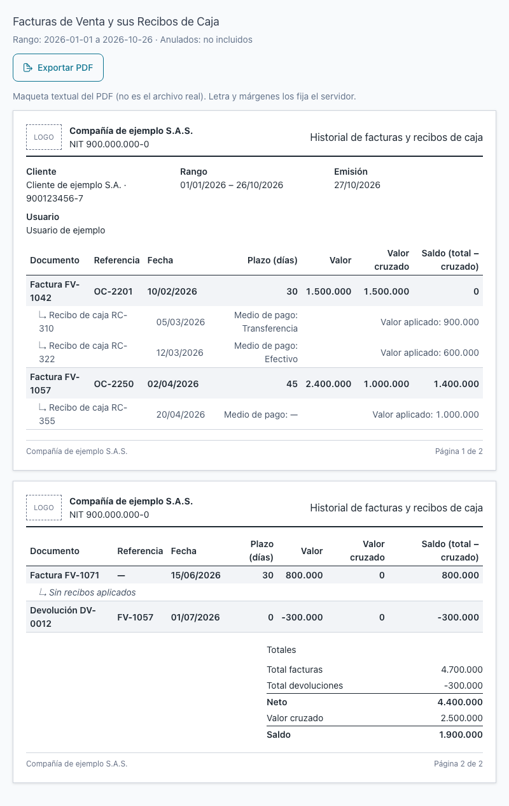
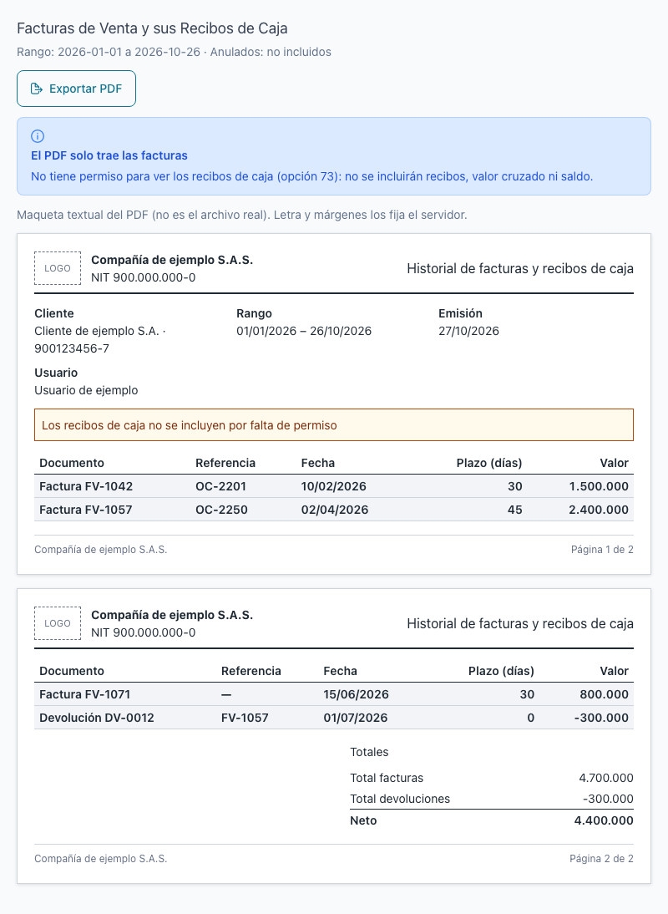
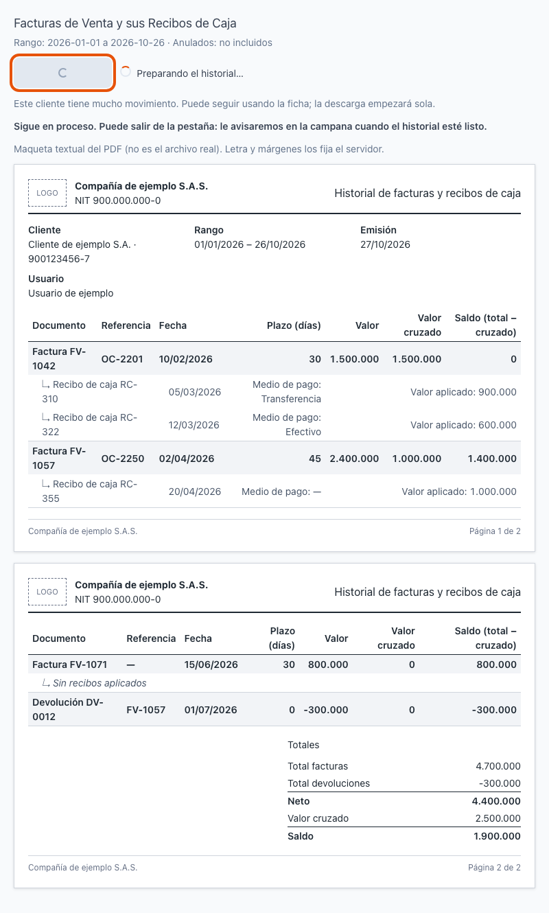
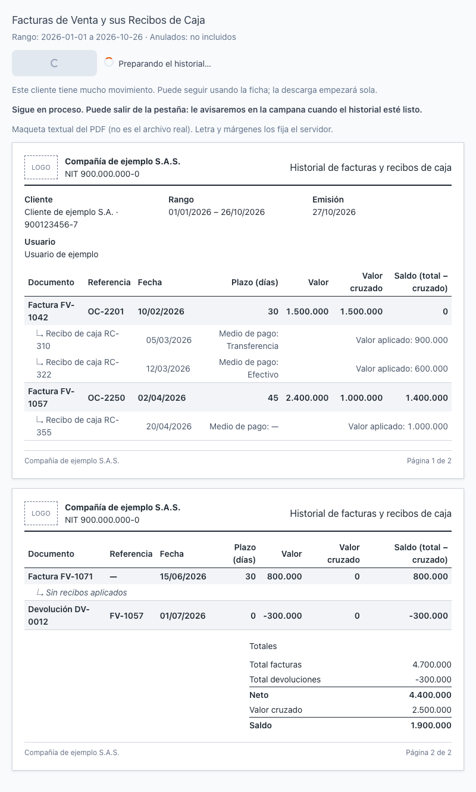
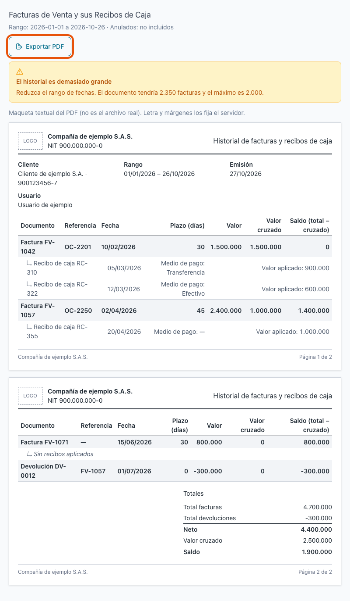
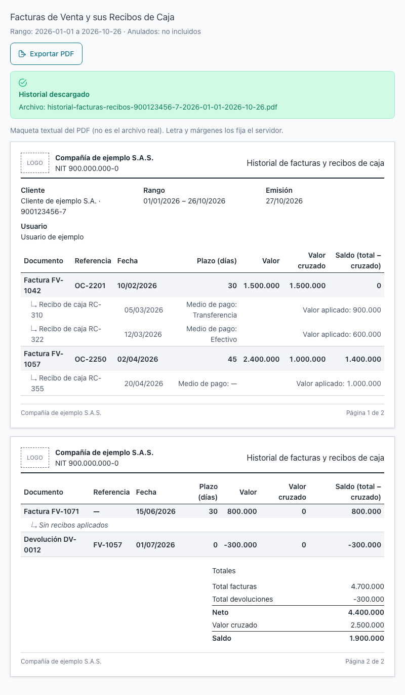

[Regresar a la documentación V2026](../../README.md)

---

# 📄 Ficha del cliente · Exportar PDF del historial de facturas y recibos

---

## 📋 Descripción

El botón **Exportar PDF** de la pestaña **Facturas de Venta y sus Recibos de Caja** entrega un documento con la trazabilidad de lo facturado y lo cobrado a un cliente: cada factura, con sus **recibos de caja** debajo, y los totales al final.

El PDF sirve para **uso interno** y para **entregarlo al cliente**.

> 💡 El PDF muestra lo mismo que la pestaña, con el **mismo rango de fechas** y los **mismos filtros**. No trae nada que usted no pueda ver en la pantalla.

---

## 🎯 Acceso

1. En el menú principal, haga clic en **Ventas**.
2. En **Maestros**, haga clic en **Clientes**.
3. Busque el cliente y ábralo en **Editar** (ficha).
4. Haga clic en la pestaña **Facturas de Venta y sus Recibos de Caja**.
5. Elija el rango de fechas y los filtros, pulse **Consultar** y, después, **Exportar PDF**.

> ⚠️ El botón **Exportar PDF** solo aparece si tiene permiso para **Consultar Facturas de venta**. Sin ese permiso no lo verá.

---

## 🖥️ Pantalla principal

Debajo del botón **Exportar PDF** aparece una **vista previa** del contenido. Es solo una muestra con datos de ejemplo: el archivo real lo arma el sistema y su letra y márgenes son los del documento oficial.

El nombre del archivo que se descarga es **historial-facturas-recibos-[NIT del cliente]-[fecha desde]-[fecha hasta].pdf**.

### Qué trae el PDF

| Parte | Qué muestra |
|-------|-------------|
| **Encabezado** | Logo y NIT de la compañía, nombre del cliente, rango de fechas, fecha de emisión y el usuario que exportó. |
| **Facturas** | Cada factura o devolución con su documento, referencia, fecha, plazo en días, **valor**, **valor cruzado** y **saldo**. |
| **Recibos de caja** | Debajo de cada factura, los recibos que la cruzan: fecha, número, **valor aplicado** y **medio de pago**. Si la factura no tiene recibos, aparece **Sin recibos aplicados**. |
| **Totales** | **Total facturas**, **Total devoluciones**, **Neto**, **Valor cruzado** y **Saldo**. |
| **Pie de página** | **Página X de Y** en cada hoja. Los títulos de columna se repiten en cada hoja. |

### Cómo leer el PDF

- **Valor cruzado**: la parte de la factura que ya fue cubierta por recibos. Es el mismo valor que ve en la pestaña.
- **Saldo** (de cada factura y del total): es el **valor menos el valor cruzado**. Es el saldo del documento, **no** el saldo de **Cartera**, que se calcula con otras reglas. Para el saldo de Cartera, vaya a la pestaña **Cartera**.
- **Devoluciones**: aparecen en negativo y restan del total facturado.
- **Anulados**: solo aparecen si activó **Incluir anulados** en la pestaña. Las facturas anuladas no suman en los totales.
- **Medio de pago** del recibo:
  - **Transferencia**, **Efectivo** u otro medio registrado en el recibo.
  - **A / B**: si el recibo se pagó con dos o más medios, aparecen unidos con una barra (por ejemplo, **Transferencia / Efectivo**).
  - **—**: el recibo no tiene un medio de pago registrado.

---

## 🔐 Qué ve cada permiso

| Permiso | Qué incluye el PDF |
|---------|--------------------|
| Consultar **Facturas de venta** | Las facturas y devoluciones del rango, con sus valores. |
| Consultar **Recibos de caja** (además del de Facturas) | Todo lo anterior, más los recibos debajo de cada factura, el **valor cruzado**, el **saldo** y el **medio de pago**. |

### Si no tiene el permiso de Recibos de caja

El PDF **solo lista las facturas**. No trae recibos, valor cruzado ni saldo. Aparece este aviso:

> **El PDF solo trae las facturas.** No tiene permiso para ver los recibos de caja: no se incluirán recibos, valor cruzado ni saldo.

En el documento también aparece la línea **Los recibos de caja no se incluyen por falta de permiso**.

Si necesita esa información, pida el permiso de **Recibos de caja** a su administrador.

---

## ✏️ Exportar el PDF

1. Elija el **rango de fechas** y los filtros en la pestaña. Por defecto es el **último mes**.
2. Pulse **Consultar** y revise que las facturas sean las que quiere entregar.
3. Pulse **Exportar PDF**.
4. Si el cálculo es rápido, el archivo se descarga de inmediato.

Si pasa de un momento, vea la sección siguiente.

> 💡 El PDF se arma con el rango y los filtros que están **en pantalla** al pulsar el botón. Si cambió las fechas y no pulsó **Consultar**, el PDF sigue el rango anterior.

---

## ⏳ Cuando tarda: Preparando el historial

Si el cliente tiene **mucho movimiento**, el documento puede tardar. Mientras tanto, el botón muestra **Preparando el historial…** y aparece este mensaje:

> Este cliente tiene mucho movimiento. Puede seguir usando la ficha; la descarga empezará sola.

Qué puede hacer:

- **Siga usando la ficha.** La pantalla no se bloquea: puede revisar otras pestañas o datos del cliente.
- **Espere.** Cuando el documento esté listo, la descarga empieza sola, sin que pulse nada.
- **Salga de la pestaña, si lo necesita.** Si el cálculo sigue en proceso, aparece **Sigue en proceso. Puede salir de la pestaña: le avisaremos en la campana cuando el historial esté listo.** Cuando termine, la **campana de notificaciones** le avisa.

> 💡 Si pulsa **Exportar PDF** otra vez poco después, con el mismo rango y filtros, el documento ya preparado se descarga de inmediato.

---

## 📦 Cuando es demasiado grande

Un PDF tiene **límites**. Si el rango tiene demasiadas facturas, recibos o páginas, aparece **El historial es demasiado grande** con el mensaje **Reduzca el rango de fechas**.

| Límite | Máximo |
|--------|--------|
| Facturas en el documento | **2 000** |
| Recibos de caja en el documento | **10 000** |
| Páginas | **400** |

El sistema **no recorta el documento en silencio**: si pasa un límite, no genera el PDF.

Qué hacer:

1. Pida un **rango de fechas menor** (por ejemplo, un mes en lugar de un año).
2. Pulse **Consultar** y, después, **Exportar PDF**.
3. Si sigue grande, repita la exportación por periodos más cortos (por ejemplo, un trimestre o un mes a la vez).

---

## ⚠️ Otros mensajes

| Mensaje | Qué significa y qué hacer |
|---------|---------------------------|
| **No hay documentos en el rango** | No hay facturas ni devoluciones en esas fechas. Cambie las fechas o active **Incluir anulados**. No se genera un PDF vacío. |
| **No se pudo preparar el historial** | Hubo un problema al armar el documento. Pulse **Reintentar** una vez. |
| **Ocurrió un problema al armar el documento. Puede intentarlo de nuevo.** | Es el texto debajo del mensaje anterior. Si el problema vuelve a aparecer después de reintentar, avise a su administrador. |

---

## 🔄 Cambios de otros usuarios (en vivo)

El PDF muestra los datos **en el momento en que se arma**. Si otro usuario registra un recibo o anula una factura después, el PDF ya descargado no cambia: vuelva a pulsar **Consultar** y **Exportar PDF** para obtener la versión actual.

---

## ❓ Preguntas frecuentes

**¿El PDF es el mismo que veo en la pestaña?**
Sí, con el mismo rango y filtros. Las cifras de valor cruzado y de facturas coinciden con la pantalla.

**¿Por qué el PDF tiene saldo si la pestaña no lo muestra?**
El saldo del PDF es el valor de la factura menos lo cruzado con recibos, para que el documento cuadre. No es el saldo de **Cartera**. Para el saldo de Cartera, use la pestaña **Cartera**.

**¿Puedo entregar el PDF al cliente?**
Sí. Tiene logo, NIT, cliente, rango, fecha de emisión y paginación. Revise el rango antes de enviarlo.

**¿Qué significa «Transferencia / Efectivo» en el medio de pago?**
El recibo se pagó con dos o más medios. Cada uno aparece separado por una barra.

**¿Por qué dice «—» en el medio de pago?**
El recibo no tiene un medio de pago registrado. No es un error: el sistema no lo inventa.

**¿Por qué no me aparece el botón Exportar PDF?**
Porque no tiene permiso para consultar las facturas de venta. Pídalo a su administrador.

**¿Dónde queda el PDF después de descargarlo?**
En la carpeta de descargas de su navegador. El sistema no lo guarda.

---

## 🛠️ Errores comunes

| Mensaje | Qué hacer |
|---------|-----------|
| **Preparando el historial…** | Espere, o use la ficha. La descarga empieza sola. |
| **Sigue en proceso. Puede salir de la pestaña: le avisaremos en la campana cuando el historial esté listo.** | Puede salir. Revise la campana de notificaciones. |
| **El historial es demasiado grande** | Reduzca el rango de fechas y pulse **Exportar PDF** de nuevo. |
| **No hay documentos en el rango** | Cambie las fechas o active **Incluir anulados**. |
| **No se pudo preparar el historial** | Pulse **Reintentar** una vez. Si vuelve a fallar, pruebe más tarde o con un rango menor. |
| **El PDF solo trae las facturas** | No tiene permiso de Recibos de caja. Pídalo a su administrador si lo necesita. |

---

## 🧷 Relacionado

- [Ficha del cliente · Facturas de Venta y sus Recibos de Caja](ficha-facturas.md)
- [Ficha del cliente · Cartera](ficha-cartera.md)
- [Ficha del cliente · Consultas que tardan](ficha-consultas-que-tardan.md)
- [Clientes · Maestro de clientes](../maestros/clientes.md)
