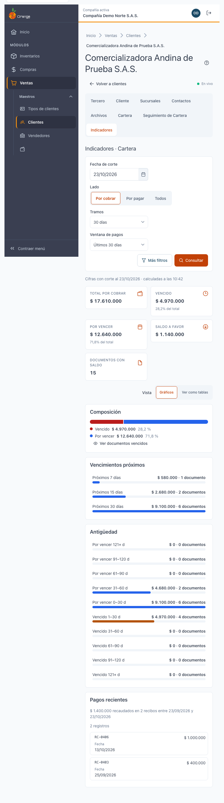
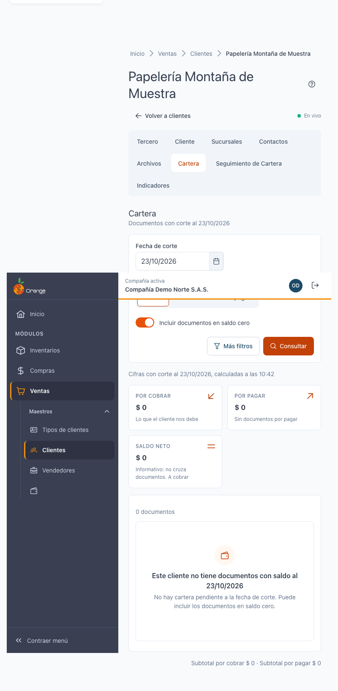

[Regresar a la documentación V2026](../../README.md)

---

# 📊 Ficha del cliente · Indicadores › Cartera

---

## 📋 Descripción

La pestaña **Indicadores** resume la **situación de cartera** del cliente en tarjetas y gráficos: cuánto debe, cuánto está vencido, cómo se reparte por antigüedad, qué vence pronto y cuánto pagó recientemente.

Es una pantalla de **consulta**: no registra ni cambia nada. Las cifras **coinciden con la pestaña [Cartera](ficha-cartera.md)** cuando usa la misma fecha de corte y los mismos filtros.

> 📘 Para el uso general de tablas (orden, paginación y exportación) vea [Manejo general de la información](../../Generales/manejo-general-informacion.md).

---

## 🎯 Acceso

1. En el menú principal, haga clic en **Ventas**.
2. En **Maestros**, haga clic en **Clientes**.
3. Busque el cliente y ábralo en **Editar** (ficha).
4. Haga clic en la pestaña **Indicadores**.

En esta versión, la pestaña muestra directamente **Cartera**; no hay otras sub-vistas.

---

## 🖥️ Pantalla principal

| Elemento | Para qué sirve |
|----------|----------------|
| **?** (junto al título) | Abre esta ayuda en un panel lateral, sin salir de la pantalla. |
| **Fecha de corte** | Día con el que se calculan las cifras. No puede ser futura. Es la misma de la pestaña Cartera. |
| **Lado** | **Por cobrar** o **Por pagar**. Ver [Por cobrar y por pagar](#por-cobrar-y-por-pagar). |
| **Tramos** | Tamaño de los tramos de la antigüedad, en días. |
| **Ventana de pagos** | Periodo de los **pagos recientes** (por ejemplo, **Últimos 7 días**). |
| **Consultar** | Vuelve a calcular las cifras con los filtros elegidos. La pantalla no se actualiza sola. |

### Tarjetas

| Tarjeta | Qué significa |
|---------|---------------|
| **Por cobrar** | Total que el cliente debe a la compañía. |
| **Vencido** | La parte del saldo cuya fecha de vencimiento ya pasó. |
| **Por vencer** | Lo que aún no ha vencido: **total menos vencido**. |
| **Saldo a favor** | Saldo que la compañía le debe al cliente, cuando existe. |
| **Documentos con saldo** | Cuántos documentos tienen saldo pendiente. |

Cada tarjeta muestra también qué parte del total representa (por ejemplo, **40 % del total**).

### Composición del saldo

Un gráfico muestra cómo se divide el saldo entre **vencido** y **por vencer**. Si pulsa **Ver documentos vencidos**, se abre la pestaña [Cartera](ficha-cartera.md) con la fecha de corte y los filtros actuales, ordenada por saldo vencido.

### Antigüedad

La **antigüedad** reparte el saldo en 10 tramos según los días de atraso. Sirve para ver si la deuda está concentrada en los tramos más antiguos.

- Con **Por cobrar** o **Por pagar** se muestra la antigüedad de ese lado.
- Con **Todos** no se muestra la antigüedad. El aviso dice **Elija un lado para ver la antigüedad**: mezclar saldos vencidos de signo opuesto no tiene lectura contable.

Para ver los datos en tabla, elija **Ver como tablas**. Para volver al gráfico, elija **Gráficos**. Cada tramo tiene **Tramo**, **Saldo** y **Documentos**.

### Vencimientos próximos

Muestra cuánto vence en los próximos **7, 15 y 30 días**, para anticiparse a la cobranza.

### Pagos recientes

Lista los pagos del cliente dentro de la **ventana de pagos** elegida, con **Fecha**, **Documento**, **Lado** y **Valor**. El resumen dice, por ejemplo, **recaudados en N recibos entre…** para lo por cobrar, o **pagados en N egresos** para lo por pagar.

Si no hubo pagos en el periodo, aparece **No hubo pagos en este periodo**: no es un error.

---

## 🧭 Por cobrar y por pagar

| Caso | Qué ve |
|------|--------|
| Cliente solo con documentos por cobrar | Solo **Por cobrar**. |
| Cliente que también es proveedor | **Por cobrar** y **Por pagar**. Puede cambiar entre los dos con el selector **Lado**. |
| Su perfil no tiene el permiso de **Cartera Terceros** | No aparece **Por pagar**, ni el saldo neto. Verá solo lo que el cliente debe. |

Un **saldo neto negativo** significa que, en conjunto, la compañía le debe más al cliente como proveedor de lo que el cliente le debe. Se marca como **A pagar**.

---

## 🧭 Saltos a Cartera

Al pulsar un tramo de la antigüedad o **Ver documentos vencidos**, la pestaña **Cartera** se abre con:

- la misma fecha de corte, lado y filtros;
- el **rango** de vencimiento del tramo elegido;
- el orden por saldo vencido, de mayor a menor.

Aparece el aviso **La lista aún no filtra por tramo: se ordenó por saldo vencido (tramo elegido: …)**. Así sabe qué documentos mirar, aunque la lista no se recorte exactamente al tramo.

Para volver a **Indicadores**, use **Volver a Indicadores** o el botón atrás del navegador.

---

## 🔄 Cambios de otros usuarios (en vivo)

Esta pantalla **no se actualiza sola**. Si otro usuario registra un pago o una factura mientras la mira, pulse **Consultar** para ver el cambio.

---

## ❓ Preguntas frecuentes

**¿Por qué las cifras no coinciden con lo que recuerdo?**
Revise la **fecha de corte**. Las cifras son a esa fecha, no necesariamente a hoy.

**¿Qué significa «por vencer»?**
Es el total menos lo vencido: lo que todavía no ha pasado de su fecha de vencimiento.

**¿Por qué no veo la antigüedad?**
Con **Todos** no se muestra. Elija **Por cobrar** o **Por pagar**.

**¿Por qué no veo la opción Por pagar?**
Su perfil no tiene el permiso de **Cartera Terceros**. Consulte con su administrador.

**¿Por qué los pagos recientes salen vacíos?**
No hubo pagos en la ventana elegida. Amplíe la ventana de pagos.

**¿Dónde veo los documentos detrás de una cifra?**
Pulse el tramo o **Ver documentos vencidos** para abrir [Cartera](ficha-cartera.md).

**¿Dónde veo si el cliente paga a tiempo?**
El cumplimiento de pago (pagado a tiempo o vencido) llegará en una versión posterior. Por ahora no se muestra ninguna cifra de ese tipo.

---

## 🛠️ Errores comunes

| Mensaje | Qué hacer |
|---------|-----------|
| **No tiene permiso para ver esta información** | Su perfil no tiene el permiso de Cartera. Consulte con su administrador. |
| **No se pudo cargar la información** | Pulse **Reintentar**. |
| **Este cliente no existe en su compañía** | El cliente es de otra compañía o fue eliminado. Vuelva a **Clientes**. |
| **Este cliente no tiene documentos con saldo al…** | No hay saldo a la fecha de corte. Pulse **Ver la cartera con saldo cero** o cambie la fecha. |

---

## 🧷 Relacionado

- [Ficha del cliente · Cartera](ficha-cartera.md)
- [Ficha del cliente · Seguimiento de Cartera](ficha-seguimiento-cartera.md)
- [Ficha del cliente · Consultas que tardan](ficha-consultas-que-tardan.md)
