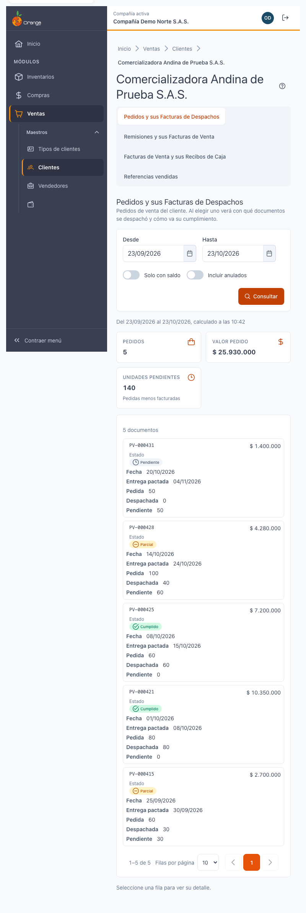
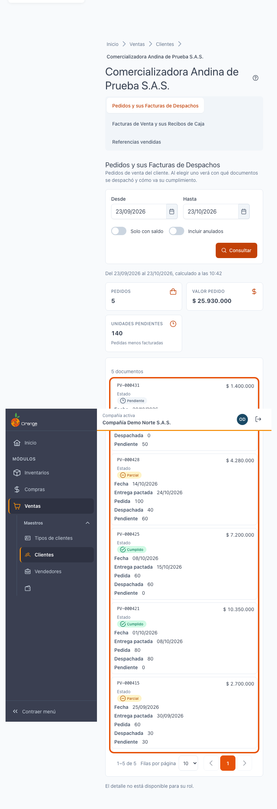
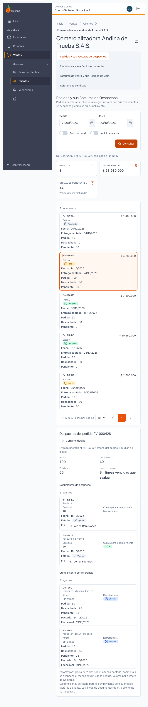
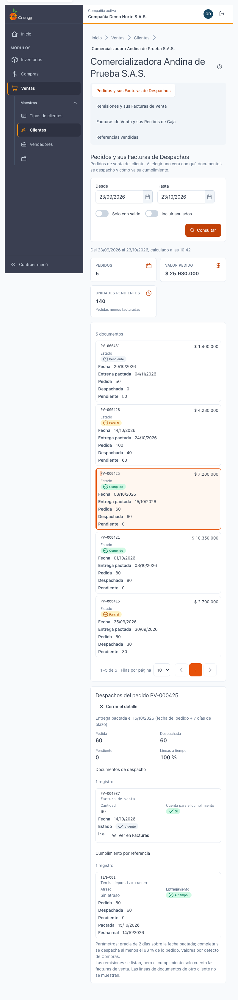

[Regresar a la documentación V2026](../../README.md)

---

# 🛒 Ficha del cliente · Pedidos y sus Facturas de Despachos

---

## 📋 Descripción

La pestaña **Pedidos y sus Facturas de Despachos** muestra los **pedidos de venta** del cliente, con su estado y lo que falta por despachar. Al elegir un pedido, ve **con qué documentos se despachó** y **cómo va su cumplimiento**, sin salir de la ficha del cliente.

Es una pantalla de **consulta**: no crea, no edita ni elimina pedidos.

> 📘 Para el uso general de tablas (orden, paginación y exportación) vea [Manejo general de la información](../../Generales/manejo-general-informacion.md).

> 💡 Los documentos (pedidos, remisiones y facturas) **no se abren desde aquí**: se muestran su número, fecha, cantidad y estado. Los botones **Ver en Remisiones**, **Ver en Facturas** y **Ver en Cartera** sí lo llevan a otra pestaña de la ficha.

---

## 🎯 Acceso

1. En el menú principal, haga clic en **Ventas**.
2. En **Maestros**, haga clic en **Clientes**.
3. Busque el cliente y ábralo en **Editar** (ficha).
4. Haga clic en la pestaña **Pedidos y sus Facturas de Despachos**.

---

## 🖥️ Pantalla principal

| Elemento | Para qué sirve |
|----------|----------------|
| **?** (junto al título) | Abre esta ayuda en un panel lateral, sin salir de la pantalla. |
| **Desde** y **Hasta** | Rango de fechas de los pedidos. Por defecto es el **último mes** (desde el mismo día del mes anterior hasta hoy). La fecha final no puede ser futura ni la inicial posterior a la final. |
| **Solo con saldo** | Muestra solo los pedidos pendientes de despachar. **Ignora el rango de fechas**: se listan todos los pedidos con saldo. |
| **Incluir anulados** | Agrega los pedidos anulados a la lista. |
| **Consultar** | Vuelve a buscar con los filtros elegidos. La pantalla no se actualiza sola. |
| **Tarjetas de totales** | Cantidad de **pedidos**, **valor pedido** y **unidades pendientes** (pedidas menos facturadas), del rango consultado. |
| **Lista de pedidos** | Un pedido por tarjeta o fila, con número, fecha, entrega pactada, estado, pedida, despachada y pendiente. |

El orden de la lista va de **mayor a menor** (por fecha del pedido). Puede cambiarlo con los encabezados de la tabla.

### Estado del pedido

El estado se calcula con las **cantidades facturadas** del pedido, no con las remisiones:

| Estado | Significado |
|--------|-------------|
| **Pendiente** | No se ha despachado nada. |
| **Parcial** | Se despachó una parte; falta saldo. |
| **Cumplido** | Se despachó todo lo pedido. |
| **Anulado** | El pedido fue anulado. |

### Qué ve cada permiso

| Permiso | Qué ve |
|---------|--------|
| Consultar **Pedidos** | La lista de pedidos y sus totales. |
| Consultar **Remisiones** y **Facturas de venta** (además del de Pedidos) | El detalle del pedido seleccionado: documentos de despacho, resumen y cumplimiento. |

Si no tiene el permiso del detalle, la pestaña muestra solo la lista de pedidos. Debajo aparece el aviso **«El detalle no está disponible para su rol»**; las filas no se pueden elegir.

---

## 🔎 Ver el detalle de un pedido

1. Haga clic en el pedido (o en su fila) para elegirlo.
2. Debajo aparece **Despachos del pedido** con:
   - **Resumen**: **Pedida**, **Despachada**, **Pendiente** y **Líneas a tiempo**.
   - **Documentos de despacho**: remisiones y facturas que tienen líneas de ese pedido.
   - **Cumplimiento por referencia**: lo pedido, despachado y pendiente por cada producto, con la fecha pactada y la fecha real.
3. Para cerrar el detalle, haga clic en **Cerrar el detalle**.

### Cómo leer el cumplimiento

- **Entrega pactada** = fecha del pedido + los días de plazo de la compañía.
- **Líneas a tiempo** = líneas con fecha pactada que se despacharon a tiempo, dividido entre todas las líneas que se pueden evaluar. Si todavía no hay líneas vencidas, dice **Sin líneas vencidas que evaluar**.
- **Entrega**: *Completa* (se despachó al menos el 98 % de lo pedido), *Parcial*, *Sin despachar* o *Sobreentrega*.
- **Cumplimiento**: *A tiempo*, *Tarde*, *Pendiente vencida* (ya pasó la fecha y falta saldo), *En curso* o *Sin plazo pactado*. Hay un margen de gracia de 2 días sobre la fecha pactada.

### Documentos de despacho: qué cuenta y qué no

- **Facturas de venta** sí cuentan para el cumplimiento.
- **Remisiones** se listan con la etiqueta **No (remisión)**, pero **no cuentan**: el cumplimiento solo toma las facturas de venta. Un pedido despachado solo con remisión aparece como **Pendiente**.
- Las facturas anuladas aparecen con **No (anulada)** y tampoco cuentan.
- Solo se muestran las líneas del pedido que pertenecen a este cliente.

Para ver un documento de despacho en su pestaña, use **Ver en Remisiones** o **Ver en Facturas**.

### Pedido sin despachos

Si el pedido aún no tiene despachos, aparece **Este pedido aún no tiene despachos**. Cuando se facture o se remita, el documento aparecerá aquí.

---

## 🧭 Saltos entre pestañas

- **Ver en Facturas** y **Ver en Remisiones** abren la pestaña del documento con el número seleccionado. Si el documento cae fuera del rango, **la pestaña amplía el rango de fechas** para incluirlo y muestra el aviso **«Se amplió el rango de fechas para incluir el documento…»**.
- **Ver en Cartera** (en las pestañas de facturas) lleva a la pestaña **Cartera** de la ficha del cliente.

---

## 🔄 Cambios de otros usuarios (en vivo)

Esta pantalla **no se actualiza sola**. Si otro usuario registra un pedido o un despacho mientras la mira, haga clic en **Consultar** para ver el cambio.

---

## ❓ Preguntas frecuentes

**¿Por qué no aparece un pedido que sé que existe?**
Revise el rango de **Desde** y **Hasta**. Por defecto solo se muestra el último mes. Si el pedido es más antiguo, amplíe el rango.

**¿Por qué «Solo con saldo» muestra pedidos de hace más de un mes?**
Con **Solo con saldo** no se aplica el rango de fechas: se listan todos los pedidos que aún tienen cantidades pendientes.

**¿Por qué una remisión facturada aparece como pendiente en el pedido?**
El cumplimiento solo cuenta **facturas de venta**. Las remisiones se listan, pero no suman al despacho.

**¿Qué significa «Líneas a tiempo»?**
Es el porcentaje de líneas del pedido despachadas dentro de su fecha pactada, entre las que ya tienen fecha vencida o ya despachada.

**¿Veo el saldo del cliente aquí?**
No. El saldo, el vencimiento y la mora están en la pestaña **Cartera**.

**No veo el detalle del pedido.**
Su perfil no tiene el permiso de Remisiones y Facturas de venta. Pídale a su administrador que se lo habilite.

---

## 🛠️ Errores comunes

| Mensaje | Qué hacer |
|---------|-----------|
| **No tiene permiso para ver esta información** | Su perfil no tiene el permiso de Pedidos. Consulte con su administrador. |
| **No se pudo cargar el detalle** | Vuelva a elegir el pedido o pulse **Consultar**. |
| **Este documento ya no está disponible para este cliente** | El pedido pudo anularse o cambiar. Pulse **Consultar** para actualizar la lista. |
| **La fecha inicial no puede ser posterior a la final** | Corrija el rango de fechas. |

---

## 🧷 Relacionado

- [Ficha del cliente · Remisiones y sus Facturas de Venta](ficha-remisiones.md)
- [Ficha del cliente · Facturas de Venta y sus Recibos de Caja](ficha-facturas.md)
- [Ficha del cliente · Referencias vendidas](ficha-referencias-vendidas.md)
