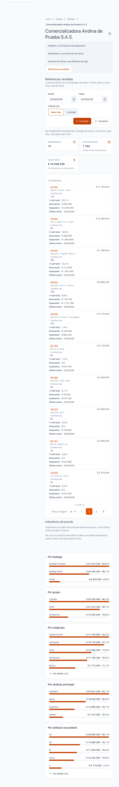
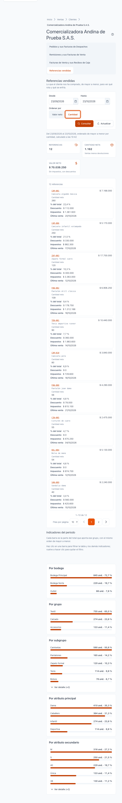
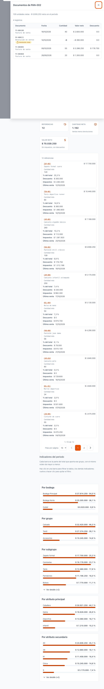
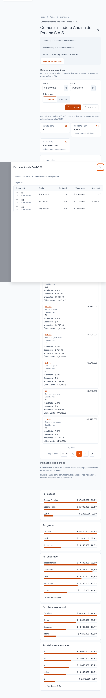
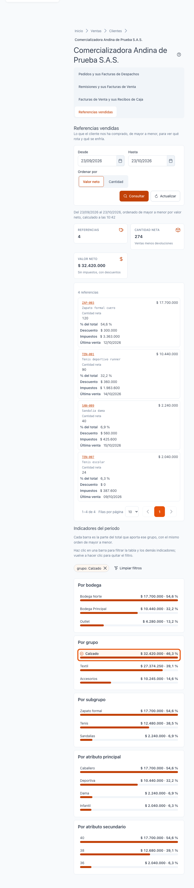
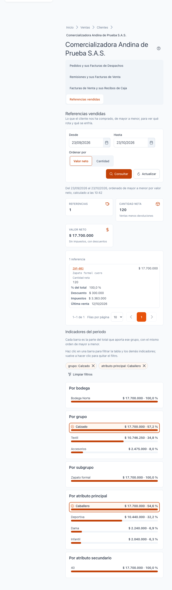
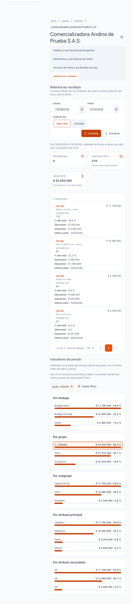
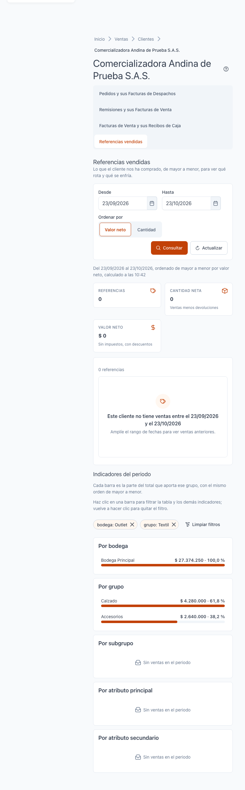
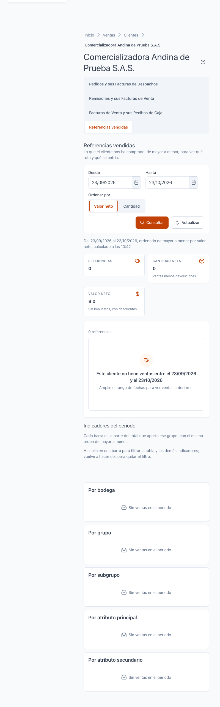

[Regresar a la documentación V2026](../../README.md)

---

# 📦 Ficha del cliente · Referencias vendidas

---

## 📋 Descripción

La pestaña **Referencias vendidas** muestra **lo que el cliente nos ha comprado**, de **mayor a menor**, para ver qué productos rotan y cuáles se enfrían. También reparte lo vendido por **bodega, grupo, subgrupo, atributo principal y atributo secundario**, y le permite filtrar la lista haciendo clic en las barras.

Es una pantalla de **consulta**: no crea, no edita ni elimina nada.

> 📘 Para el uso general de tablas (orden, paginación y exportación) vea [Manejo general de la información](../../Generales/manejo-general-informacion.md).

> 💡 Las ventas se muestran **netas**: las devoluciones **restan**. Los valores no incluyen impuestos y ya tienen descuentos aplicados.

> 💡 Los documentos **no se abren desde aquí**. Desde cada referencia puede ver los documentos y líneas en que se vendió, pero no abrirlos.

---

## 🎯 Acceso

1. En el menú principal, haga clic en **Ventas**.
2. En **Maestros**, haga clic en **Clientes**.
3. Busque el cliente y ábralo en **Editar** (ficha).
4. Haga clic en la pestaña **Referencias vendidas**.

La pestaña solo aparece si su perfil puede **consultar ventas por clientes y referencias**. Si no la ve, pida ese permiso a su administrador.

---

## 🖥️ Pantalla principal

| Elemento | Para qué sirve |
|----------|----------------|
| **?** (junto al título) | Abre esta ayuda en un panel lateral, sin salir de la pantalla. |
| **Desde** y **Hasta** | Rango de fechas de las ventas. Por defecto es el **último mes**. Puede ampliarlo para ver más historia. |
| **Ordenar por** | **Valor neto** (por defecto) o **Cantidad**. Cambia el orden de la lista al momento. |
| **Consultar** | Vuelve a calcular las ventas con el rango de fechas elegido. La pantalla no se actualiza sola. |
| **Tarjetas de totales** | **Referencias**, **Cantidad neta** (ventas menos devoluciones) y **Valor neto** (sin impuestos, con descuentos). Muestran solo lo que está filtrado. |
| **Filtros activos** | Aparecen cuando hay filtros puestos. Vea [Filtrar con los indicadores](#-filtrar-con-los-indicadores). |
| **Lista de referencias** | Una referencia por fila o tarjeta, de mayor a menor, con cantidad y valor. |
| **Ver documentos de…** | Abre el detalle de esa referencia (ver más abajo). |

Al pie de la consulta aparece cuándo se calculó (**«Del … al …, ordenado de mayor a menor por …, calculado a las …»**).

### Mayor a menor

La lista siempre va de **mayor a menor** según la medida elegida:

- Con **Valor neto**, arriba están las referencias que más dinero representan.
- Con **Cantidad**, arriba están las que más unidades representan.

Cambie la medida en **Ordenar por**. La lista se reordena de inmediato, sin pulsar **Consultar**. Las dos vistas se pueden comparar para encontrar productos con mucho volumen y poco valor, o al revés.

### Devoluciones

Las devoluciones de venta **restan** de la cantidad y del valor de la referencia. Una referencia con más devoluciones que ventas puede quedar con cantidad neta negativa.

---

## 🔎 Ver los documentos de una referencia

1. Haga clic en **Ver documentos de** la referencia (o en su fila).
2. Aparece **Documentos y líneas de** esa referencia en el periodo, con:
   - **Documento**, **Fecha**, **Cantidad**, **Valor neto** y **Descuento** de cada línea.
   - Las devoluciones aparecen con **Devolución: resta**.
3. Para cerrar, haga clic en **Cerrar**.

---

## 📊 Indicadores del periodo

Debajo de la lista están los **Indicadores del periodo**. Cada barra muestra la **parte del total** que aporta ese grupo, con el mismo orden de mayor a menor:

| Indicador | Qué agrupa |
|-----------|------------|
| **Por bodega** | Lo vendido desde cada bodega. |
| **Por grupo** | Grupos de referencias. |
| **Por subgrupo** | Subgrupos dentro de cada grupo. |
| **Por atributo principal** | Los atributos principales de las referencias (por ejemplo, las tallas). Se configuran en [Atributos principales](../../inventarios/maestros/atributos-principales.md). |
| **Por atributo secundario** | Los atributos secundarios de las referencias (por ejemplo, los colores). Se configuran en [Atributos secundarios](../../inventarios/maestros/atributos-secundarios.md). |

Cada grupo muestra su cantidad o valor neto y su **porcentaje del total**. Si hay más grupos de los visibles, use **Ver detalle (+n)** para verlos todos y **Ver menos** para volver.

Si en el periodo no hubo ventas, aparece **Sin ventas en el periodo**.

---

## 🎛️ Filtrar con los indicadores

Puede dejar solo las referencias que le interesan haciendo clic en las barras de los indicadores.

1. Haga clic en una barra (por ejemplo, un grupo).
2. La **lista**, las **tarjetas de totales** y los **demás indicadores** muestran solo las referencias de ese grupo.
3. Aparece un **chip** arriba de la lista, con el texto del filtro, por ejemplo **grupo: Calzado**.
4. Para quitar ese filtro, vuelva a hacer clic en la misma barra o pulse la **×** del chip.

### Reglas de los filtros

- **Puede combinar filtros de indicadores distintos.** Por ejemplo, **grupo: Calzado** y **atributo principal: Caballero**. La lista muestra solo las referencias que cumplen todos.
- **En cada indicador solo puede haber una barra elegida.** Si hace clic en otra barra del mismo indicador, reemplaza la anterior.
- **Cada indicador ignora su propio filtro.** Así, si eligió un grupo, la tarjeta **Por grupo** sigue mostrando todos los grupos para que pueda cambiar de grupo. Los demás indicadores sí se ajustan a lo que eligió.
- **Los filtros, el orden y las páginas son instantáneos.** Al filtrar, ordenar o cambiar de página no hay que esperar ni pulsar **Consultar**.
- **Quitar filtros:** pulse la **×** de un chip para quitar solo ese filtro, o **Limpiar filtros** para quitarlos todos.

### Sin resultados con los filtros

Si la combinación de filtros no tiene ventas, la lista queda vacía y aparece un aviso de que no hay ventas con esa selección. Los chips siguen visibles: quite uno con su **×** o pulse **Limpiar filtros** para volver a ver todas las referencias.

---

## 🗓️ Rango de fechas

- Por defecto se consulta el **último mes**.
- Para ver ventas anteriores, cambie **Desde** o **Hasta** y pulse **Consultar**.
- **Al cambiar el rango de fechas, los filtros se quitan.** La pantalla vuelve a consultar las ventas de ese rango y muestra todas las referencias, sin filtros.
- Si el rango no tiene ventas, aparece **Este cliente no tiene ventas entre el … y el …**. Amplíe el rango para ver ventas anteriores.
- Si el rango es **demasiado grande** (tiene más documentos de los que se pueden calcular a la vez), aparece **La consulta es demasiado grande**. Acorte **Desde** y **Hasta** y pulse **Consultar**.

---

## 🔄 Cambios de otros usuarios (en vivo)

Esta pantalla **no se actualiza sola**. Si se registran ventas o devoluciones mientras la consulta está abierta, pulse **Consultar** para recalcular. Al recalcular, los filtros que tenía puestos se mantienen.

---

## ❓ Preguntas frecuentes

**¿Por qué una referencia no aparece?**
No se vendió en el rango de fechas, o está oculta por un filtro. Quite los filtros con **Limpiar filtros** y revise el rango en **Desde**.

**¿Por qué la lista está vacía?**
Los filtros que tiene puestos no coinciden con ninguna venta. Quite uno de los chips o pulse **Limpiar filtros**.

**¿Por qué los demás grupos siguen apareciendo si filtré por uno?**
Porque cada indicador ignora su propio filtro, para que pueda cambiar la elección dentro de su mismo indicador. Los demás indicadores sí se ajustan.

**¿Por qué la cantidad neta es menor que la vendida?**
Porque las devoluciones restan. Compare con el detalle de la referencia para ver las devoluciones.

**¿Los valores incluyen IVA?**
No. El valor neto va sin impuestos y con los descuentos aplicados.

**¿Puedo abrir la factura de una venta desde aquí?**
No. Los documentos se muestran para consulta; la pantalla de cada documento llegará con su módulo.

**¿Por qué no veo esta pestaña?**
Su perfil no tiene el permiso de consulta de ventas por clientes y referencias.

---

## 🛠️ Errores comunes

| Mensaje | Qué hacer |
|---------|-----------|
| **No tiene permiso para ver esta información** | Su perfil no tiene el permiso necesario. Consulte con su administrador. |
| **No se pudo cargar el detalle** | Vuelva a elegir la referencia o pulse **Reintentar**. |
| **Esta referencia ya no está disponible para este cliente** | Las ventas pudieron cambiar. Pulse **Consultar**. |
| **La consulta es demasiado grande** | Acorte el rango en **Desde** y **Hasta** y pulse **Consultar**. |
| **La fecha inicial no puede ser posterior a la final** | Corrija el rango de fechas. |

---

## 🧷 Relacionado

- [Manejo general de la información](../../Generales/manejo-general-informacion.md)
- [Atributos principales](../../inventarios/maestros/atributos-principales.md)
- [Atributos secundarios](../../inventarios/maestros/atributos-secundarios.md)
- [Ficha del cliente · Pedidos y sus Facturas de Despachos](ficha-pedidos.md)
- [Ficha del cliente · Remisiones y sus Facturas de Venta](ficha-remisiones.md)
- [Ficha del cliente · Facturas de Venta y sus Recibos de Caja](ficha-facturas.md)
- [Ficha del cliente · Cartera](ficha-cartera.md)
- [Ficha del cliente · Consultas que tardan](ficha-consultas-que-tardan.md)
