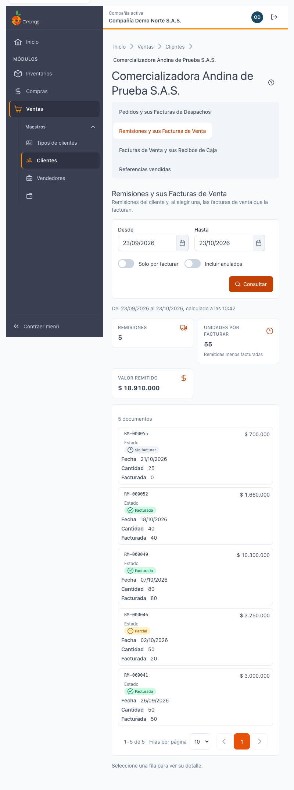
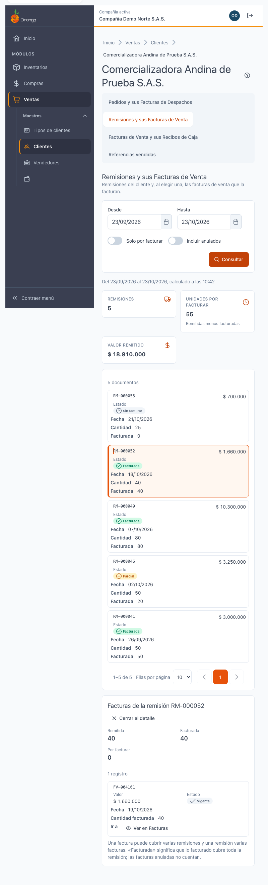
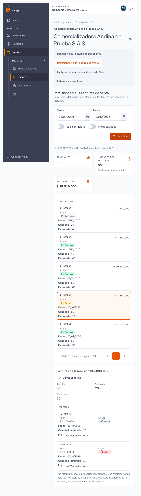
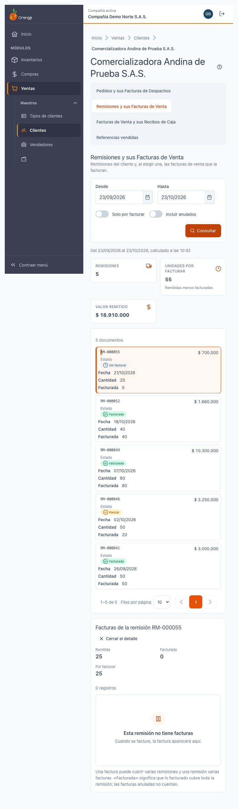
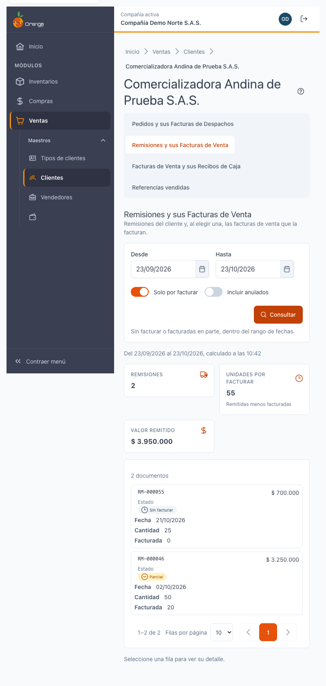

[Regresar a la documentación V2026](../../README.md)

---

# 🚚 Ficha del cliente · Remisiones y sus Facturas de Venta

---

## 📋 Descripción

La pestaña **Remisiones y sus Facturas de Venta** muestra las **remisiones** del cliente y, si elige una, **las facturas de venta que la facturan**. Así puede ver si lo remitido ya se facturó, parcialmente o no.

Es una pantalla de **consulta**: no crea, no edita ni elimina remisiones.

> 📘 Para el uso general de tablas (orden, paginación y exportación) vea [Manejo general de la información](../../Generales/manejo-general-informacion.md).

> 💡 Las remisiones y las facturas **no se abren desde aquí**: se muestran su número, fecha, cantidad y estado. El botón **Ver en Facturas** lleva a la pestaña **Facturas de Venta y sus Recibos de Caja** con la factura seleccionada.

> 💡 Si la compañía todavía no usa remisiones, la pestaña puede aparecer **vacía**. Es normal: no es un error.

---

## 🎯 Acceso

1. En el menú principal, haga clic en **Ventas**.
2. En **Maestros**, haga clic en **Clientes**.
3. Busque el cliente y ábralo en **Editar** (ficha).
4. Haga clic en la pestaña **Remisiones y sus Facturas de Venta**.

---

## 🖥️ Pantalla principal

| Elemento | Para qué sirve |
|----------|----------------|
| **?** (junto al título) | Abre esta ayuda en un panel lateral, sin salir de la pantalla. |
| **Desde** y **Hasta** | Rango de fechas de las remisiones. Por defecto es el **último mes**. |
| **Solo por facturar** | Muestra solo las remisiones **Sin facturar** o **Parcial**, dentro del rango de fechas. |
| **Incluir anulados** | Agrega las remisiones anuladas a la lista. |
| **Consultar** | Vuelve a buscar con los filtros elegidos. La pantalla no se actualiza sola. |
| **Tarjetas de totales** | **Remisiones**, **Unidades por facturar** (remitidas menos facturadas) y **Valor remitido**, del rango consultado. |
| **Lista de remisiones** | Una remisión por fila o tarjeta, con número, fecha, estado, valor, cantidad y cuánto se facturó. |

El orden de la lista va de **mayor a menor** (por fecha). Puede cambiarlo con los encabezados.

> ℹ️ A diferencia de **Solo con saldo** en Pedidos, **Solo por facturar sí respeta el rango de fechas**.

### Estado de la remisión

| Estado | Significado |
|--------|-------------|
| **Facturada** | Lo facturado, sumando una o varias facturas, cubre **toda** la cantidad de la remisión. |
| **Parcial** | Hay facturas, pero aún no cubren toda la remisión. |
| **Sin facturar** | Ninguna factura la cubre todavía. |
| **Anulada** | La remisión fue anulada. |

Las facturas anuladas **no cuentan**: si la única factura de una remisión se anuló, la remisión vuelve a **Parcial** o **Sin facturar**.

### Qué ve cada permiso

| Permiso | Qué ve |
|---------|--------|
| Consultar **Remisiones** | La lista de remisiones y sus totales. |
| Consultar **Facturas de venta** (además del de Remisiones) | El detalle: las facturas que facturan la remisión elegida. |

Sin el permiso del detalle, la pestaña muestra solo la lista de remisiones. Aparece el aviso **«El detalle no está disponible para su rol»** y las filas no se pueden elegir.

---

## 🔎 Ver las facturas de una remisión

1. Haga clic en la remisión (o en su fila) para elegirla.
2. Debajo aparece **Facturas de la remisión** con:
   - **Resumen**: **Remitida**, **Facturada** y **Por facturar**.
   - **Facturas de venta** que la cubren, con fecha, cantidad facturada, valor y estado. La columna **Ir a** tiene **Ver en Facturas**.
3. Para cerrar el detalle, haga clic en **Cerrar el detalle**.

Si la remisión no tiene facturas, aparece **Esta remisión no tiene facturas**. Cuando se facture, la factura aparecerá aquí.

### Cómo se relacionan remisiones y facturas

- Una **factura** puede cubrir **varias remisiones**.
- Una **remisión** puede tener **varias facturas**.
- Por eso «Facturada» quiere decir que lo facturado cubre **toda** la remisión, no que exista una sola factura.

---

## 🧭 Saltos entre pestañas

- **Ver en Facturas** abre la pestaña **Facturas de Venta y sus Recibos de Caja** con esa factura seleccionada. Si la factura cae fuera del rango, **la pestaña amplía el rango de fechas** y muestra el aviso **«Se amplió el rango de fechas para incluir el documento…»**.

---

## 🔄 Cambios de otros usuarios (en vivo)

Esta pantalla **no se actualiza sola**. Si otro usuario factura una remisión mientras la mira, haga clic en **Consultar** para ver el nuevo estado.

---

## ❓ Preguntas frecuentes

**¿Por qué la pestaña está vacía?**
Puede que la compañía no tenga remisiones en el rango de fechas. Amplíe **Desde** o quite **Solo por facturar**. Si la compañía aún no usa remisiones, la pestaña seguirá vacía.

**¿Por qué una remisión sigue en «Parcial» si ya la facturé?**
Revise si una de las facturas está anulada (las anuladas no cuentan) o si la cantidad facturada no cubre toda la remisión.

**¿Por qué una factura aparece en dos remisiones?**
Una factura puede cubrir varias remisiones. Se muestra en cada una con la cantidad que le corresponde.

**¿Veo aquí el saldo o la mora del cliente?**
No. Eso está en la pestaña **[Cartera](ficha-cartera.md)**.

---

## 🛠️ Errores comunes

| Mensaje | Qué hacer |
|---------|-----------|
| **No tiene permiso para ver esta información** | Su perfil no tiene el permiso de Remisiones. Consulte con su administrador. |
| **No se pudo cargar el detalle** | Vuelva a elegir la remisión o pulse **Consultar**. |
| **Este documento ya no está disponible para este cliente** | La remisión pudo anularse o cambiar. Pulse **Consultar**. |
| **La fecha inicial no puede ser posterior a la final** | Corrija el rango de fechas. |

---

## 🧷 Relacionado

- [Ficha del cliente · Pedidos y sus Facturas de Despachos](ficha-pedidos.md)
- [Ficha del cliente · Facturas de Venta y sus Recibos de Caja](ficha-facturas.md)
- [Ficha del cliente · Referencias vendidas](ficha-referencias-vendidas.md)
- [Ficha del cliente · Cartera](ficha-cartera.md)
- [Ficha del cliente · Consultas que tardan](ficha-consultas-que-tardan.md)
