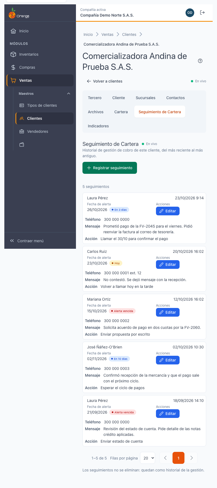
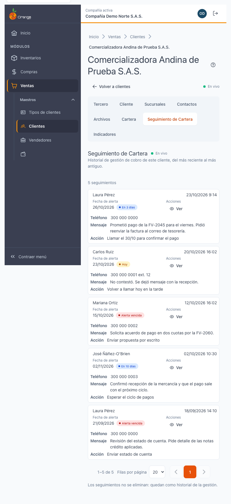
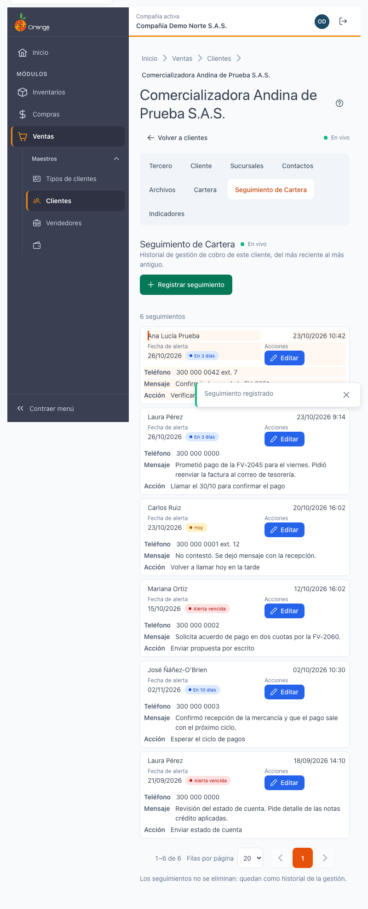
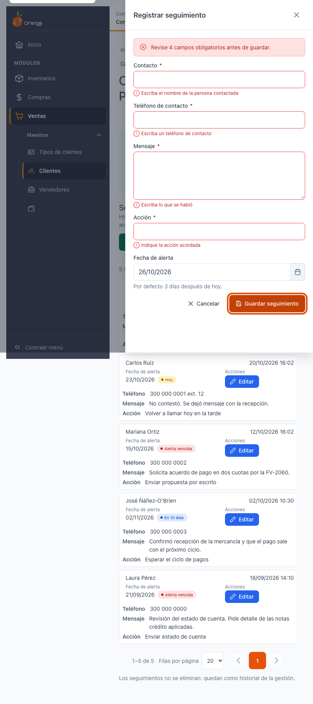
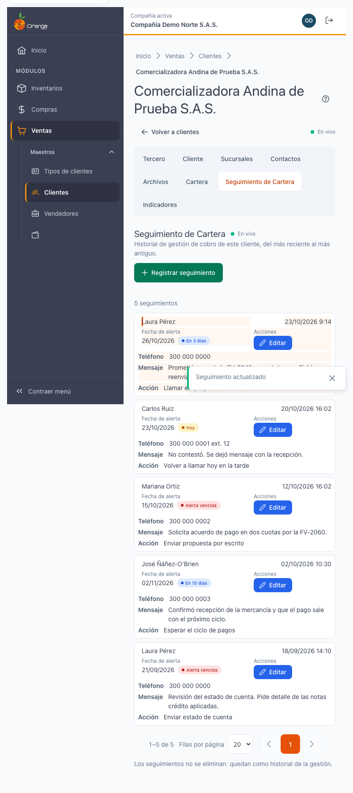

[Regresar a la documentación V2026](../../README.md)

---

# 📞 Ficha del cliente · Seguimiento de Cartera

---

## 📋 Descripción

La pestaña **Seguimiento de Cartera** guarda la **gestión de cobro** de este cliente: a quién se llamó, qué se habló, qué se acordó y en qué fecha debe recordarse. Es el historial de la gestión: del más reciente al más antiguo.

Aquí puede **registrar** un seguimiento nuevo y **editar** uno existente. **Los seguimientos no se eliminan**: quedan como historial de la gestión de cobro.

> 📘 Para el uso general de tablas (orden, paginación y exportación) vea [Manejo general de la información](../../Generales/manejo-general-informacion.md).

> 💡 Para ver el saldo y los documentos del cliente, use la pestaña [Cartera](ficha-cartera.md).

---

## 🎯 Acceso

1. En el menú principal, haga clic en **Ventas**.
2. En **Maestros**, haga clic en **Clientes**.
3. Busque el cliente y ábralo en **Editar** (ficha).
4. Haga clic en la pestaña **Seguimiento de Cartera**.

---

## 🖥️ Pantalla principal

| Elemento | Para qué sirve |
|----------|----------------|
| **?** (junto al título) | Abre esta ayuda en un panel lateral, sin salir de la pantalla. |
| **Registrar seguimiento** | Abre el panel para anotar una gestión nueva. Solo aparece si su perfil puede crear seguimientos. |
| **Lista de seguimientos** | Un seguimiento por fila, con contacto, fecha de la llamada, teléfono, mensaje, acción y fecha de alerta. |
| **Editar** | Abre el seguimiento para corregirlo. Si su perfil solo puede consultar, la fila tiene **Ver**. |

La lista va de la **llamada más reciente a la más antigua**. Puede ordenarla también por **Fecha de alerta** con su encabezado.

### Fecha de alerta

La **fecha de alerta** es el día en que el seguimiento debe volver a revisarse. Se muestra así:

| Texto | Significado |
|-------|-------------|
| **En 3 días** | Falta tiempo para la alerta. |
| **Hoy** | La alerta es hoy. |
| **Alerta vencida** | La fecha de alerta ya pasó. |

La fecha de alerta es una marca de fecha: **no hay estados de cerrado**. Un seguimiento con alerta vencida sigue en la lista; para cambiar su fecha de alerta, edítelo.

### Qué ve cada permiso

| Permiso | Qué puede hacer |
|---------|-----------------|
| Consultar **Seguimiento de Cartera** | Ver la lista y los seguimientos (con **Ver**). |
| **Crear** | Ver el botón **Registrar seguimiento** y guardar seguimientos nuevos. |
| **Actualizar** | Ver **Editar** y guardar cambios en un seguimiento. |

Ningún perfil puede **eliminar** un seguimiento: no existe esa acción en la pantalla.

Si su perfil solo consulta, verá la lista sin el botón **Registrar seguimiento** y sin **Editar**. Si la lista está vacía y no puede crear, verá el texto **Aún no hay seguimientos de este cliente** sin botón.

---

## ➕ Registrar un seguimiento

1. Haga clic en **Registrar seguimiento**.
2. Llene los campos del panel:

| Campo | Qué escribir | Obligatorio |
|-------|--------------|-------------|
| **Contacto** | Nombre de la persona contactada (hasta 200 caracteres). | Sí |
| **Teléfono de contacto** | Teléfono por el que se contactó (puede incluir extensión). | Sí |
| **Mensaje** | Lo que se habló. Puede escribir varias líneas. | Sí |
| **Acción** | La acción acordada, por ejemplo **Llamar el 30/10** (hasta 200 caracteres). | Sí |
| **Fecha de alerta** | Día en que debe revisarse. Por defecto es **3 días después de hoy**. | Sí |

3. Pulse **Guardar seguimiento**.

La **fecha y hora de la llamada** no se escribe: el sistema la pone al guardar.

Al guardar bien, el panel se cierra, el seguimiento nuevo aparece resaltado unos segundos y el aviso dice **Seguimiento registrado**.

### Errores al escribir

| Mensaje | Qué hacer |
|---------|-----------|
| **Escriba el nombre de la persona contactada** | Escriba el contacto. |
| **Escriba un teléfono de contacto** | Escriba el teléfono. |
| **Escriba lo que se habló** | Escriba el mensaje. |
| **Indique la acción acordada** | Escriba la acción. |
| **La alerta no puede ser anterior al seguimiento** | Elija una fecha de alerta igual a la fecha de hoy o posterior. |
| **Revise N campos obligatorios antes de guardar** | Los campos marcados en rojo están incompletos. |

Lo que escribió **no se pierde** si ocurre un error. Si el servidor no acepta un dato, el mensaje aparece junto al campo: corríjalo y guarde otra vez.

---

## ✏️ Editar un seguimiento

1. Haga clic en **Editar** de la fila (o en la fila).
2. Cambie lo que necesite. El panel muestra **Registrado el…** y **Última edición…**.
3. Pulse **Guardar seguimiento**. El aviso dice **Seguimiento actualizado**.

Si cambia la **fecha de alerta** a otra fecha futura, el sistema vuelve a avisar en esa nueva fecha (ver [Aviso por fecha de alerta](#aviso-por-fecha-de-alerta)).

### Cerrar el panel con cambios

Si pulsa **Cancelar** o **Escape** con cambios sin guardar, aparece **¿Descartar los cambios del seguimiento?**:

- **Descartar cambios** cierra el panel y pierde lo escrito.
- **Seguir editando** le deja en el panel.

Si no hizo cambios, el panel se cierra sin preguntar.

### Si el seguimiento ya no existe

Si el seguimiento ya no existe o no pertenece a esta compañía, aparece **Este seguimiento ya no existe o no es de esta compañía**. Pulse **Cerrar**: la lista se actualiza.

---

## 🔔 Aviso por fecha de alerta

La fecha de alerta sirve para recordar el seguimiento:

- El aviso llega a **quien registró el seguimiento**, en la **campana de notificaciones**.
- Se revisa **todos los días a las 5:00 a. m. (hora de Colombia)**. El aviso dice **Seguimiento de cartera vencido**, y al pulsarlo se abre la pestaña **Seguimiento de Cartera** del cliente.
- Un seguimiento con alerta para hoy **después de las 5:00 a. m.** recibe el aviso a la mañana siguiente.
- Si cambia la fecha de alerta a otro día futuro, el aviso se repite en esa fecha.
- El aviso **no incluye** el mensaje del seguimiento ni el nombre del cliente.
- Si la persona que registró el seguimiento ya no está activa en la compañía, no recibe el aviso.

Debajo de la fecha de alerta del formulario aparece el texto **Aviso el… a las 5:00 a. m. (hora de Colombia) a quien registra**.

---

## 🔄 Cambios de otros usuarios (en vivo)

Esta pestaña **sí se actualiza sola** cuando otro usuario trabaja en la misma ficha:

| Lo que pasa | Qué verá |
|-------------|----------|
| Otro usuario registra un seguimiento | La lista se actualiza y la fila nueva aparece resaltada. Aparece el aviso **Otro usuario registró un seguimiento**. |
| Otro usuario edita un seguimiento | La lista se actualiza. Aparece **Otro usuario actualizó un seguimiento**. |
| Otro usuario edita **el seguimiento que usted tiene abierto** | Dentro del panel aparece **Otro usuario modificó este seguimiento** con el botón **Ver cambios**. |

Al pulsar **Ver cambios**, los campos se recargan con la versión nueva. Lo que escribió en el panel **se pierde** al recargar; el sistema se lo advierte antes.

Quien hace el cambio **no recibe** ese aviso sobre su propio seguimiento.

Si la conexión en vivo se cae, aparece **Reconectando: los datos mostrados pueden no estar actualizados**. Pulse **Consultar** o recargue la ficha cuando vuelva la conexión.

---

## ❓ Preguntas frecuentes

**¿Por qué no hay botón para eliminar un seguimiento?**
Porque los seguimientos son el historial de la gestión de cobro. Si se corrige algo, se edita el seguimiento. Por la misma razón, un cliente con seguimientos registrados **no se puede eliminar**.

**¿Qué pongo en la fecha de alerta?**
El día en que debe volver a revisar al cliente. Si no cambia nada, queda **3 días después de hoy**.

**¿Por qué no me llegó el aviso de un seguimiento?**
Revise que la fecha de alerta sea la que espera y que su usuario siga activo en la compañía. El aviso llega a quien registró el seguimiento, no a otros usuarios.

**¿Por qué el aviso llegó un día después?**
Si registró el seguimiento con alerta para hoy después de las 5:00 a. m., el aviso llega a la mañana siguiente.

**¿Puedo ver el saldo del cliente aquí?**
No. El saldo está en la pestaña [Cartera](ficha-cartera.md).

**¿Por qué no veo Registrar seguimiento?**
Su perfil puede consultar, pero no crear seguimientos. Consulte con su administrador.

---

## 🛠️ Errores comunes

| Mensaje | Qué hacer |
|---------|-----------|
| **No se pudo guardar el seguimiento** | Lo escrito se conservó. Intente de nuevo. |
| **El servidor no aceptó este dato. Corríjalo e intente de nuevo.** | Revise el campo que aparece marcado. |
| **Este seguimiento ya no existe o no es de esta compañía** | Pulse **Cerrar** y revise la lista. |
| **No tiene permiso para ver esta información** | Su perfil no tiene el permiso de Seguimiento de Cartera. Consulte con su administrador. |
| **No se pudo cargar la información** | Pulse **Reintentar**. |

---

## 🧷 Relacionado

- [Ficha del cliente · Cartera](ficha-cartera.md)
- [Ficha del cliente · Indicadores](ficha-indicadores.md)
- [Ficha del cliente · Consultas que tardan](ficha-consultas-que-tardan.md)
