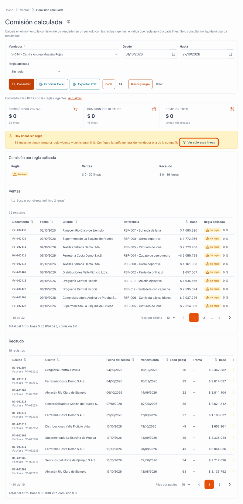
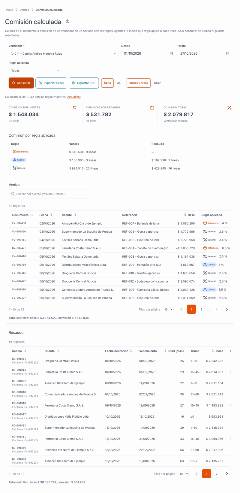
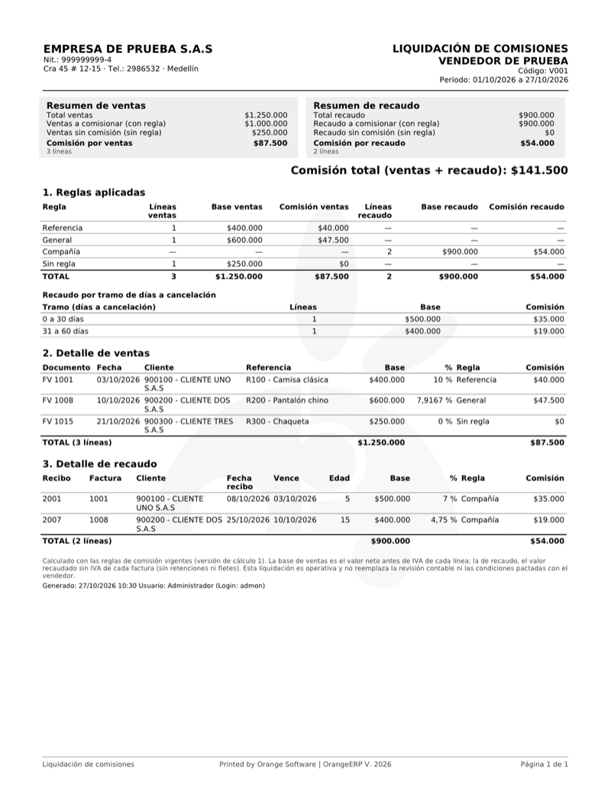

[Regresar a Ventas](../readme.md)

---

# Comisión calculada

---

## Descripción

**Comisión calculada** muestra cuánto le corresponde comisión a un vendedor en un periodo, con las reglas que están vigentes **hoy**. Para cada línea indica qué regla se aplicó: de referencia, de cliente, general del vendedor o de la compañía.

Es solo una **consulta**. No liquida, no paga, no guarda resultados y no congela el periodo: cada vez que consulta, el cálculo se hace de nuevo.

Las reglas se configuran en la pestaña **Comisiones** de la [ficha del vendedor](../vendedores/ficha-comisiones.md).

> Para el uso general de las tablas y la ayuda vea [Manejo general de la información](../../Generales/manejo-general-informacion.md).

---

## Acceso

1. En el menú principal, haga clic en **Ventas**.
2. Abra la opción **Comisión calculada** dentro del módulo Ventas.

Para ver la pantalla necesita el permiso **Consultar** sobre **Comisión calculada**.

También puede llegar desde el **informe** de la pestaña **Comisiones** de la [ficha del vendedor](../vendedores/ficha-comisiones.md), con el botón **Abrir en pantalla completa**. En ese caso la pantalla se abre con el vendedor y el periodo que ya tenía elegidos en el informe. Si no ve el resultado, pulse **Consultar**.

---

## Pantalla principal

| Elemento | Para qué sirve |
|----------|----------------|
| **?** (junto al título) | Abre esta ayuda en un panel lateral. |
| **Vendedor** | Vendedor al que se calcula la comisión. Es obligatorio. Busque por código o nombre. |
| **Desde** y **Hasta** | Periodo del cálculo. Por defecto es el mes en curso. Máximo 366 días y sin fechas futuras. |
| **Regla aplicada** | Filtra las líneas por la regla usada: **Todas**, **Referencia**, **Cliente**, **General** o **Compañía**, y **Sin regla**. |
| **Consultar** | Calcula con los filtros elegidos. Cambiar un filtro **no consulta** hasta que pulse el botón. |
| **Exportar Excel** | Descarga el resultado. Ver [Exportar a Excel](#exportar-a-excel). |
| **Exportar PDF** | Descarga el resultado en PDF, en papel Carta o A4. Ver [Exportar a PDF](#exportar-a-pdf). |
| **Resumen de ventas** y **Resumen de recaudo** | Tarjetas con los totales, las líneas con y sin regla, y la comisión del periodo. Ver [Resumen de ventas y resumen de recaudo](#resumen-de-ventas-y-resumen-de-recaudo). |
| **Calculado a las [hora] con las reglas vigentes** | Indica cuándo se calculó. |
| **Actualizar** | Vuelve a calcular con las reglas vigentes en ese momento. |

### Resumen de ventas y resumen de recaudo

Arriba de las dos tablas verá dos tarjetas con el resumen del periodo y de los filtros que eligió.

**Resumen de ventas**

- **Total ventas**: valor de todas las ventas del filtro.
- **Ventas a comisionar (con regla)**: ventas a las que sí se aplica una regla de comisión. Debajo aparece el número de líneas.
- **Ventas sin comisión (sin regla)**: ventas a las que no se aplica ninguna regla vigente. Estas líneas comisionan 0 %.
- **Comisión por ventas**: comisión total de las ventas, con el número de líneas.

**Resumen de recaudo**

Tiene las mismas partes, con los recibos de caja en lugar de las ventas:

- **Total recaudo**.
- **Recaudo a comisionar (con regla)**.
- **Recaudo sin comisión (sin regla)**.
- **Comisión por recaudo**, con el número de líneas.

**Qué significa «sin regla»**

Una línea está «sin regla» cuando, para ese vendedor, ese cliente y esa fecha, no hay ninguna regla de comisión vigente. En ese caso la comisión es 0 %. Para corregirlo, configure la tarifa general del vendedor o la tarifa de la compañía en la ficha del vendedor.

Si hay líneas sin regla, aparece el aviso **Hay líneas sin regla**, con el número de líneas y el botón **Ver solo esas líneas**. Al pulsarlo, la tabla muestra únicamente esas líneas para revisarlas.

### Las secciones de resultado

El resultado se divide en dos secciones:

- **Ventas**: una línea por cada factura o devolución de la línea de venta. Muestra documento, fecha, cliente, referencia, base, porcentaje, **regla aplicada** y comisión.
- **Recaudo**: una línea por cada cruce entre un recibo y una factura. Muestra recibo, factura, cliente, fecha del recibo, vencimiento, **edad en días**, tramo, base, porcentaje, **regla aplicada** y comisión.

Las devoluciones aparecen con base y comisión **negativas**.

Cada sección tiene su propia tabla, con buscador por cliente (escriba al menos 2 letras) y sus encabezados para ordenar.

### Totales

- Los totales de cada sección y el **total general** se calculan sobre **todo el filtro**, no solo sobre la página que ve.
- Al pie de cada tabla aparece **Total del filtro**, con la base y la comisión.
- Las cifras se muestran con 2 decimales.

### Comisión por regla aplicada

La tabla **Comisión por regla aplicada** resume cuánta comisión vino de cada regla, por sección. Permite ver de un vistazo si la comisión depende de excepciones o de la tarifa general. En cada fila ve:

- El nombre de la regla y su origen.
- La **comisión** de esa regla, en la línea principal.
- Debajo, la **base** sobre la que se calculó y el **número de líneas**.

Los totales de esta tabla y de los resúmenes se calculan sobre todo el filtro, no solo sobre la página que ve.

---

## Líneas sin regla

Si alguna línea no tuvo ninguna regla vigente, aparece el aviso **Hay líneas sin regla**, con el texto: **[n] líneas no tienen ninguna regla vigente y comisionan 0 %. Configure la tarifa general del vendedor o la de la compañía.**

Pulse **Ver solo esas líneas** para filtrar la tabla y revisar solo esos casos. Las líneas aparecen con la regla **Sin regla**.

Para corregirlas, vaya a la pestaña **Comisiones** del vendedor y configure la tarifa general o la escala general, o la de la compañía.

---

## Estados y mensajes

| Mensaje | Qué significa o qué hacer |
|---------|---------------------------|
| **Elija un vendedor y un periodo** | Pantalla inicial. Elija el vendedor y pulse **Consultar**. |
| **Calculando la comisión…** | El cálculo está en curso. Espere. |
| **El cálculo tarda más de lo normal.** | Se sigue procesando; la pantalla se actualizará sola. |
| **Sin ventas ni recaudo en el periodo** | El vendedor no tiene movimientos comisionables entre esas fechas. Cambie el periodo y consulte de nuevo. |
| **Sin líneas de venta** / **Sin líneas de recaudo** | No hay líneas de esa sección con el filtro elegido. |
| **Elija un vendedor.** | El vendedor es obligatorio. |
| **Escriba la fecha.** | Falta **Desde** o **Hasta**. |
| **La fecha no puede ser futura.** | Elija hoy o una fecha anterior. |
| **«Desde» no puede ser posterior a «Hasta».** | Corrija las fechas. |
| **El periodo no puede superar 366 días.** | Acorte el periodo. |
| **La consulta supera el máximo de líneas por sección. Acorte el periodo y consulte de nuevo.** | Use un periodo más corto. |
| **Hay más de 4.000 líneas con este filtro. Acorte el periodo o use Exportar Excel.** | El PDF no admite tantas líneas. Acorte el periodo o exporte a Excel. |
| **El servidor rechazó el filtro. Revise el vendedor y el periodo.** | Revise el vendedor y las fechas, y consulte otra vez. |
| **Este tercero tiene más de un registro de vendedor en la compañía; no se puede calcular su comisión.** | Pida a su administrador que revise el dato del vendedor. |
| **[n] reglas se ignoraron porque su cliente o referencia ya no existe.** | Revise las reglas del vendedor en la pestaña **Comisiones**. |
| **No se pudo cargar el detalle** | Pulse **Reintentar** o consulte de nuevo. |
| **Su rol no puede consultar la comisión calculada. Pida el acceso a un administrador.** | Su perfil no tiene el permiso de la consulta. |

---

## Exportar a Excel

1. Calcule el resultado con el vendedor y el periodo que necesite.
2. Pulse **Exportar Excel**.
3. El archivo trae las secciones **Ventas** y **Recaudo**, una fila de **TOTAL** y el encabezado de la compañía, los filtros usados, su usuario y la fecha.

Si el resultado supera **50.000 líneas**, el sistema no exporta. Acorte el periodo y vuelva a exportar.

Los botones **Exportar Excel** y **Exportar PDF** solo aparecen si su perfil tiene permiso para exportar esta consulta.

---

## Exportar a PDF

Junto al botón **Exportar Excel** hay un botón **Exportar PDF**. Solo lo ve si tiene el permiso **Exportar** en esta opción; sin ese permiso, el botón no aparece.

1. Elija los filtros (vendedor y periodo) y pulse **Consultar**.
2. Pulse **Exportar PDF**.
3. En **Papel del PDF**, elija **Carta** o **A4**.
4. Marque **PDF en color** si lo quiere a color. Por defecto el PDF sale en blanco y negro.
5. Al terminar aparece el mensaje **Se generó el PDF de la liquidación.**

**Qué contiene el PDF**

- **Encabezado** con el logo y los datos de la compañía.
- **Resúmenes** de ventas y de recaudo, igual que en pantalla.
- **Reglas aplicadas** del filtro y el recaudo por tramo.
- **Detalle de ventas** y **detalle de recaudo**, cada uno con una fila **TOTAL** al final.
- **Marca de agua** del documento.
- **Pie de página** con el número de página en formato «página X de Y».

**Límite de líneas**

El PDF admite hasta **4.000 líneas** con el filtro elegido. Si el filtro tiene más, aparece el mensaje **Hay más de 4.000 líneas con este filtro. Acorte el periodo o use Exportar Excel.** Para resolverlo:

- Acorte el periodo (por ejemplo, un mes en lugar de un año) y vuelva a exportar, o
- use **Exportar Excel**, que admite más líneas.

---

## Qué ve cada permiso

| Permiso | Qué ve |
|---------|--------|
| Consultar **Comisión calculada** | La consulta completa, sin el botón de exportar. |
| Consultar y **Exportar** en **Comisión calculada** | Además, los botones **Exportar Excel** y **Exportar PDF**. |
| Sin Consultar | La pantalla muestra que no tiene permiso. No se calcula nada. |

---

## Cambios de otros usuarios

El resultado **no se guarda**: dos personas pueden consultar al mismo tiempo sin afectarse. Si cambia una regla en la pestaña **Comisiones** después de calcular, el resultado mostrado no cambia hasta que pulse **Actualizar**. La hora de **Calculado a las** le indica qué tan reciente es.

---

## Preguntas frecuentes

**¿Esta consulta paga o liquida la comisión?**
No. Solo calcula. Liquidar, pagar o congelar comisiones no está disponible en esta versión.

**¿Por qué el total cambia si consulto otro día?**
El cálculo usa las reglas vigentes en el momento de la consulta. Si una regla cambió o hubo nuevas facturas o recibos, el resultado cambia.

**¿Por qué una venta aparece con 0 %?**
Ninguna regla vigente aplicó a esa línea en la fecha del documento. Aparece como **Sin regla**.

**¿Qué pasa con las devoluciones?**
Restan: aparecen con base y comisión negativas.

**¿Por qué el recaudo se calcula por edad?**
La comisión de recaudo depende de cuántos días después del vencimiento se pagó la factura. La **edad** es la fecha del recibo menos el vencimiento; si es negativa, el cliente pagó antes.

**¿Por qué el PDF sale en blanco y negro?**
Es el valor por defecto. Marque **PDF en color** antes de exportar para obtenerlo a color.

**¿Qué hago si el PDF no se genera por el límite?**
Acorte el periodo o use **Exportar Excel**, que admite más líneas.

**¿El informe de la ficha del vendedor es distinto de esta pantalla?**
No. Es el mismo cálculo, con el vendedor ya fijado. Si cambia las reglas, el informe muestra el aviso **Las reglas cambiaron** hasta que pulse **Actualizar**.

---

## Relacionado

- [Ficha del vendedor · Comisiones](../vendedores/ficha-comisiones.md)
- [Ficha del vendedor · Ventas](../vendedores/ficha-ventas.md)
- [Vendedores (maestro)](../maestros/vendedores.md)
