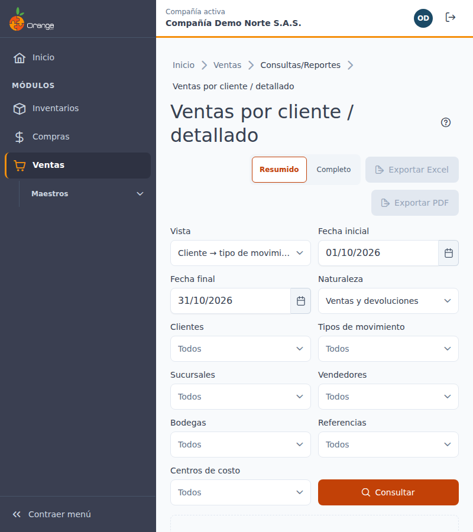
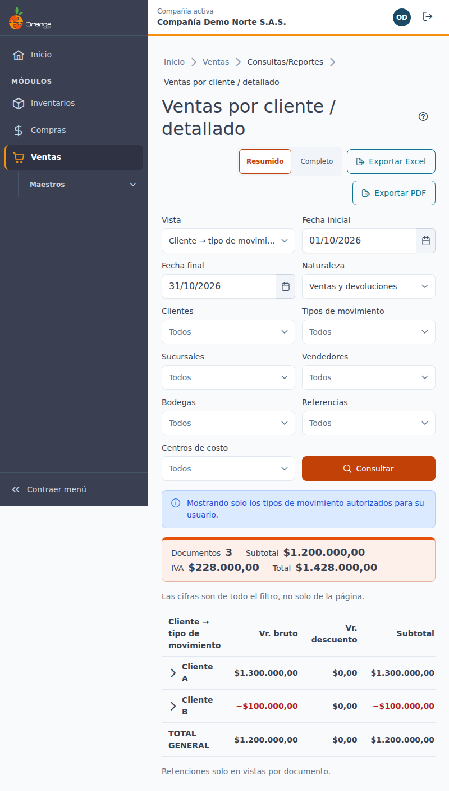
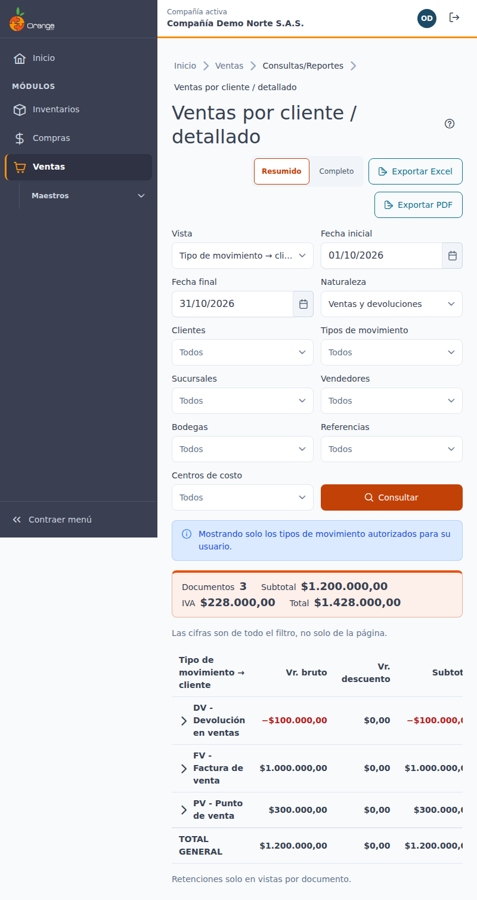
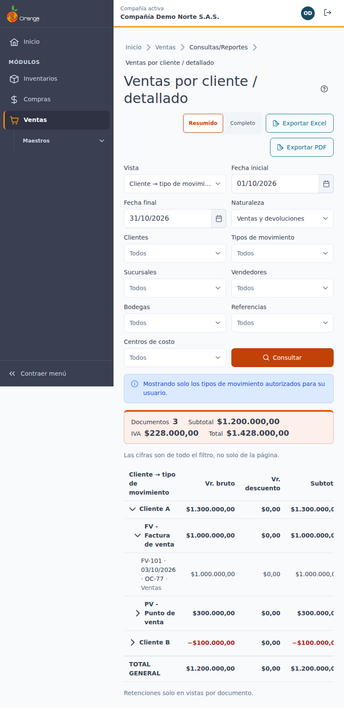
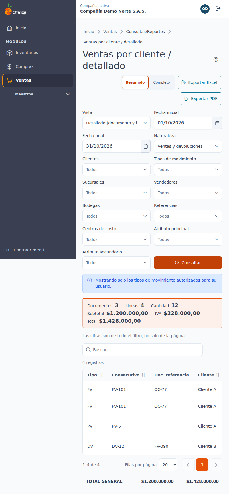
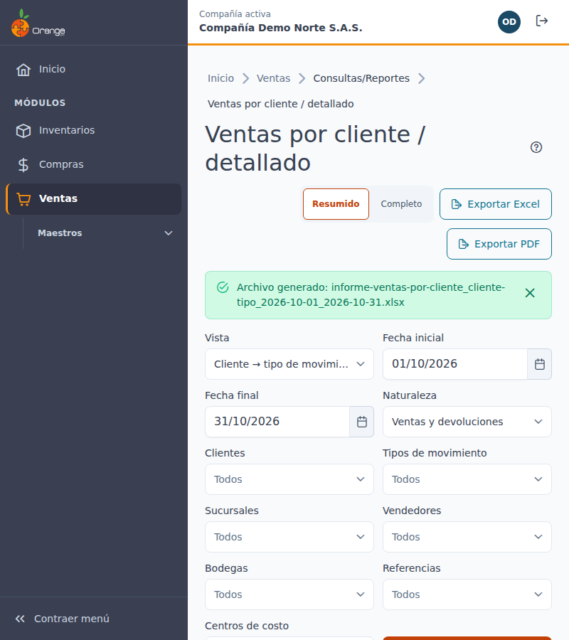
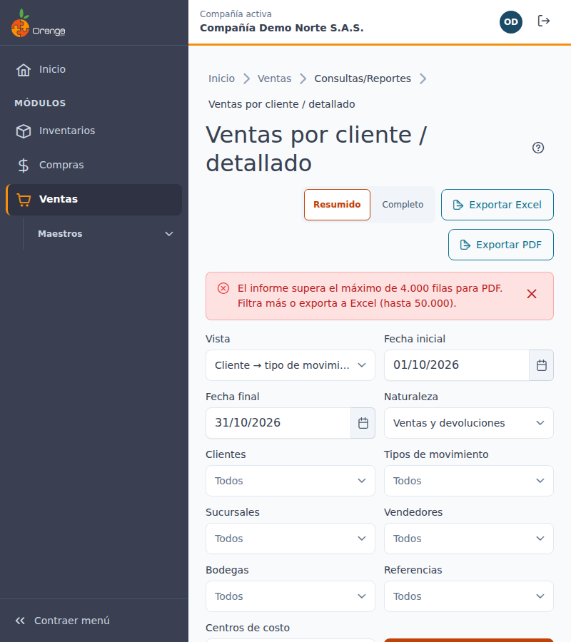

[Regresar a Ventas](../readme.md)

---

# 📊 Ventas por cliente / detallado

---

## 📋 Descripción

Esta pantalla muestra las **ventas y devoluciones** de la compañía en un rango de fechas, desde **seis vistas** distintas. Cada vista responde una pregunta diferente:

- ¿Qué tipos de movimiento tiene cada cliente? ¿Y qué clientes tienen cada tipo?
- ¿Qué referencias compró cada cliente? ¿Y quién compró cada referencia?
- ¿Qué referencias se vendieron por cada tipo de movimiento?
- ¿Cuál es el detalle documento por documento y línea por línea?

Es una pantalla de **consulta**: no crea, no edita, no anula ni elimina nada. Los totales son los del **filtro completo**, no solo los de la página que está viendo.

Quién la usa:

- **Analista de ventas**: revisa qué compra cada cliente y en qué documentos.
- **Jefe comercial**: compara clientes y referencias, y busca quién compra cada producto.
- **Gerencia**: consulta los totales del periodo y exporta el resumen en Excel o PDF.

> 📘 Para el uso general de tablas (orden, búsqueda y paginación) vea [Manejo general de la información](../../Generales/manejo-general-informacion.md).

> 💡 Las **devoluciones restan**. Las cantidades y los importes de una devolución aparecen en negativo, con el signo **−**. Los documentos **anulados no aparecen** ni suman.

> ⚠️ **Sus cifras pueden ser distintas a las de otro usuario, y a las de la consulta de ventas y devoluciones (103) o a la de tipo de movimiento a documentos (235).** La pantalla solo suma los tipos de movimiento que están autorizados para su usuario. Vea [Tipos de movimiento autorizados](#tipos-autorizados).

---

## 🎯 Acceso

1. En el menú principal, haga clic en **Ventas**.
2. Abra el grupo **Consultas/Reportes**.
3. Haga clic en **Ventas por cliente / detallado**.

La entrada aparece si su perfil puede **consultar** al menos una de estas opciones de permisos: **Por Clientes y Tipo Movimiento**, **Por Clientes y Referencias**, **Por Tipo Movimiento y Referencias** o **Ventas Detallado**. Si no ve la entrada, pida a su administrador el permiso de consulta de alguna vista. Vea [Permisos por vista](#permisos).

---

## 🔀 Las seis vistas

La vista se elige en el campo **Vista**. La vista por defecto es **Cliente → tipo de movimiento**.

| Vista | Qué muestra | Cuándo usarla |
|-------|-------------|---------------|
| **Cliente → tipo de movimiento** (por defecto) | Cada cliente, con los tipos de movimiento en los que compró o devolvió, y sus documentos. | Para saber qué tipos de venta o devolución tiene cada cliente. |
| **Tipo de movimiento → cliente** | Cada tipo de movimiento, con los clientes que aparecen en él y sus documentos. | Para saber qué clientes tienen devoluciones, o quién usa cada tipo. |
| **Cliente → referencia** | Cada cliente, con las referencias que compró, y sus líneas. | Para saber qué productos compra cada cliente. |
| **Referencia → cliente** | Cada referencia, con los clientes que la compraron, y sus líneas. | Para saber quién compró un producto. |
| **Tipo de movimiento → referencia** | Cada tipo de movimiento, con las referencias que se vendieron con ese tipo, y sus líneas. | Para saber qué se vendió en el punto de venta o en cada tipo de venta. |
| **Detallado (documento y líneas)** | Una fila por cada línea de cada documento, con tipo, consecutivo, cliente, bodega, referencia y atributos. Es una grilla plana. | Para revisar un documento completo, buscar un consecutivo o revisar líneas con bodega y atributos. |

### Vistas por documento y vistas por línea

Las cuatro primeras vistas de la tabla anterior se agrupan en dos niveles y, al abrir un grupo, aparecen los documentos o las líneas:

- **Por documento** (cliente → tipo y tipo → cliente): al abrir el grupo aparece cada **documento**, con su bruto, descuento, subtotal, IVA, **retenciones**, seguros y fletes, otros valores y total.
- **Por línea** (cliente → referencia, referencia → cliente y tipo → referencia): al abrir el grupo aparece cada **línea** de la referencia, con cantidad, valor, bruto, descuento, subtotal, IVA y total de línea. **No muestran retenciones**: las retenciones, seguros, fletes y otros valores solo se ven en las vistas por documento.

La vista **Detallado** también es por línea y tampoco muestra retenciones.

> 💡 Si cambia de vista, los filtros se conservan. Pulse **Consultar** para ver los datos de la nueva vista.

---

## 🔐 Permisos por vista

Cada vista exige el permiso de consulta de **su** opción. El permiso de exportar se da por separado, para la misma opción.

| Vista | Opción de permiso | Consultar | Exportar |
|-------|-------------------|-----------|----------|
| Cliente → tipo de movimiento | Por Clientes y Tipo Movimiento | Sí | Sí, con el permiso de exportar de esa opción |
| Tipo de movimiento → cliente | Por Clientes y Tipo Movimiento | Sí | Sí, con el permiso de exportar de esa opción |
| Cliente → referencia | Por Clientes y Referencias | Sí | Sí, con el permiso de exportar de esa opción |
| Referencia → cliente | Por Clientes y Referencias | Sí | Sí, con el permiso de exportar de esa opción |
| Tipo de movimiento → referencia | Por Tipo Movimiento y Referencias | Sí | Sí, con el permiso de exportar de esa opción |
| Detallado (documento y líneas) | Ventas Detallado | Sí | Sí, con el permiso de exportar de esa opción |

### Qué ve cada perfil

- **Con permiso en todas las vistas**: ve el selector de vista con las seis opciones.
- **Con permiso solo en algunas vistas**: el selector **solo muestra las vistas autorizadas**. Si la vista por defecto no está autorizada, la pantalla abre la primera vista que sí lo está.
- **Con permiso solo en Ventas Detallado**: el selector muestra solo **Detallado**, y la pantalla abre directamente en esa vista.
- **Sin permiso de consulta en ninguna vista**: la pantalla muestra **No tienes acceso a este informe** y no hace ninguna consulta.
- **Sin permiso de exportar**: los botones de exportar no aparecen.

> 📘 Si una vista no aparece en el selector, no es un error: su perfil no tiene el permiso de esa vista. Pida a su administrador que lo habilite.

---

## 🖥️ Pantalla principal

Al entrar, la pantalla muestra solo los filtros y el mensaje **Elige la vista y los filtros y pulsa Consultar**. No se consulta nada hasta que pulse **Consultar**.

| Elemento | Para qué sirve |
|----------|----------------|
| **?** (junto al título) | Abre esta ayuda en un panel lateral, sin salir de la pantalla. |
| **Vista** | Elige una de las seis vistas autorizadas para su perfil. |
| **Fecha inicial** y **Fecha final** | Rango de fechas. Por defecto es el **mes en curso**, hasta hoy. |
| **Naturaleza** | **Ventas y devoluciones** (por defecto), **Solo ventas** o **Solo devoluciones**. |
| Filtros de selección | **Clientes**, **Sucursales**, **Vendedores**, **Bodegas**, **Tipos de movimiento**, **Referencias** y **Centros de costo**. Vacío significa todos. |
| **Atributo principal** y **Atributo secundario** | Solo aparecen en las vistas por línea (vea [Filtros](#filtros)). |
| **Consultar** | Calcula el informe con los filtros elegidos. |
| **Exportar Excel** y **Exportar PDF** | Descargan el informe de la vista activa (vea [Exportar](#exportar)). |
| **Nivel de exportación** | **Resumido** (por defecto) o **Completo**. |
| **Totales del filtro completo** | Documentos, líneas y cantidad (en vistas por línea), subtotal, IVA y total. |
| **Resumen jerárquico** | El árbol de grupos de la vista. Cada grupo se abre con su botón. |
| **Detalle por documento y línea** | Solo en la vista **Detallado**: la grilla plana con búsqueda y paginación. |

Al pie de los totales aparece la nota **Las cifras son de todo el filtro, no solo de la página.** Cuando la consulta termina, la banda superior indica el periodo consultado y la hora de la consulta.

---

## 🎛️ Filtros

### Fechas

- Por defecto, la pantalla propone el **mes en curso**. La fecha final es **hoy**, y la fija el servidor.
- Puede consultar **hasta 366 días** por vez.
- La **fecha final** no puede ser futura.
- La **fecha inicial** no puede ser posterior a la fecha final.

Si el rango es mayor, aparece **El rango no puede superar 366 días.** Acorte el rango y pulse **Consultar**.

### Filtros que puede dejar vacíos

Ningún filtro es obligatorio. **Vacío significa todos.** Por ejemplo, si no elige bodegas, el informe incluye todas las bodegas.

Cada filtro acepta hasta **50** elementos. Si elige más, la consulta no se ejecuta.

| Filtro | Qué hace |
|--------|----------|
| **Naturaleza** | Ventas y devoluciones, solo ventas o solo devoluciones. |
| **Clientes** | Solo los clientes elegidos. |
| **Sucursales** | Solo las sucursales de **un** cliente. Este filtro se habilita cuando elige **un solo cliente**; si elige varios o ninguno, aparece **Elige un solo cliente para filtrar sucursales**. |
| **Vendedores** | Solo los documentos de los vendedores elegidos. |
| **Bodegas** | En vistas por línea, solo las líneas de esas bodegas. En vistas por documento, los documentos con al menos una línea de esas bodegas. |
| **Tipos de movimiento** | Solo los tipos elegidos (vea [Tipos de movimiento](#tipos)). |
| **Referencias** | En vistas por línea, solo las líneas de esas referencias. En vistas por documento, los documentos con al menos una línea de esas referencias. |
| **Centros de costo** | Igual que referencias: por línea, o por documento con al menos una línea que cumpla. |
| **Atributo principal** y **Atributo secundario** | Solo en vistas por línea y en **Detallado**. Por ejemplo, las tallas y los colores. |

> 💡 En vistas por documento, al filtrar por referencia, bodega o centro de costo se muestra el **valor completo del documento**, no solo la parte de la línea que cumple.

### Tipos de movimiento

El filtro **Tipos de movimiento** permite elegir **varios tipos a la vez**. Incluye:

- Los tipos de **ventas y devoluciones** que su usuario tiene autorizados.
- Los tipos del **Punto de venta**.

**El Punto de venta cuenta como venta.** Sus documentos suman igual que los de ventas, con el mismo signo, en los totales, en los grupos y en la exportación. No hay un filtro aparte de **origen** ni un subtotal separado por origen.

Si quiere ver **solo el Punto de venta**, elija únicamente sus tipos en este filtro. Para ver **solo las ventas**, elija solo los tipos de ventas y devoluciones.

### Columna Origen

En las grillas y en las hojas del árbol aparece la columna **Origen**, solo como información:

- **Ventas**: el documento es de un tipo de ventas o devoluciones.
- **Punto de venta**: el documento es de un tipo del Punto de venta.

La columna **no filtra** ni cambia los totales.

### Tipos de movimiento autorizados

El informe **solo suma los tipos de movimiento autorizados para su usuario**. Si un tipo de ventas no está autorizado para usted, sus documentos no aparecen en filas, grupos, totales ni archivos exportados.

Por eso:

- Dos usuarios con autorizaciones distintas pueden ver **totales distintos** para el mismo rango de fechas.
- Los totales **pueden no coincidir** con la consulta de ventas y devoluciones (103) ni con la consulta de tipo de movimiento a documentos (235), que no aplican esta limitación. Coinciden solo si su usuario está autorizado en todos los tipos.
- Encima del panel de totales aparece el aviso **Mostrando solo los tipos de movimiento autorizados para su usuario.**

Si no tiene ningún tipo de ventas autorizado, verá solo los tipos del Punto de venta. Si tampoco tiene esos tipos visibles, la pantalla muestra **Sin ventas ni devoluciones** y los totales en cero. En ese caso, pida a su administrador que lo autorice en los tipos de venta.

### Naturaleza y signo

- Las **devoluciones restan**: su cantidad y sus importes aparecen en negativo, con el signo **−** y en color.
- Los mismos valores aparecen en la pantalla, en los totales, en el resumen y en los archivos Excel y PDF.
- Los documentos **anulados no aparecen** en ninguna vista.

---

## 🌳 Ver el resumen y sus grupos

En las cinco vistas que no son **Detallado**, el informe se muestra como un **resumen jerárquico**:

1. El **primer nivel** son los grupos de la vista (por ejemplo, un cliente). Cada grupo muestra sus documentos, cantidad y totales.
2. El **segundo nivel** son los subgrupos (por ejemplo, los tipos de movimiento de ese cliente).
3. Al abrir un subgrupo aparecen sus **documentos** (vistas por documento) o sus **líneas** (vistas por línea).

Para abrir un grupo, haga clic en su botón **Expandir**. Para cerrarlo, haga clic en **Contraer**.

Si hay más grupos de los visibles, aparece **Ver más grupos (n de total)**. Haga clic para ver los siguientes.

El último renglón es **TOTAL GENERAL**: es el total de todo el filtro, aunque no tenga todos los grupos en pantalla.

### Ejemplos de cada vista

| Vista | Qué ve al abrir el primer grupo |
|-------|---------------------------------|
| Cliente → tipo de movimiento | Los tipos de movimiento del cliente. Al abrir un tipo, sus documentos. |
| Tipo de movimiento → cliente | Los clientes del tipo. Al abrir un cliente, sus documentos. |
| Cliente → referencia | Las referencias del cliente. Al abrir una referencia, sus líneas. |
| Referencia → cliente | Los clientes de la referencia. Al abrir un cliente, sus líneas. |
| Tipo de movimiento → referencia | Las referencias del tipo. Al abrir una referencia, sus líneas. |

### Abrir un grupo (drill-down)

1. Haga clic en **Expandir** del grupo que le interesa.
2. Mientras carga, aparece **Cargando…**. Solo se pide el detalle de ese grupo.
3. Aparecen sus documentos o líneas, con sus importes.
4. Para cerrarlo, haga clic en **Contraer**.

Si el detalle de un grupo no carga, aparece **No se pudo cargar el detalle del grupo.** Los filtros y el resumen se conservan: pulse de nuevo **Expandir** para reintentar.

---

## 📑 Vista Detallado

La vista **Detallado** muestra una fila por cada **línea** de cada documento, en una grilla con estas columnas:

| Columna | Qué contiene |
|---------|--------------|
| **Tipo** | Tipo de movimiento del documento. |
| **Consecutivo** | Número del documento. |
| **Doc. referencia** | Documento al que se refiere, si lo tiene. |
| **Cliente** | Cliente del documento. |
| **Fecha** | Fecha del documento. |
| **Origen** | **Ventas** o **Punto de venta** (solo informativo). |
| **Bodega** | Bodega de la línea. |
| **Referencia** | Producto de la línea. Si la línea no tiene referencia, aparece **Sin referencia**. |
| **Atributos** | Atributos principal y secundario de la línea. |
| **Cantidad**, **Vr. bruto**, **Vr. descuento**, **Subtotal**, **IVA** y **Total** | Valores de la línea. |

- La grilla se **ordena** y se **pagina** en el servidor: 10, 25, 50 o 100 filas por página.
- **Buscar en el detalle** filtra las filas por número, cliente o referencia. Escriba al menos **2 letras**.
- Si ninguna línea coincide, aparece **Ninguna línea coincide con «…»**. Pulse **Limpiar búsqueda** para volver a ver todas.
- Debajo de la grilla aparece el **TOTAL GENERAL** del filtro completo, no solo de la página.

En Detallado no aparecen retenciones ni seguros, fletes y otros valores.

---

## 📤 Exportar

Los botones **Exportar Excel** y **Exportar PDF** descargan el informe de la vista activa, con los mismos filtros, el mismo orden y los mismos totales que ve en pantalla.

1. Elija el **Nivel de exportación**:
   - **Resumido** (por defecto).
   - **Completo**.
2. Haga clic en **Exportar Excel** o en **Exportar PDF**.
3. Mientras se genera, aparece **Generando el archivo…**.
4. Cuando termina, aparece **Archivo generado** con el nombre del archivo. El archivo se descarga con el nombre de la vista y de las fechas.

El PDF sale en formato horizontal. El Excel y el PDF incluyen los subtotales por grupo y el **TOTAL GENERAL**.

### Límites de exportación

| Formato | Máximo de filas |
|---------|-----------------|
| **Excel** | 50.000 filas |
| **PDF** | 4.000 filas |

Si el informe supera el máximo, aparece un aviso con el límite. Para exportar, acote los filtros (por ejemplo, un rango de fechas más corto) o exporte a Excel, que admite más filas.

---

## 🔄 Cambios de otros usuarios (en vivo)

Esta pantalla **no se actualiza sola**. Si se registran ventas o devoluciones mientras la consulta está abierta, pulse **Consultar** para recalcular. Los filtros que tenía puestos se mantienen.

---

## 🧭 Estados de la pantalla

| Estado | Qué ve |
|--------|--------|
| **Inicial** | Los filtros y el mensaje **Elige la vista y los filtros y pulsa Consultar**. Por defecto se muestra el mes en curso. |
| **Cargando** | La pantalla indica que el informe se está calculando. |
| **Sin ventas ni devoluciones** | No hay documentos con esos filtros. Si no ve ninguno, revise sus tipos de movimiento autorizados. |
| **Error** | **No se pudo cargar el informe**, con el botón **Reintentar**. Sus filtros se conservan. |
| **Filtro no válido** | Un filtro elegido no existe o no está autorizado para su usuario. Quítelo e inténtelo de nuevo. |
| **Sin acceso** | **No tienes acceso a este informe**. No se hace ninguna consulta. |

---

## 🔁 Diferencias con el legado

Esta pantalla **reemplaza** las cuatro pantallas separadas del sistema anterior (**Por Clientes y Tipo Movimiento**, **Por Clientes y Referencias**, **Por Tipo Movimiento y Referencias** y **Ventas Detallado**). Estas son las diferencias principales:

| En el sistema anterior | En esta pantalla |
|------------------------|------------------|
| Cuatro pantallas separadas. | Una sola pantalla con selector de **vista**. Las opciones anteriores son los permisos de cada vista. |
| Rango de **31 días** como máximo. | Rango de hasta **366 días**. |
| Los tipos de movimiento y la bodega eran **obligatorios**. | Todos los filtros son **opcionales**. Vacío significa todos. |
| El filtro de tipos solo listaba los tipos de la 67. | Los tipos de la 67 y del Punto de venta aparecen juntos en el mismo filtro. |
| El filtrado se hacía en pantalla, sobre todo el resultado. | Los filtros, el orden y la paginación se aplican en el servidor. |
| Las devoluciones se veían con un signo en pantalla y con otro en Excel. Los anulados podían aparecer. | Las devoluciones **restan** en todos los medios. Los anulados **no aparecen**. |
| Reporte completo sí o no. | Nivel **Resumido** o **Completo**. |
| Las retenciones aparecían en todos los reportes. | Las retenciones solo aparecen en las vistas por documento. |
| Todos los tipos de movimiento se mostraban al usuario. | Solo se suman los tipos **autorizados** para su usuario. |
| Sin filtros de sucursal, referencia, centro de costo ni atributos en todas las vistas. | Se agregan **Sucursales** (con un solo cliente), **Referencias**, **Centros de costo** y los **atributos**, en las vistas que aplican. |

---

## ❓ Preguntas frecuentes

**¿Por qué no veo la entrada Ventas por cliente / detallado en el menú?**
Su perfil no tiene el permiso de consulta de ninguna de las cuatro vistas. Pida a su administrador que lo habilite en al menos una.

**¿Por qué no veo todas las vistas?**
Solo aparecen las vistas para las que su perfil tiene permiso de consulta. Vea [Permisos por vista](#permisos).

**¿Por qué mis totales son distintos a los de un compañero?**
La pantalla suma solo los tipos de movimiento autorizados para cada usuario. Si uno de los dos no está autorizado en algún tipo, sus cifras serán diferentes. Vea [Tipos de movimiento autorizados](#tipos-autorizados).

**¿Por qué mis totales no coinciden con la consulta de ventas y devoluciones (103)?**
Por la misma razón: esta pantalla suma solo los tipos autorizados para su usuario, y la 103 y la 235 no aplican esa limitación. Las cifras coinciden solo si su usuario está autorizado en todos los tipos.

**¿Por qué no veo las ventas del Punto de venta?**
Los tipos del Punto de venta están en el filtro **Tipos de movimiento**. Si elige otros tipos, no aparecen. Quite el filtro o elija también los tipos del Punto de venta.

**¿Cómo veo solo las ventas del Punto de venta?**
En **Tipos de movimiento**, elija solo los tipos del Punto de venta.

**¿Por qué el filtro de sucursales está deshabilitado?**
Las sucursales se filtran por cliente. Elija **un solo cliente** para habilitarlo.

**¿Por qué en Cliente → referencia no veo retenciones?**
Las vistas por línea no muestran retenciones, seguros, fletes ni otros valores. Esas columnas aparecen en las vistas por documento.

**¿Por qué el total de una línea no coincide con el total del documento?**
Porque la línea muestra solo su parte del documento. El total del documento aparece en las vistas por documento.

**¿Por qué la cantidad de una referencia es menor que la vendida?**
Porque las devoluciones restan. Revise la vista **Detallado** para ver las líneas de devolución.

**¿Los valores incluyen IVA?**
Los importes muestran el subtotal, el IVA y el total por separado. Use el total si necesita el valor con impuestos.

**¿Por qué no veo los botones de exportar?**
Su perfil no tiene el permiso de exportar de esa opción. Pida a su administrador que lo habilite.

**¿Puedo ver el informe en tiempo real?**
No. Pulse **Consultar** para recalcular.

---

## 🛠️ Errores comunes

| Mensaje | Qué hacer |
|---------|-----------|
| **El rango no puede superar 366 días.** | Acorte **Fecha inicial** o **Fecha final** y pulse **Consultar**. |
| **La fecha final es obligatoria y no puede ser futura.** | Elija una fecha de hoy o anterior. |
| **La fecha inicial no puede ser posterior a la final.** | Corrija el rango de fechas. |
| **Elige un solo cliente para filtrar sucursales.** | Elija un solo cliente antes de elegir sucursales. |
| **No se pudo cargar el informe** | Pulse **Reintentar**. Sus filtros se conservan. |
| **Alguno de los filtros elegidos no existe o no está autorizado para tu usuario.** | Quite el filtro indicado (por ejemplo, un tipo de movimiento) e inténtelo de nuevo. |
| **No tienes permiso para consultar la vista «…». Elige otra vista.** | Elija otra vista de la lista. |
| **No tienes acceso a este informe** | Su perfil no tiene permiso de consulta en ninguna vista. Consulte con su administrador. |
| **No tienes permiso para exportar esta vista.** | Pida a su administrador el permiso de exportar de esa opción. |
| **El informe supera el máximo de filas para Excel o PDF.** | Acote los filtros o exporte a Excel. |
| **No se pudo generar el archivo.** | Pulse **Exportar** de nuevo. |
| **No se pudo cargar el detalle del grupo.** | Pulse **Expandir** de nuevo. |

---

## 🧷 Relacionado

- [Ventas y devoluciones](../movimientos/ventas-devoluciones.md)
- [Clientes](../maestros/clientes.md)
- [Ficha del cliente · Referencias vendidas](../clientes/ficha-referencias-vendidas.md)
- [Manejo general de la información](../../Generales/manejo-general-informacion.md)
