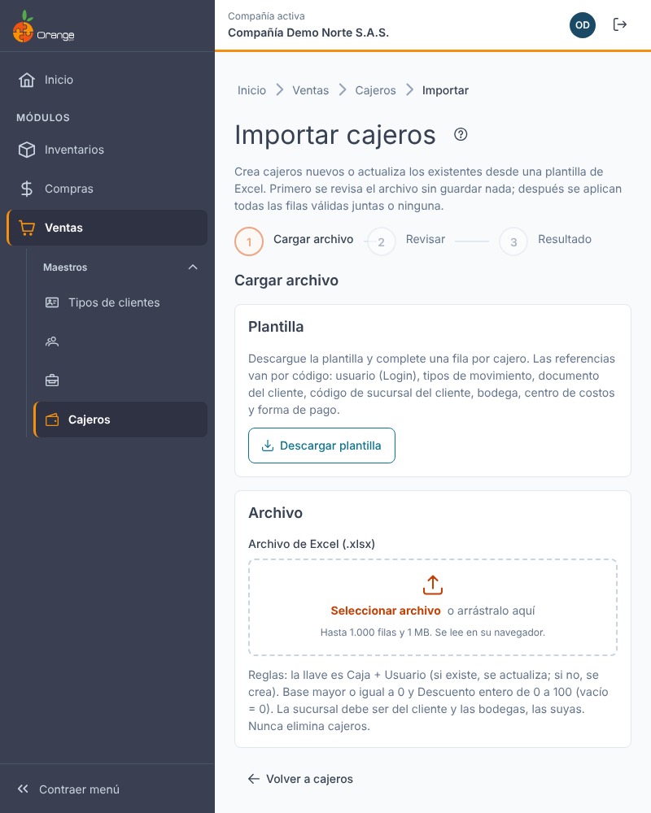
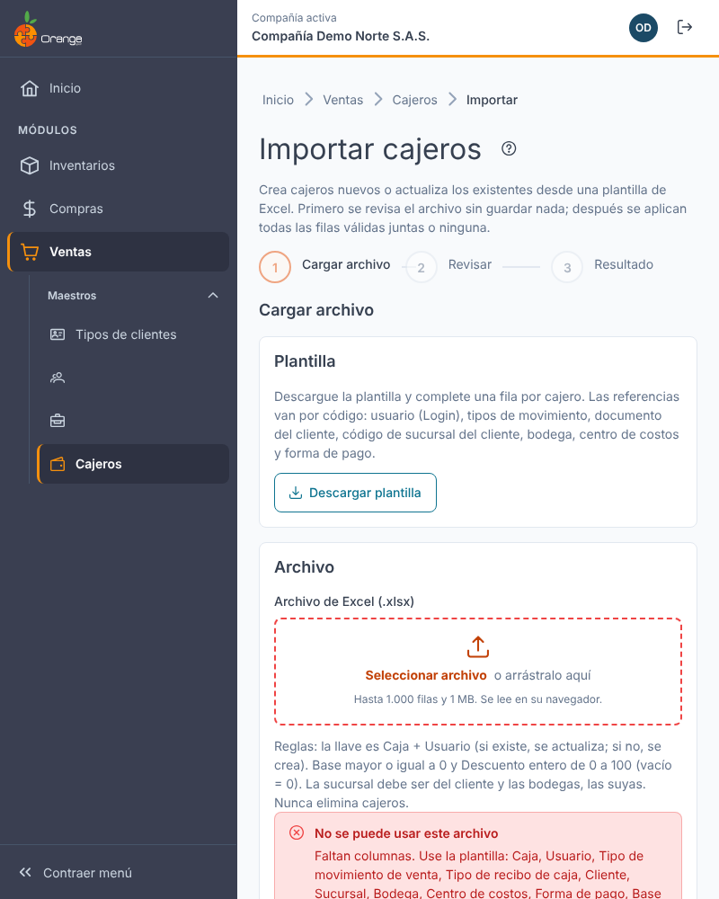
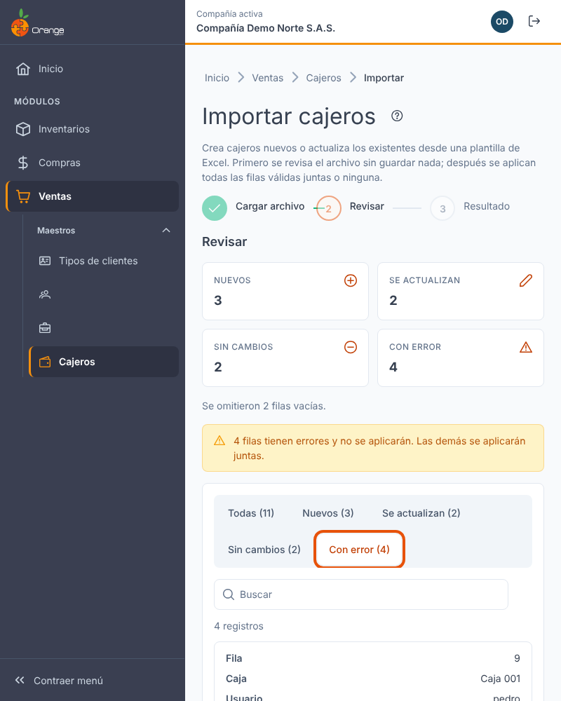
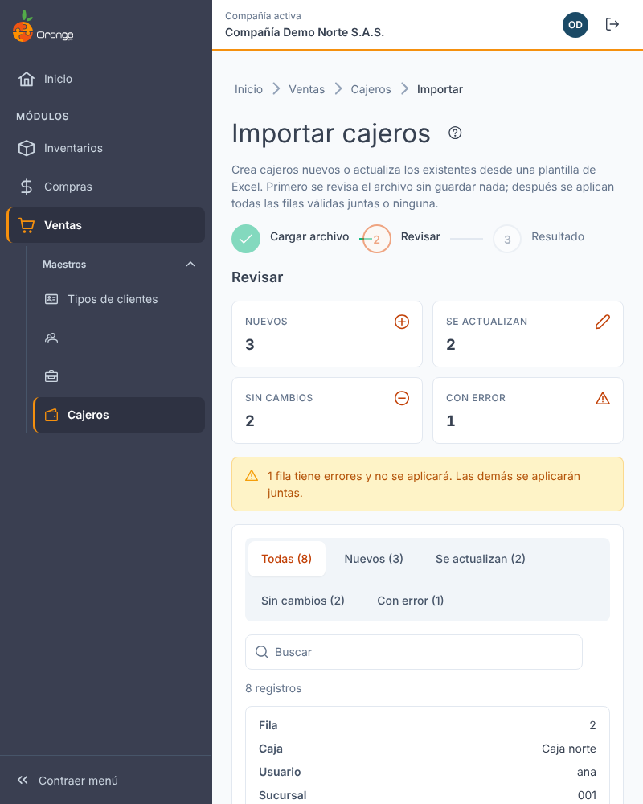
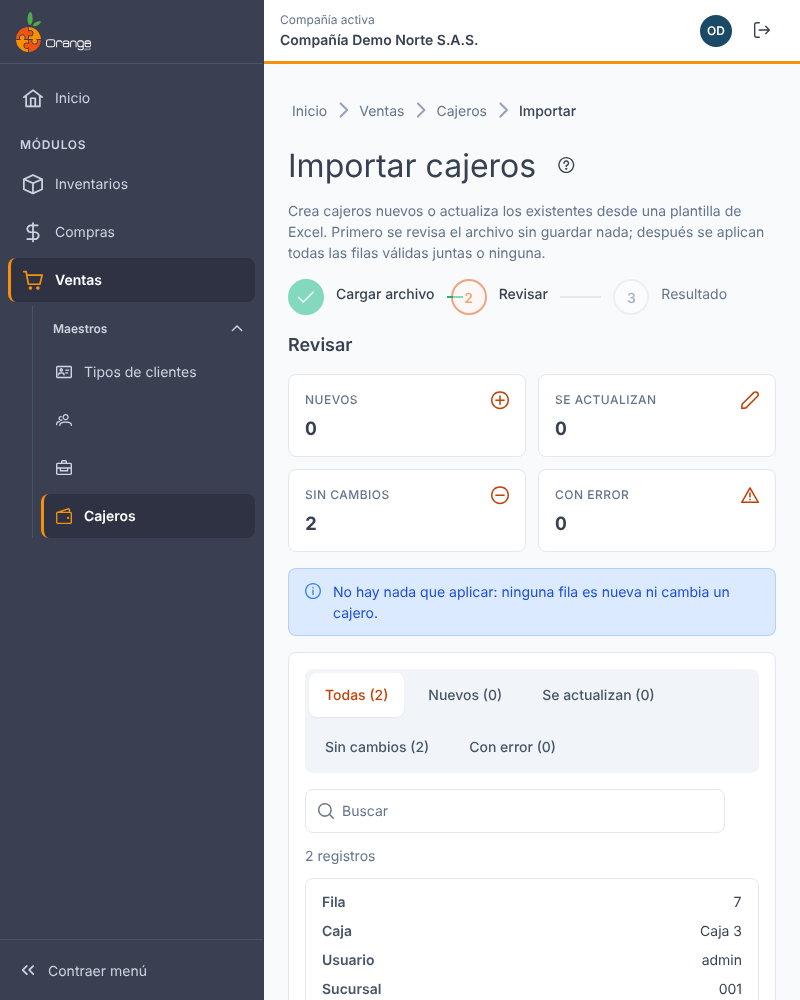
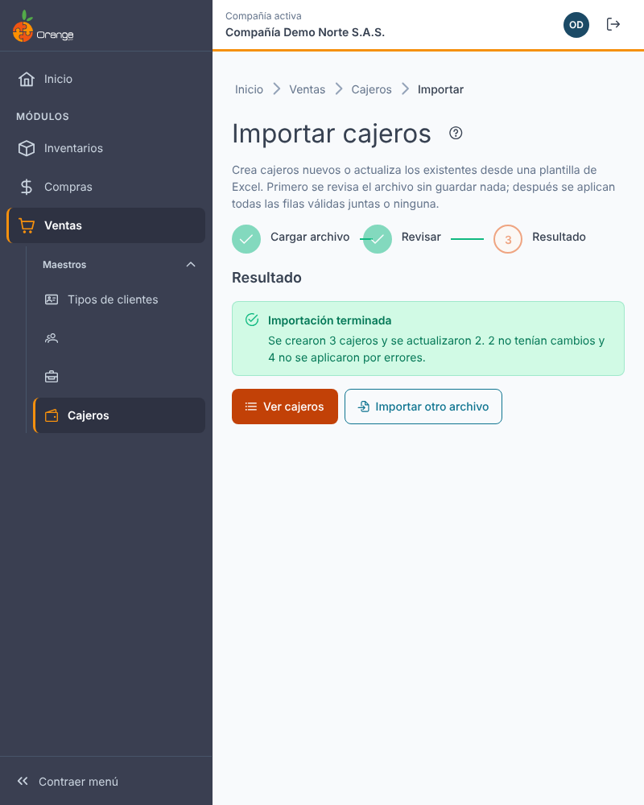
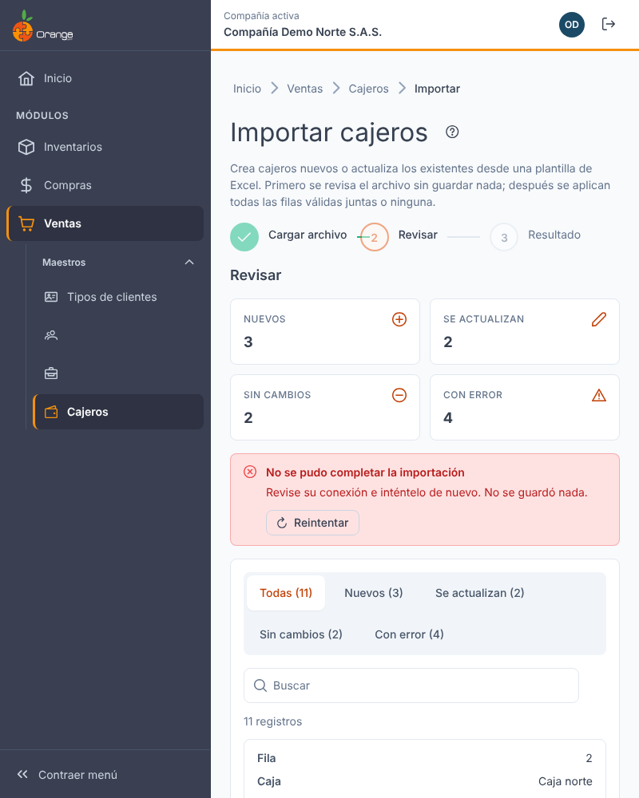
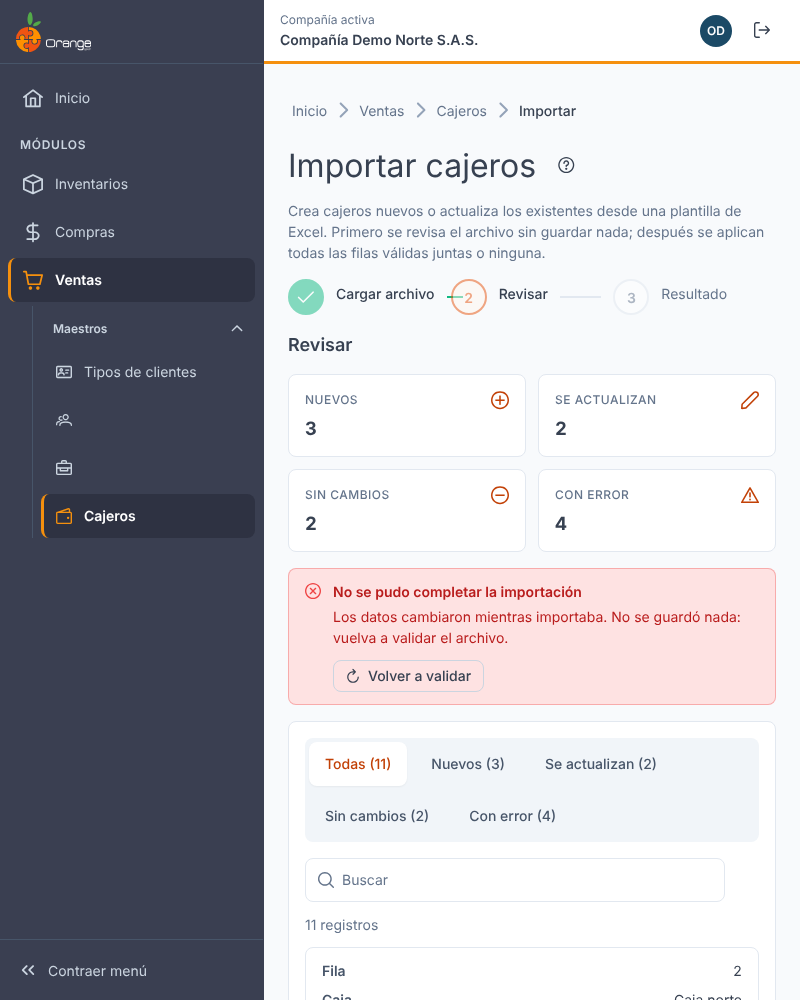

[Regresar a Cajeros](cajeros.md)

---

# 📥 Importar cajeros desde Excel

---

## 📋 Descripción

Crea cajeros nuevos o actualiza los existentes a partir de un archivo de Excel. Antes de guardar, el sistema le muestra qué va a crear, qué va a actualizar y qué filas tienen errores. **Nunca elimina cajeros.**

> 🔐 Necesita el permiso **Exportar** sobre la opción Cajeros (es el mismo permiso de **Exportar a Excel**).

---

## 🎯 Acceso

En [Cajeros](cajeros.md), haga clic en **Importar** (junto a **Exportar a Excel**). La importación tiene tres pasos: **Cargar archivo → Revisar → Resultado**.

---

## 1️⃣ Cargar archivo

1. Haga clic en **Descargar plantilla**. Se descarga `cajeros-plantilla.xlsx` con las columnas: **Caja, Usuario, Tipo de movimiento de venta, Tipo de recibo de caja, Cliente, Sucursal, Bodega, Centro de costos, Forma de pago, Base** y **Descuento (%)**.
2. Llene **una fila por cajero**. Las referencias van por su código o documento: usuario (Login), tipos de movimiento, documento del cliente, código de la sucursal del cliente, bodega, centro de costos y forma de pago.
3. Guarde el archivo y arrástrelo al recuadro, o haga clic en **Seleccionar archivos**.

La **llave** de cada fila es **Caja + Usuario**: si ya existe un cajero con esa caja y ese usuario, se **actualiza** (todos sus datos); si no, se **crea**.

| Regla | Detalle |
|-------|---------|
| Formato | Excel `.xlsx`. Solo se lee la **primera hoja**. |
| Encabezado | La primera fila debe tener los encabezados de la plantilla (con o sin tilde, en mayúsculas o minúsculas). El orden no importa. **Descuento (%)** es opcional. |
| Tamaño | Hasta **1.000 filas** y **1 MB**. Si tiene más, divida el archivo. |
| Filas vacías | Se ignoran; en **Revisar** se indica cuántas se omitieron. |
| Caja | Obligatoria, hasta 50 caracteres, sin comas ni punto y coma. |
| Base | Número mayor o igual a 0. |
| Descuento | Entero de 0 a 100 (vacío = 0). |
| Sucursal | Debe ser una sucursal del cliente de la fila. |
| Bodega | Debe ser una de **sus** bodegas. |
| Tipos de movimiento | Solo los que usted tiene autorizados (venta y recibo de caja). |

Si el archivo no sirve, verá el motivo y no se envía nada: no es un `.xlsx`, faltan columnas, no tiene filas, tiene más de 1.000 filas o pesa más de 1 MB.

---

## 2️⃣ Revisar

El sistema valida cada fila **sin guardar nada**:

| Indicador | Significado |
|-----------|-------------|
| **Nuevos** | Caja + Usuario que no existen: se crearán. |
| **Se actualizan** | Ya existen y algún dato cambia: se actualizan. |
| **Sin cambios** | Ya existen con los mismos datos: no se toca nada. |
| **Con error** | Filas que **no se importarán**. En **Estado** verá el motivo. |

Use las pestañas **Todas / Nuevos / Se actualizan / Sin cambios / Con error** para filtrar la tabla.

### Errores frecuentes

| Mensaje | Cómo corregirlo |
|---------|-----------------|
| *Falta la caja / el usuario / la bodega…* | Complete la celda. |
| *El usuario no existe o no está activo en esta compañía.* | Revise el Login. |
| *La sucursal no pertenece al cliente de la fila.* | Use una sucursal del cliente. |
| *La base debe ser mayor o igual a 0.* / *El descuento debe ser un entero de 0 a 100.* | Corrija el número. |
| *La fila se repite en el archivo.* | Deje una sola fila por Caja + Usuario. |
| **Conflicto: ya hay una caja con ese nombre de otro usuario** | Dos cajeros no deberían compartir nombre de caja. El sistema **no lo resuelve solo**: cambie el nombre de la caja o el usuario. |

> 💡 **Descargar filas con error** genera un Excel solo con esas filas, para corregirlas y volver a cargarlas.

Si no hay nada para aplicar, verá *"No hay nada que aplicar"* y el botón queda deshabilitado.

---

## 3️⃣ Aplicar y resultado

Haga clic en **Aplicar N cambios** (nuevos + se actualizan). Las filas con error se omiten. Todo se guarda **junto**: si algo falla, **no se guarda ningún cambio**.

Al terminar verá el resumen de cuántos se crearon, cuántos se actualizaron, cuántos no tenían cambios y cuántas filas no se aplicaron por errores. **Ver cajeros** vuelve al listado, que ya muestra los cambios.

### ¿Qué puede salir mal al aplicar?

| Mensaje | Qué hacer |
|---------|-----------|
| **No se pudo completar la importación.** | Haga clic en **Reintentar**. No se guardó nada. |
| **Los datos cambiaron mientras importaba.** | Otro usuario cambió cajeros; no se guardó nada. Haga clic en **Volver a validar**. |

Si otra persona cambia cajeros mientras usted revisa, verá un aviso para **Volver a validar** antes de aplicar.

---

## ❓ Preguntas frecuentes

**¿Puedo cambiar el nombre de una caja con la importación?**
No: Caja + Usuario es la llave, así que otro nombre crea un cajero nuevo. Para renombrar use **Editar** en [Cajeros](cajeros.md).

**¿La importación borra los cajeros que no están en el archivo?**
No. Nunca elimina cajeros.

**No veo el botón Importar.**
Su perfil necesita el permiso **Exportar** sobre Cajeros. Consulte a su administrador.

**Una fila marca "Conflicto" con el nombre de la caja.**
Ya hay una caja con ese nombre asignada a otro usuario. Cambie el nombre o el usuario de la fila; el sistema no elige por usted.
