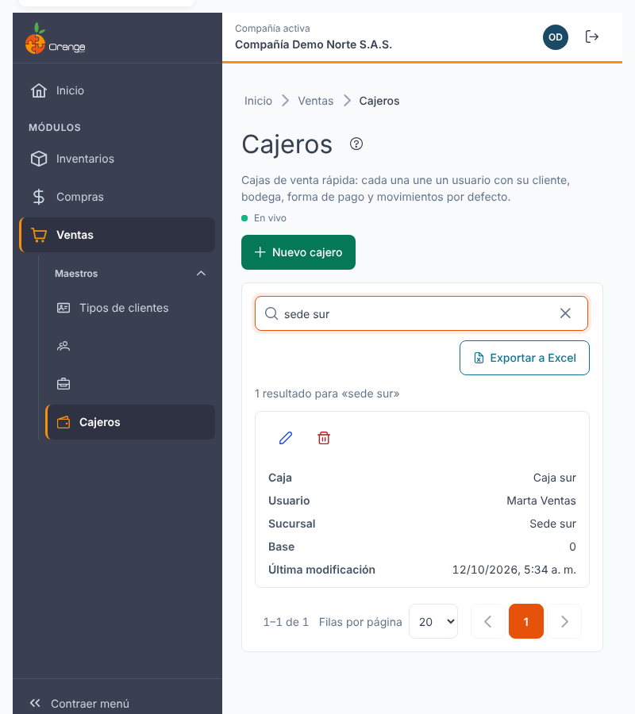
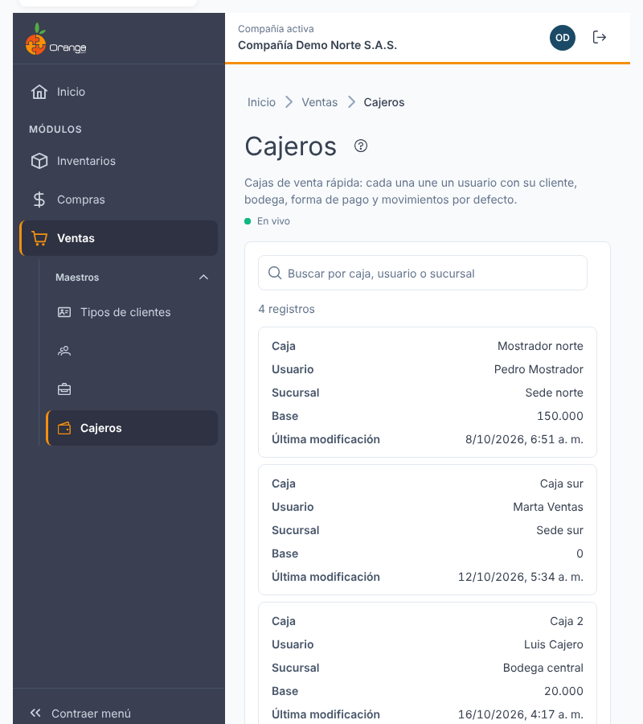
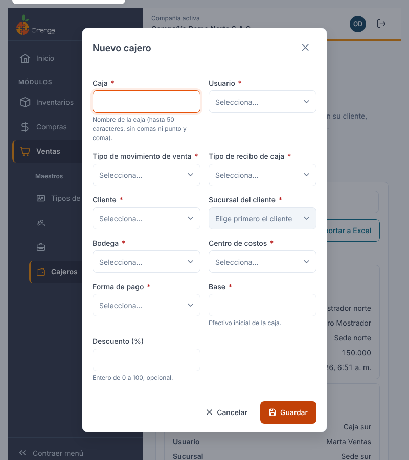
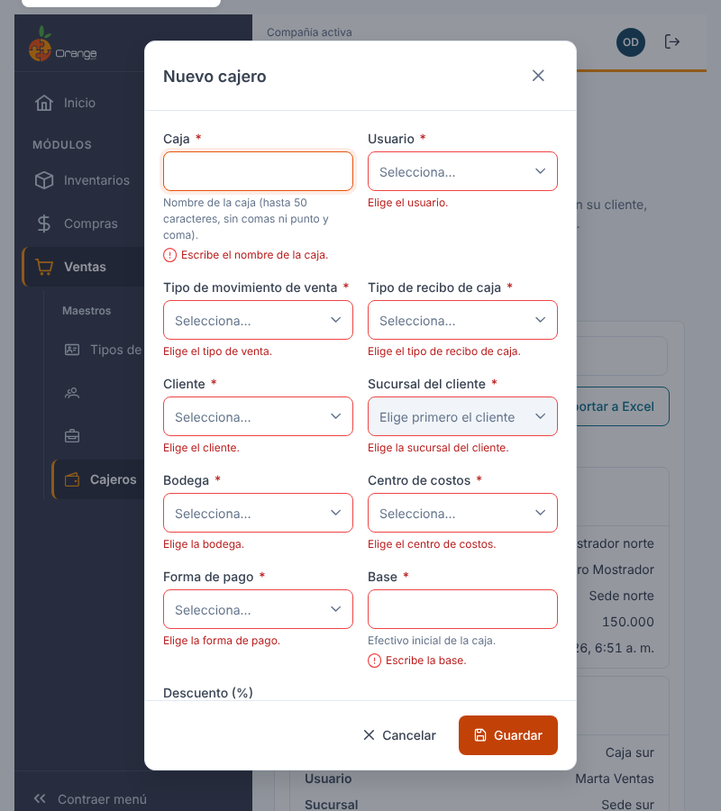
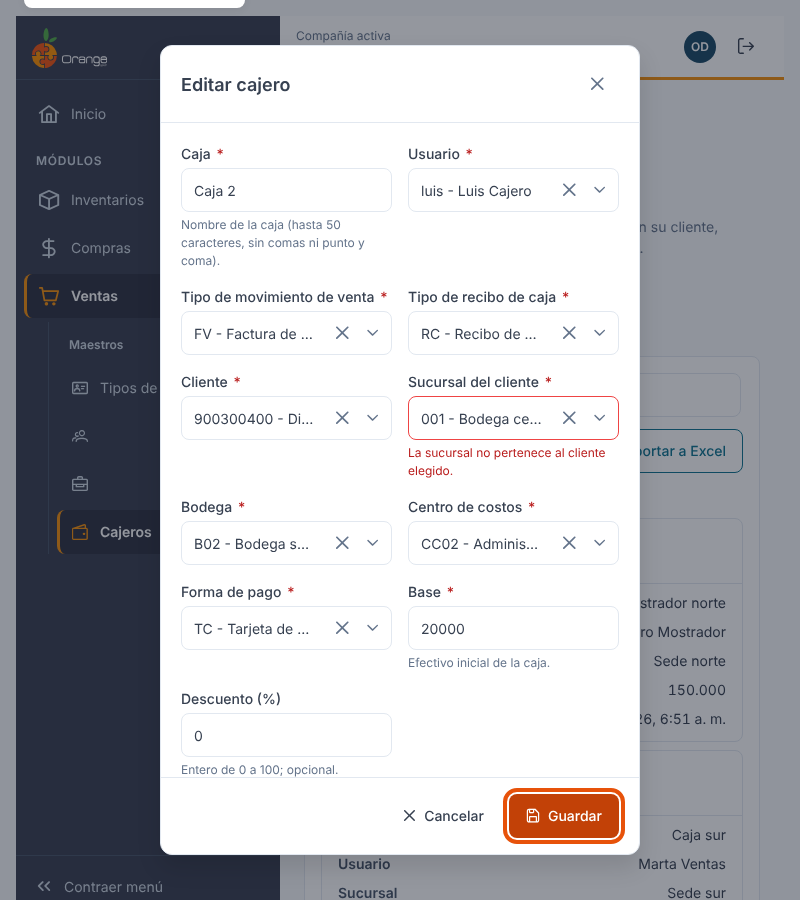
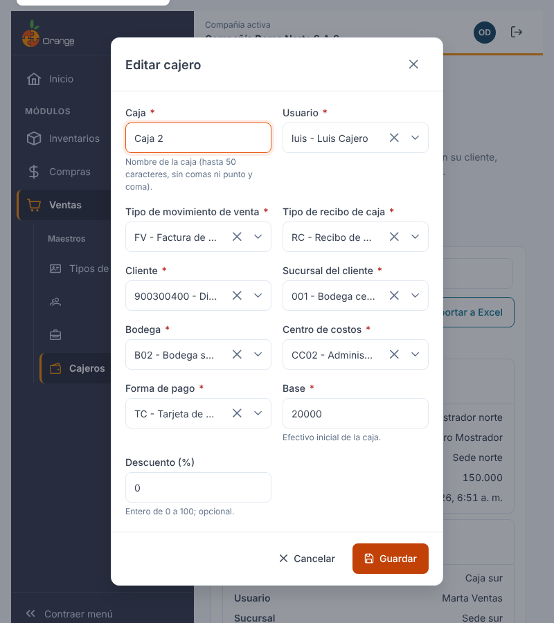
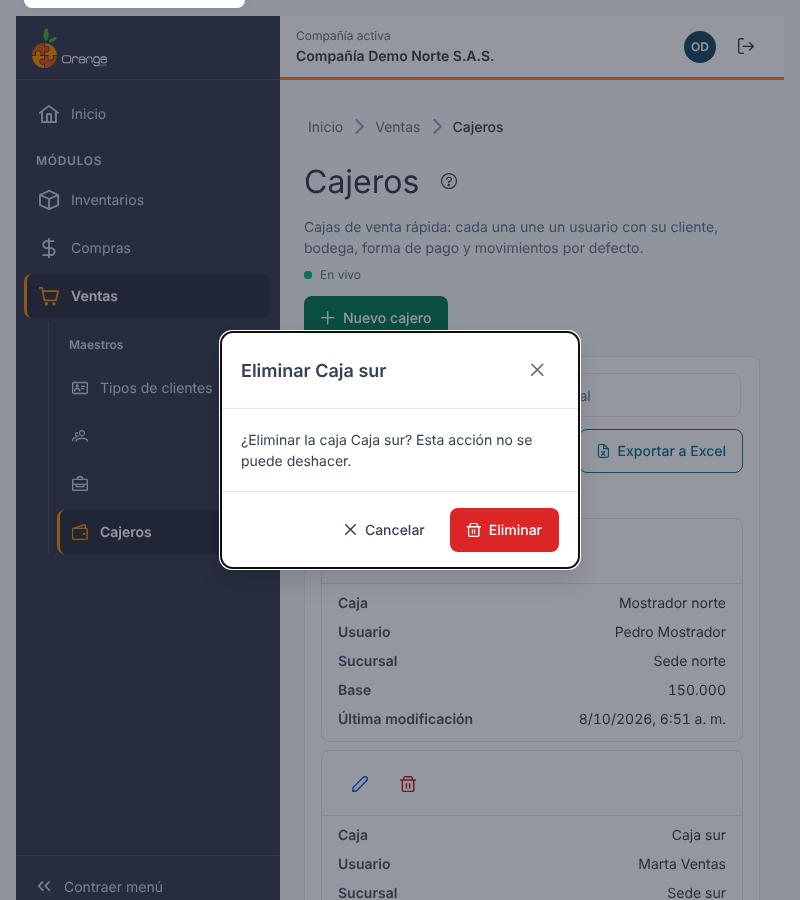
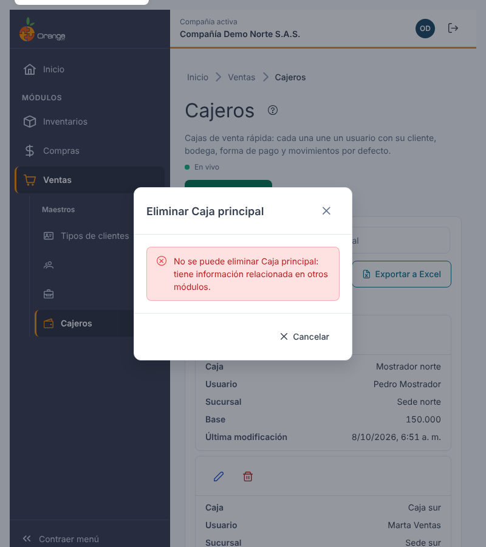
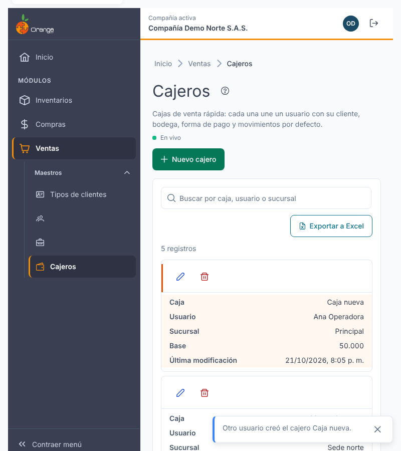
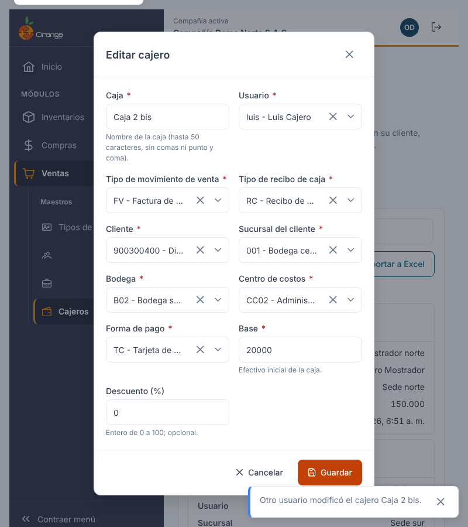

[Regresar a la documentación V2026](../../README.md)

---

# 💵 Cajeros

---

## 📋 Descripción

Un **cajero** es una caja de venta rápida: une a un **usuario** con la configuración que se usa por defecto cuando vende desde esa caja, es decir los tipos de movimiento de **venta** y de **recibo de caja**, el **cliente** y su **sucursal**, la **bodega**, el **centro de costos**, la **forma de pago**, la **base** de efectivo y el **descuento** de la caja.

En esta pantalla puede **consultar, crear, editar y eliminar** los cajeros de la compañía con la que está trabajando y **exportar** el listado a Excel.

> 📘 La búsqueda, el orden, la paginación, la exportación y la ayuda funcionan igual en todas las tablas: ver [Manejo general de la información](../../Generales/manejo-general-informacion.md).

> 💡 Cada pestaña del navegador trabaja con **una compañía**. El nombre y el color de la compañía se ven en el título de la pestaña y en la barra superior.

> ℹ️ El cajero de un usuario se toma al iniciar sesión: si crea, cambia o elimina el cajero de un usuario, el cambio le llega en su **próximo inicio de sesión**.

---

## 🎯 Acceso

1. En el menú principal, haga clic en **Ventas**.
2. En **Maestros**, haga clic en **Cajeros**.

---

## 🖥️ Pantalla principal

| Elemento | Para qué sirve |
|----------|----------------|
| **?** (junto al título) | Abre esta ayuda en un panel lateral, sin salir de la pantalla. |
| **En vivo** | La pantalla está conectada: los cambios de otros usuarios aparecen solos. Ver *Cambios de otros usuarios* más abajo. |
| **Nuevo cajero** | Crea un cajero. |
| **Buscar por caja, usuario o sucursal** | Filtra el listado mientras escribe. No distingue mayúsculas ni tildes. |
| **Exportar a Excel** | Descarga el listado (con el filtro y el orden que tenga en pantalla). |
| **Lápiz** / **Papelera** | Editar o eliminar el cajero de esa fila. Siempre están en la **primera columna**, visibles aunque la tabla tenga que desplazarse. |
| **Encabezados** | Un clic ordena de forma ascendente, el segundo descendente y el tercero quita el orden. |
| **Filas por página** y paginación | Cambian cuántos cajeros ve y la página. |

Las columnas son **Caja**, **Usuario**, **Sucursal**, **Base** y **Última modificación** (fecha y hora del último cambio).

> 📱 En el celular cada cajero se muestra como una tarjeta, con las acciones arriba.

**¿No ve algún botón?** Cada acción depende de los permisos de su perfil sobre la opción Cajeros:

| Permiso | Qué habilita |
|---------|--------------|
| Consultar | Ver la pantalla |
| Crear | **Nuevo cajero** |
| Actualizar | **Lápiz** (editar) |
| Eliminar | **Papelera** (eliminar) |
| Exportar | **Exportar a Excel** |

Con solo el permiso de consulta el listado se ve completo, pero no aparecen los botones de crear, editar, eliminar ni exportar.

---

## ➕ Crear un cajero

1. Haga clic en **Nuevo cajero**.
2. Complete los campos y haga clic en **Guardar**.

| Campo | Obligatorio | Reglas |
|-------|:-----------:|--------|
| **Caja** | ✅ | Nombre de la caja, hasta 50 caracteres. No admite comas (,) ni punto y coma (;). Puede haber dos cajas con el mismo nombre. |
| **Usuario** | ✅ | El usuario dueño de la caja. Solo se ofrecen usuarios activos con acceso a la compañía. Un usuario puede tener más de un cajero; la pantalla se lo avisa, pero no se lo impide. |
| **Tipo de movimiento de venta** | ✅ | Solo los tipos de venta que usted tiene autorizados. |
| **Tipo de recibo de caja** | ✅ | Solo los tipos de recibos de caja y egresos que usted tiene autorizados. |
| **Cliente** | ✅ | El cliente por defecto de la caja. |
| **Sucursal del cliente** | ✅ | Está deshabilitada hasta elegir el cliente y solo muestra las sucursales de **ese** cliente. Si cambia el cliente, se borra la sucursal elegida. |
| **Bodega** | ✅ | Solo las bodegas que su perfil tiene asignadas (si no tiene restricción, todas). |
| **Centro de costos** | ✅ | — |
| **Forma de pago** | ✅ | — |
| **Base** | ✅ | Efectivo inicial de la caja. Debe ser mayor o igual a 0. |
| **Descuento (%)** | — | Número **entero** de 0 a 100. Si lo deja vacío se guarda 0. |

Todos los campos de selección se buscan escribiendo parte del código o del nombre; la lista se carga por páginas. Al guardar verá **"Cajero Caja 1 creado."** y el cajero aparece en el listado, sin recargar la pantalla.

### ¿Qué puede salir mal?

Si algo no es válido, la pantalla no guarda y le indica qué corregir. El cursor va al primer campo con error.

| Mensaje | Qué hacer |
|---------|-----------|
| Escriba el nombre de la caja. / Elija el usuario, el cliente, la bodega… | Complete el campo. |
| La caja admite hasta 50 caracteres y no puede tener comas ni punto y coma. | Corrija el nombre. |
| La base debe ser mayor o igual a 0. | Escriba un valor válido. |
| El descuento debe ser un número entero entre 0 y 100. | Escriba, por ejemplo, 5 o 12 (no 12,5). |
| La sucursal no pertenece al cliente elegido. | Elija una sucursal del cliente (o cambie el cliente). |
| No se pudo guardar. Tus datos siguen aquí: inténtalo de nuevo. | Revise su conexión y haga clic en **Guardar** otra vez. Lo que escribió se conserva. |

---

## ✏️ Editar un cajero

1. Haga clic en el **lápiz** del cajero.
2. Cambie lo que necesite y haga clic en **Guardar**.

> ✅ El **descuento** se muestra tal como está guardado (por ejemplo, 5) y **no cambia** si usted no lo toca, aunque edite el cajero muchas veces para modificar otros datos. (La pantalla anterior, en cambio, dividía el descuento entre 100 cada vez que se editaba la caja.)

Si otro usuario eliminó el cajero mientras lo editaba, al guardar el diálogo se cierra, el cajero desaparece del listado y un aviso le indica **"El cajero ya no existe: otro usuario lo eliminó."**

---

## 🗑️ Eliminar un cajero

1. Haga clic en la **papelera** del cajero.
2. Confirme con **Eliminar**.

Al confirmar, el cajero desaparece del listado y verá el mensaje **"Cajero Caja sur eliminado."**. Esta acción no se puede deshacer.

### Cajero en uso

Un cajero **no se puede eliminar** si tiene información relacionada en otros módulos (por ejemplo, cuadres de caja registrados con el nombre de esa caja). En ese caso verá:

> No se puede eliminar Caja principal: tiene información relacionada en otros módulos.

El diálogo solo permite **Cancelar**. El cajero no se modifica ni se elimina.

---

## 📤 Exportar a Excel

Haga clic en **Exportar a Excel**. Se descarga `cajeros_AAAA-MM-DD.xlsx` con **todos** los cajeros del filtro actual (no solo la página visible), con el encabezado fijo y filtros de Excel.

---

## 📥 Importar desde Excel

Haga clic en **Importar** (junto a **Exportar a Excel**) para crear o actualizar varios cajeros a la vez. Primero el sistema revisa el archivo sin guardar nada; después usted aplica todas las filas válidas juntas o ninguna. Necesita el permiso **Exportar**. Vea el manual completo: [Importar cajeros desde Excel](cajeros-importar.md).

---

## 🔄 Cambios de otros usuarios (en vivo)

Si otra persona crea, modifica o elimina cajeros mientras usted tiene abierta esta pantalla, **no tiene que recargar**: el listado se pone al día solo, sin perder lo que buscó, el orden ni la página.

- Las filas nuevas o modificadas se **resaltan** unos segundos.
- Abajo a la derecha aparece un aviso, por ejemplo *"Otro usuario creó el cajero Caja nueva."*
- Junto a la descripción verá **En vivo** mientras la conexión esté activa. Si se interrumpe, dice **Reconectando…**; al volver, la pantalla se actualiza sola.

**Si estaba editando ese mismo cajero:**

| Qué hizo el otro usuario | Qué verá | Qué puede hacer |
|--------------------------|----------|-----------------|
| Lo modificó | *"Otro usuario modificó este cajero mientras lo editabas. Recarga para ver sus cambios (lo que escribiste se pierde)."* | **Recargar** para cargar lo que él guardó. |
| Lo eliminó | *"Otro usuario eliminó este cajero. No se puede guardar."* | **Cancelar**. El botón Guardar queda deshabilitado. |

Si estaba por confirmar la eliminación de un cajero que otro ya eliminó, el diálogo se cierra con el aviso *"Otro usuario ya eliminó el cajero …"*.

> ℹ️ Los cambios que usted hace en esta misma pestaña no generan avisos.

---

## ❓ Preguntas frecuentes

**¿Por qué la sucursal está deshabilitada?**
Porque primero debe elegir el cliente: la sucursal siempre es una sucursal de ese cliente.

**¿Por qué no veo todas las bodegas, o algún tipo de movimiento?**
La lista de bodegas se limita a las que su perfil tiene asignadas y los tipos de movimiento a los que usted tiene autorizados. Pida a su administrador que lo revise.

**¿Por qué el descuento no admite decimales?**
Se guarda como porcentaje entero (de 0 a 100) para que el valor quede exactamente como lo escribió.

**¿Por qué no puedo eliminar un cajero?**
Porque tiene información relacionada en otros módulos. Vea *Cajero en uso* más arriba.

**No veo "En vivo".**
La conexión en vivo no está disponible en este momento (por ejemplo, por la red de su empresa). La pantalla funciona igual; para ver cambios de otros usuarios, recargue la página.

**No veo el botón Nuevo cajero, Editar, Eliminar ni Exportar.**
Su perfil no tiene ese permiso sobre la opción. Pida a su administrador que lo revise.
