[Regresar a la documentación V2026](../../README.md)

---

# 💵 Cajeros

---

## 📋 Descripción

Un **cajero** es una caja de venta rápida: une a un **usuario** con su **tipo de movimiento de venta** y con la **forma de pago** que aparece por defecto, y le asigna una **base** de efectivo inicial.

El cliente, la sucursal, la bodega, el centro de costos y el recibo de caja **no se escriben en el cajero**: se toman del **tipo de movimiento de venta**. Así, si cambia la configuración del tipo, la caja la usa sin que tenga que editar cada cajero.

En esta pantalla puede **consultar, crear, editar y eliminar** los cajeros de la compañía con la que está trabajando, **exportar** el listado a Excel e **importar** varios cajeros desde Excel.

> 📘 La búsqueda, el orden, la paginación, la exportación y la ayuda funcionan igual en todas las tablas: ver [Manejo general de la información](../../Generales/manejo-general-informacion.md).

> 💡 Cada pestaña del navegador trabaja con **una compañía**. El nombre y el color de la compañía se ven en el título de la pestaña y en la barra superior.

> ℹ️ El cajero de un usuario se toma al iniciar sesión: si crea, cambia o elimina el cajero de un usuario, el cambio le llega en su **próximo inicio de sesión**.

> 🛒 Para vender desde la caja use el [Punto de venta](../movimientos/punto-de-venta.md). Si la caja aparece **Incompleta** en el listado, el punto de venta no la deja vender.

---

## 🎯 Acceso

1. En el menú principal, haga clic en **Ventas**.
2. En **Maestros**, haga clic en **Cajeros**.

---

## 🖥️ Pantalla principal

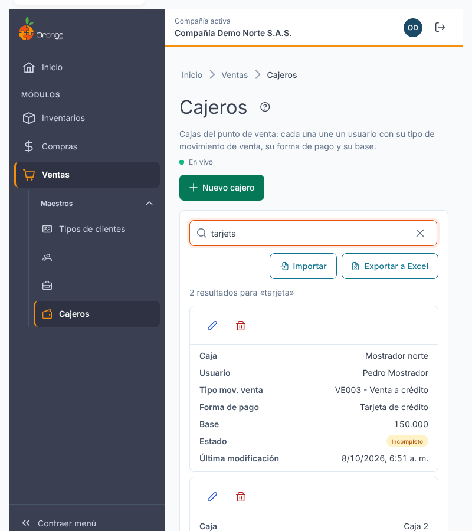

| Elemento | Para qué sirve |
|----------|----------------|
| **?** (junto al título) | Abre esta ayuda en un panel lateral, sin salir de la pantalla. |
| **En vivo** | La pantalla está conectada: los cambios de otros usuarios aparecen solos. Ver *Cambios de otros usuarios* más abajo. |
| **Nuevo cajero** | Crea un cajero. |
| **Buscar por caja, usuario, tipo o forma de pago** | Filtra el listado mientras escribe. No distingue mayúsculas ni tildes. |
| **Exportar a Excel** | Descarga el listado (con el filtro y el orden que tenga en pantalla). |
| **Importar** | Crea o actualiza varios cajeros desde un archivo de Excel. |
| **Lápiz** / **Papelera** | Editar o eliminar el cajero de esa fila. Siempre están en la **primera columna**, visibles aunque la tabla tenga que desplazarse. |
| **Encabezados** | Un clic ordena de forma ascendente, el segundo descendente y el tercero quita el orden. |
| **Filas por página** y paginación | Cambian cuántos cajeros ve y la página. |

Las columnas son **Caja**, **Usuario**, **Tipo mov. venta**, **Forma de pago**, **Base**, **Estado** y **Última modificación** (fecha y hora del último cambio).

La columna **Estado** indica si el cajero está listo para vender:

| Estado | Significado |
|--------|-------------|
| **Completo** | El tipo de movimiento de venta tiene todo lo necesario y el usuario está autorizado a usarlo. |
| **Incompleto** | Al tipo le falta algo (por ejemplo, el recibo de caja automático, el cliente por defecto, la sucursal o la bodega), o el usuario ya no está autorizado a ese tipo. Lo indica con el texto, no solo con el color. Ábralo con el lápiz para ver qué falta. |

> 📱 En el celular cada cajero se muestra como una tarjeta, con las acciones arriba.

**¿No ve algún botón?** Cada acción depende de los permisos de su perfil sobre la opción Cajeros:

| Permiso | Qué habilita |
|---------|--------------|
| Consultar | Ver la pantalla |
| Crear | **Nuevo cajero** |
| Actualizar | **Lápiz** (editar) |
| Eliminar | **Papelera** (eliminar) |
| Exportar | **Exportar a Excel** e **Importar** |

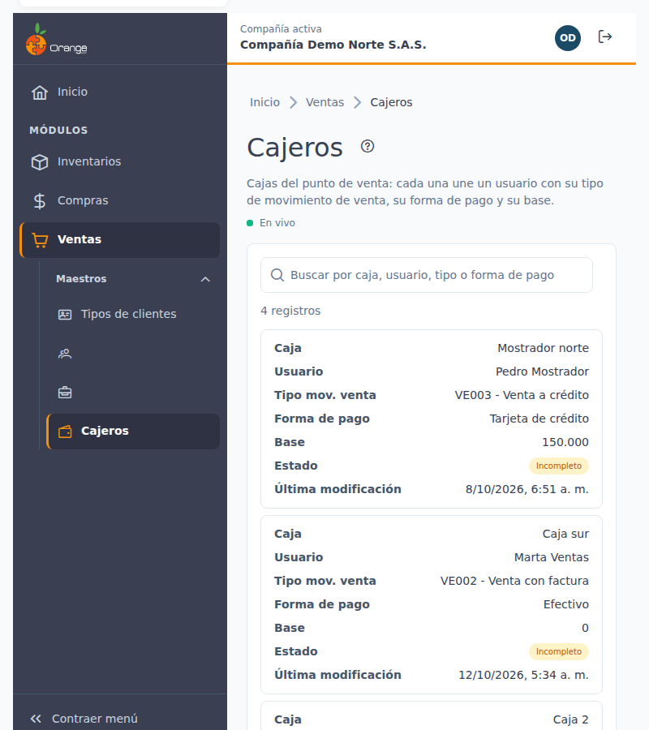

Con solo el permiso de consulta el listado se ve completo, pero no aparecen los botones de crear, editar, eliminar ni exportar.

---

## ➕ Crear un cajero

1. Haga clic en **Nuevo cajero**.
2. Complete los campos y haga clic en **Guardar**.

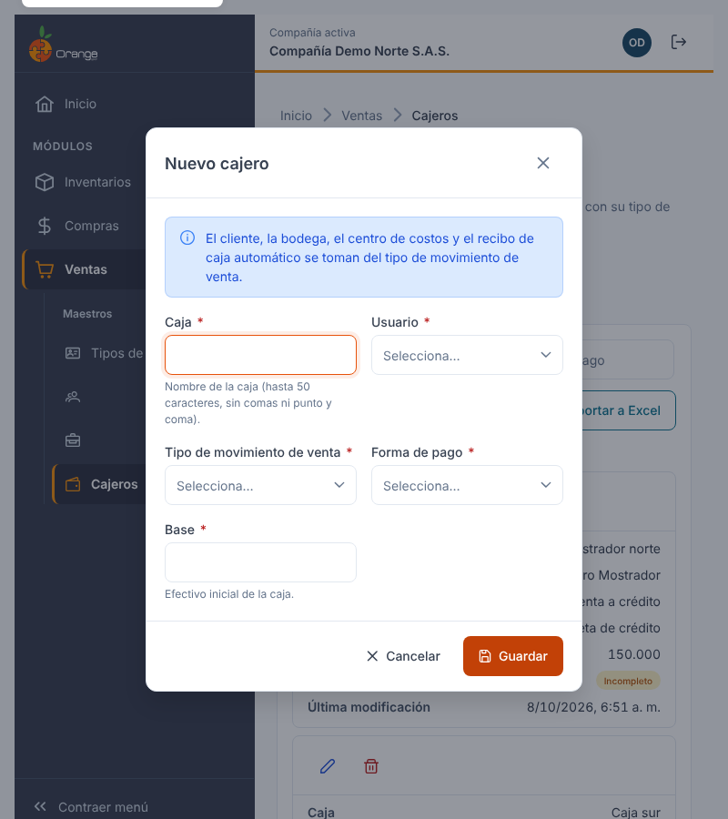

| Campo | Obligatorio | Reglas |
|-------|:-----------:|--------|
| **Caja** | ✅ | Nombre de la caja, hasta 50 caracteres. No admite comas (,) ni punto y coma (;). Puede haber dos cajas con el mismo nombre. |
| **Usuario** | ✅ | El usuario dueño de la caja. Solo se ofrecen usuarios activos con acceso a la compañía. Un usuario puede tener más de un cajero; la pantalla se lo avisa, pero no se lo impide. Al iniciar sesión se usa el primero que se registró. |
| **Tipo de movimiento de venta** | ✅ | Solo los tipos de movimiento del **Punto de venta** que usted tiene autorizados (no los de Ventas y devoluciones). El tipo debe tener recibo de caja automático, cliente por defecto con sucursal y bodega. |
| **Forma de pago** | ✅ | La forma de pago que aparece por defecto al cobrar en el punto de venta. |
| **Base** | ✅ | Efectivo inicial de la caja. Debe ser mayor o igual a 0. |

Todos los campos de selección se buscan escribiendo parte del código o del nombre; la lista se carga por páginas. Al guardar verá **"Cajero Caja 1 creado."** y el cajero aparece en el listado, sin recargar la pantalla.

> ℹ️ El cliente, la sucursal, la bodega, el centro de costos y el recibo de caja se toman del tipo de movimiento de venta. Por eso no aparecen en el formulario.

### ¿Qué puede salir mal?

Si algo no es válido, la pantalla no guarda y le indica qué corregir. El cursor va al primer campo con error.

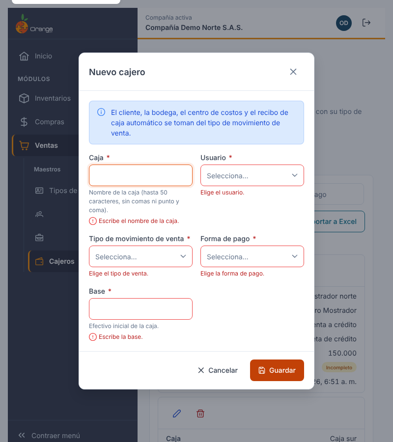

| Mensaje | Qué hacer |
|---------|-----------|
| Escriba el nombre de la caja. / Elija el usuario, el tipo de venta o la forma de pago. | Complete el campo. |
| La caja admite hasta 50 caracteres y no puede tener comas ni punto y coma. | Corrija el nombre. |
| La base debe ser mayor o igual a 0. | Escriba un valor válido. |
| Este tipo de movimiento del Punto de venta no tiene recibo de caja automático; configúrelo en Tipos de movimiento. | El tipo elegido no se puede usar en la caja. Pida a un administrador que lo complete, o elija otro tipo. |
| Este tipo de movimiento del Punto de venta no se puede usar: … Configúrelo en Tipos de movimiento. | Lo que falta aparece en el mensaje (cliente por defecto, sucursal o bodega). Complételo en el tipo, o elija otro. |
| El usuario no está autorizado a este tipo de movimiento del Punto de venta. | Elija un tipo al que el usuario tenga acceso. |
| No se pudo guardar. Tus datos siguen aquí: inténtalo de nuevo. | Revise su conexión y haga clic en **Guardar** otra vez. Lo que escribió se conserva. |

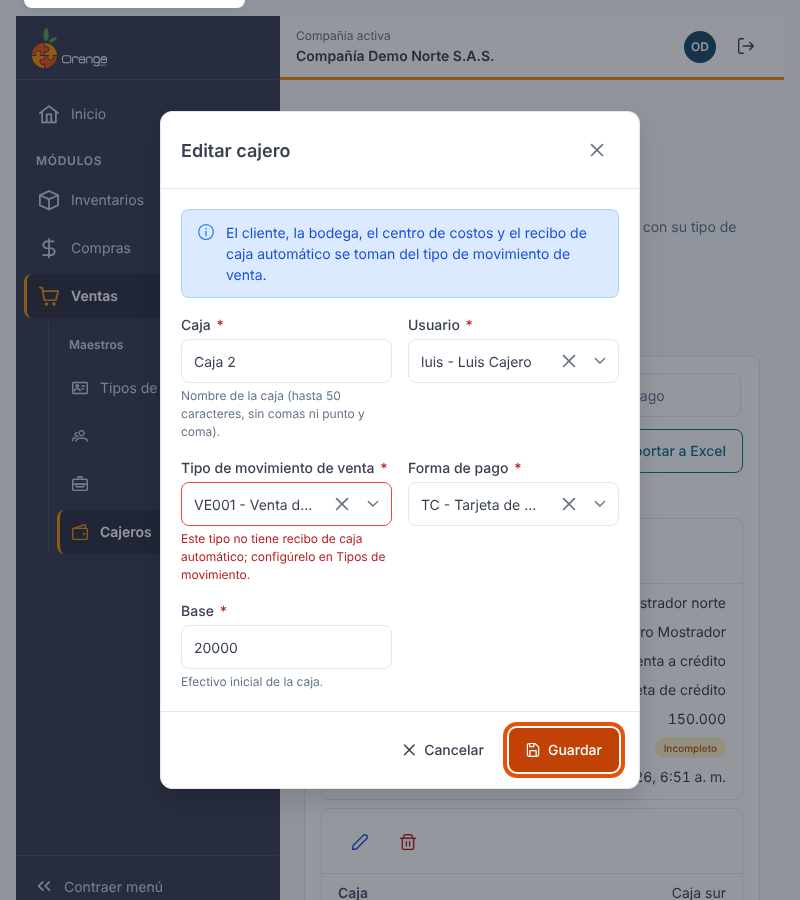

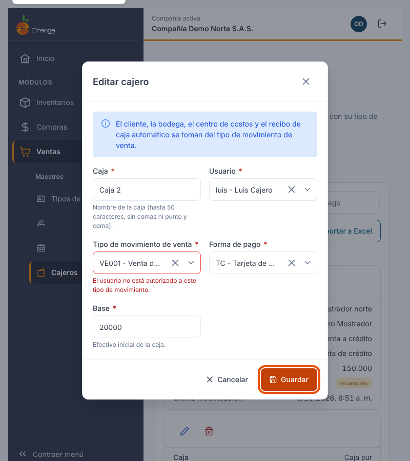

---

## ✏️ Editar un cajero

1. Haga clic en el **lápiz** del cajero.
2. Cambie lo que necesite y haga clic en **Guardar**.

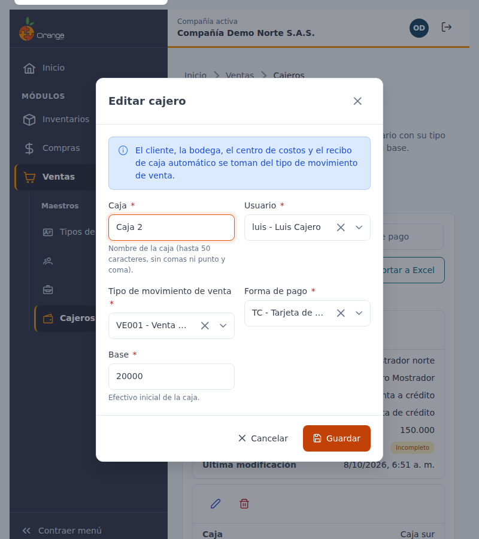

> ✅ Al editar, la caja **conserva** los datos que vienen del tipo de movimiento aunque no los vea en pantalla. Si solo cambia la base o la caja, esos datos no cambian. Si cambia el **tipo de movimiento de venta**, la caja vuelve a tomar el cliente, la sucursal, la bodega y el recibo del nuevo tipo.

> ℹ️ Un cajero que ya estaba guardado con un tipo que hoy está incompleto aparece como **Incompleto**. Para corregirlo basta con completar el tipo en su maestro; no es necesario editar el cajero.

Si otro usuario eliminó el cajero mientras lo editaba, al guardar el diálogo se cierra, el cajero desaparece del listado y un aviso le indica **"El cajero ya no existe: otro usuario lo eliminó."**

---

## 🗑️ Eliminar un cajero

1. Haga clic en la **papelera** del cajero.
2. Confirme con **Eliminar**.

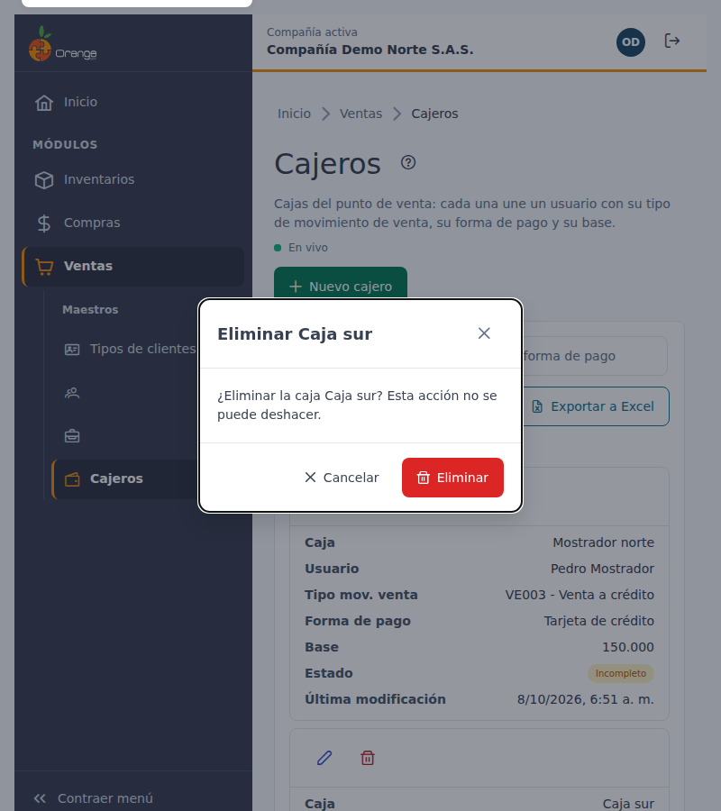

Al confirmar, el cajero desaparece del listado y verá el mensaje **"Cajero Caja sur eliminado."**. Esta acción no se puede deshacer.

### Cajero en uso

Un cajero **no se puede eliminar** si tiene información relacionada en otros módulos (por ejemplo, cuadres de caja registrados con el nombre de esa caja). En ese caso verá:

> No se puede eliminar Caja principal: tiene información relacionada en otros módulos.

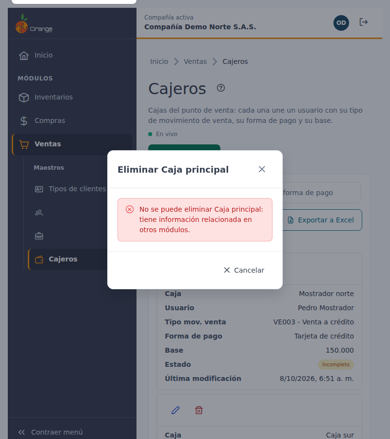

El diálogo solo permite **Cancelar**. El cajero no se modifica ni se elimina.

---

## 📤 Exportar a Excel

Haga clic en **Exportar a Excel**. Se descarga `cajeros_AAAA-MM-DD.xlsx` con **todos** los cajeros del filtro actual (no solo la página visible), con el encabezado fijo y filtros de Excel. Las columnas son **Caja, Usuario, Tipo de movimiento de venta, Forma de pago, Base, Estado** y **Última modificación**.

---

## 📥 Importar desde Excel

Haga clic en **Importar** (junto a **Exportar a Excel**) para crear o actualizar varios cajeros a la vez. Primero el sistema revisa el archivo sin guardar nada; después usted aplica todas las filas válidas juntas o ninguna. Necesita el permiso **Exportar**. Vea el manual completo: [Importar cajeros desde Excel](cajeros-importar.md).

---

## 🔄 Cambios de otros usuarios (en vivo)

Si otra persona crea, modifica o elimina cajeros mientras usted tiene abierta esta pantalla, **no tiene que recargar**: el listado se pone al día solo, sin perder lo que buscó, el orden ni la página.

- Las filas nuevas o modificadas se **resaltan** unos segundos.
- Abajo a la derecha aparece un aviso, por ejemplo *"Otro usuario creó el cajero Caja nueva."*
- Junto a la descripción verá **En vivo** mientras la conexión esté activa. Si se interrumpe, dice **Reconectando…**; al volver, la pantalla se actualiza sola.

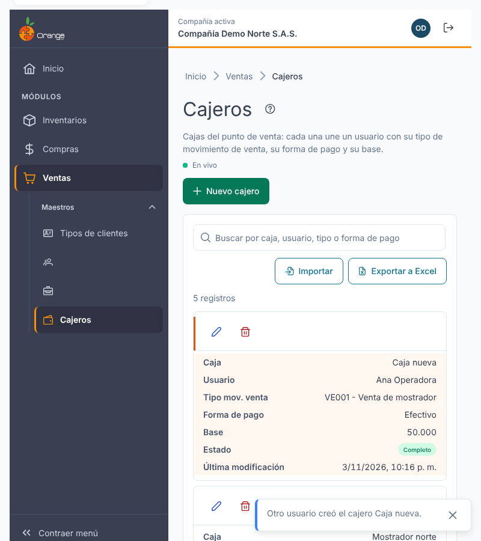

**Si estaba editando ese mismo cajero:**

| Qué hizo el otro usuario | Qué verá | Qué puede hacer |
|--------------------------|----------|-----------------|
| Lo modificó | *"Otro usuario modificó este cajero mientras lo editabas. Recarga para ver sus cambios (lo que escribiste se pierde)."* | **Recargar** para cargar lo que él guardó. |
| Lo eliminó | *"Otro usuario eliminó este cajero. No se puede guardar."* | **Cancelar**. El botón Guardar queda deshabilitado. |

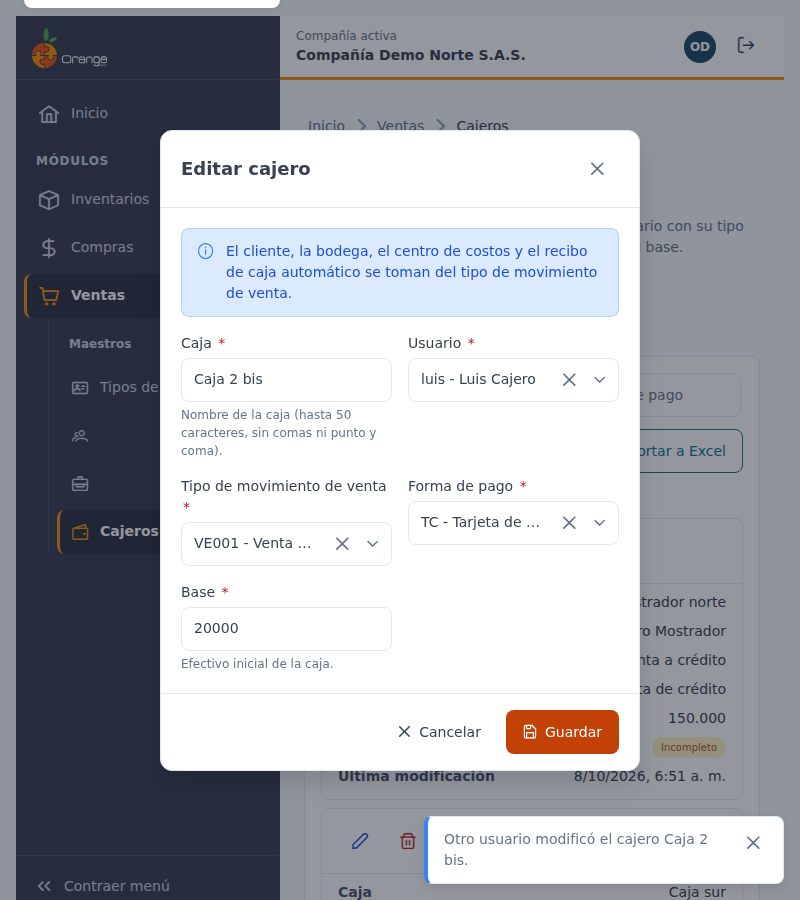

Si estaba por confirmar la eliminación de un cajero que otro ya eliminó, el diálogo se cierra con el aviso *"Otro usuario ya eliminó el cajero …"*.

> ℹ️ Los cambios que usted hace en esta misma pestaña no generan avisos.

---

## ❓ Preguntas frecuentes

**¿Por qué no me piden el cliente, la sucursal o la bodega?**
Porque la caja los toma del tipo de movimiento de venta. Para cambiarlos, edite el tipo en su maestro.

**¿Qué significa Incompleto en la columna Estado?**
Que el tipo de movimiento de venta de esa caja no tiene todo lo necesario para vender (recibo de caja automático, cliente por defecto con sucursal, o bodega), o que el usuario ya no está autorizado a usarlo. El punto de venta no deja vender con esa caja hasta completarla.

**¿Por qué no veo algún tipo de movimiento?**
La lista muestra solo los tipos de movimiento del Punto de venta que usted tiene autorizados. Los tipos de Ventas y devoluciones no aparecen aquí. Pida a su administrador que lo revise.

**¿Por qué no puedo eliminar un cajero?**
Porque tiene información relacionada en otros módulos. Vea *Cajero en uso* más arriba.

**No veo "En vivo".**
La conexión en vivo no está disponible en este momento (por ejemplo, por la red de su empresa). La pantalla funciona igual; para ver cambios de otros usuarios, recargue la página.

**No veo el botón Nuevo cajero, Editar, Eliminar ni Exportar.**
Su perfil no tiene ese permiso sobre la opción. Pida a su administrador que lo revise.
