[Regresar a Ventas](../readme.md)

---

# 🧑‍💼 Clientes

---

## 📋 Descripción

Los **clientes** son los terceros a quienes la compañía les vende. Cada cliente tiene su ficha con los datos de identificación, la información tributaria, las condiciones comerciales (descuento, plazo, tipo de cliente, impuestos, cupo de crédito y días de mora), sus **sucursales**, sus contactos, un logo y los archivos adjuntos.

En esta pantalla puede **consultar, crear, editar y eliminar** clientes, y **exportar** el listado a Excel. Trabaje siempre con la compañía que aparece en el título de la pestaña.

> 📘 La búsqueda, el orden, la paginación y la ayuda funcionan igual en todas las tablas: ver [Manejo general de la información](../../Generales/manejo-general-informacion.md).

> 💡 Una persona puede ser **cliente y vendedor** a la vez. Los datos del tercero (documento, nombre, logo y adjuntos) son los mismos en ambas pantallas; ver [Vendedores](vendedores.md).

---

## 🎯 Acceso

1. En el menú principal, haga clic en **Ventas**.
2. En **Maestros de Ventas**, haga clic en **Clientes**.

Para ver la pantalla necesita el permiso **Consultar** sobre la opción Clientes. Los demás botones dependen de los permisos que le haya dado el administrador (ver la tabla más abajo).

---

## 🖥️ Pantalla principal

| Elemento | Para qué sirve |
|----------|----------------|
| **?** (junto al título) | Abre esta ayuda en un panel lateral, sin salir de la pantalla. |
| **En vivo** | La pantalla está conectada: los cambios de otros usuarios aparecen solos. Ver *Cambios de otros usuarios* más abajo. |
| **Nuevo cliente** | Abre la ficha vacía para crear un cliente. |
| **Buscar por documento o nombre** | Muestra solo los clientes que coinciden con lo que escribe. Para quitar el texto, use la **✕**. |
| **Exportar a Excel** | Descarga los clientes que cumplen la búsqueda y el orden actuales. Ver *Exportar a Excel* más abajo. |
| **Lápiz** / **Papelera** | Editar o eliminar el cliente de esa fila. Están en la **primera columna**. Si no tiene permiso para actualizar, el lápiz dice **Ver** y abre la ficha en solo lectura. |
| **Encabezados** | Un clic ordena de forma ascendente, el segundo descendente y el tercero quita el orden. Por defecto aparece primero el último cliente registrado. |
| **Filas por página** y paginación | Cambian cuántos clientes ve por página (10, 20, 50 o 100) y la página. La búsqueda y el orden se aplican sobre todos los clientes de la compañía, no solo sobre la página visible. |

Las columnas del listado son: **Nro. documento**, **Nombre completo**, **Nombre comercial**, **Activo** y **Última modificación**.

> 📱 En pantallas pequeñas el listado se ajusta al ancho disponible y las acciones quedan visibles en cada fila.

**¿No ve algún botón?** Cada acción depende de los permisos de su perfil sobre la opción Clientes:

| Permiso | Qué habilita |
|---------|--------------|
| Consultar | Ver el listado, abrir la ficha, ver las sucursales, los contactos y los archivos. |
| Crear | **Nuevo cliente** y convertir en cliente a un tercero que ya existe en la compañía. |
| Actualizar | **Editar**, **Guardar** en la ficha, agregar y editar sucursales, contactos, el logo y los adjuntos. |
| Eliminar | **Papelera**, **Eliminar** en la ficha y quitar una sucursal. |
| Exportar | **Exportar a Excel**. |

Si solo tiene **Consultar**, la ficha aparece con el aviso *"Solo tienes permiso de consulta: la ficha no se puede modificar."* Si no tiene **Consultar**, la pantalla muestra *"No tienes acceso a clientes"* y no aparece en el menú.

---

## ➕ Crear un cliente

1. Haga clic en **Nuevo cliente**.
2. Escriba el **Tipo de documento** y el **Número de documento** (entre 5 y 20 caracteres). Cuando deja el campo, el sistema revisa si ese documento ya está registrado en la compañía (ver el paso siguiente).
3. Complete las secciones de la ficha y haga clic en **Guardar**.

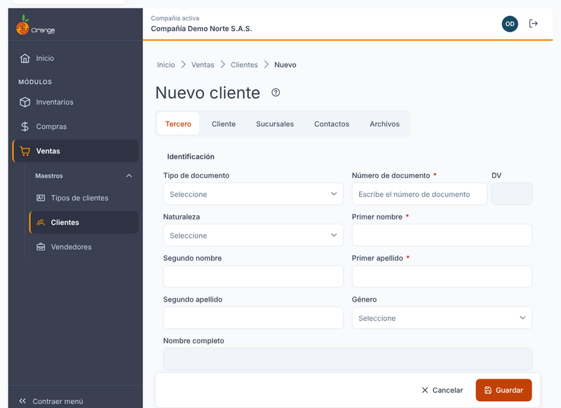

Al guardar por primera vez verá el aviso **"Cambios guardados."** y la pantalla vuelve al listado, donde aparece el cliente nuevo.

La ficha tiene cinco pestañas:

| Pestaña | Qué incluye |
|---------|-------------|
| **Tercero** | Identificación (tipo y número de documento, con el dígito de verificación calculado; nombre o razón social), ubicación y contacto (dirección, ciudad, teléfono, celular, correo), información tributaria (régimen, actividad económica, cuenta contable, gran contribuyente, autorretenedor) y estado (activo, observaciones). El rol **Es cliente** aparece fijo y no se puede cambiar. |
| **Cliente** | Condiciones comerciales, impuestos y retenciones, y crédito y central de riesgo. Ver *Sección Cliente* más abajo. |
| **Sucursales** | Los lugares de entrega o de facturación del cliente. Ver *Sucursales* más abajo. |
| **Contactos** | Las personas con quienes se trata en el cliente. |
| **Archivos** | El logo y los adjuntos del tercero. |

Los campos obligatorios se marcan en la ficha. Si falta algún dato o un valor no es válido, la pestaña aparece con el contador de errores (por ejemplo, **2 errores**) y el campo muestra el motivo. Corríjalo y guarde de nuevo.

### Verificar el documento antes de crear

Mientras el sistema revisa el documento verá *"Verificando si el documento ya está registrado…"*. Según el resultado, verá uno de estos avisos:

| Aviso | Qué significa | Qué puede hacer |
|-------|---------------|-----------------|
| *"Este documento ya existe en la compañía como {nombre} ({roles})."* | El tercero ya existe con otro perfil (proveedor, vendedor u otro). **No se duplica.** La ficha se llena con sus datos. | Revise los datos precargados y haga clic en **Guardar**: el tercero se agrega como cliente sin crear otro. |
| *"Este documento ya es cliente en la compañía."* | Ya tiene este perfil. | Haga clic en **Abrir su edición** para modificarlo. El botón **Guardar** queda deshabilitado. |
| *"No se pudo verificar el documento…"* | La revisión falló por la conexión. | Haga clic en **Reintentar**, o guarde: el sistema lo verifica otra vez al guardar. |

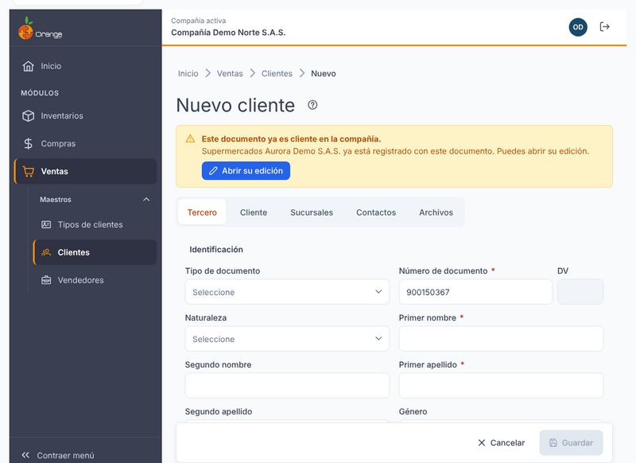

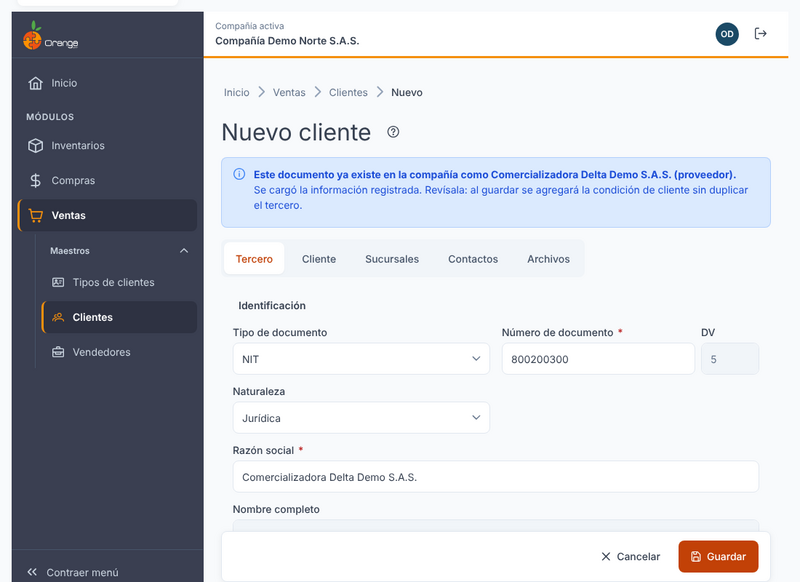

Si cambia el número de documento después de haber cargado un tercero existente, la información precargada se quita y la verificación se repite.

> ⚠️ Si otro usuario crea ese mismo tercero mientras usted llena la ficha, al guardar el sistema vuelve a revisar el documento y le pide revisar la información cargada antes de guardar otra vez. El sistema nunca crea dos terceros con el mismo documento.

---

## ✏️ Editar un cliente

1. Haga clic en el **lápiz** del cliente (o en **Ver** si solo tiene consulta).
2. Cambie los datos y haga clic en **Guardar**.

Los cambios de **Tercero** y **Cliente** se guardan con el botón **Guardar**. Si sale de la ficha con cambios sin guardar, el sistema pregunta **"¿Salir sin guardar?"**: **Seguir editando** lo deja en la ficha; **Salir sin guardar** descarta los cambios.

> ℹ️ **Sucursales**, **Contactos** y **Archivos** no usan **Guardar**: cada cambio se guarda al instante.

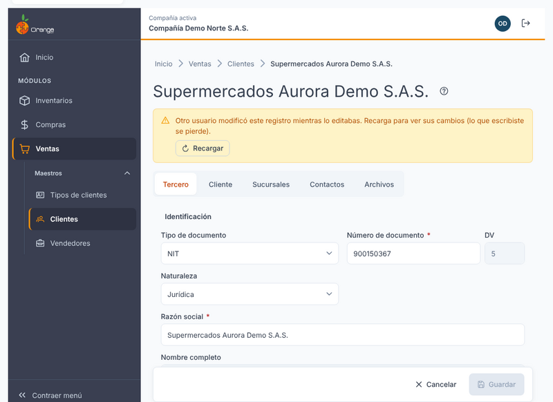
Si otro usuario modificó el mismo cliente mientras lo edita, vea *Cambios de otros usuarios* más abajo.

### Sección Cliente

**Condiciones comerciales**

| Campo | Regla |
|-------|-------|
| **Descuento comercial (%)** | Obligatorio. Escriba el porcentaje **de 0 a 100**, por ejemplo `12,5` para 12,5 %. El valor inicial es 0. |
| **Días de plazo** | Obligatorio. Número de 0 en adelante. El valor inicial es 0. |
| **Tipo de cliente** | Opcional. Si no tiene tipo, déjelo vacío (*Sin tipo*). Busque por código o nombre. |
| **Fecha de nacimiento** | Opcional. Elíjala en el calendario o escríbala. Si la deja vacía, se guarda 1753-01-01. |

**Impuestos y retenciones**

Hay cinco impuestos: **IVA**, **Retefuente**, **ReteIVA**, **ICA** y **otra retención**. Cada uno tiene una casilla. Si marca la casilla, debe elegir el impuesto en la lista (es obligatorio). Si la desmarca, el impuesto queda vacío.

**Crédito y central de riesgo**

| Campo | Regla |
|-------|-------|
| **Cupo de crédito** | Obligatorio. Número de 0 en adelante. |
| **Días de mora** | Obligatorio. Número de 0 en adelante. |
| **Autoriza consultar en la central de riesgo** y **Autoriza reportar a la central de riesgo** | Casillas de sí o no. |

Cuando el cupo ya fue autorizado, debajo del campo aparece **"Cupo autorizado por {usuario} el {fecha}."**. Ese dato lo registra el sistema cuando se cambia el cupo; no se puede editar.

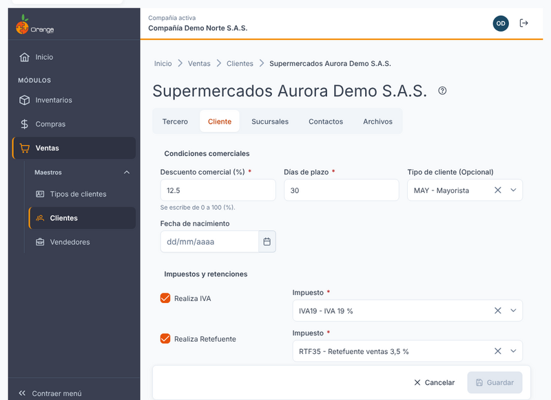

| Mensaje | Qué hacer |
|---------|-----------|
| *"Escribe un número mayor o igual a 0."* | Escriba un número de 0 en adelante. |
| *"El porcentaje debe estar entre 0 y 100."* | Escriba el porcentaje sin el signo y entre 0 y 100. |
| *"Elige el impuesto o desmarca la casilla."* | Elija el impuesto de la lista, o quite la marca de la casilla. |

---

## 🏬 Sucursales

Las sucursales son los lugares del cliente (por ejemplo, sus sedes). Un cliente puede tener hasta **58** sucursales.

La pestaña **Sucursales** solo se usa cuando el cliente ya está guardado: si es nuevo, primero guarde la ficha. El aviso dice *"Guarda el cliente para poder agregar sucursales."*

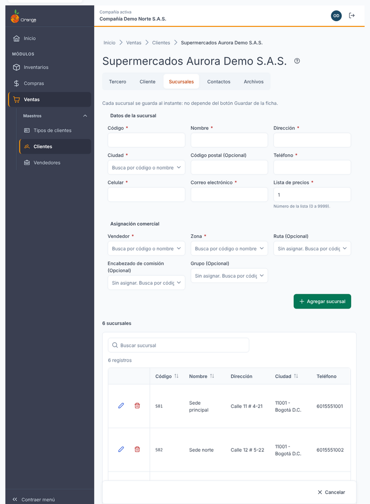

### Agregar una sucursal

1. Escriba los datos en el formulario de arriba.
2. Haga clic en **Agregar sucursal**.

La sucursal aparece en la lista de abajo, sin recargar la ficha, y el formulario queda limpio. Verá el aviso *"Sucursal {nombre} agregada."*.

| Campo | Regla |
|-------|-------|
| **Código**, **Nombre**, **Dirección**, **Ciudad**, **Teléfono**, **Celular**, **Correo electrónico** | Obligatorios. El nombre no puede llevar comas ni punto y coma. El correo debe ser válido. |
| **Lista de precios** | Obligatoria. Solo números, de 0 a 9999. |
| **Vendedor** y **Zona** | Obligatorios. Elíjalos de la lista. |
| **Código postal**, **Ruta**, **Encabezado de comisión** y **Grupo** | Opcionales. Si no los usa, déjelos en *Sin asignar*. |

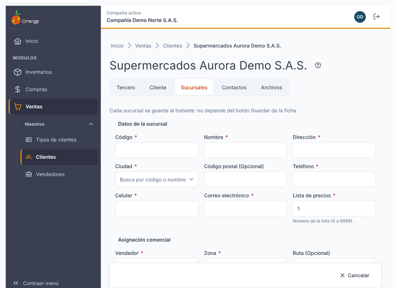

### Editar o quitar una sucursal

- Para cambiar una sucursal, haga clic en su **lápiz**. El formulario se llena con sus datos y el botón cambia a **Actualizar sucursal**. Para dejar de editar, haga clic en **Cancelar edición**.
- Para quitarla, haga clic en la **papelera** de la fila. Se abre el diálogo *"Eliminar sucursal"* con su código. Confirme con **Eliminar sucursal**. No se puede deshacer.

> ℹ️ Si una sucursal ya está en uso (por ejemplo, la usan cajeros o movimientos), no se puede quitar. El diálogo lo dice en el mismo recuadro: *"No se puede eliminar la sucursal {nombre}: está en uso (cajeros o movimientos)."*

### ¿Qué puede salir mal?

| Mensaje | Qué hacer |
|---------|-----------|
| *"Escribe el código de la sucursal."* (y los demás *"Escribe…"* o *"Elige…"*) | Complete el campo indicado. |
| *"Ya existe una sucursal con ese código en este cliente."* | Use otro código para esta sucursal. |
| *"La zona ya no existe en la compañía. Elígela de nuevo."* | Elija una zona de la lista. Es normal en sucursales creadas hace tiempo: la zona anterior ya no está en la compañía. |
| *"No se pudo guardar la sucursal. Lo escrito se conserva; inténtalo de nuevo."* | Lo que escribió sigue en el formulario. Revise la conexión y haga clic otra vez. |
| *"No tienes permiso para modificar sucursales de este cliente."* | Pida el permiso **Actualizar** a su administrador. |
| *"La sucursal ya no existe. Se actualizó la lista."* | Otro usuario la quitó. La lista ya está al día. |

---

## 📇 Contactos

Los contactos se agregan dentro de la pestaña **Contactos** de la ficha del cliente.

1. Escriba el **nombre del contacto** (obligatorio), el **tipo de contacto**, el teléfono, el celular, el correo y la **ciudad** (obligatoria).
2. Haga clic en **Agregar contacto**.

- **Los contactos se guardan al instante**: no hace falta pulsar **Guardar** en la ficha.
- El nombre y el tipo de contacto se guardan en **MAYÚSCULAS**.
- Para cambiar un contacto, haga clic en su **lápiz**, modifique los datos y pulse **Actualizar contacto**. Para cancelar, **Cancelar edición**.
- Para quitar un contacto, haga clic en la **papelera** de la fila y confirme. Esta acción no se puede deshacer.

> ℹ️ Si el cliente es nuevo, primero guarde la ficha. El aviso dice *"Guarda el cliente para poder agregar contactos."*

---

## 🖼️ Logo y adjuntos

El **logo** y los **adjuntos** están en la pestaña **Archivos**. Son los mismos para el cliente y el proveedor o comprador de un mismo tercero. Se suben al instante, así que el cliente debe estar guardado antes.

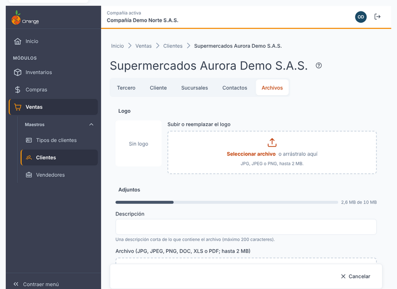

| Archivo | Formatos | Tamaño |
|---------|----------|--------|
| **Logo** | JPG, JPEG o PNG | Hasta 2 MB. Para reemplazarlo, suba otro; para quitarlo, use **Quitar logo** y confirme. |
| **Adjuntos** | JPG, JPEG, PNG, DOC, XLS o PDF | Hasta 2 MB por archivo y **10 MB en total** por tercero. Sobre la lista verá cuánto del cupo está usado (por ejemplo, *2,6 MB de 10 MB*). |

Para agregar un adjunto, escriba su **descripción** (de 1 a 200 caracteres), elija el archivo y haga clic en **Agregar adjunto**. En la lista puede **Descargar** cada archivo o **Eliminar** el adjunto, con confirmación.

| Mensaje | Qué hacer |
|---------|-----------|
| *"El logo debe ser JPG, JPEG o PNG."* / *"El adjunto debe ser JPG, JPEG, PNG, DOC, XLS o PDF."* | Use un archivo de un tipo permitido. |
| *"El archivo supera el máximo de 2 MB."* | Reduzca el tamaño del archivo. |
| *"Con este archivo se superaría el cupo de 10 MB por tercero."* | Elimine adjuntos que ya no necesite. |
| *"El archivo está vacío."* | Elija otro archivo. |
| *"El archivo ya no existe."* | Actualice la pantalla: alguien más pudo eliminarlo. |

---

## 🗑️ Eliminar un cliente

Hay dos formas de empezar: la **papelera** de la fila en el listado, o el botón **Eliminar** al final de la ficha.

Antes de borrar, el sistema confirma con **Eliminar cliente** y le muestra el documento. Según el caso, verá una de estas situaciones:

| Situación | Qué ocurre |
|-----------|------------|
| El tercero **solo es cliente**. | Se elimina el cliente y sus **sucursales**. Si tiene más de una, el aviso dice *"También se eliminarán sus N sucursales."*. |
| El tercero **también es proveedor, vendedor u otro perfil**. | El aviso dice *"Esta persona o empresa también es {roles}: solo se retira su condición de cliente; el tercero se conserva."*. Se retira la condición de cliente, sus sucursales se eliminan y **el tercero se conserva** con sus otros perfiles. |
| El cliente **está en uso** (movimientos, cajeros, referencias o saldos). | No se puede eliminar. El diálogo muestra *"No se puede eliminar {nombre}: está en uso."* con el motivo *"Motivo: tiene movimientos, cajeros o saldos."*. Cierre el diálogo: el cliente no cambia. |

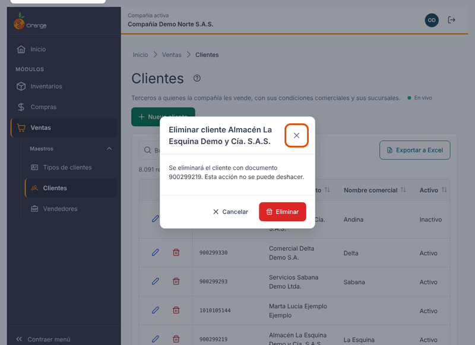

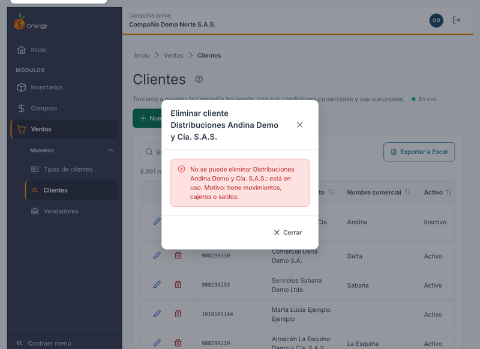

### ¿Qué puede salir mal?

| Mensaje | Qué hacer |
|---------|-----------|
| *"No tienes permiso para realizar esta acción con clientes."* | Pida el permiso **Eliminar** a su administrador. |
| *"El registro ya no existe. Se quitó del listado."* | Otro usuario lo eliminó. El listado ya se actualizó. |
| *"No se pudo eliminar"* | Revise la conexión e intente otra vez. |

---

## 📤 Exportar a Excel

Haga clic en **Exportar a Excel**. Se descarga el archivo con los clientes que cumplen la **búsqueda** y el **orden** que tiene en pantalla, de todas las páginas (no solo la visible). Mientras se genera verá un indicador de carga; al terminar, el aviso *"Se exportaron {N} clientes a Excel."*.

- El archivo puede tener **hasta 10.000 filas**. Si la búsqueda tiene más resultados, verá el aviso *"Hay más de 10.000 clientes con este filtro. Acota la búsqueda y vuelve a exportar."*. Escriba más texto en el buscador (documento o nombre) para reducir la lista y vuelva a exportar.
- Si la exportación falla, verá *"No se pudo generar el archivo de Excel. Inténtalo de nuevo."*.

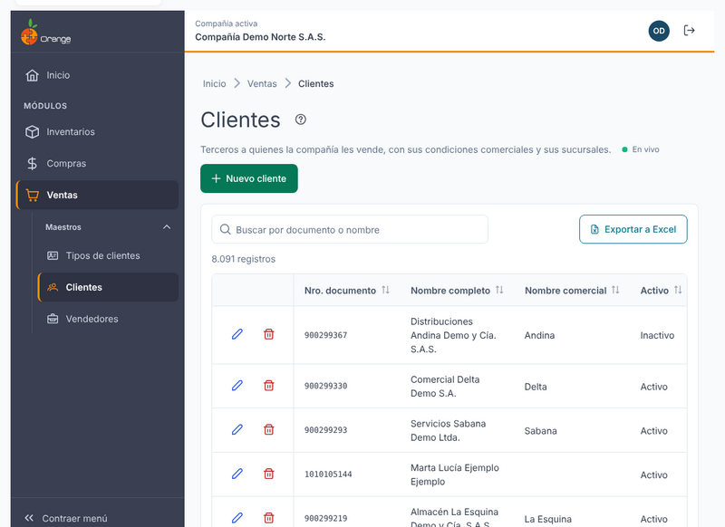

Para exportar necesita el permiso **Exportar** sobre la opción Clientes. Si no lo tiene, el botón no aparece.

---

## 🔄 Cambios de otros usuarios (en vivo)

Si otra persona crea, modifica o elimina clientes mientras usted tiene abierto el listado, **no tiene que recargar**: el listado se pone al día solo, sin perder lo que buscó, el orden ni la página.

- Las filas nuevas o modificadas se **resaltan** unos segundos.
- Abajo a la derecha aparece un aviso, por ejemplo *"Otro usuario creó Cliente Ejemplo S.A.S."*.
- Junto a la descripción verá **En vivo** mientras la conexión esté activa. Si se interrumpe, dice **Reconectando…**; al volver, la pantalla se actualiza sola.

**Si estaba editando ese mismo cliente:**

| Qué hizo el otro usuario | Qué verá | Qué puede hacer |
|--------------------------|----------|-----------------|
| Lo modificó | *"Otro usuario modificó este registro mientras lo editabas. Recarga para ver sus cambios (lo que escribiste se pierde)."* | **Recargar** para ver lo que él guardó. |
| Lo eliminó | *"Otro usuario eliminó este registro. No se puede guardar."* | **Cancelar**. El botón **Guardar** queda deshabilitado. |

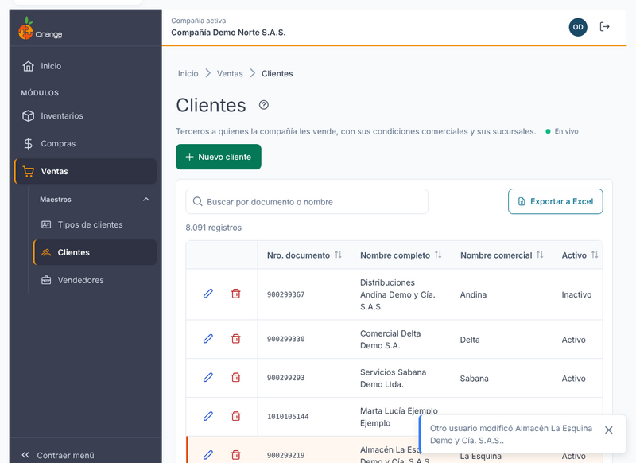

> ℹ️ Los cambios que usted hace en esta misma pantalla no generan avisos.

**Clientes que también son proveedores o compradores.** Si el tercero tiene varios perfiles, un cambio en su ficha también aparece en vivo en la otra pantalla donde está registrado.

---

## ❓ Preguntas frecuentes

**¿Por qué el sistema dice que el documento ya existe?**
El número de documento es único en la compañía. Si el tercero ya existe (por ejemplo, como proveedor), la ficha carga sus datos y, al guardar, solo se agrega la condición de cliente.

**¿Por qué no puedo guardar el cliente?**
Revise las pestañas marcadas con el contador de errores. Los campos obligatorios de la pestaña **Cliente** son necesarios cuando el tercero es cliente.

**¿Por qué no veo las pestañas Sucursales, Contactos o Archivos como formularios?**
Aparecen solo en un cliente guardado. Si el cliente es nuevo, primero guarde la ficha.

**¿Por qué el porcentaje dice que debe estar entre 0 y 100?**
Los descuentos y porcentajes se escriben como porcentaje. Por ejemplo, para 5 % escriba `5`, no `0,05`.

**Quité un cliente y el tercero sigue apareciendo en otra pantalla.**
Si el tercero tenía otro perfil (proveedor, vendedor u otro), solo se retiró su condición de cliente, y eso es lo esperado.

**¿Por qué no encuentro un cliente que sí existe?**
Revise que esté en la compañía correcta (título de la pestaña) y borre el texto del buscador con la **✕**.

**Al editar una sucursal antigua, la zona aparece vacía.**
La zona que tenía ya no existe en la compañía. Elija una zona de la lista y guarde la sucursal.

**¿Por qué no veo "En vivo"?**
La conexión en vivo no está disponible en este momento (por ejemplo, por la red de su empresa). La pantalla funciona igual; para ver cambios de otros usuarios, recargue la página.

**¿Por qué no aparece el botón Eliminar?**
Necesita el permiso **Eliminar** sobre la opción Clientes. Pida ese permiso a su administrador.

---

## 📚 Relacionado

- [Vendedores](vendedores.md)
- [Manejo general de la información](../../Generales/manejo-general-informacion.md)
