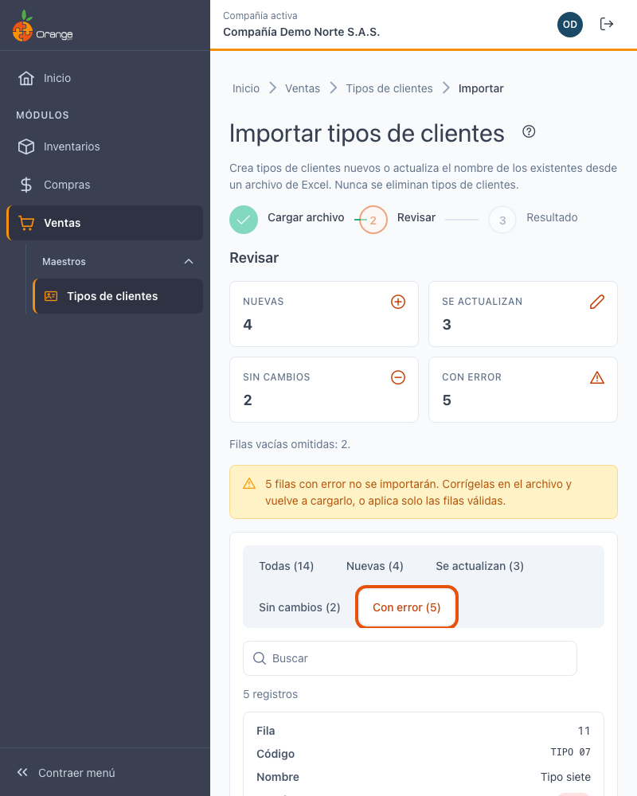

[Regresar a Tipos de clientes](tipos-clientes.md)

---

# 📥 Importar tipos de clientes desde Excel

---

## 📋 Descripción

Crea tipos de clientes nuevos o actualiza el **nombre** de los existentes a partir de un archivo de Excel. Antes de guardar, el sistema le muestra qué va a crear, qué va a actualizar y qué filas tienen errores. **Nunca elimina tipos de clientes.**

> 🔐 Necesita el permiso **Exportar** sobre la opción Tipos de clientes (es el mismo permiso de **Exportar a Excel**).

---

## 🎯 Acceso

En [Tipos de clientes](tipos-clientes.md), haga clic en **Importar** (junto a **Exportar a Excel**).

La importación tiene tres pasos: **Cargar archivo → Revisar → Resultado**.

---

## 1️⃣ Cargar archivo

1. Haga clic en **Descargar plantilla**. Se descarga `tipos-clientes-plantilla.xlsx` con las columnas **Código** y **Nombre**.
2. Llene **una fila por tipo de cliente**:
   - Si el **código ya existe**, se actualiza su **nombre**.
   - Si el **código no existe**, se **crea** el tipo de cliente.
3. Guarde el archivo y arrástrelo al recuadro, o haga clic en **Seleccionar archivos**.

| Regla | Detalle |
|-------|---------|
| Formato | Excel `.xlsx`. Solo se lee la **primera hoja**. |
| Encabezado | La primera fila debe tener **Código** y **Nombre** (con o sin tilde, en mayúsculas o minúsculas). El orden de las columnas no importa. |
| Tamaño | Hasta **1.000 filas** y **1 MB**. Si tiene más, divida el archivo en varios. |
| Filas vacías | Se ignoran; en **Revisar** se indica cuántas se omitieron (*"Filas vacías omitidas: 2."*). |
| Código | Hasta 10 caracteres: letras, números y guion. Se guarda en mayúsculas. |
| Nombre | Hasta 40 caracteres, sin comas ni punto y coma. |

Mientras el archivo se lee verá *"Leyendo el archivo…"*. Si el archivo no sirve, verá el motivo y no se envía nada:

| Mensaje | Qué hacer |
|---------|-----------|
| No se puede usar este archivo: *"El archivo no es un Excel (.xlsx) válido o está dañado. Usa la plantilla."* | Guarde el archivo como `.xlsx` o use la plantilla. |
| *"No se encontraron las columnas Código y Nombre en la primera fila. Usa la plantilla."* | Ponga los encabezados en la primera fila o use la plantilla. |
| *"El archivo no tiene tipos de clientes: agrega al menos una fila debajo del encabezado."* | Escriba al menos una fila de datos. |
| *"El archivo tiene N filas; el máximo es 1.000. Divídelo en varios archivos."* | Divida el archivo. |
| *"El archivo pesa más de 1 MB."* | Divida el archivo o quite columnas que no use. |

---

## 2️⃣ Revisar

El sistema valida cada fila **sin guardar nada** y le muestra un resumen:

| Indicador | Significado |
|-----------|-------------|
| **Nuevas** | Códigos que no existen: se crearán. |
| **Se actualizan** | Códigos que ya existen con otro nombre: se cambiará el nombre. Debajo verá **Antes: …** con el nombre actual. |
| **Sin cambios** | Códigos que ya existen con el mismo nombre: no se toca nada. |
| **Con error** | Filas que **no se importarán**. En la columna **Detalle** verá el motivo. |

Use las pestañas **Todas / Nuevas / Se actualizan / Sin cambios / Con error** para filtrar la tabla. La tabla muestra **Fila**, **Código**, **Nombre**, **Estado** y **Detalle** de cada fila del archivo.

Si hay filas con error, verá un aviso: *"N filas con error no se importarán. Corrígelas en el archivo y vuelve a cargarlo, o aplica solo las filas válidas."*

### Estados y errores por fila

| Estado o mensaje | Cómo corregirlo |
|------------------|-----------------|
| **Nueva** / **Se actualiza** / **Sin cambios** | No requiere acción. Se aplicará o no según corresponda. |
| **Error** con *"Falta el código."* o *"Falta el nombre."* | Complete la celda. |
| *"El código tiene más de 10 caracteres."* | Acorte el código. |
| *"El código solo puede tener letras, números y guion."* | Quite espacios, tildes o símbolos. |
| *"El código no puede tener comas ni punto y coma."* | Quite `,` y `;`. |
| *"El nombre tiene más de 40 caracteres."* | Acorte el nombre. |
| *"El nombre no puede tener comas ni punto y coma."* | Quite `,` y `;`. |
| *"El código se repite en el archivo (filas 3, 7)."* | Deje una sola fila por código. Todas las filas repetidas quedan con error. |

> 💡 **Descargar filas con error** genera un Excel solo con esas filas, para corregirlas y volver a cargarlas. Se descarga como `tipos-clientes-errores.xlsx`.

Si no hay cambios para aplicar (todas las filas están sin cambios o con error), verá *"No hay cambios para aplicar: todas las filas están sin cambios o con error."* y el botón de aplicar no hace nada.

---

## 3️⃣ Aplicar y resultado

Haga clic en **Aplicar N cambios** (N = nuevas + se actualizan). Las filas con error se omiten.

- Todo se guarda **junto**: si algo falla, **no se guarda ningún cambio** y puede reintentar.
- Si otro usuario cambió tipos de clientes mientras usted revisaba, la pantalla no aplica el archivo. Vea *Otro usuario cambió tipos de clientes* más abajo.

Al terminar verá el resumen: cuántos se crearon, cuántos se actualizaron, cuántos quedaron sin cambios y cuántas filas con error no se importaron.

Use **Ver tipos de clientes** para volver al listado, que ya muestra los cambios, o **Importar otro archivo** para cargar otro.

### ¿Qué puede salir mal al aplicar?

| Mensaje | Qué hacer |
|---------|-----------|
| **No se pudo completar la importación.** *"No se guardó ningún cambio. Inténtalo de nuevo."* | Haga clic en **Reintentar**. Revise la conexión si el problema se repite. |
| **Otro usuario cambió tipos de clientes mientras revisabas.** *"Vuelve a validar el archivo; no se guardó ningún cambio."* | Haga clic en **Volver a validar** y revise de nuevo. |

### Otro usuario cambió tipos de clientes

Si otra persona crea, modifica o elimina tipos de clientes mientras usted revisa el archivo, verá el aviso *"Otro usuario cambió tipos de clientes mientras revisabas. Vuelve a validar antes de aplicar."* 

Haga clic en **Volver a validar** para que la revisión tenga en cuenta esos cambios. Ninguna fila se guarda hasta que aplique de nuevo.

---

## ❓ Preguntas frecuentes

**¿Puedo cambiar el código de un tipo de cliente con la importación?**
No. El código es lo que identifica el tipo de cliente: si pone un código distinto, se crea un tipo de cliente nuevo. Para cambiar un código use **Editar** en [Tipos de clientes](tipos-clientes.md).

**¿La importación borra los tipos de clientes que no están en el archivo?**
No. Nunca elimina tipos de clientes. Para eliminar uno use la papelera en [Tipos de clientes](tipos-clientes.md).

**¿El código queda en mayúsculas?**
Sí. Los códigos se guardan en mayúsculas, igual que al crear o editar a mano. Así `may` y `MAY` no se convierten en dos tipos distintos.

**No veo el botón Importar.**
Su perfil necesita el permiso **Exportar** sobre Tipos de clientes. Consulte a su administrador.

**Subí el archivo y quedó con error una fila que sí está bien.**
Revise que la fila no tenga comas, punto y coma ni espacios en el código, y que el código no esté repetido en otra fila del archivo.
