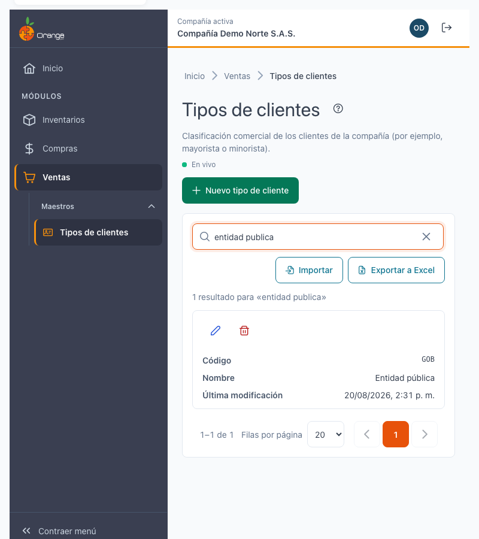
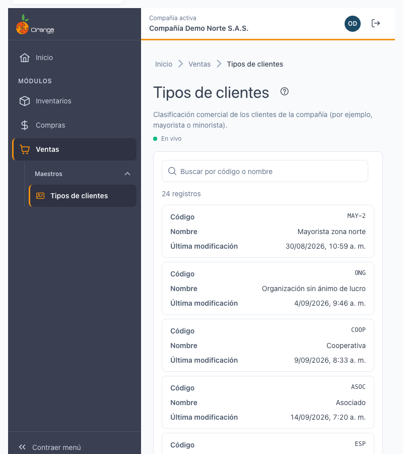
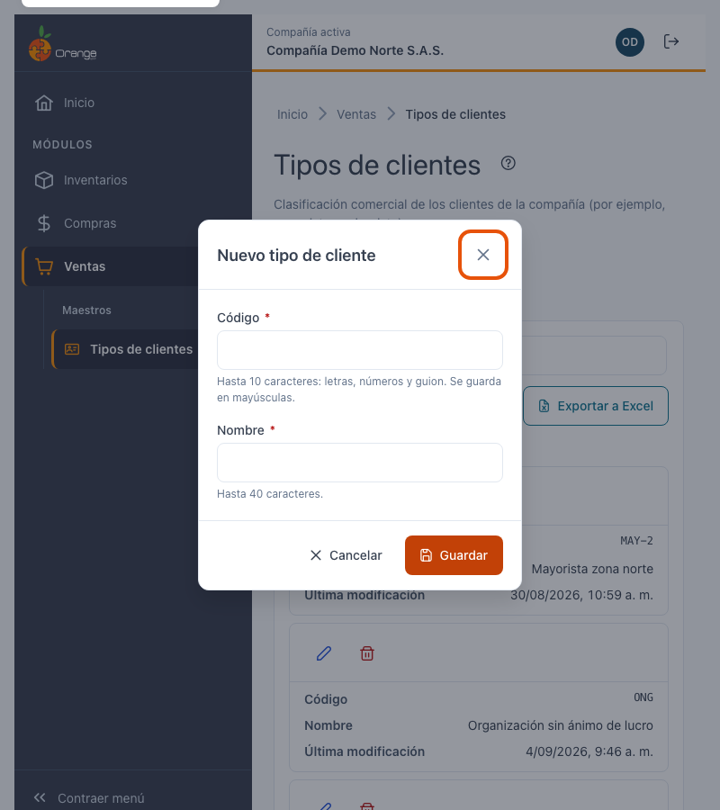
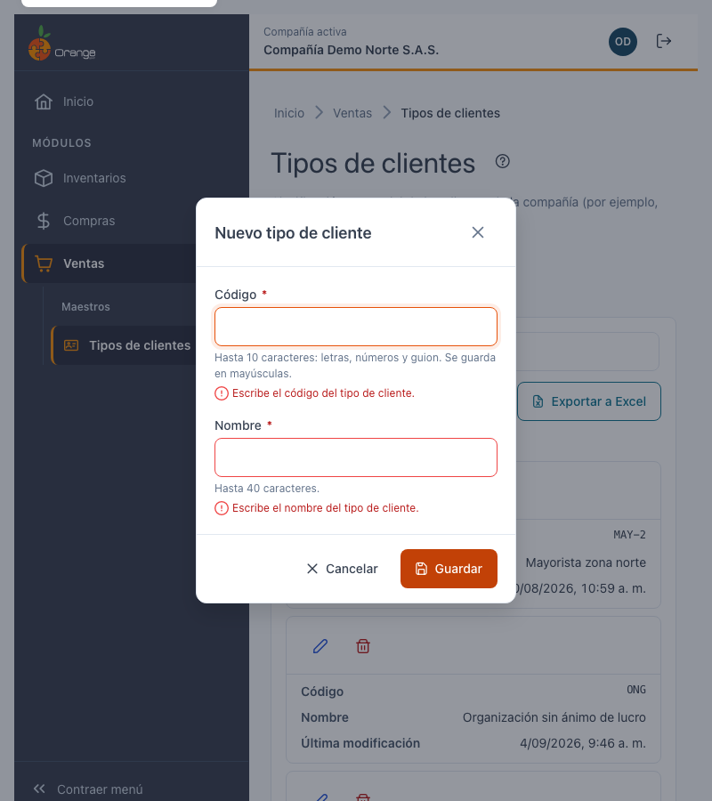
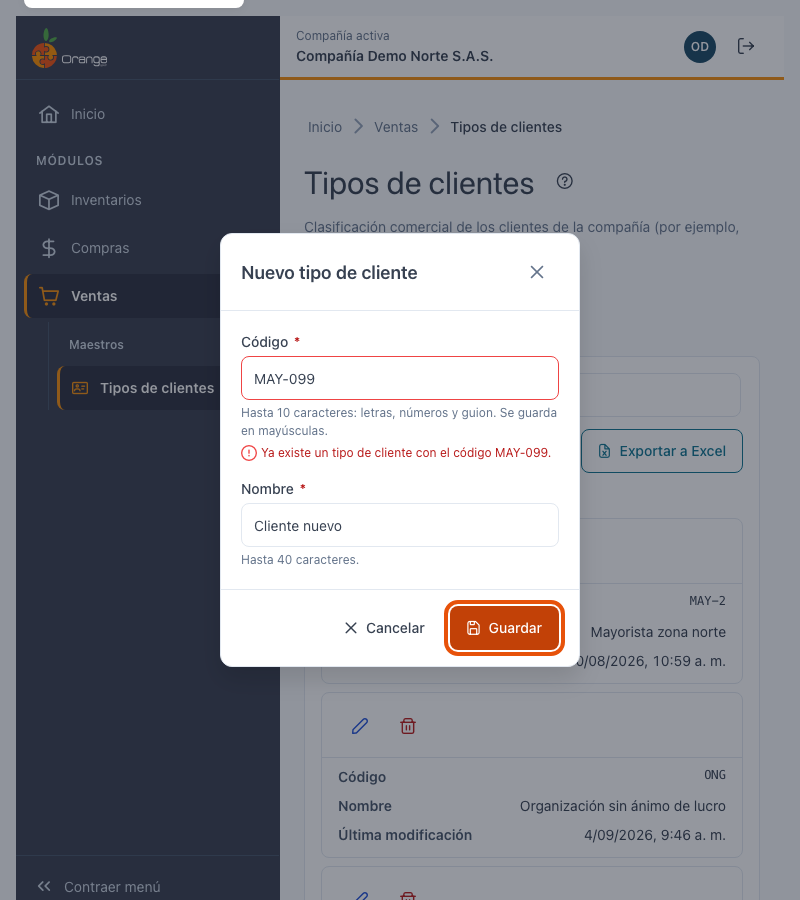
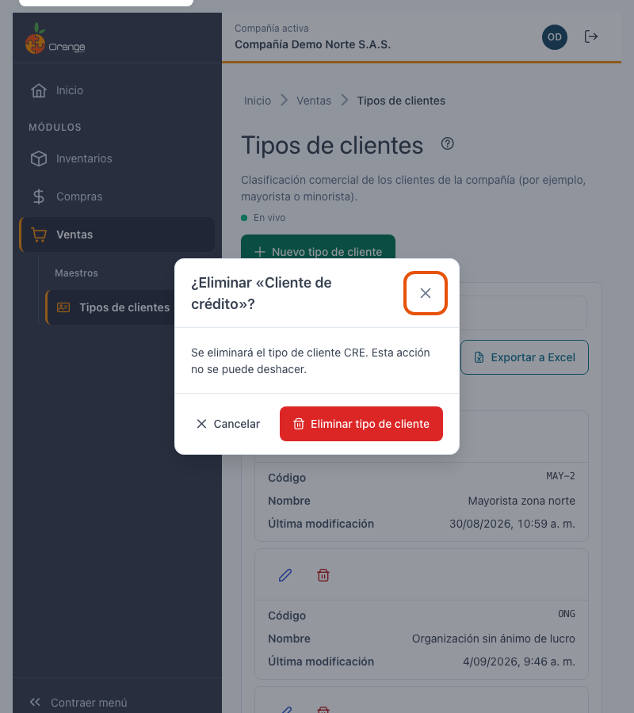
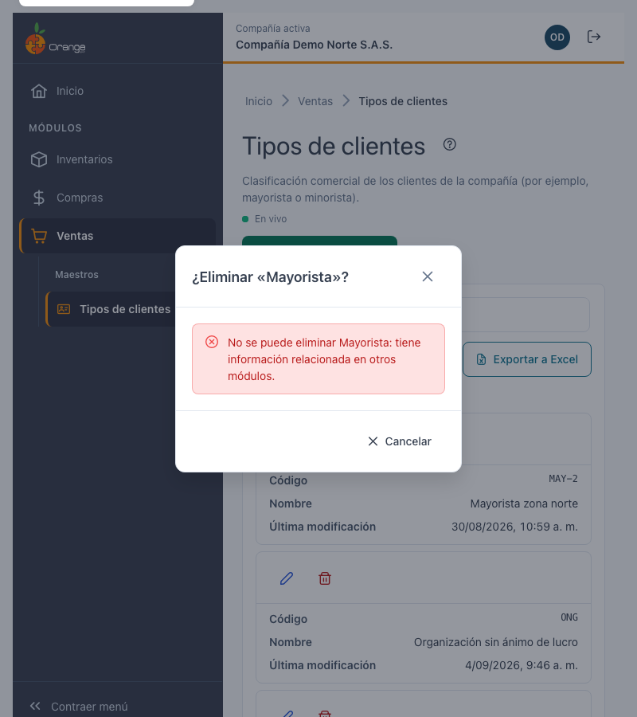
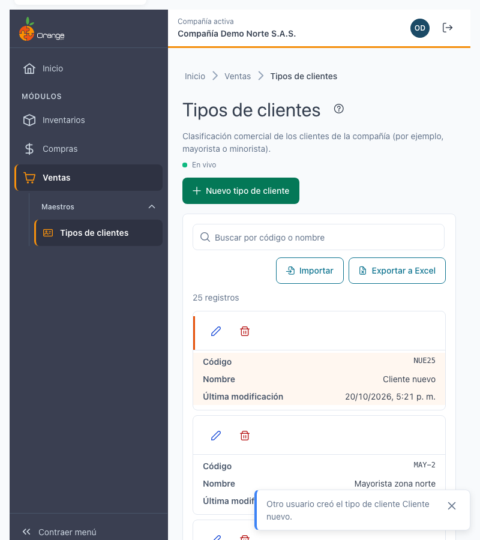
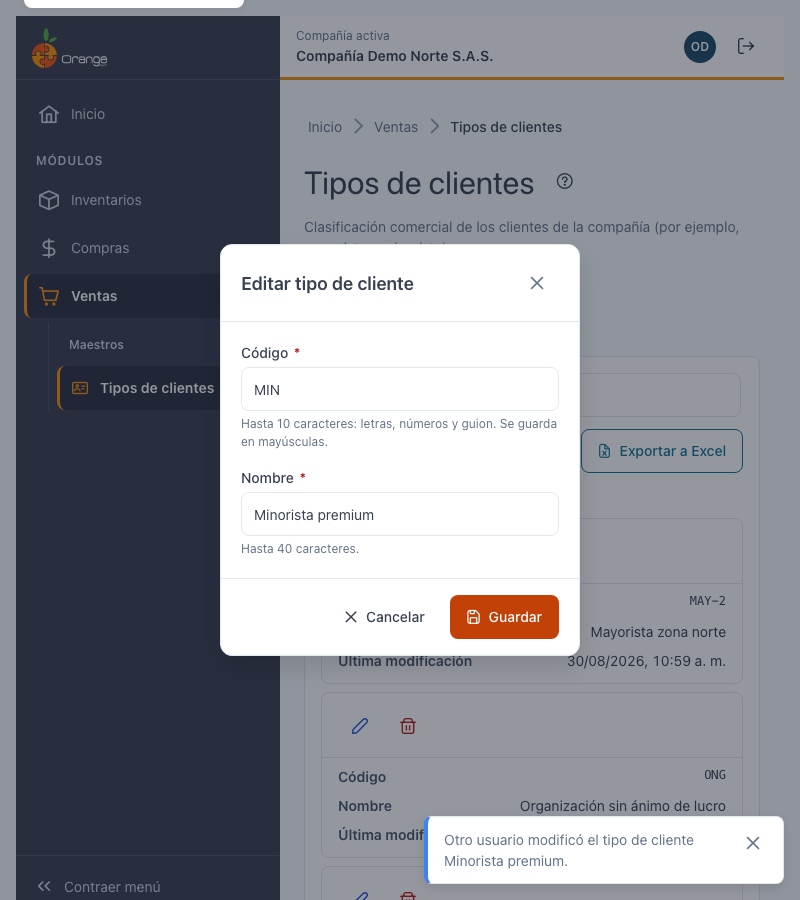

[Regresar a la documentación V2026](../../README.md)

---

# 🏷️ Tipos de clientes

---

## 📋 Descripción

Los **tipos de clientes** sirven para clasificar a los clientes de la compañía, por ejemplo **mayorista** o **minorista**.

En esta pantalla puede **consultar, crear, editar y eliminar** los tipos de clientes de la compañía con la que está trabajando, **exportar** el listado a Excel e **importar** tipos de clientes desde un archivo de Excel (ver [Importar tipos de clientes desde Excel](tipos-clientes-importar.md)).

> 📘 La búsqueda, el orden, la paginación, la exportación y la ayuda funcionan igual en todas las tablas: ver [Manejo general de la información](../../Generales/manejo-general-informacion.md).

> 💡 Cada pestaña del navegador trabaja con **una compañía**. El nombre y el color de la compañía se ven en el título de la pestaña y en la barra superior.

---

## 🎯 Acceso

1. En el menú principal, haga clic en **Ventas**.
2. En **Maestros**, haga clic en **Tipos de clientes**.

---

## 🖥️ Pantalla principal

| Elemento | Para qué sirve |
|----------|----------------|
| **?** (junto al título) | Abre esta ayuda en un panel lateral, sin salir de la pantalla. |
| **En vivo** | La pantalla está conectada: los cambios de otros usuarios aparecen solos. Ver *Cambios de otros usuarios* más abajo. |
| **Nuevo tipo de cliente** | Crea un tipo de cliente. |
| **Buscar por código o nombre** | Filtra el listado mientras escribe. No distingue mayúsculas ni tildes: "mayorista" encuentra "Mayorista". |
| **Exportar a Excel** | Descarga el listado (con el filtro y el orden que tenga en pantalla). |
| **Importar** | Crea tipos de clientes nuevos o cambia el nombre de los existentes desde una plantilla de Excel. Ver [Importar tipos de clientes desde Excel](tipos-clientes-importar.md). |
| **Lápiz** / **Papelera** | Editar o eliminar el tipo de cliente de esa fila. Siempre están en la **primera columna**, visibles aunque la tabla tenga que desplazarse. |
| **Encabezados** | Un clic ordena de forma ascendente, el segundo descendente y el tercero quita el orden. |
| **Filas por página** y paginación | Cambian cuántos tipos de clientes ve y la página. |

Las columnas son **Código**, **Nombre** y **Última modificación** (fecha y hora del último cambio).

> 📱 En el celular cada tipo de cliente se muestra como una tarjeta, con las acciones arriba.

**¿No ve algún botón?** Cada acción depende de los permisos de su perfil sobre la opción Tipos de clientes:

| Permiso | Qué habilita |
|---------|--------------|
| Consultar | Ver la pantalla |
| Crear | **Nuevo tipo de cliente** |
| Actualizar | **Lápiz** (editar) |
| Eliminar | **Papelera** (eliminar) |
| Exportar | **Exportar a Excel** e **Importar** |

Con solo el permiso de consulta el listado se ve completo, pero no aparecen los botones de crear, editar, eliminar ni exportar.

---

## ➕ Crear un tipo de cliente

1. Haga clic en **Nuevo tipo de cliente**.
2. Complete los campos y haga clic en **Guardar** (o presione **Enter**).

| Campo | Obligatorio | Reglas | Ejemplo |
|-------|:-----------:|--------|---------|
| **Código** | ✅ | Hasta 10 caracteres: letras, números y guion. Se guarda **siempre en MAYÚSCULAS** (lo convierte mientras escribe). No se puede repetir en la compañía. | `MAY` |
| **Nombre** | ✅ | Hasta 40 caracteres. No admite comas (,) ni punto y coma (;). | `Mayorista` |

Al guardar verá el mensaje **"Tipo de cliente Mayorista creado."** y el tipo aparece en el listado, sin recargar la pantalla.

### ¿Qué puede salir mal?

Si algo no es válido, la pantalla no guarda y le indica qué corregir. El cursor va al primer campo con error.

| Mensaje | Qué hacer |
|---------|-----------|
| Escriba el código del tipo de cliente. / Escriba el nombre del tipo de cliente. | Complete el campo. |
| Use solo letras, números y guion (máximo 10). | Quite espacios, tildes u otros símbolos del código. |
| El nombre no puede tener comas ni punto y coma (máximo 40). | Corrija el nombre. |
| Ya existe un tipo de cliente con el código … | Use otro código. La pantalla conserva lo que escribió. |
| No se pudo guardar el tipo de cliente. Inténtelo de nuevo. | Revise su conexión y haga clic en **Guardar** otra vez. Lo que escribió se conserva. |

---

## ✏️ Editar un tipo de cliente

1. Haga clic en el **lápiz** del tipo de cliente.
2. Cambie el código o el nombre y haga clic en **Guardar**.

> ℹ️ Puede cambiar el código aunque el tipo ya esté asignado a clientes. Los clientes se relacionan con el tipo y no con su código, así que siguen asignados después del cambio.

Si otro usuario eliminó el tipo mientras lo editaba, al guardar el diálogo se cierra, el tipo desaparece del listado y un aviso le indica **"Este tipo de cliente ya no existe; otro usuario pudo eliminarlo."**

---

## 🗑️ Eliminar un tipo de cliente

1. Haga clic en la **papelera** del tipo de cliente.
2. Confirme con **Eliminar tipo de cliente**.

Al confirmar, el tipo desaparece del listado y verá el mensaje **"Tipo de cliente Minorista eliminado."**. Esta acción no se puede deshacer.

### Tipo de cliente en uso

Un tipo de cliente **no se puede eliminar** si tiene información relacionada en otros módulos (por ejemplo, si hay clientes asignados a ese tipo). En ese caso verá:

> No se puede eliminar Mayorista: tiene información relacionada en otros módulos.

El diálogo solo permite **Cerrar**. El tipo no se modifica ni se elimina.

---

## 📤 Exportar a Excel

Haga clic en **Exportar a Excel**. Se descarga `tipos-clientes_AAAA-MM-DD.xlsx` con **todos** los tipos de clientes del filtro actual (no solo la página visible), con el encabezado fijo y filtros de Excel.

## 📥 Importar desde Excel

Haga clic en **Importar** para crear o actualizar varios tipos de clientes a la vez. Primero el sistema revisa el archivo sin guardar nada; después usted aplica todas las filas válidas juntas o ninguna. Vea el manual completo: [Importar tipos de clientes desde Excel](tipos-clientes-importar.md).

> ℹ️ La importación nunca elimina tipos de clientes.

---

## 🔄 Cambios de otros usuarios (en vivo)

Si otra persona crea, modifica o elimina tipos de clientes mientras usted tiene abierta esta pantalla, **no tiene que recargar**: el listado se pone al día solo, sin perder lo que buscó, el orden ni la página.

- Las filas nuevas o modificadas se **resaltan** unos segundos.
- Abajo a la derecha aparece un aviso, por ejemplo *"Otro usuario creó el tipo de cliente Almacén sur."*
- Junto a la descripción verá **En vivo** mientras la conexión esté activa. Si se interrumpe, dice **Reconectando…**; al volver, la pantalla se actualiza sola.

**Si estaba editando ese mismo tipo de cliente:**

| Qué hizo el otro usuario | Qué verá | Qué puede hacer |
|--------------------------|----------|-----------------|
| Lo modificó | *"Otro usuario modificó este tipo de cliente mientras lo editabas. Si guardas, reemplazarás sus cambios."* | **Ver sus cambios** para cargar lo que él guardó, o **Guardar** para dejar lo suyo. |
| Lo eliminó | *"Otro usuario eliminó este tipo de cliente. Ya no se puede guardar."* | **Cancelar**. El botón Guardar queda deshabilitado. |

Si estaba por confirmar la eliminación de un tipo que otro ya eliminó, el diálogo se cierra con el aviso *"Otro usuario ya eliminó el tipo de cliente …"*.

> ℹ️ Los cambios que usted hace en esta misma pestaña no generan avisos.

---

## ❓ Preguntas frecuentes

**¿Por qué el código quedó en mayúsculas?**
Los códigos de tipo de cliente siempre se guardan en mayúsculas para que no haya dos tipos "iguales" escritos distinto.

**¿Por qué no encuentro un tipo de cliente que sí existe?**
Revise que esté en la compañía correcta (título de la pestaña) y borre el texto del buscador con la **✕**.

**¿Por qué no puedo eliminar un tipo de cliente?**
Porque tiene información relacionada en otros módulos. Vea *Tipo de cliente en uso* más arriba.

**No veo "En vivo".**
La conexión en vivo no está disponible en este momento (por ejemplo, por la red de su empresa). La pantalla funciona igual; para ver cambios de otros usuarios, recargue la página.

**No veo el botón Nuevo tipo de cliente, Editar, Eliminar ni Exportar.**
Su perfil no tiene ese permiso sobre la opción. Pida a su administrador que lo revise.
