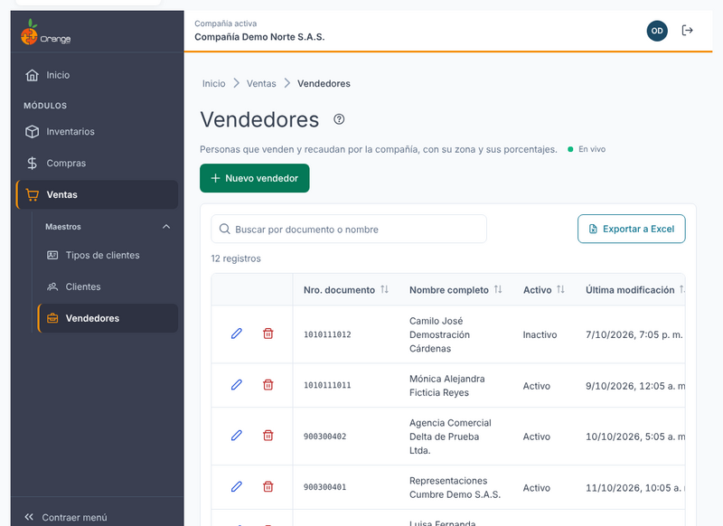
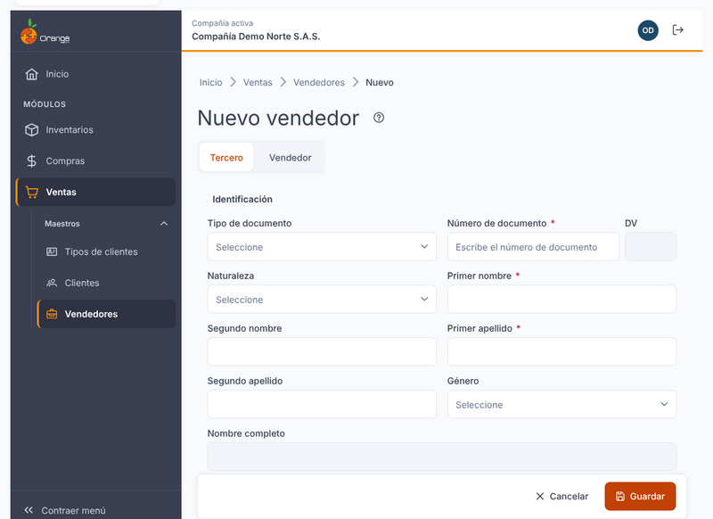
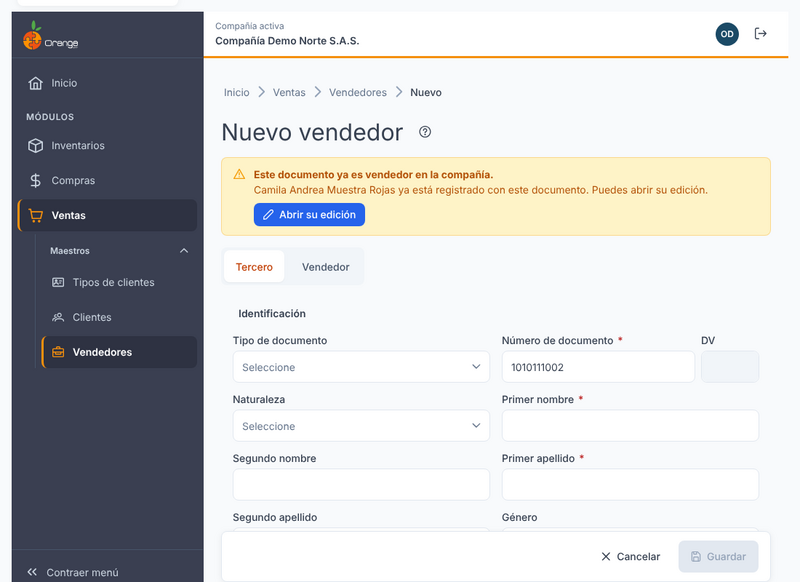
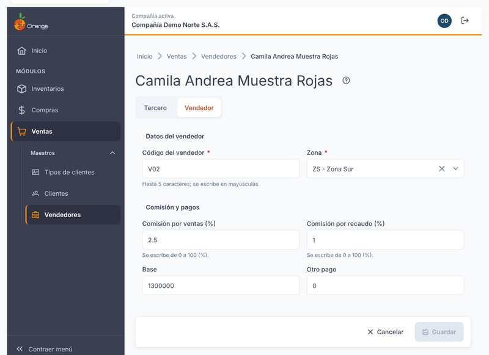
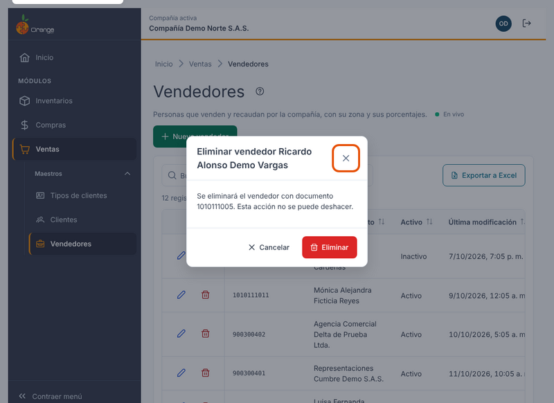
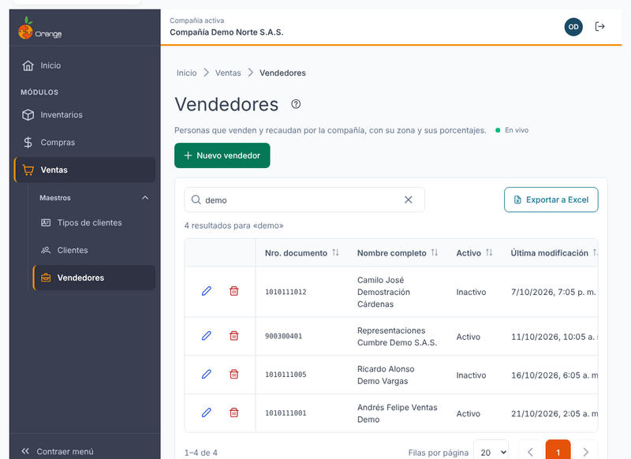
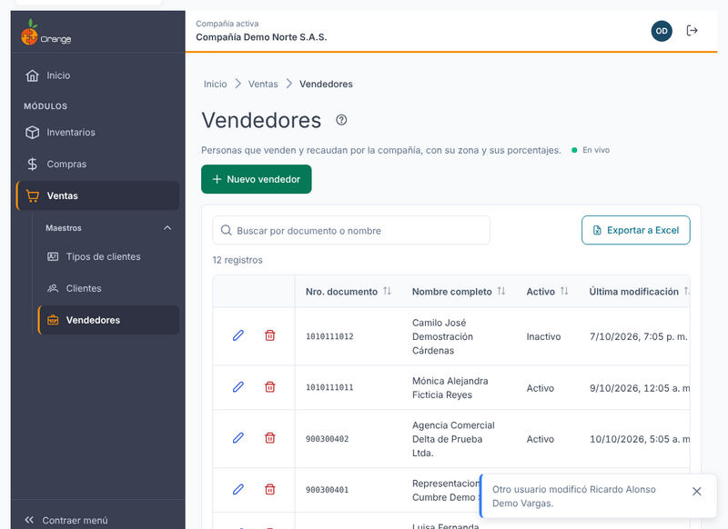

[Regresar a Ventas](../readme.md)

---

# 🤝 Vendedores

---

## 📋 Descripción

Los **vendedores** son las personas que venden y recaudan por la compañía. Cada vendedor tiene su ficha con los datos de identificación del tercero y los datos propios del vendedor: su **código**, su **zona** y sus **comisiones**.

En esta pantalla puede **consultar, crear, editar y eliminar** vendedores, y **exportar** el listado a Excel. Trabaje siempre con la compañía que aparece en el título de la pestaña.

> 📘 La búsqueda, el orden, la paginación y la ayuda funcionan igual en todas las tablas: ver [Manejo general de la información](../../Generales/manejo-general-informacion.md).

> 💡 Un vendedor también puede ser **cliente**. Los datos del tercero (documento, nombre, logo y adjuntos) son los mismos en ambas pantallas; ver [Clientes](clientes.md).

---

## 🎯 Acceso

1. En el menú principal, haga clic en **Ventas**.
2. En **Maestros de Ventas**, haga clic en **Vendedores**.

Para ver la pantalla necesita el permiso **Consultar** sobre la opción Vendedores. Los demás botones dependen de los permisos que le haya dado el administrador (ver la tabla más abajo).

---

## 🖥️ Pantalla principal

| Elemento | Para qué sirve |
|----------|----------------|
| **?** (junto al título) | Abre esta ayuda en un panel lateral, sin salir de la pantalla. |
| **En vivo** | La pantalla está conectada: los cambios de otros usuarios aparecen solos. Ver *Cambios de otros usuarios* más abajo. |
| **Nuevo vendedor** | Abre la ficha vacía para crear un vendedor. |
| **Buscar por documento o nombre** | Muestra solo los vendedores que coinciden con lo que escribe. Para quitar el texto, use la **✕**. |
| **Exportar a Excel** | Descarga los vendedores que cumplen la búsqueda y el orden actuales. Ver *Exportar a Excel* más abajo. |
| **Lápiz** / **Papelera** | Editar o eliminar el vendedor de esa fila. Están en la **primera columna**. Si no tiene permiso para actualizar, el lápiz dice **Ver** y abre la ficha en solo lectura. |
| **Encabezados** | Un clic ordena de forma ascendente, el segundo descendente y el tercero quita el orden. Por defecto aparece primero el último vendedor registrado. |
| **Filas por página** y paginación | Cambian cuántos vendedores ve por página (10, 20, 50 o 100) y la página. |

Las columnas del listado son: **Nro. documento**, **Nombre completo**, **Código** del vendedor, **Zona**, **Activo** y **Última modificación**. La imagen de arriba es una captura de diseño y todavía no muestra Código ni Zona.

> 📱 En pantallas pequeñas el listado se ajusta al ancho disponible y las acciones quedan visibles en cada fila.

**¿No ve algún botón?** Cada acción depende de los permisos de su perfil sobre la opción Vendedores:

| Permiso | Qué habilita |
|---------|--------------|
| Consultar | Ver el listado y abrir la ficha. |
| Crear | **Nuevo vendedor** y convertir en vendedor a un tercero que ya existe en la compañía. |
| Actualizar | **Editar** y **Guardar** en la ficha. |
| Eliminar | **Papelera** y **Eliminar** en la ficha. |
| Exportar | **Exportar a Excel**. |

Si solo tiene **Consultar**, la ficha aparece con el aviso *"Solo tienes permiso de consulta: la ficha no se puede modificar."* Si no tiene **Consultar**, la pantalla muestra *"No tienes acceso a vendedores"* y no aparece en el menú.

---

## ➕ Crear un vendedor

1. Haga clic en **Nuevo vendedor**.
2. Escriba el **Tipo de documento** y el **Número de documento** (entre 5 y 20 caracteres). Cuando deja el campo, el sistema revisa si ese documento ya está registrado en la compañía (ver el paso siguiente).
3. Complete las dos secciones de la ficha y haga clic en **Guardar**.

Al guardar por primera vez verá el aviso **"Cambios guardados."** y la pantalla vuelve al listado, donde aparece el vendedor nuevo.

La ficha tiene dos pestañas:

| Pestaña | Qué incluye |
|---------|-------------|
| **Tercero** | Identificación (tipo y número de documento, con el dígito de verificación calculado; nombre), ubicación y contacto (dirección, ciudad, teléfono, celular, correo), información tributaria y estado (activo, observaciones). El rol **Es vendedor** aparece fijo y no se puede cambiar. |
| **Vendedor** | El código, la zona y las comisiones del vendedor. Ver *Sección Vendedor* más abajo. |

> ℹ️ Los vendedores no tienen las pestañas de **Sucursales**, **Contactos** ni **Archivos**. Esas pestañas son de los clientes; ver [Clientes](clientes.md).

Los campos obligatorios se marcan en la ficha. Si falta algún dato o un valor no es válido, la pestaña aparece con el contador de errores (por ejemplo, **1 error**) y el campo muestra el motivo. Corríjalo y guarde de nuevo.

### Verificar el documento antes de crear

Mientras el sistema revisa el documento verá *"Verificando si el documento ya está registrado…"*. Según el resultado, verá uno de estos avisos:

| Aviso | Qué significa | Qué puede hacer |
|-------|---------------|-----------------|
| *"Este documento ya existe en la compañía como {nombre} ({roles})."* | El tercero ya existe con otro perfil (cliente, proveedor u otro). **No se duplica.** La ficha se llena con sus datos. | Revise los datos precargados y haga clic en **Convertir en vendedor**. Luego guarde: el tercero se agrega como vendedor sin crear otro. |
| *"Este documento ya es vendedor en la compañía."* | Ya tiene este perfil. | Haga clic en **Abrir su edición** para modificarlo. El botón **Guardar** queda deshabilitado. |
| *"No se pudo verificar el documento…"* | La revisión falló por la conexión. | Haga clic en **Reintentar**, o guarde: el sistema lo verifica otra vez al guardar. |

Si cambia el número de documento después de haber cargado un tercero existente, la información precargada se quita y la verificación se repite.

---

## ✏️ Editar un vendedor

1. Haga clic en el **lápiz** del vendedor (o en **Ver** si solo tiene consulta).
2. Cambie los datos y haga clic en **Guardar**.

Los cambios se guardan cuando hace clic en **Guardar**. Si sale de la ficha con cambios sin guardar, el sistema pregunta **"¿Salir sin guardar?"**: **Seguir editando** lo deja en la ficha; **Salir sin guardar** descarta los cambios.

Si otro usuario modificó el mismo vendedor mientras lo edita, vea *Cambios de otros usuarios* más abajo.

### Sección Vendedor

**Datos del vendedor**

| Campo | Regla |
|-------|-------|
| **Código del vendedor** | Obligatorio. Hasta **5 caracteres**. Se escribe en **MAYÚSCULAS**. No puede repetirse en la compañía. |
| **Zona** | Obligatoria. Busque por código o nombre y elija de la lista. |

**Comisión y pagos**

| Campo | Regla |
|-------|-------|
| **Comisión por ventas (%)** | Escriba el porcentaje **de 0 a 100**, por ejemplo `2,5` para 2,5 %. |
| **Comisión por recaudo (%)** | Escriba el porcentaje **de 0 a 100**. |
| **Base** | Número de 0 en adelante. |
| **Otro pago** | Número de 0 en adelante. |

| Mensaje | Qué hacer |
|---------|-----------|
| *"Escribe el código del vendedor."* | Escriba el código (hasta 5 caracteres). |
| *"El código admite hasta 5 caracteres."* | Acorte el código. |
| *"Ya existe un vendedor con ese código."* | Use otro código. |
| *"Elige la zona."* | Elija una zona de la lista. |
| *"Escribe un número mayor o igual a 0."* | Escriba un número de 0 en adelante. |
| *"El porcentaje debe estar entre 0 y 100."* | Escriba el porcentaje entre 0 y 100, sin el signo. |

---

## 🗑️ Eliminar un vendedor

Hay dos formas de empezar: la **papelera** de la fila en el listado, o el botón **Eliminar** al final de la ficha.

Antes de borrar, el sistema confirma con **Eliminar vendedor** y le muestra el nombre y el documento. Según el caso, verá una de estas situaciones:

| Situación | Qué ocurre |
|-----------|------------|
| El tercero **solo es vendedor**. | Se elimina el vendedor. |
| El tercero **también es cliente, proveedor u otro perfil**. | El aviso dice *"Esta persona o empresa también es {roles}: solo se retira su condición de vendedor; el tercero se conserva."*. Se retira la condición de vendedor y **el tercero se conserva** con sus otros perfiles. |
| El vendedor **está en uso** (asignado a sucursales de clientes o a movimientos). | No se puede eliminar. El diálogo muestra *"No se puede eliminar {nombre}: está en uso."* con el motivo *"Motivo: está asignado a sucursales de clientes o a movimientos."*. Cierre el diálogo: el vendedor no cambia. |

### ¿Qué puede salir mal?

| Mensaje | Qué hacer |
|---------|-----------|
| *"No tienes permiso para realizar esta acción con vendedores."* | Pida el permiso **Eliminar** a su administrador. |
| *"El registro ya no existe. Se quitó del listado."* | Otro usuario lo eliminó. El listado ya se actualizó. |
| *"No se pudo eliminar"* | Revise la conexión e intente otra vez. |

Para quitar un vendedor que está asignado a sucursales de clientes, primero cambie el vendedor de esas sucursales en la pestaña **Sucursales** de cada cliente; ver [Clientes](clientes.md).

---

## 📤 Exportar a Excel

Haga clic en **Exportar a Excel**. Se descarga el archivo con los vendedores que cumplen la **búsqueda** y el **orden** que tiene en pantalla, de todas las páginas (no solo la visible). Al terminar verá el aviso *"Se exportaron {N} vendedores a Excel."*.

- El archivo puede tener **hasta 10.000 filas**. Si la búsqueda tiene más resultados, verá el aviso *"Hay más de 10.000 vendedores con este filtro. Acota la búsqueda y vuelve a exportar."*.
- Si la exportación falla, verá *"No se pudo generar el archivo de Excel. Inténtalo de nuevo."*.

Para exportar necesita el permiso **Exportar** sobre la opción Vendedores. Si no lo tiene, el botón no aparece.

---

## 🔄 Cambios de otros usuarios (en vivo)

Si otra persona crea, modifica o elimina vendedores mientras usted tiene abierto el listado, **no tiene que recargar**: el listado se pone al día solo, sin perder lo que buscó, el orden ni la página.

- Las filas nuevas o modificadas se **resaltan** unos segundos.
- Abajo a la derecha aparece un aviso, por ejemplo *"Otro usuario creó Vendedor Ejemplo"*.
- Junto a la descripción verá **En vivo** mientras la conexión esté activa. Si se interrumpe, dice **Reconectando…**; al volver, la pantalla se actualiza sola.

**Si estaba editando ese mismo vendedor:**

| Qué hizo el otro usuario | Qué verá | Qué puede hacer |
|--------------------------|----------|-----------------|
| Lo modificó | *"Otro usuario modificó este registro mientras lo editabas. Recarga para ver sus cambios (lo que escribiste se pierde)."* | **Recargar** para ver lo que él guardó. |
| Lo eliminó | *"Otro usuario eliminó este registro. No se puede guardar."* | **Cancelar**. El botón **Guardar** queda deshabilitado. |

> ℹ️ Los cambios que usted hace en esta misma pantalla no generan avisos.

---

## ❓ Preguntas frecuentes

**¿Por qué el sistema dice que el documento ya existe?**
El número de documento es único en la compañía. Si el tercero ya existe (por ejemplo, como cliente), la ficha carga sus datos y, al guardar, solo se agrega la condición de vendedor.

**¿Por qué no puedo guardar el vendedor?**
Revise la pestaña **Vendedor**, que tiene el contador de errores. El código y la zona son obligatorios.

**¿Por qué no me deja usar el código de un vendedor?**
El código no puede repetirse en la compañía. Si ya existe, use otro código de hasta 5 caracteres.

**¿Por qué el porcentaje dice que debe estar entre 0 y 100?**
Las comisiones se escriben como porcentaje. Por ejemplo, para 2,5 % escriba `2,5`, no `0,025`.

**Quité un vendedor y el tercero sigue apareciendo en otra pantalla.**
Si el tercero tenía otro perfil (cliente, proveedor u otro), solo se retiró su condición de vendedor, y eso es lo esperado.

**¿Por qué no puedo eliminar un vendedor?**
Está asignado a sucursales de clientes o tiene movimientos. Cambie el vendedor de esas sucursales o revise los movimientos, y vuelva a intentar.

**¿Por qué no veo "En vivo"?**
La conexión en vivo no está disponible en este momento (por ejemplo, por la red de su empresa). La pantalla funciona igual; para ver cambios de otros usuarios, recargue la página.

---

## 📚 Relacionado

- [Clientes](clientes.md)
- [Manejo general de la información](../../Generales/manejo-general-informacion.md)
