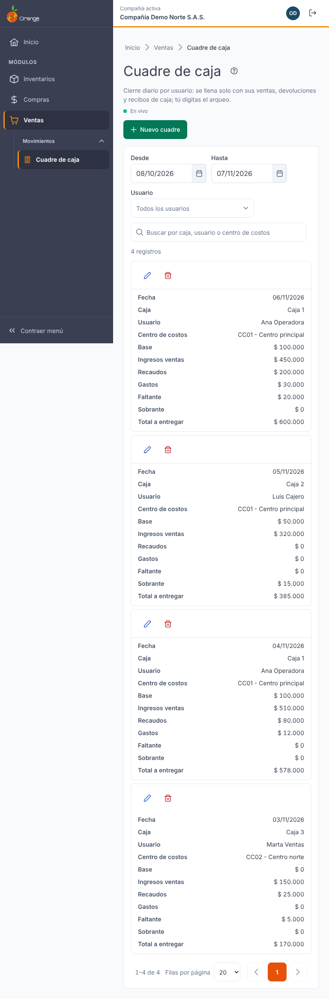
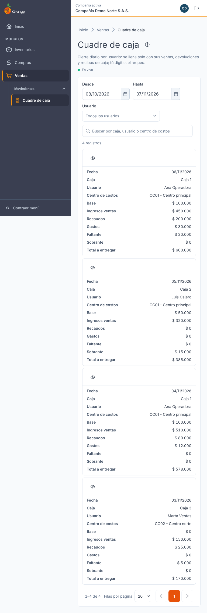
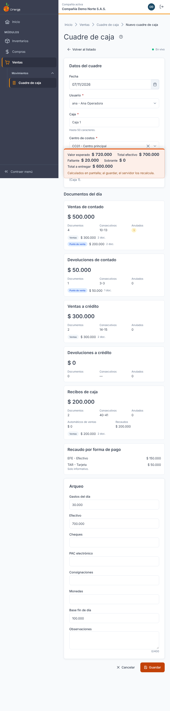
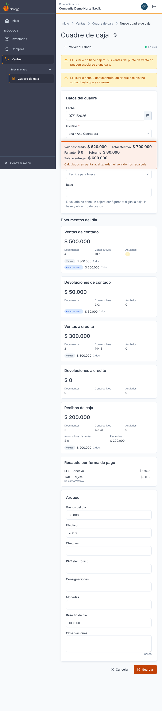
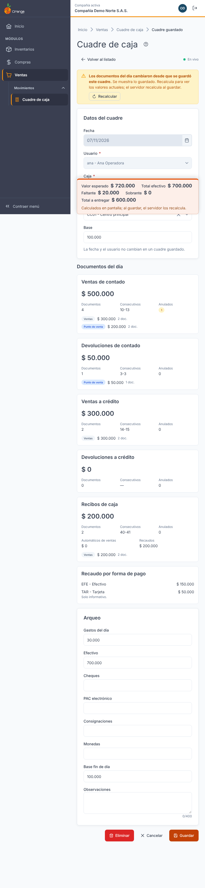
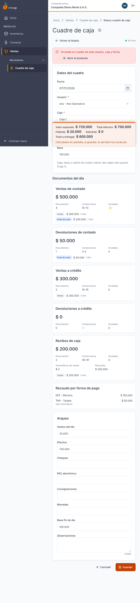
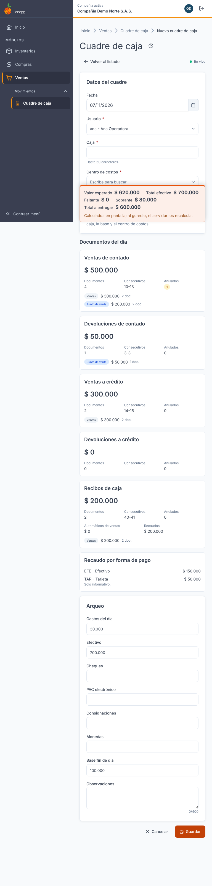

[Regresar a la documentación V2026](../../README.md) · [Regresar al índice de Ventas](../readme.md)

---

# 🧾 Cuadre de caja

---

## 📋 Descripción

El **cuadre de caja** es el cierre del día de una caja. Para cada **usuario** y **fecha** registra cuánto se vendió, cuánto se devolvió y cuánto se recaudó, y compara lo que **debería** haber en efectivo con lo que **realmente** cuenta al final del día.

La pantalla **se llena sola**. Usted no escoge documentos: el sistema toma los documentos que **creó ese usuario** con esa fecha de documento (la fecha del movimiento, no la hora en que se digitó):

- **Ventas y devoluciones** (de contado y a crédito), hechas en **Ventas y devoluciones** y en el **Punto de venta**.
- **Recibos de caja** creados por ese usuario.

Lo que usted digita es el **arqueo**: el efectivo, los cheques, los gastos del día y la base que queda al final. El sistema calcula el resto.

> 📘 La búsqueda, el orden, la paginación y la ayuda funcionan igual en todas las tablas: ver [Manejo general de la información](../../Generales/manejo-general-informacion.md).

> 🛒 Para vender desde la caja use el [Punto de venta](punto-de-venta.md). Para revisar o crear las ventas use [Ventas y devoluciones](ventas-devoluciones.md).

> ℹ️ Si el usuario tiene un **cajero** configurado, la caja, la base y el centro de costos vienen de ese cajero. Vea [Cajeros](../maestros/cajeros.md).

---

## 🎯 Acceso

1. En el menú principal, haga clic en **Ventas**.
2. En **Movimientos**, haga clic en **Cuadre de caja**.

---

## 🖥️ Pantalla principal

| Elemento | Para qué sirve |
|----------|----------------|
| **?** (junto al título) | Abre esta ayuda en un panel lateral, sin salir de la pantalla. |
| **En vivo** | La pantalla está conectada: los cambios de otros usuarios aparecen solos. Ver *Cambios de otros usuarios* más abajo. |
| **Nuevo cuadre** | Abre un cuadre nuevo. |
| **Desde** / **Hasta** | Limitan las fechas del listado. La fecha inicial no puede ser posterior a la final. |
| **Usuario** | Muestra solo los cuadres de un usuario. Por defecto, *Todos los usuarios*. |
| **Limpiar filtros** | Quita las fechas y el usuario del filtro. |
| **Buscar por caja, usuario o centro de costos** | Filtra el listado mientras escribe. |
| **Lápiz** / **Papelera** | Abrir o editar el cuadre de esa fila, o eliminarlo. Están en la primera columna. |
| **Encabezados** | Un clic ordena de forma ascendente, el segundo descendente y el tercero quita el orden. |

El listado muestra: **Fecha**, **Caja**, **Usuario**, **Centro de costos**, **Base**, **Ingresos ventas**, **Recaudos**, **Gastos**, **Faltante**, **Sobrante** y **Total a entregar**.

Si no hay cuadres en el rango, la pantalla dice *Aún no hay cuadres en este rango*. Cambie las fechas del filtro o cree el primero con **Nuevo cuadre**.

**¿No ve algún botón?** Cada acción depende de los permisos de su perfil sobre la opción **Cuadre de caja**:

| Permiso | Qué habilita |
|---------|--------------|
| Consultar | Ver el listado y abrir los cuadres. |
| Crear | **Nuevo cuadre**. |
| Actualizar | Editar el arqueo, **Recalcular** y **Guardar** en un cuadre existente. |
| Eliminar | **Papelera** (eliminar) y el botón **Eliminar** dentro del cuadre. |

Con solo el permiso de consulta el listado se ve completo, pero no aparecen los botones de crear, editar ni eliminar. Si abre un cuadre sin permiso de actualizar, lo ve **solo para consulta** y verá el aviso *Solo consulta: tu perfil no puede modificar los cuadres.*

---

## ➕ Crear un cuadre

1. Haga clic en **Nuevo cuadre**.
2. Revise la **fecha** y el **usuario**. Por defecto aparece el usuario de su sesión.
3. Revise o complete **caja**, **base** y **centro de costos**.
4. Digite el **arqueo** (ver *Cómo se calcula* más abajo).
5. Haga clic en **Guardar**.

Mientras cambia la fecha o el usuario, la pantalla muestra *Calculando documentos del día…* y después llena los **Documentos del día**.

### Datos del cuadre

| Campo | Obligatorio | Reglas |
|-------|:-----------:|--------|
| **Fecha** | ✅ | El día del cuadre. No puede ser una fecha futura. |
| **Usuario** | ✅ | El usuario cuyos documentos se cuentan. Por defecto, el de su sesión. |
| **Caja** | ✅ | Nombre de la caja, hasta 50 caracteres. |
| **Centro de costos** | ✅ | Se busca escribiendo parte del código o del nombre. |
| **Base** | | Efectivo con el que se abrió la caja. Mayor o igual a 0. |

El banner **Caja, base y centro de costos vienen del cajero del usuario** indica que esos datos salen del cajero. Si el usuario **no tiene cajero**, el aviso le pide digitar la caja, la base y el centro de costos.

### Documentos del día

Cada bloque muestra lo que el sistema encontró para el usuario y la fecha:

| Bloque | Qué incluye |
|--------|-------------|
| **Ventas de contado** | Ventas pagadas de contado (plazo 0 días), de Ventas y devoluciones y del Punto de venta. |
| **Devoluciones de contado** | Devoluciones de esas ventas de contado. |
| **Ventas a crédito** | Ventas con plazo mayor a 0 días. |
| **Devoluciones a crédito** | Devoluciones de esas ventas a crédito. |
| **Recibos de caja** | Recibos de caja creados por el usuario, con el valor de los automáticos de ventas y el valor de los recaudos. |

En cada bloque verá:

- **Valor** y **Documentos**: cuántos documentos entraron.
- **Consecutivos**: el primero y el último número (por ejemplo, *10-25*).
- **Anulados**: cuántos documentos del día se anularon. Se cuentan, pero **no suman valor**.
- **Por origen**: cuánto viene de **Ventas** y cuánto del **Punto de venta**.

> ℹ️ Solo entran documentos **cerrados** y **no anulados** en el valor. Un documento que sigue abierto no suma hasta que se cierre; la pantalla lo indica con un aviso.

Debajo de los bloques aparece **Recaudo por forma de pago** (efectivo, tarjeta y las demás formas de pago). Es **solo informativo**: no cambia los totales.

---

## 🧮 Arqueo y totales

El **arqueo** es lo que usted cuenta físicamente:

| Campo | Qué digitar |
|-------|-------------|
| **Gastos del día** | Gastos pagados con la caja durante el día. |
| **Efectivo** | Billetes contados. |
| **Cheques** | Valor de los cheques recibidos. |
| **PAC electrónico** | Valor recibido por PAC electrónico. |
| **Consignaciones** | Valor consignado. |
| **Monedas** | Monedas contadas. |
| **Base fin de día** | Efectivo que se deja en la caja para el día siguiente. |
| **Observaciones** | Notas del cuadre (hasta 400 caracteres). |

Los **Totales** se recalculan en pantalla mientras digita:

| Total | Cómo se calcula |
|-------|-----------------|
| **Ingresos por ventas** | Ventas de contado − devoluciones de contado. |
| **Ingresos por recaudos** | Recibos de caja que **no** son el automático de una venta (el automático ya está en ingresos por ventas). |
| **Valor esperado** | Base + ingresos por ventas + ingresos por recaudos − gastos del día. Es lo que debería haber en caja. |
| **Total efectivo** | Efectivo + cheques + PAC electrónico + consignaciones + monedas. |
| **Faltante** | Si el total efectivo es **menor** que el valor esperado, la diferencia. |
| **Sobrante** | Si el total efectivo es **mayor** que el valor esperado, la diferencia. |
| **Total a entregar** | Total efectivo − base fin de día. Nunca es negativo. |

Si el total efectivo coincide con el valor esperado, la pantalla muestra **Cuadrado**.

**Ejemplo.** Base 100, ventas de contado 500, devoluciones de contado 50, recaudos 200 y gastos 30:

- Valor esperado = 100 + (500 − 50) + 200 − 30 = **720**.
- Si cuenta **700** en efectivo: Faltante = **20**, Sobrante = **0**.

> ℹ️ Los totales de pantalla son una vista previa. **Al guardar, el sistema recalcula** los documentos y los totales, y muestra lo que quedó guardado.

---

## ✏️ Editar un cuadre

1. Haga clic en el **lápiz** del cuadre.
2. Cambie el arqueo, la caja, la base, el centro de costos o las observaciones.
3. Haga clic en **Guardar**.

La **fecha** y el **usuario** de un cuadre guardado **no se pueden cambiar**. Si necesita otro día o de otro usuario, cree un cuadre nuevo.

### Los documentos cambiaron

Si después de guardar se crearon, anularon o cerraron documentos de ese usuario y ese día, la pantalla muestra el aviso *Los documentos del día cambiaron desde que se guardó este cuadre.* Se muestran los valores **guardados**. Con **Recalcular** (con permiso de actualizar) verá los valores actuales; para conservarlos, haga clic en **Guardar**.

---

## 🗑️ Eliminar un cuadre

1. Haga clic en la **papelera** del cuadre, o en **Eliminar** dentro del cuadre.
2. Confirme con **Eliminar**.

Al confirmar, el cuadre desaparece del listado. **Esta acción no se puede deshacer.** Los documentos de ventas y recibos no se modifican: solo se borra el cuadre.

---

## 🔄 Cambios de otros usuarios (en vivo)

Si otra persona crea, modifica o elimina cuadres mientras usted tiene abierta esta pantalla, **no tiene que recargar**: el listado se pone al día solo, sin perder los filtros, el orden ni la página.

- Las filas nuevas o modificadas se **resaltan** unos segundos.
- Aparece un aviso, por ejemplo *Se creó el cuadre de Caja 1.*
- Junto a la descripción verá **En vivo** mientras la conexión esté activa.

**Si estaba editando ese mismo cuadre:**

| Qué hizo el otro usuario | Qué verá | Qué puede hacer |
|--------------------------|----------|-----------------|
| Lo modificó | *Otro usuario modificó este cuadre. Recárgalo para ver sus cambios; si guardas ahora, se sobrescribirán.* | **Ver sus cambios** para cargar lo que él guardó. |
| Lo eliminó | *Otro usuario eliminó este cuadre. Ya no se puede guardar.* | Cancelar. El botón **Guardar** queda deshabilitado. |

---

## ⚠️ Errores frecuentes

Si algo no es válido, la pantalla no guarda y le indica qué corregir. El cursor va al primer campo con error.

| Mensaje | Qué hacer |
|---------|-----------|
| Ya existe un cuadre de este usuario, caja y fecha. | Pulse **Abrir el existente**, o cambie la caja o la fecha. Un usuario no puede tener dos cuadres con la misma caja y fecha. |
| La fecha no puede ser futura. | Elija hoy o una fecha anterior. |
| Elige la fecha del cuadre. / Elige el usuario. / Indica la caja. / Elige el centro de costos. | Complete el campo. |
| La caja admite hasta 50 caracteres. | Acorte el nombre. |
| Indica un valor válido (0 o más, hasta 2 decimales). | Revise los montos: no pueden ser negativos ni tener más de dos decimales. |
| Las observaciones admiten hasta 400 caracteres. | Acorte el texto. |
| La fecha y el usuario de un cuadre guardado no se pueden cambiar. | Cree un cuadre nuevo para ese día o usuario. |
| El cuadre ya no existe. | Otro usuario lo eliminó. Vuelva al listado. |
| No se pudo guardar el cuadre. Inténtalo de nuevo. | Lo que escribió se conserva. Revise su conexión y pulse **Guardar** otra vez. |
| Sin conexión con el servidor. Revisa tu red e inténtalo de nuevo. | Revise la red y vuelva a intentar. |
| No se pudo calcular el cuadre de ese día. | Revise la fecha y el usuario, y vuelva a intentar. |
| No tienes permiso para realizar esta acción con los cuadres de caja. | Pida a su administrador el permiso correspondiente. |

### Avisos del cálculo

| Aviso | Qué significa |
|-------|---------------|
| El usuario no tiene cajero: sus ventas del punto de venta no pueden asociarse a una caja. | Configure un cajero para ese usuario en [Cajeros](../maestros/cajeros.md). |
| El usuario tiene documento(s) abierto(s) ese día: no suman hasta que se cierren. | Cierre esos documentos y recalcule. |
| El cajero del usuario no tiene caja o centro de costos: complétalos aquí o en el maestro de Cajeros. | Digite la caja y el centro de costos, o complete el cajero. |

---

## ❓ Preguntas frecuentes

**¿Por qué no aparecen algunas ventas del punto de venta?**
Solo entran los documentos **creados por el usuario del cuadre**, en la **fecha** del cuadre, y que estén **cerrados** y **no anulados**. Revise el usuario y la fecha del cuadre.

**¿Por qué las ventas a crédito no están en el efectivo esperado?**
Porque no se cobraron de contado. Sus valores aparecen en el bloque **Ventas a crédito**, pero no suman al valor esperado de la caja.

**¿Qué es el recaudo por forma de pago?**
Es informativo: muestra cuánto entró por cada forma de pago. No cambia los totales ni el faltante o el sobrante.

**¿Puedo cuadrar la caja de otro usuario?**
Sí, si su perfil tiene permiso sobre **Cuadre de caja**. Escoja el usuario en la pantalla. Cada cuadre queda registrado en la bitácora.

**¿Por qué el usuario no tiene caja, base ni centro de costos?**
Porque no tiene un cajero configurado. Digítelos en el cuadre, o configure el cajero en [Cajeros](../maestros/cajeros.md).

**¿Puedo cambiar la fecha de un cuadre guardado?**
No. Cree un cuadre nuevo para la fecha correcta.

**No veo "En vivo".**
La conexión en vivo no está disponible en este momento. La pantalla funciona igual; para ver cambios de otros usuarios, recargue la página.

**No veo los botones Nuevo cuadre, Editar o Eliminar.**
Su perfil no tiene ese permiso sobre la opción. Pida a su administrador que lo revise.
