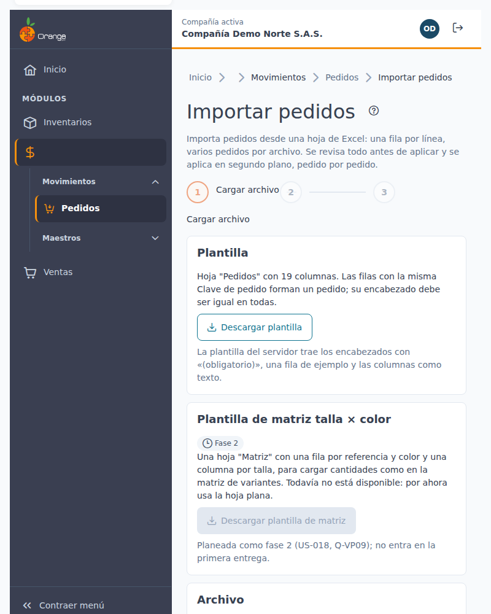
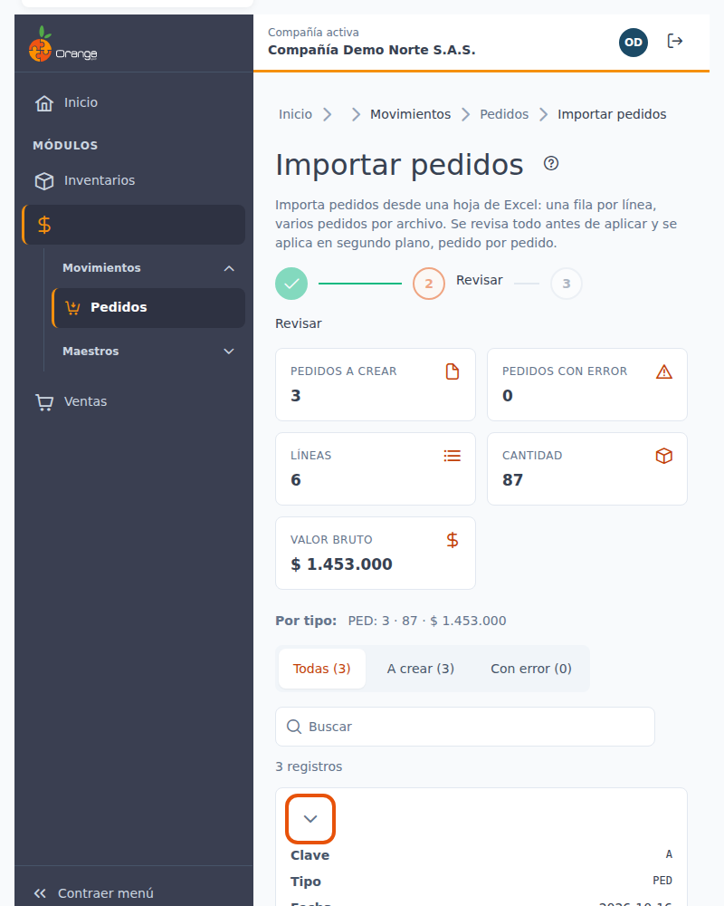
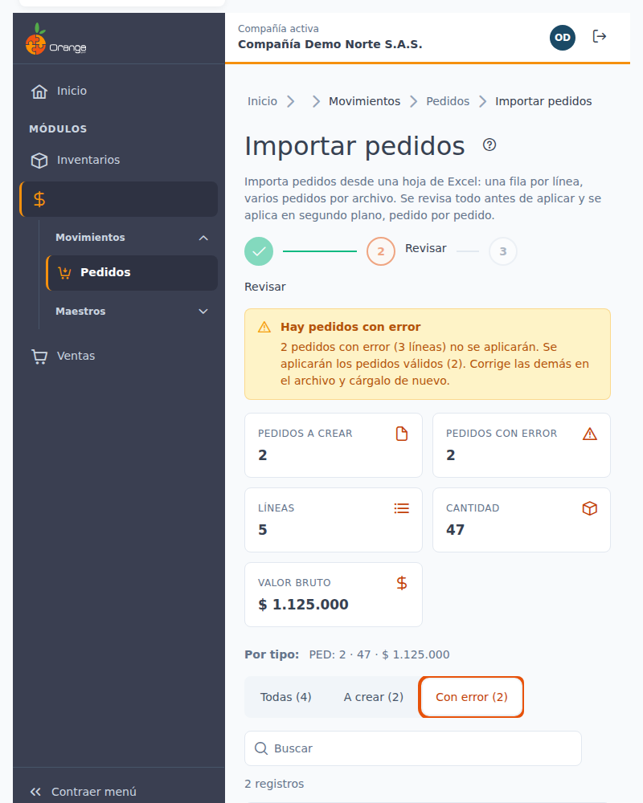
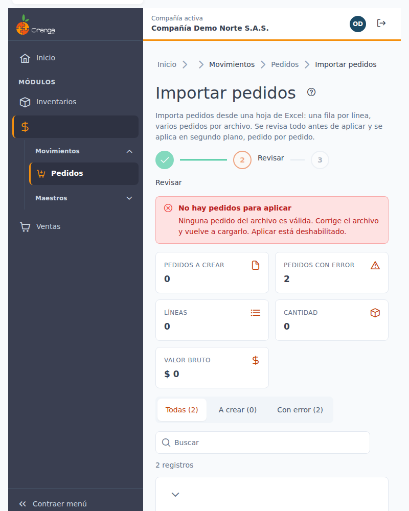
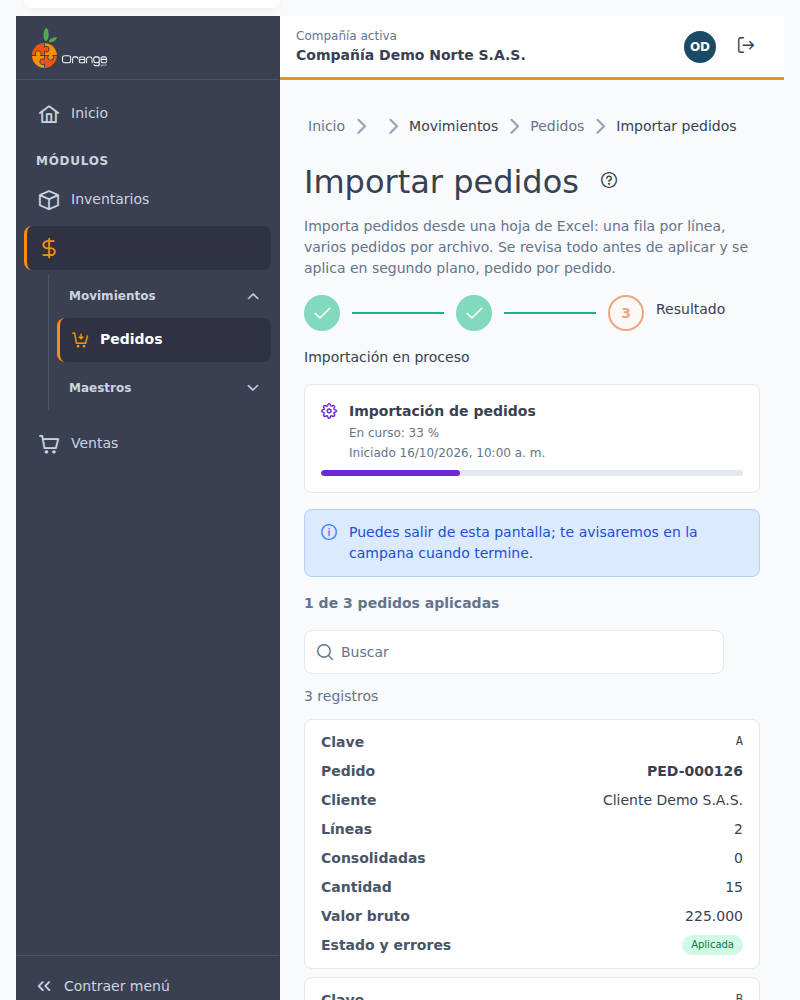
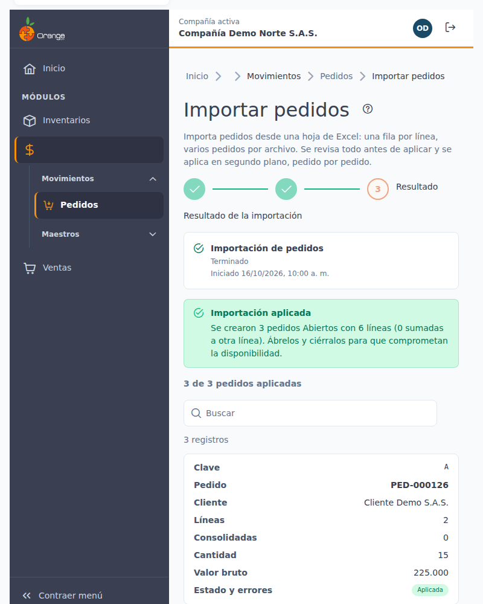
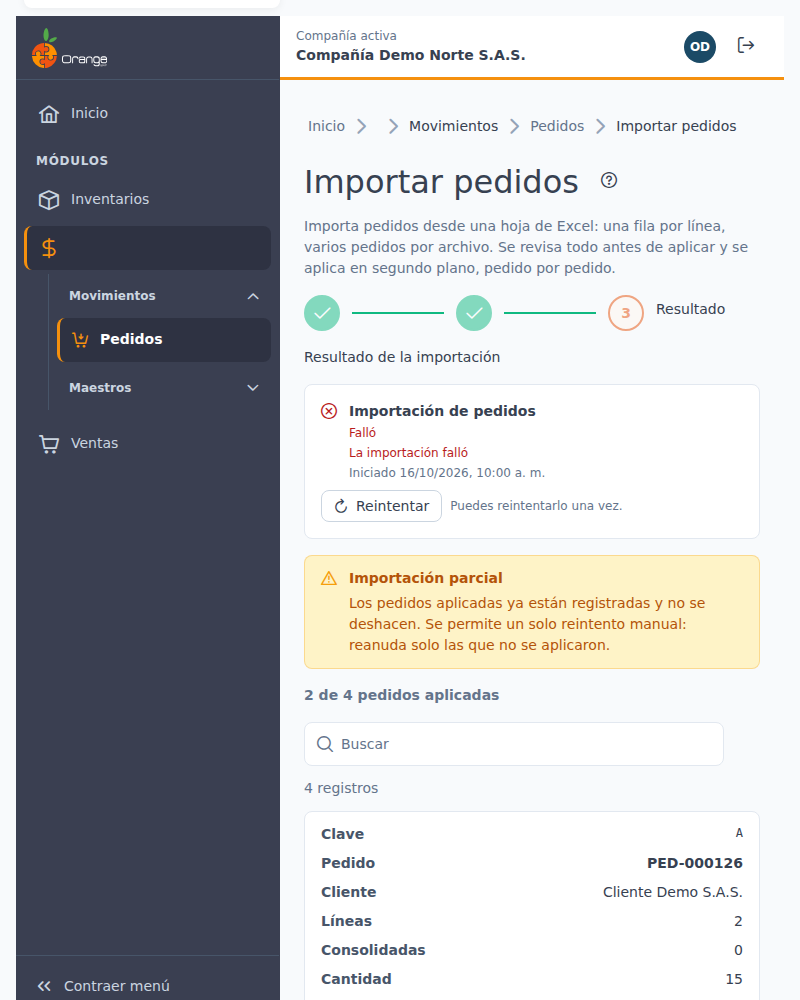
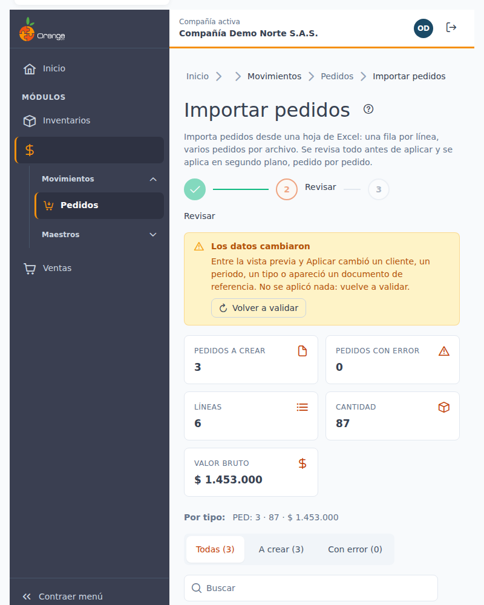
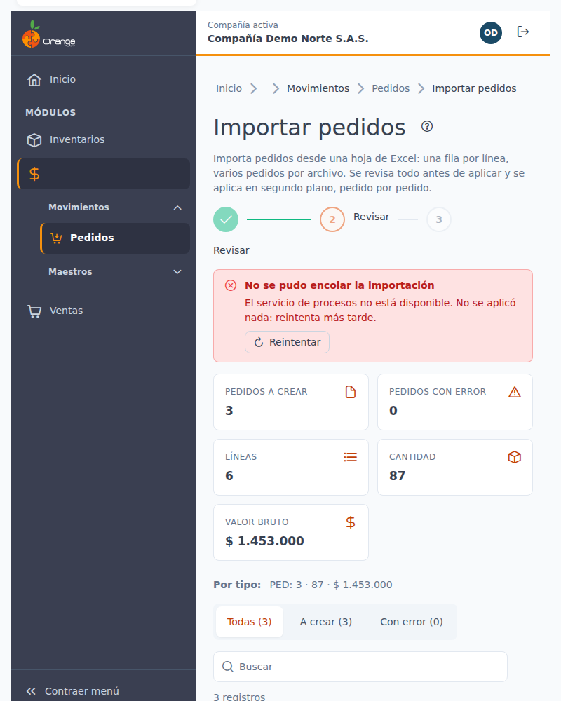

[Regresar a Pedidos](pedidos.md)

---

# 📥 Importar pedidos desde Excel

[← Volver al índice de ventas](../readme.md) · [Pedidos](pedidos.md)

Crea **varios pedidos nuevos** de una sola vez a partir de una hoja de Excel: cada fila es una línea de un pedido y las filas con la misma **Clave de pedido** forman un pedido. Antes de guardar, el sistema le muestra qué pedidos va a crear y qué filas tienen errores. **Nada se guarda hasta que usted aplica.**

- [Permisos y acceso](#acceso)
- [Los tres pasos](#pasos)
- [La hoja Pedidos: 19 columnas](#columnas)
- [Cómo se identifican cliente, sucursal y variante](#identificacion)
- [Valores vacíos](#vacios)
- [Revisar y corregir errores](#revisar)
- [Mensajes de error](#errores)
- [Límites](#limites)
- [Aplicar, avisos y resultado](#aplicar)
- [Qué queda después de importar](#despues)
- [Reintentar](#reintentar)
- [Plantilla de matriz talla × color (próximamente)](#matriz)

## Acceso

En el listado de [pedidos](pedidos.md) pulse **Importar**. El botón aparece solo si tiene los permisos **Crear** y **Exportar** sobre la opción de pedidos, y en la pantalla solo puede usar los tipos de pedido que tiene autorizados. Si le falta alguno de los dos permisos, el botón no aparece y la pantalla no se abre.

La importación **solo crea pedidos nuevos**. Nunca modifica, anula ni borra los pedidos que ya existen.

## Los tres pasos: Cargar archivo → Revisar → Resultado

**1. Cargar archivo.** Descargue la **plantilla** con **Descargar plantilla** (archivo `PlantillaImportarPedidos.xlsx`, hoja **Pedidos**, con los encabezados en la primera fila, la palabra *(obligatorio)* en las columnas obligatorias y un ejemplo en la segunda). Llénela, arrastre el archivo `.xlsx` al recuadro o elíjalo con el botón. Con **Cancelar** regresa sin importar nada.

> 💡 Las columnas de la plantilla quedan como texto. Si escribe los números con punto o coma decimal, el sistema los interpreta; no use separador de miles.

Si el archivo no sirve, verá el motivo y no se envía nada: no es un `.xlsx`, no tiene la hoja **Pedidos**, le falta una columna obligatoria, no tiene filas, pesa más de 1 MB o trae más de 200 pedidos o de 1.000 líneas.

**2. Revisar.** El sistema valida cada fila **sin guardar nada**.

- El resumen muestra **Pedidos a crear**, **Pedidos con error**, **Líneas**, **Cantidad** y **Valor bruto**.
- La lista muestra una fila por **pedido**. Pulse para expandirlo y ver sus líneas.
- Con **Todos**, **A crear** o **Con error** filtra la lista.
- Un error en una línea marca **todo el pedido** como *Con error*.
- Las líneas que el sistema va a sumar en una (iguales, misma variante y bodega) aparecen marcadas como **consolidadas**.

**3. Aplicar y resultado.** Pulse **Aplicar N pedidos** (N es el número de pedidos válidos). La aplicación se describe en [Aplicar, avisos y resultado](#aplicar).

## La hoja Pedidos: 19 columnas

El orden de las columnas no importa: el sistema las lee por su nombre, sin distinguir mayúsculas, tildes ni el texto «(obligatorio)». Las columnas desconocidas se ignoran. Las marcadas con * son obligatorias.

Los datos del **pedido** (encabezado) deben repetirse igual en todas las filas de ese pedido. Los datos de la **línea** son propios de cada fila.

| N.º | Columna | Qué escribir |
|-----|---------|--------------|
| 1 | **Clave de pedido*** | Texto de hasta 20 caracteres, sin comas ni punto y coma. Solo agrupa las filas; no se guarda. |
| 2 | **Código tipo movimiento*** | Código del tipo de pedido que usted puede usar. |
| 3 | **Fecha*** | Fecha de Excel o `aaaa-mm-dd`. Debe estar en un periodo abierto. |
| 4 | **Documento referencia** | Hasta 20 caracteres: el número con el que el cliente identifica su pedido. No puede repetirse con el mismo cliente (ver [Duplicados](#duplicados)). |
| 5 | **Documento cliente*** | Documento (NIT o cédula) de un cliente activo. |
| 6 | **Código sucursal*** | Código de la sucursal de ese cliente. |
| 7 | **Documento vendedor** | Documento de un vendedor activo. Opcional, salvo que el tipo de pedido lo exija. |
| 8 | **Días de plazo** | Número entero de 0 a 365. |
| 9 | **Observaciones** | Hasta 200 caracteres. No use comas ni punto y coma. |
| 10 | **Referencia** | Código de la referencia. |
| 11 | **Atributo principal** | Código del atributo principal (por ejemplo, la talla), si la referencia lo usa. |
| 12 | **Atributo secundario** | Código del atributo secundario (por ejemplo, el color), si la referencia lo usa. |
| 13 | **Código de barras** | Código de barras de la variante (en lugar de referencia y atributos). |
| 14 | **Código bodega*** | Código de la bodega de la que sale la mercancía. |
| 15 | **Código centro de costos** | Obligatorio solo si el tipo de pedido lo exige. |
| 16 | **Cantidad*** | Mayor que 0, hasta 4 decimales. |
| 17 | **Valor unitario** | Mayor que 0. Si lo deja vacío, se usa el valor de la lista de precios de la sucursal. |
| 18 | **% Descuento** | De 0 a 100. Si lo deja vacío, se usa el descuento del cliente (solo si el tipo liquida descuento). |
| 19 | **Detalle** | Texto adicional de la línea (opcional). |

> 💡 No hay columna de **impuesto**: el sistema toma el impuesto de la referencia. Tampoco hay columna de **número de pedido**: el sistema asigna el número de cada pedido.

## Cómo se identifican cliente, sucursal y variante

Todo se identifica por **código o documento**, nunca por un número interno.

| Dato | Cómo se busca | Qué debe cumplir |
|------|---------------|------------------|
| **Cliente** | Documento cliente (columna 5) | Un tercero con perfil de cliente y **activo**. |
| **Sucursal** | Código sucursal (columna 6) | Una sucursal que pertenezca a ese cliente. |
| **Vendedor** | Documento vendedor (columna 7) | Un vendedor activo de su compañía. |
| **Tipo de pedido** | Código (columna 2) | Un tipo de pedido que usted tiene autorizado. |
| **Referencia y variante** | Referencia, atributos o código de barras | Dentro de su compañía, sin distinguir mayúsculas. |
| **Bodega y centro de costos** | Código (columnas 14 y 15) | Un código existente en su compañía. |

**La variante se informa de una sola forma:**

- **Por referencia:** código de referencia y, si la referencia los usa, sus atributos principal y secundario; **o**
- **Por código de barras.**

No informe las dos formas en la misma fila, y tampoco deje las dos vacías. Solo se pueden vender las referencias que la compañía tiene habilitadas para venta; una referencia de otro tipo da error.

## Valores vacíos

| Columna | Si la deja vacía |
|---------|------------------|
| Días de plazo | Se usan los días de plazo del cliente. |
| Valor unitario | Se usa el valor de la lista de precios de la sucursal. Si la variante no tiene precio en esa lista, se usa el costo sugerido y se avisa. |
| % Descuento | Se usa el descuento comercial del cliente, si el tipo de pedido liquida descuento. Si el tipo no liquida descuento, déjela vacía. |
| Documento vendedor | El pedido se crea sin vendedor, salvo que el tipo de pedido lo exija. |
| Documento referencia | El pedido se crea sin control de duplicados. |
| Observaciones y Detalle | El pedido o la línea se crean sin ese texto. |
| Centro de costos | Es obligatorio solo si el tipo de pedido lo exige; si no, déjela vacía. |
| Atributos y código de barras | Use la forma de variante que corresponda (ver arriba). Los atributos van vacíos si la referencia no los usa. |

Nunca se usa un cero por defecto: un código escrito que no existe da error.

## Revisar y corregir errores

Cada error muestra el encabezado de su columna y el valor que el sistema no reconoció.

- **Un pedido con error no se crea**, aunque solo tenga un error en una línea. Los demás pedidos válidos sí se pueden aplicar.
- **Descargar errores** genera un Excel con las filas con error y su motivo, para corregirlas.
- **Cambiar archivo** vuelve al paso 1 con un archivo nuevo.
- **Volver a validar** vuelve a revisar el mismo archivo, por si los datos cambiaron (por ejemplo, otro usuario cambió un cliente).

**Cuando no hay pedidos válidos**, **Aplicar** queda deshabilitado (**Aplicar 0 pedidos**). Corrija el archivo y vuelva a cargarlo.

## Mensajes de error

La vista previa muestra el mensaje de cada error. Esta tabla explica qué significa y qué hacer.

| Mensaje | Qué significa | Qué hacer |
|---------|---------------|-----------|
| Falta la clave de pedido. | La fila no tiene clave. | Escriba una clave en la columna 1. |
| La clave de pedido supera 20 caracteres o tiene "," o ";". | La clave no es válida. | Use una clave corta, sin comas ni punto y coma. |
| La columna … difiere de la primera fila del pedido. | Una fila del mismo pedido tiene otro dato del encabezado. | Deje los datos del pedido iguales en todas sus filas. |
| El tipo de movimiento … no existe. | El código de tipo no existe. | Use un código de tipo de pedido existente. |
| No está autorizado para el tipo … | Usted no puede usar ese tipo. | Use un tipo autorizado o pida el permiso a quien administra sus accesos. |
| La fecha … no es válida. | La fecha no se reconoce. | Escriba la fecha como `aaaa-mm-dd` o como fecha de Excel. |
| El periodo de … está cerrado. | No se puede registrar en ese mes. | Use una fecha de un periodo abierto. |
| Falta el documento del cliente. | La columna 5 está vacía. | Escriba el documento del cliente. |
| … el cliente no existe. | No hay un cliente con ese documento. | Revise el documento. |
| El cliente … está inactivo. | El cliente existe pero no está activo. | Active el cliente o use otro. |
| Falta el documento del vendedor. | El tipo de pedido exige vendedor y la columna está vacía. | Escriba el documento del vendedor. |
| El vendedor … no existe. | No hay un vendedor con ese documento. | Revise el documento. |
| Los días de plazo … no son válidos (0 a 365). | El plazo no es un entero de 0 a 365. | Corrija el número. |
| Falta la variante. | No informó referencia ni código de barras. | Informe la referencia con sus atributos, o el código de barras. |
| Informe la variante por referencia o por código de barras, no por ambas. | Informó las dos formas. | Deje solo una. |
| La variante … no existe o no está activa. | Ningún código coincide. | Revise referencia, atributos o código de barras. |
| La variante … coincide con varias: indique los atributos. | El código de barras coincide con más de una variante. | Informe referencia y atributos. |
| La variante no se puede vender. | La referencia no está habilitada para venta. | Elija otra referencia en el archivo. |
| … no existe. | La bodega, la sucursal o el centro de costos no existe en su compañía. | Escriba el código tal como aparece en el catálogo. |
| El tipo exige centro de costos. | Falta el centro de costos. | Escriba el centro de costos. |
| El valor … no es numérico. | Hay texto donde va un número. | Escriba solo el número. |
| La cantidad … debe ser mayor que cero (máximo 4 decimales). | Cantidad cero, negativa o con más decimales. | Corrija la cantidad. |
| El valor unitario debe ser mayor que cero tras redondear. | El valor queda en cero al redondear. | Escriba un valor mayor. |
| El % de descuento … debe estar entre 0 y 100. | Descuento fuera de rango. | Escriba un porcentaje de 0 a 100. |
| El tipo no liquida descuento. | El tipo no admite descuento y la fila trae uno. | Deje la columna vacía. |
| La referencia no tiene el impuesto configurado. | No hay impuesto para la referencia. | Configure el impuesto de la referencia antes de importar. |
| El impuesto de la referencia está vencido. | El impuesto no está vigente. | Actualice el impuesto de la referencia. |
| El texto supera el máximo permitido. | Un texto pasa del largo permitido. | Acórtelo. |
| El pedido supera las … líneas que permite el tipo. | Hay más líneas que el tipo permite. | Divida el pedido en dos claves. |
| El pedido supera el tope de valor del tipo. | El valor total pasa del tope del tipo. | Divida el pedido o revise cantidades y valores. |
| Ya existe el pedido … de este cliente con el mismo documento de referencia. | Ya hay un pedido de ese cliente con el mismo documento de referencia. | No lo importe de nuevo. Si es otro pedido, cambie el documento de referencia. |
| Otro pedido del archivo tiene el mismo cliente y documento de referencia. | Dos claves del archivo tienen el mismo cliente y documento. | Deje una sola, o cambie el documento de referencia de una. |
| Ya hay una línea igual con otro descuento o impuesto. | Dos líneas que el sistema sumaría en una tienen distinto descuento o impuesto. | Use el mismo descuento en esas líneas, o sepárelas en otro pedido. |

Un error en cualquier línea deja **todo el pedido** con error. Corrija todas sus filas y vuelva a validar.

### Documento de referencia repetido

- Si dos pedidos **del mismo archivo** tienen el mismo cliente y el mismo documento de referencia, **los dos** quedan con error.
- Si **ya existe** un pedido no anulado de ese cliente con el mismo documento de referencia, el pedido del archivo queda con error. El sistema no reemplaza el pedido existente.
- Si el documento de referencia está vacío, no hay control de duplicados.

## Límites

| Límite | Valor |
|--------|-------|
| Archivo | `.xlsx`, hasta **1 MB**. Si pesa más, no se envía. |
| Pedidos por archivo | Hasta **200** pedidos (por clave distinta). |
| Líneas por archivo | Hasta **1.000** líneas. |

Si el archivo pasa de algún límite, el sistema no lo acepta, ni para revisar ni para aplicar: divídalo en dos o más archivos, con claves de pedido distintas en cada uno.

## Aplicar, avisos y resultado

Pulse **Aplicar N pedidos**. La aplicación **no ocurre al instante**: el sistema la pone en cola como un **proceso en segundo plano**, y crea cada pedido completo, uno a uno.

- **Tarda.** Un archivo grande puede tomar varios minutos. Mientras corre verá el porcentaje y cuántos pedidos van aplicados. Cada pedido se marca como **Aplicado**, **Falló** o **Pendiente**.
- **Puede salir de la pantalla.** El proceso sigue y le avisamos en la **campana de notificaciones** cuando termine, con el número de pedidos y de líneas y un enlace al resultado.
- **Si vuelve a abrir la importación** mientras el proceso sigue, la pantalla retoma su estado.
- **No envíe dos veces el mismo archivo en 10 minutos.** El sistema reutiliza el proceso que ya está en curso y no crea otro, así que no se duplican pedidos.

**Se aplican los pedidos válidos, aunque otros fallen.** Los pedidos con error de la vista previa **nunca** se escriben, ni parcialmente. Cada pedido válido se guarda completo o no se guarda. Si uno falla al guardarse, no queda nada de ese pedido, **los que ya se aplicaron se conservan** y el proceso sigue con los demás.

Al terminar, cada pedido aparece con su estado. Si se aplicó, verá su **número** como enlace al pedido.

**Resultado parcial.** Algunos pedidos se aplicaron y otros no: verá el aviso *Importación parcial* y el conteo. Las aplicadas ya están registradas; las que fallaron muestran el motivo.

| Aviso | Qué hacer |
|-------|-----------|
| *Importación parcial: los pedidos aplicados ya están registrados.* | Reintente los pendientes, o cargue un archivo solo con los que faltan. |
| *Los datos cambiaron* (conflicto) | Use **Volver a validar** y revise el archivo. Ocurre si, después de validar, otro usuario cambió un cliente, el periodo, el tipo, o apareció un pedido con el mismo documento de referencia. Nada se aplicó. |
| *La importación falló. No se aplicó ningún pedido.* | Corrija la causa que muestra cada pedido y reintente. |
| *El servicio de procesos no está disponible.* | Nada se aplicó. Intente más tarde. |

## Qué queda después de importar

- Cada pedido se crea **Abierto**, con el número que asigna el sistema. **No se cierra**: ciérrelo a mano cuando lo haya revisado. Al cerrarlo, el pedido queda fijo y su saldo pasa a contar por despachar.
- **No mueve inventario, costos ni cartera.** El inventario sale con el despacho de la mercancía.
- Los pedidos importados **no comprometen** la disponibilidad mientras estén abiertos. Ver [Qué compromete un pedido](pedidos.md#disponibilidad).
- Cada pedido importado queda en su **bitácora** como un pedido creado.
- Si otro usuario tiene el listado de pedidos abierto, verá el aviso **Hay cambios nuevos**.

**Para corregir un pedido que ya se creó,** no lo vuelva a importar: ábralo desde el listado de [pedidos](pedidos.md) y edítelo mientras esté abierto. La importación nunca cambia un pedido existente.

## Reintentar

- **Reintentar** (en un proceso parcial o fallido) vuelve a intentar **solo los pedidos que faltan**. Los ya aplicados no se duplican. Se puede reintentar una vez.
- **Volver a validar** vuelve a revisar el archivo con los datos actuales. Úselo antes de reintentar si el aviso dice que los datos cambiaron.
- Para cargar un archivo nuevo, pulse **Importar otro archivo**.

Si un pedido sigue con error después de corregir el archivo, revise la columna y el mensaje en la [tabla de mensajes](#errores).

## Plantilla de matriz talla × color (próximamente)

En el paso 1 verá la tarjeta **Plantilla de matriz talla × color — Fase 2**. Esa plantilla, con una fila por referencia y color y una columna por talla, **todavía no está disponible**: el botón aparece deshabilitado. Por ahora, para cargar varias tallas y colores, use la hoja **Pedidos** con una fila por cada variante y cantidad.

---

[← Volver a Pedidos](pedidos.md) · [← Volver al índice de ventas](../readme.md)
