[Regresar a Ventas](../readme.md)

---

# 🧾 Pedidos de venta

---

## 📋 Descripción

Un **pedido de venta** es lo que un cliente le pide a la compañía: qué referencias necesita, en qué bodega salen, cuántas unidades, a qué valor y para qué fecha de entrega. Cada pedido lleva el **avance de despacho**: cuánto ya salió y cuánto falta por despachar.

Un pedido **no mueve inventario, costos, cartera ni contabilidad**. El inventario sale cuando se despacha la mercancía. Lo que el cliente pidió y aún no se ha despachado se llama **por despachar**: sirve para planear y se ve en la pantalla [Disponibilidad de Inventarios](../../inventarios/consultas/disponibilidad.md) (ver [Qué compromete un pedido](#disponibilidad)).

En esta pantalla puede **consultar, crear, editar, cerrar, anular, eliminar, imprimir, adjuntar documentos** y **ver la bitácora** de cada pedido. Trabaje siempre con la compañía que aparece en la barra superior.

> 📘 La búsqueda, el orden, la paginación y la ayuda funcionan igual en todas las tablas: ver [Manejo general de la información](../../Generales/manejo-general-informacion.md).

> ⚠️ **Congelar es Anular.** La acción que antes se llamaba **Congelar** ahora se llama **Anular pedido**, y el estado que antes decía **Congelado** ahora dice **Anulado**. Es la misma acción y el mismo estado: el pedido deja de contar como pendiente y se conserva para consulta. Si un pedido de la versión anterior trae la marca *Congelado*, la verá como insignia de solo lectura.

---

## 🎯 Acceso

1. En el menú principal, haga clic en **Ventas**.
2. En **Movimientos**, haga clic en **Pedidos**.

---

## 🖥️ Pantalla principal: el listado

El listado muestra los pedidos de la compañía, del más reciente al más antiguo. Arriba hay cuatro indicadores del filtro que está aplicado:

| Indicador | Qué muestra |
|-----------|-------------|
| **Pedidos** | Cuántos pedidos hay, y cuántos están abiertos, cerrados y anulados. |
| **Despacho** | Cuántos están sin despachar, despachados parcialmente y despachados. |
| **Unidades por despachar** | Unidades pedidas que todavía no han salido. Los anulados no suman. |
| **Valor por despachar** | Valor de lo que falta por despachar. Los anulados no suman. |

Cada fila muestra el número del pedido, la fecha, el documento de referencia, el cliente, la sucursal, el vendedor, la fecha de entrega, la cantidad pedida, lo despachado (por ejemplo, *4 de 10 · 40 %*), el valor total, el **despacho** y el **estado**. El estado y el despacho siempre llevan texto e ícono, no solo color.

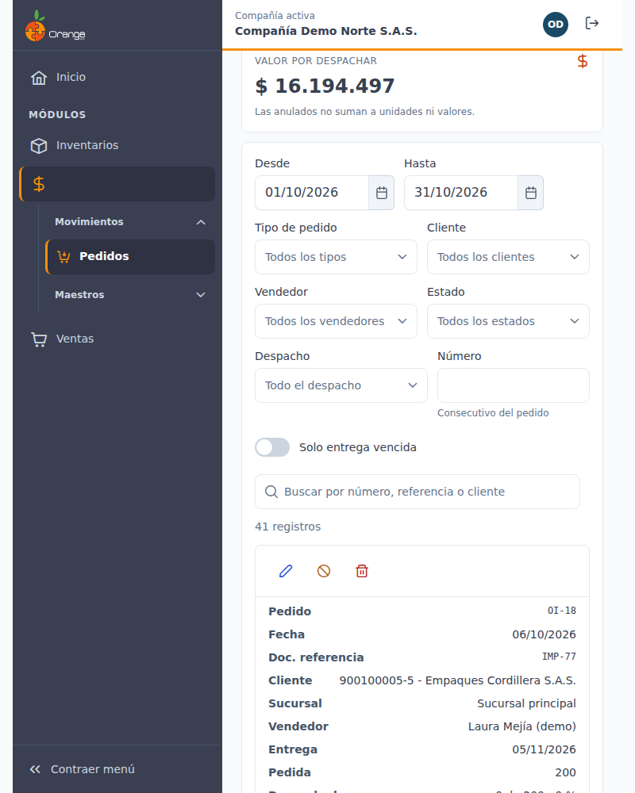

### Filtrar el listado

Los filtros aparecen arriba de la tabla y quedan en la dirección de la página, para que pueda compartir la vista:

- **Desde** y **Hasta**: rango de fechas del pedido. Por defecto es el mes en curso. El rango máximo es de 12 meses.
- **Tipo**, **Cliente** y **Vendedor**.
- **Estado**: *Abierto*, *Cerrado* o *Anulado*.
- **Despacho**: *Sin despachar*, *Despachado parcial* o *Despachado*. **Para filtrar por despacho debe elegir un rango de fechas** (desde y hasta).
- **Número**: el consecutivo del pedido.
- **Solo entrega vencida**: muestra los pedidos cuya fecha de entrega ya pasó y que todavía tienen algo por despachar.
- **Buscar**: por número, documento de referencia o cliente.

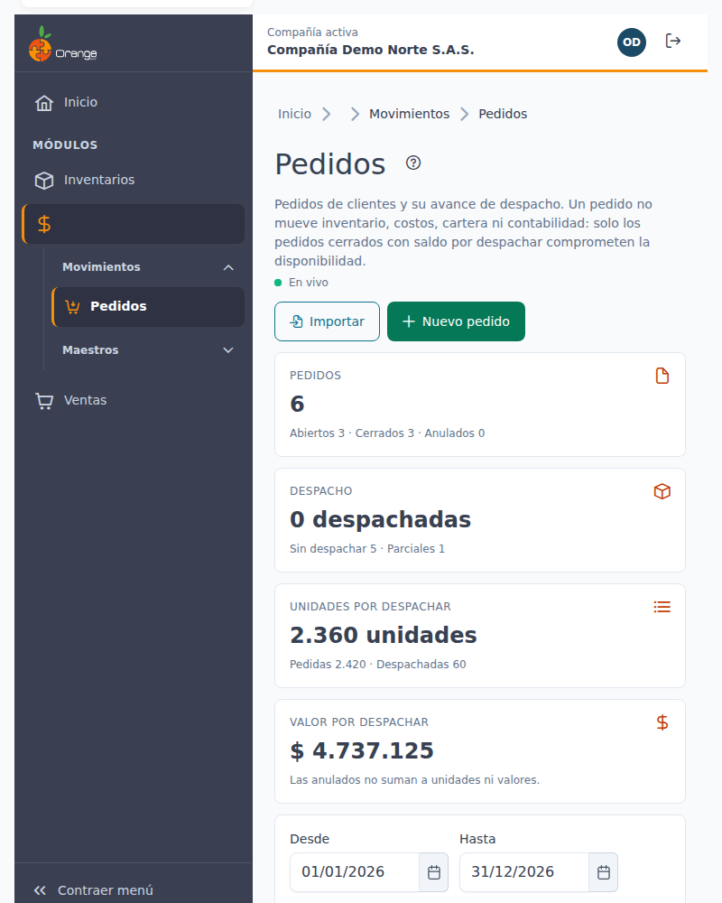

### ¿Qué puedo hacer desde una fila?

Los botones de cada fila dependen del estado del pedido y de sus permisos:

| Botón | Cuándo aparece |
|-------|----------------|
| **Ver** | Siempre que tenga permiso para consultar. |
| **Imprimir** | Solo pedidos cerrados y no anulados. Ver [Imprimir](#imprimir). |
| **Anular** | Pedidos abiertos o cerrados que no estén anulados. Ver [Anular o eliminar](#anular-eliminar). |
| **Eliminar** | Solo pedidos sin remisiones ni otros documentos que dependan de ellos. |

Para cambiar un pedido abierto o cerrado, ábralo con **Ver** y use los botones del documento. Si su usuario no tiene permiso para consultar pedidos, la pantalla le muestra el aviso de acceso restringido.

---

## ➕ Crear un pedido

1. En el listado, haga clic en **Nuevo pedido**.
2. Elija el **Tipo de pedido**. Sin tipo no se pueden capturar líneas.
3. Elija el **Cliente**. Solo puede elegir clientes activos.
4. Elija la **Sucursal** del cliente. Al elegirla, la pantalla carga su **lista de precios**.
5. Revise el **Vendedor**. Se precarga con el vendedor de la sucursal, si lo tiene, y puede cambiarlo o dejarlo en blanco.
6. Revise los **Días de plazo** y el **descuento**. Se precargan con las condiciones del cliente y puede cambiarlos.
7. Capture las líneas (ver [Captura línea a línea](#captura)).
8. Cuando el pedido tenga líneas guardadas, cierre el pedido (ver [Cerrar](#cerrar)).

> 💡 El número del pedido aparece como *tentativo* hasta que el pedido se guarda, cuando se guarda la primera línea. El tipo no se puede cambiar después de crear el pedido: elíjalo bien antes de capturar.

### Datos del encabezado

| Campo | Regla |
|-------|-------|
| **Tipo de pedido** | Obligatorio. No se cambia después de crear el pedido. |
| **Cliente** | Obligatorio. Debe estar activo. Se busca por documento o nombre. Se bloquea si el pedido ya tiene despachos. |
| **Sucursal** | Obligatoria si el cliente tiene sucursales. Solo muestra las del cliente elegido. Se bloquea si el pedido ya tiene despachos. |
| **Vendedor** | Opcional. Se precarga desde la sucursal y se puede cambiar. |
| **Fecha** | Obligatoria. Debe estar en un periodo abierto. |
| **Días de plazo** | Número entero de 0 a 365. Se precarga con los días de plazo del cliente. |
| **Fecha de entrega** | Solo lectura: fecha del pedido más los días de plazo. |
| **Documento referencia** | Hasta 20 caracteres (opcional). Es el número con el que el cliente identifica su pedido. |
| **Observaciones** | Hasta 200 caracteres. **No use comas (,) ni punto y coma (;).** |

### Lista de precios y aviso de precio vacío

Cuando elige la sucursal, la pantalla usa su **lista de precios** (de la 1 a la 5) para sugerir el **valor unitario** de cada variante:

- Si la variante tiene precio en la lista de la sucursal, ese es el valor sugerido.
- Si la variante **no tiene precio** en esa lista, la pantalla propone el **costo sugerido** y muestra el aviso **sin precio en la lista N**. Revise ese valor antes de guardar.
- Si usted ya escribió un valor, la pantalla **no lo cambia**.

El valor sugerido se redondea según la configuración del tipo de pedido. Puede cambiarlo en cada línea.

---

## ⌨️ Captura línea a línea

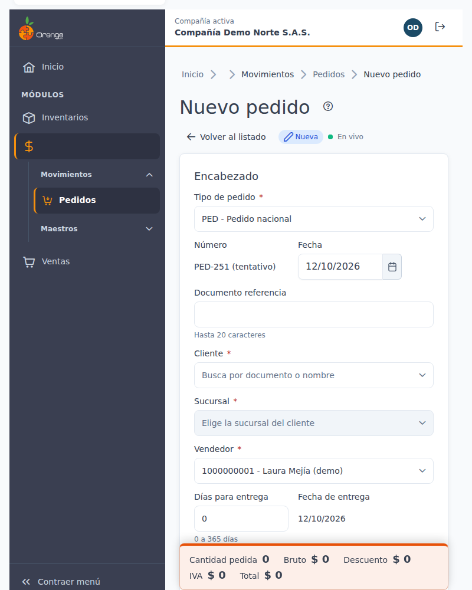

En un pedido no hay botón *Guardar documento*. **Cada línea se guarda en el momento en que la confirma.** Así, si otro usuario o la red fallan, solo se pierde la línea que estaba escribiendo.

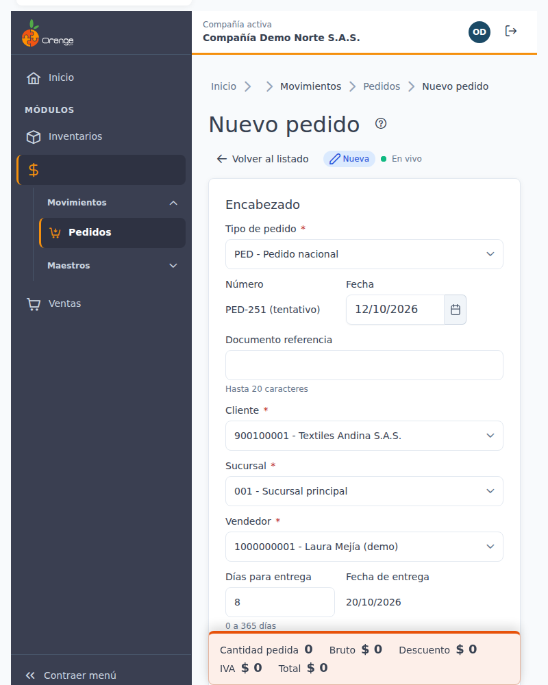

La fila de captura sigue este orden (con **Enter** avanza al siguiente campo; en el último campo, guarda):

**Referencia / variante → Bodega → Centro de costos (si el tipo lo exige) → Cantidad → Valor unitario → % Dto. (si el tipo lo liquida)**

| Campo | Regla |
|-------|-------|
| **Referencia / variante** | Obligatorio. Se busca por código o nombre. |
| **Bodega** | Obligatoria. Es la bodega de la que sale la mercancía. |
| **Centro de costos** | Solo si el tipo de pedido lo exige. |
| **Cantidad** | Mayor que 0, hasta 4 decimales. No puede ser menor que lo que ya se despachó. |
| **Valor unitario** | Mayor que 0. Se propone el valor de la lista de precios de la sucursal (ver [Lista de precios](#crear)). |
| **% Dto.** | De 0 a 100. Por defecto el descuento comercial del cliente, si el tipo liquida descuento. |

El **IVA** se toma de la referencia y del tipo de pedido; usted no lo escribe. El **Total** de la línea se calcula solo.

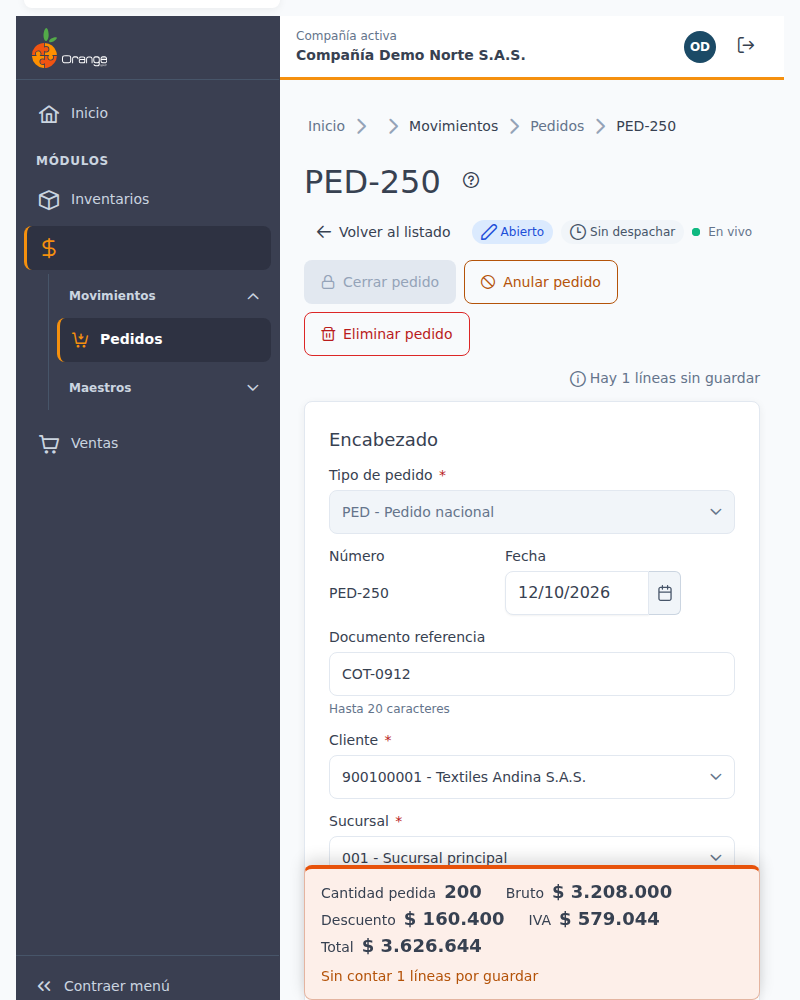

### Estados de cada línea

Cada línea muestra su estado con texto e ícono:

| Estado | Qué significa | Qué puede hacer |
|--------|---------------|-----------------|
| **En cola** | Se va a guardar. | Espere. |
| **Guardando…** | Se está guardando. | Espere. |
| **Guardada** | Quedó guardada. | Editarla o quitarla. |
| **Error** | El sistema no la aceptó. Se muestra el motivo. | **Corregir** o **Descartar**. |
| **No se guardó** | Se perdió la conexión. | **Reintentar**. |
| **Conflicto** | Otra persona cambió esta línea. | **Usar la versión actual** o **Descartar**. |

### ¿Qué puede salir mal?

- **«La cantidad no puede ser menor que lo ya despachado»**: la línea ya tiene despachos. Use una cantidad igual o mayor que lo despachado. Ver [Cambios con despachos](#despachos).
- **«No se puede quitar una línea que ya tiene despachos»**: esa línea se queda. Si ya no se necesita, anule el pedido o deje la cantidad como está.
- **«No se puede cambiar el cliente ni la sucursal de un pedido con despachos»**: el pedido ya tiene mercancía despachada. Cree otro pedido para el nuevo cliente.
- **«El cliente está inactivo»** o **«La sucursal no pertenece al cliente»**: elija otro cliente o una sucursal de ese cliente.
- **«El impuesto de la referencia está vencido»**: pida que se actualice el impuesto de la referencia.
- **«El pedido supera las líneas que permite el tipo»** o **«el tope de valor del tipo»**: la línea no se guardó. Divida el pedido en otro.
- **«La fecha está en un periodo cerrado»**: cambie la fecha del pedido a un periodo abierto.
- **«Hay N líneas sin guardar»**: el botón **Cerrar pedido** no está disponible hasta que todas las líneas estén guardadas, corregidas o descartadas.
- **«Otra persona cambió este pedido»**: recargue la pantalla para ver la versión actual antes de guardar.

## 🧩 Captura por matriz de tallas y colores

Cuando una referencia tiene variantes (por ejemplo, talla y color), no hace falta capturar una línea por cada una:

1. En la fila de captura, elija **Bodega** (y **Centro de costos**, si el tipo lo exige).
2. Pulse **Matriz**.
3. Busque y elija la referencia. Se muestra una cuadrícula con un atributo en las filas y el otro en las columnas.

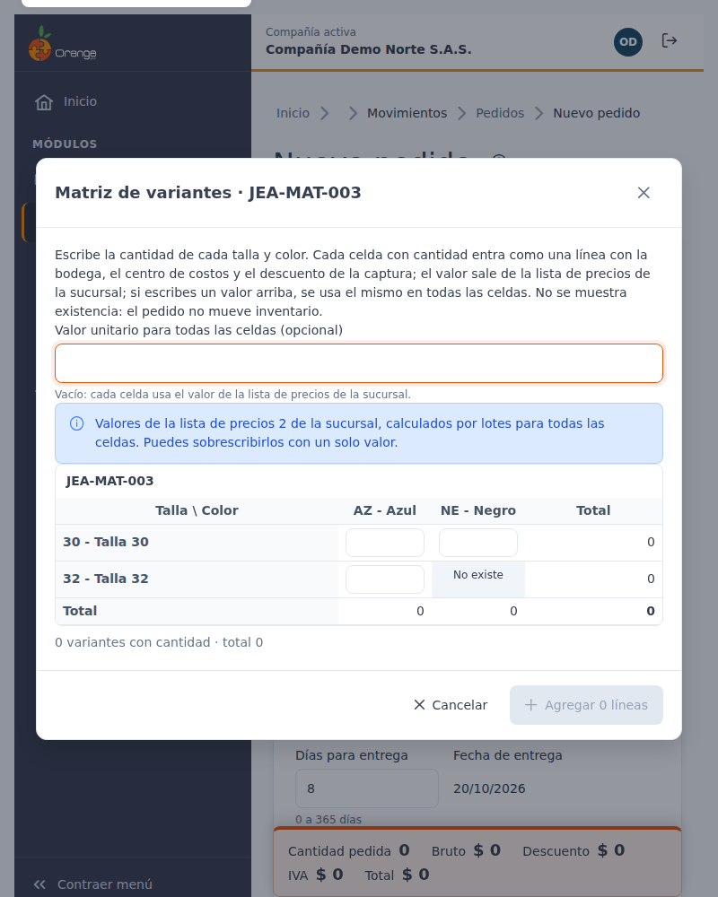

4. Escriba la **cantidad** en cada celda que quiera vender. Las celdas vacías no generan línea.
5. Revise el **valor de cada celda**. Cada variante trae el valor de la lista de precios de la sucursal. Si una celda no tiene precio en esa lista, verá el aviso de **sin precio** (costo sugerido).

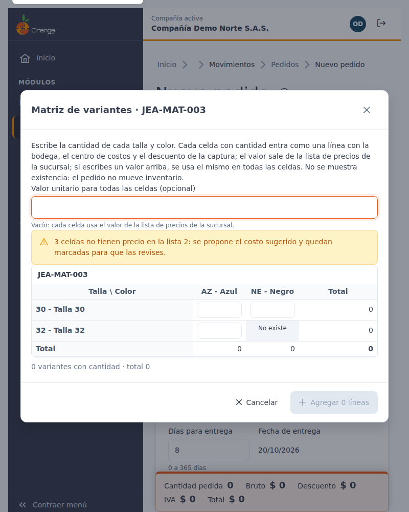

6. Si quiere **un solo valor para todas las celdas**, escríbalo en **Valor unitario para todas las celdas (opcional)**. Ese valor reemplaza el de todas las celdas.

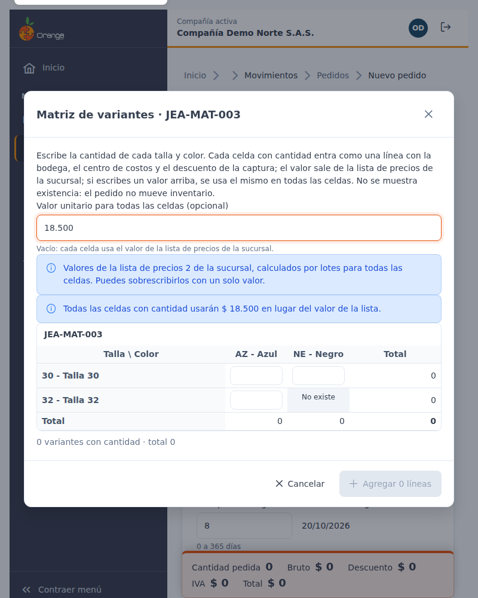

7. Acepte. **Cada celda con cantidad entra como una línea**, con la bodega, el centro de costos y el descuento de la captura, y se guarda como cualquier otra línea.

Si la cantidad total de celdas supera las líneas que admite el tipo de pedido, la pantalla bloquea **Aceptar** y le explica el máximo.

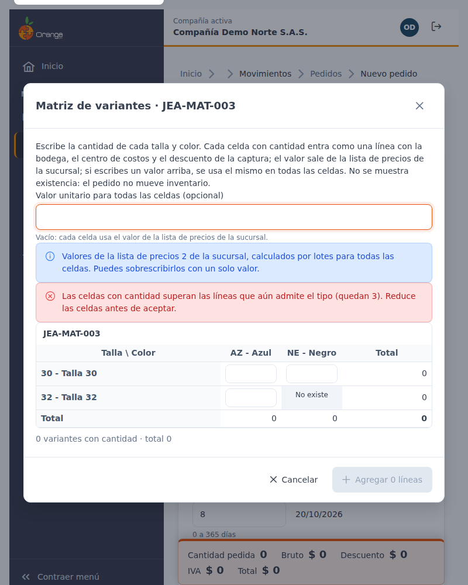

> 💡 El botón **Matriz** solo aparece si tiene permiso para crear o actualizar pedidos. Si la referencia no tiene variantes, capture la línea normal.

---

## ✏️ Editar un pedido

- Un pedido **abierto** se edita directamente: encabezado y líneas.
- Un pedido **cerrado** solo se edita si su usuario tiene el permiso especial **Editar documentos cerrados** y la fecha del pedido está en un periodo abierto. Al editarlo, el pedido **vuelve a abierto** y deja de comprometer el inventario hasta que lo cierre otra vez. El cambio queda en la bitácora.
- Un pedido **anulado** no se edita.

### Cambios con despachos

Si el pedido ya tiene despachos, el sistema protege lo que ya salió:

- La cantidad de una línea **no puede bajar** de lo que ya se despachó. Sí puede bajarla hasta esa cifra.
- Una línea con despachos **no se puede quitar**.
- No se puede cambiar el **cliente**, la **sucursal** ni la **referencia** de una línea con despachos.

---

## 🔒 Cerrar un pedido

**Cerrar pedido** deja el pedido listo para imprimir y enviar al cliente. **Es el paso que hace que el pedido cuente** como mercancía por despachar (ver [Qué compromete un pedido](#disponibilidad)).

1. Confirme en el diálogo **Cerrar pedido**. Le explica que, al cerrarlo, su saldo pasa a contar por despachar.
2. El pedido queda de **solo lectura**: se ocultan los botones de agregar líneas y adjuntar, y aparece **Imprimir**.

Para cerrar, debe tener permiso para actualizar pedidos, tener al menos una línea guardada y no tener líneas pendientes. Cerrar un pedido que ya está cerrado no hace nada ni repite el registro.

---

## 🚫 Anular o eliminar

Son dos acciones distintas. **Si ya despachó mercancía del pedido, anule; no elimine.**

| | **Anular pedido** | **Eliminar pedido** |
|--|-------------------|---------------------|
| **Qué hace** | Cancela lo que falta por despachar. El pedido queda en estado **Anulado** y se conserva para consulta. | Borra el pedido, sus líneas y sus adjuntos de forma definitiva. |
| **Motivo** | Obligatorio: de 1 a 200 caracteres, sin comas ni punto y coma. | No pide motivo, pero pide confirmar escribiendo el número del pedido, tal como aparece en el encabezado. |
| **Con remisiones** | Se permite. El diálogo indica cuántas remisiones lo tocan y que lo ya despachado no se afecta. | **No se permite.** El sistema responde que tiene documentos ligados y sugiere anular. |
| **Efecto en el inventario por despachar** | El pedido deja de contar. | Igual, porque el pedido desaparece. |
| **Reversible** | No. Para vender lo que sigue faltando, cree un pedido nuevo. | No. |

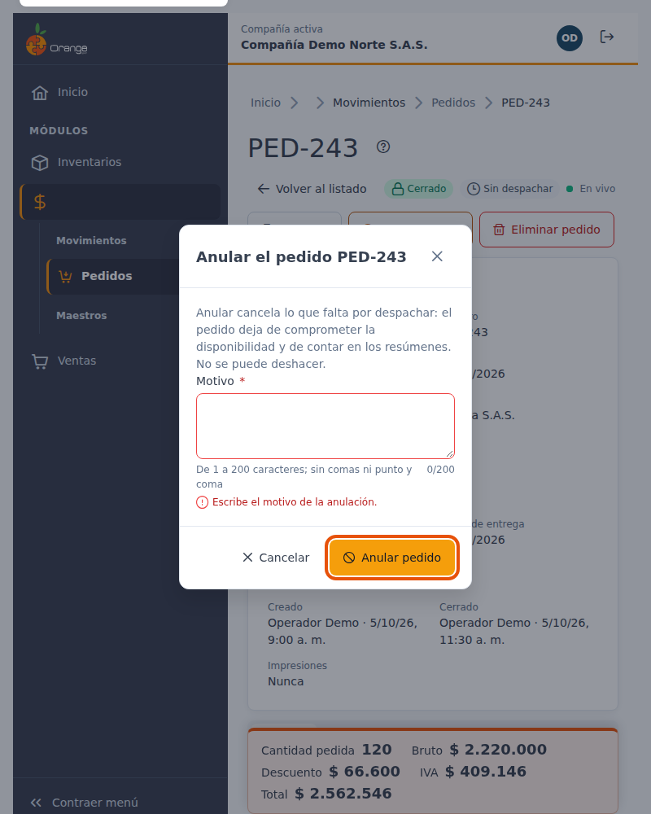

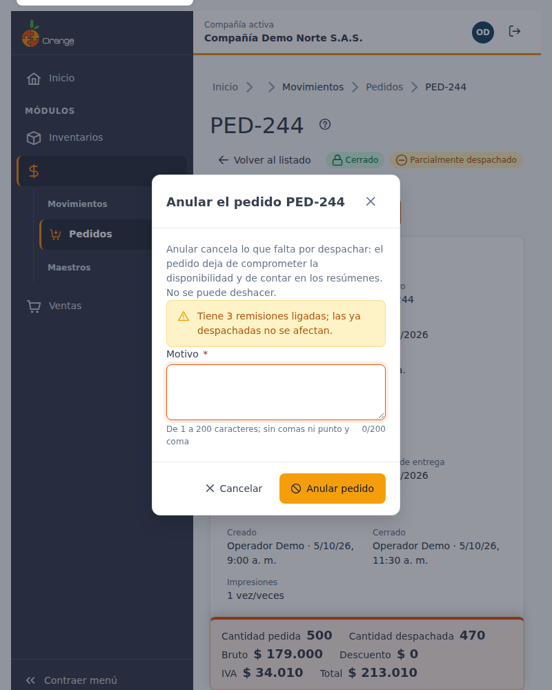

Un pedido anulado no se puede anular otra vez, no se imprime y no se edita.

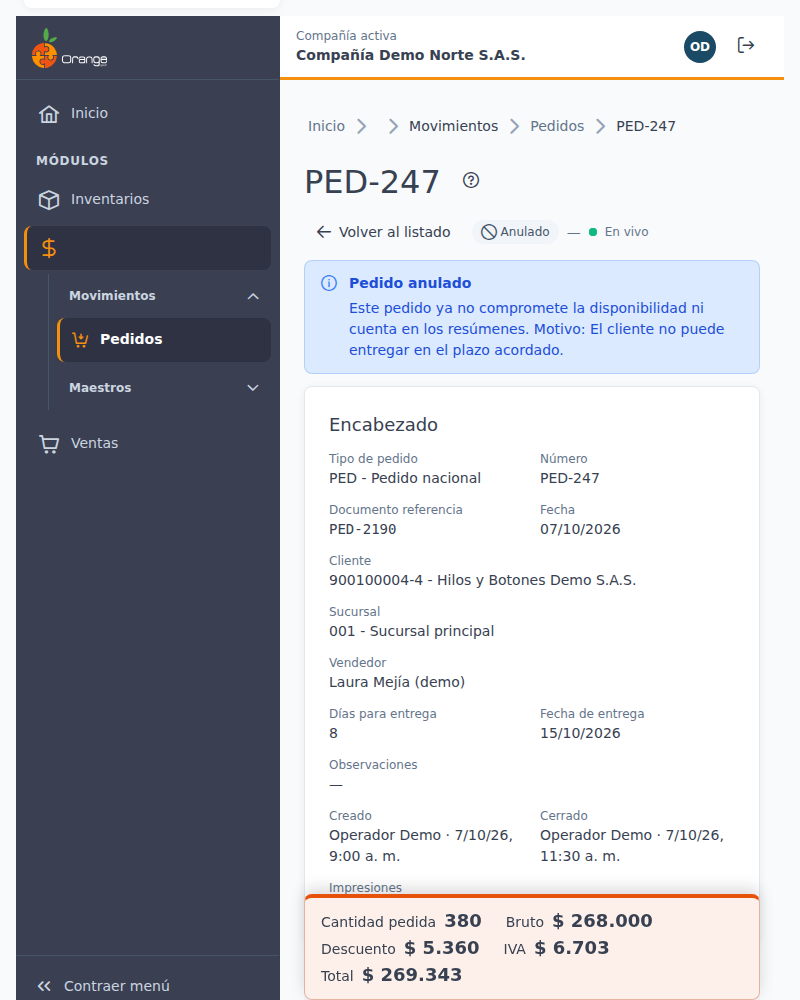

> 💡 Un pedido anulado se sigue viendo en el listado y en el filtro de estado *Anulado*. En su encabezado aparece el motivo, el usuario y la fecha de la anulación.

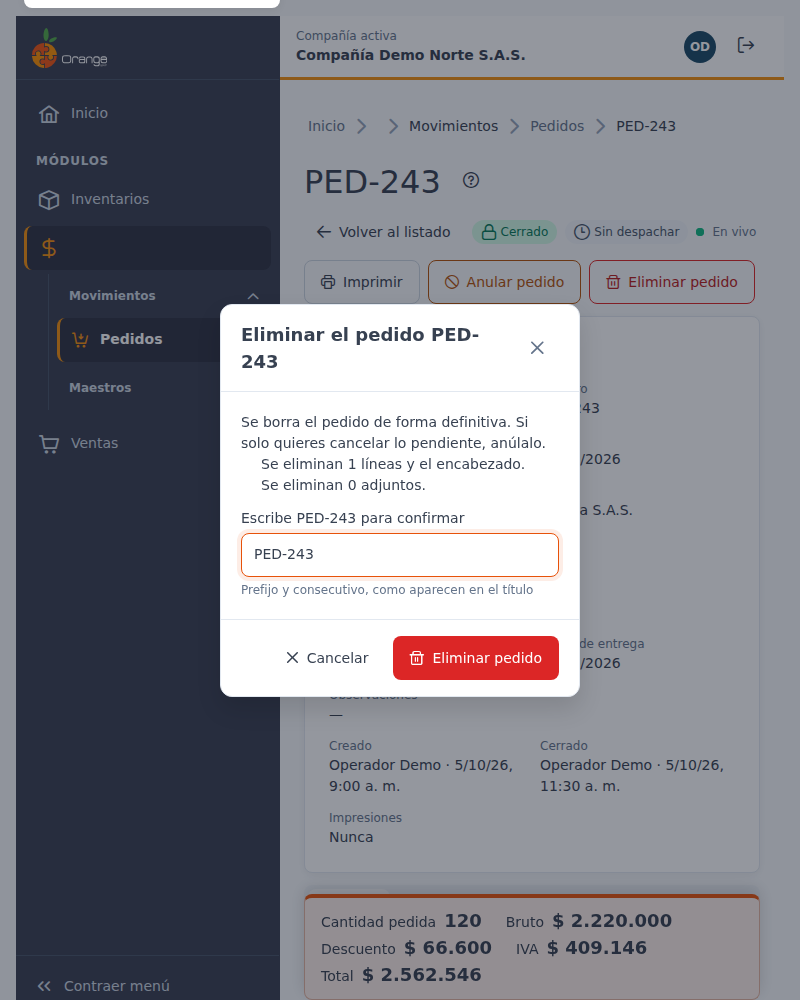

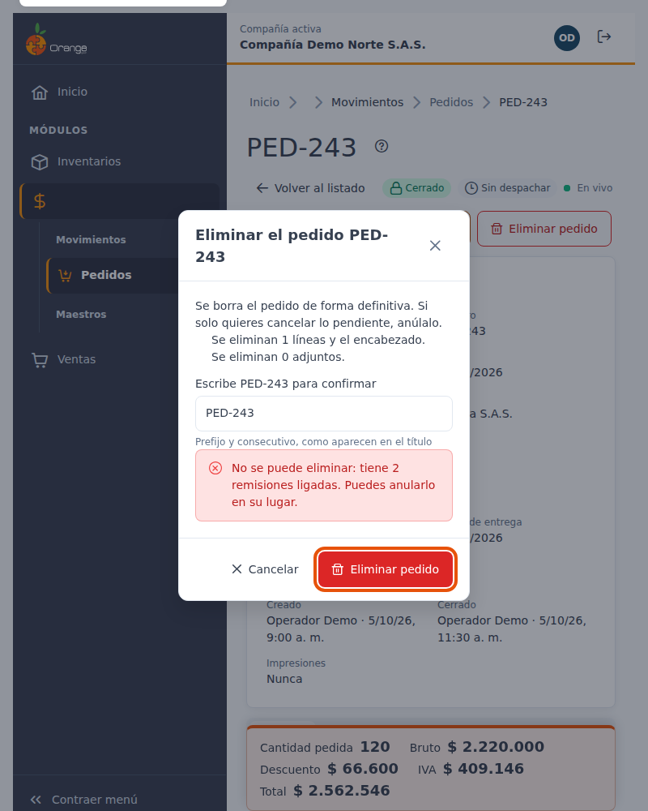

### ¿Qué puede salir mal?

- **«No se puede eliminar: tiene remisiones u otros documentos ligados. Puede anularlo en su lugar.»**: use **Anular pedido**.
- **«Demasiadas eliminaciones seguidas; espere un minuto.»**: el sistema limita la cantidad de eliminaciones por minuto. Espere y vuelva a intentar.
- **«El pedido ya estaba anulado.»**: otra persona ya lo anuló. Actualice la pantalla.

---

## 🏷️ Estados del pedido

Cada pedido tiene **dos** estados que se leen juntos: el **documento** y el **despacho**.

### Estado del documento

| Estado | Qué significa |
|--------|---------------|
| **Abierto** | Se puede seguir editando. No compromete inventario por despachar y no se puede imprimir. |
| **Cerrado** | Listo para imprimir y enviar. Compromete su saldo por despachar. Solo lectura, salvo con el permiso especial. |
| **Anulado** (antes *Congelado*) | Se anuló lo pendiente. No cuenta por despachar, no se imprime y no se edita. |

### Estado del despacho

El despacho se calcula solo con lo que ya salió por los documentos de venta que citan el pedido. Usted no lo cambia en esta pantalla.

| Estado | Cuándo aparece |
|--------|----------------|
| **Sin despachar** | No ha salido nada del pedido. |
| **Despachado parcial** | Ya salió algo, pero no todo. Se muestra, por ejemplo, *4 de 10 · 40 %*. |
| **Despachado** | Todas las líneas ya salieron en su totalidad. |

Un pedido **anulado** no tiene estado de despacho: en la fila aparece un guion (—).

Un pedido con saldo por despachar cuya fecha de entrega ya pasó se marca como **Entrega vencida**, con texto e ícono.

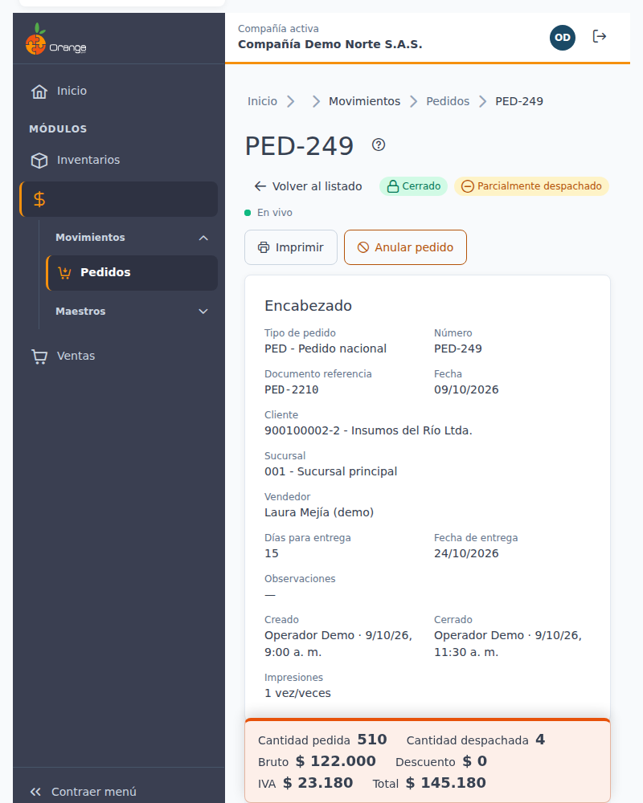

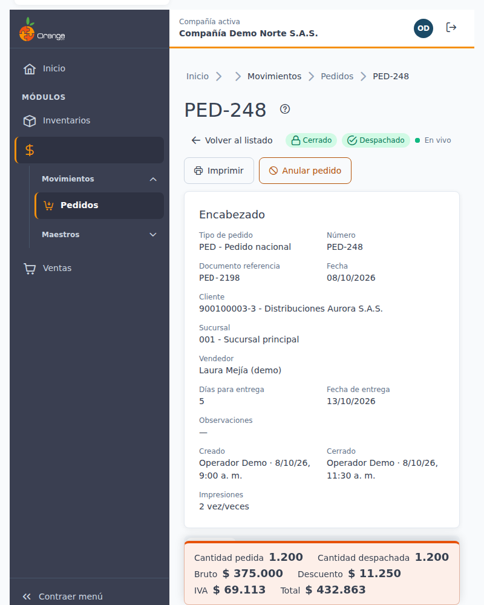

---

## 📦 Qué compromete un pedido

El **inventario por despachar** es lo que los clientes ya pidieron en pedidos **cerrados** y todavía no ha salido. Es el saldo pendiente de cada pedido, por referencia y bodega.

| Estado del pedido | ¿Cuenta por despachar? |
|-------------------|------------------------|
| **Abierto** | **No.** Mientras esté abierto, Disponibilidad no lo descuenta. |
| **Cerrado con saldo** | **Sí**, por su saldo pendiente. |
| **Cerrado sin saldo** (todo despachado) | No. Ya no hay nada pendiente. |
| **Anulado** | No. |

Por eso, para que un pedido reserve inventario, **ciérrelo**. Anularlo o eliminarlo libera ese inventario al instante.

En la pantalla [Disponibilidad de Inventarios](../../inventarios/consultas/disponibilidad.md) la lógica es:

> **Existencia − Por despachar = Disponible hoy**

Disponibilidad se actualiza al consultar y puede tardar hasta 5 minutos en reflejar un cambio hecho por otro usuario.

---

## 🖨️ Imprimir

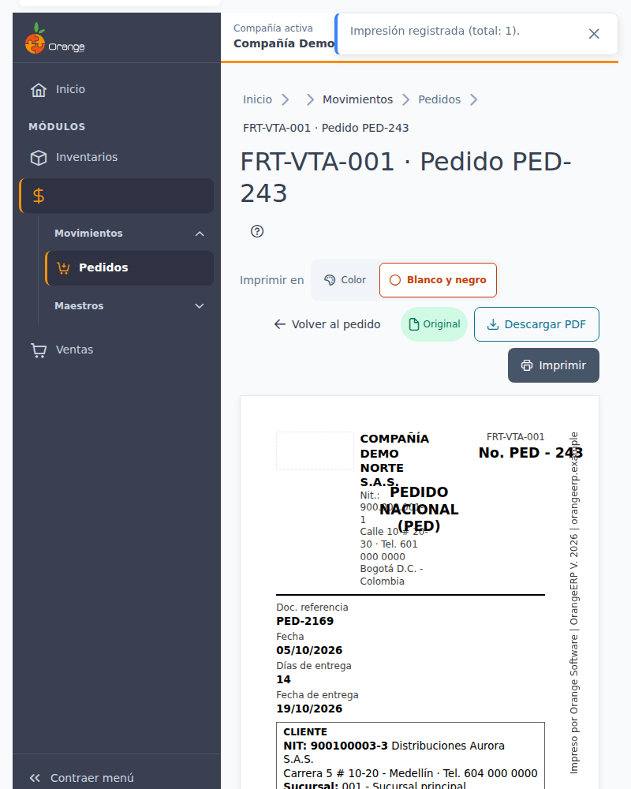

Solo se imprimen pedidos **cerrados** y **no anulados**. El botón **Imprimir** aparece en el documento y en el listado.

1. Abra el pedido cerrado y haga clic en **Imprimir**.
2. Elija el papel: **Carta** o **A4**.
3. Haga clic en **Imprimir** para mandarlo a la impresora, o en **Descargar PDF** para guardarlo.

El documento muestra la empresa, el tipo y el número, el documento de referencia, las fechas y el plazo, el cliente con su sucursal (código, nombre, dirección, ciudad y teléfono), el vendedor, las líneas con sus valores y totales, el valor en letras, las observaciones, la información tributaria, los espacios de firma y el aviso de habeas data.

- La **primera** impresión lleva la marca **Original**. Las siguientes llevan la marca **Copia**.

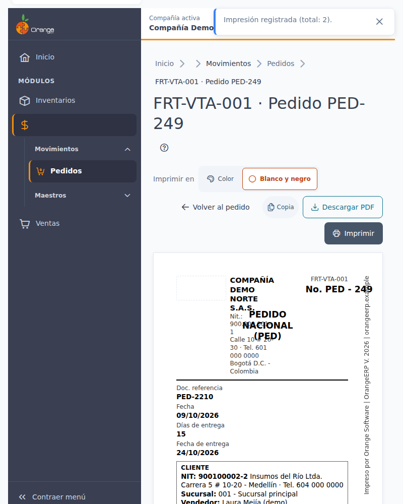

- Cada impresión queda registrada: se cuenta una sola vez, aunque abra la vista varias veces. **Descargar PDF** también cuenta como impresión.
- Para volver al pedido, use **Volver al pedido**.

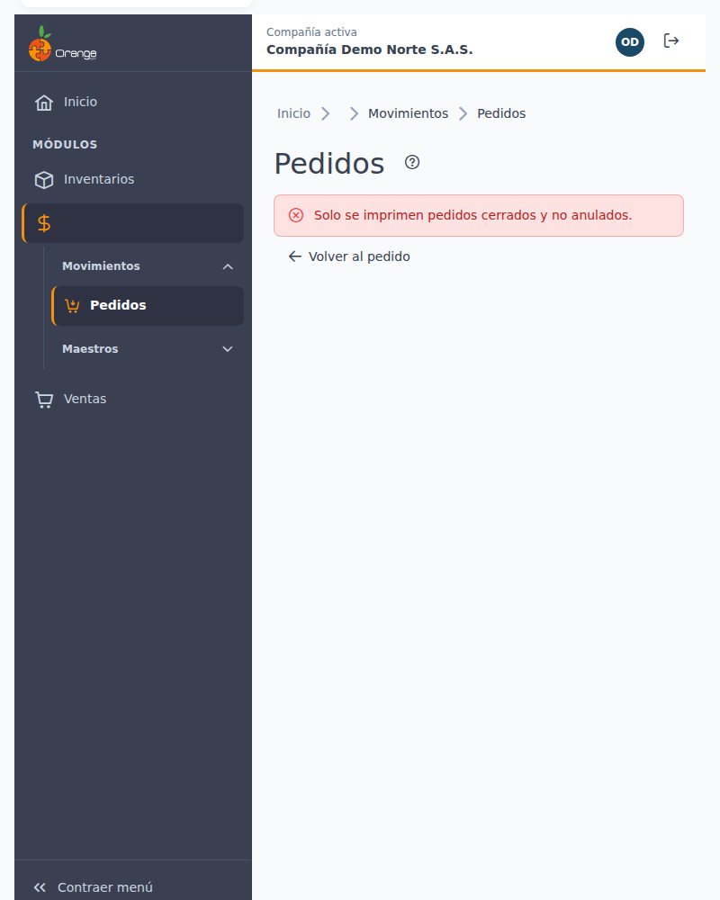

### ¿Qué puede salir mal?

- **«Solo se imprimen pedidos cerrados y no anulados.»**: cierre el pedido primero. Un pedido anulado no se imprime.
- **No ve el botón Imprimir**: su usuario no tiene el permiso **Imprimir** sobre Pedidos.

---

## 📎 Adjuntos

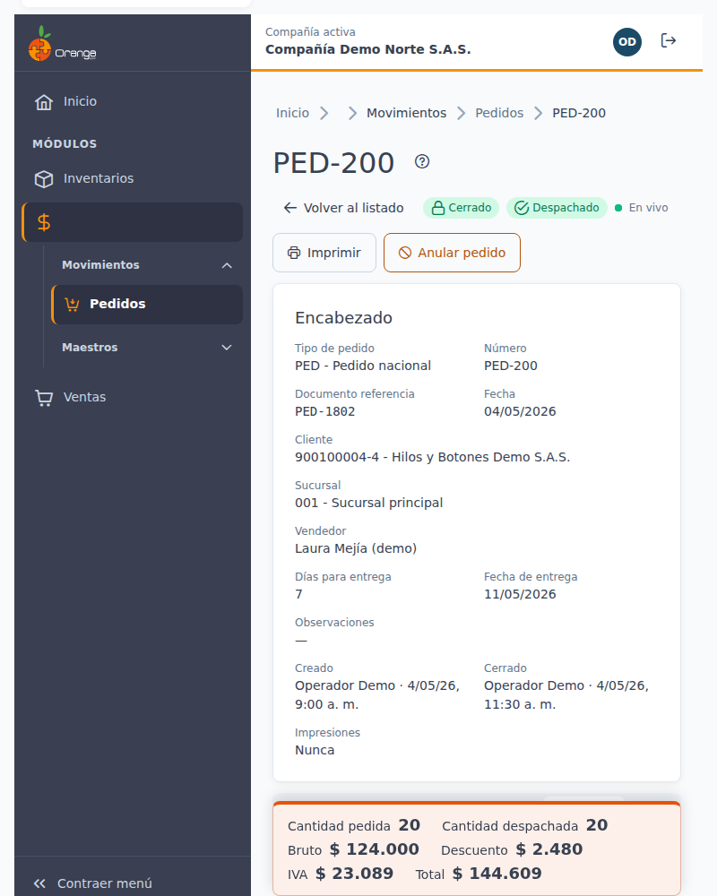

Puede adjuntar archivos al pedido, por ejemplo la orden de compra del cliente o una confirmación.

- Solo puede **adjuntar y quitar** archivos en un pedido **abierto**.
- Cada adjunto lleva una **descripción** corta.
- El espacio de adjuntos es compartido por todos los archivos del pedido. La pantalla muestra cuánto va usado. Si el archivo no cabe, no se guarda.
- Puede **descargar** cada adjunto.
- En un pedido **cerrado** o **anulado** los adjuntos solo se ven y se descargan.
- Al eliminar el pedido se eliminan también sus adjuntos.

---

## 🔗 Remisiones ligadas

La pestaña **Remisiones ligadas** muestra las remisiones que despacharon mercancía de este pedido. Por ahora el número de la remisión es solo texto: todavía no lleva a la pantalla de Remisiones.

---

## 🔄 Cambios de otros usuarios (en vivo)

La pantalla se actualiza sola cuando otro usuario cambia algo de los pedidos:

- **Otro usuario creó, modificó o eliminó un pedido:** aparece un aviso en el listado. Haga clic en **Actualizar** para ver los cambios.
- **Otro usuario modificó el pedido que tiene abierto:** aparece el aviso de cambios, y debe **Actualizar** para verlos.
- **Otro usuario anuló el pedido:** aparece el aviso con el nombre de quien lo anuló. Actualice para ver su estado.
- **Otro usuario eliminó el pedido:** aparece el aviso y debe volver al listado.
- **Conflicto en una línea:** si otra persona cambió la línea que usted editaba, la línea muestra **Conflicto**. Elija **Usar la versión actual** para tomar la versión guardada, o **Descartar** para dejar su cambio fuera.
- **Sin conexión:** la pantalla lo indica y reintenta sola cuando vuelve la conexión.

---

## 📜 Bitácora

La pestaña **Bitácora** registra quién y cuándo creó el pedido, agregó, cambió o quitó líneas, lo cerró, lo reabrió para editar, lo anuló y lo imprimió. Cada registro se puede abrir para ver el detalle.

---

## 🔐 Permisos

¿No ve algún botón? Cada acción depende de los permisos de su perfil.

| Permiso | Opción | Qué habilita |
|---------|--------|--------------|
| Consultar | Pedidos | Ver el listado, abrir los pedidos, sus despachos y su bitácora. |
| Crear | Pedidos | **Nuevo pedido**, la captura de líneas y la **Matriz**. |
| Actualizar | Pedidos | Agregar, cambiar y quitar líneas; cambiar el encabezado; **Cerrar pedido**. |
| Anular | Pedidos | **Anular pedido**. |
| Eliminar | Pedidos | **Eliminar pedido**. |
| Imprimir | Pedidos | **Imprimir** y **Descargar PDF**. |
| Exportar | Pedidos | **Importar** pedidos desde Excel (se necesita junto con Crear). |
| Editar documentos cerrados (permiso especial del usuario) | Pedidos | Editar un pedido cerrado con periodo abierto. |

Los tipos de pedido que aparecen en la pantalla son solo los que tiene autorizados su usuario.

---

## ❓ Preguntas frecuentes

**¿Por qué no hay botón Guardar?**
Cada línea se guarda cuando la confirma. El encabezado también se guarda al cambiarlo.

**¿Por qué no puedo cerrar el pedido?**
Porque tiene líneas sin guardar o con error. El botón dice cuántas faltan. Guárdelas, corríjalas o descártelas.

**Cerré el pedido, ¿por qué mi inventario disponible bajó?**
Porque al cerrarlo, su saldo pasa a contar por despachar. Si no quiere reservar la mercancía todavía, no cierre el pedido.

**¿Por qué un pedido abierto no aparece como por despachar?**
Porque los pedidos abiertos todavía pueden cambiar, así que no comprometen inventario. Ciérrelo para que cuente.

**¿Qué es «Congelar»? Antes el botón decía así.**
Es lo mismo que **Anular pedido**. El estado ahora se llama **Anulado**. Significa que el pedido se anuló.

**¿Qué pasa con lo que ya se despachó si anulo el pedido?**
No se afecta. Solo se cancela lo que falta por despachar.

**¿Puedo cancelar solo una línea?**
No. Anule el pedido y cree uno nuevo con lo que sí se va a vender.

**¿Por qué el valor de una línea aparece con el aviso «sin precio en la lista»?**
Porque la variante no tiene precio en la lista de la sucursal. La pantalla propone el costo sugerido; revise el valor antes de guardar.

**¿Por qué no veo el botón Matriz?**
Porque su usuario no tiene permiso para crear o actualizar pedidos.

**¿Por qué no puedo editar un pedido cerrado?**
Su usuario necesita el permiso especial **Editar documentos cerrados**, y la fecha del pedido debe estar en un periodo abierto.

---

## 📚 Relacionado

- [Ventas](../readme.md): índice del módulo.
- [Importar pedidos desde Excel](pedidos-importar.md): carga de varios pedidos nuevos desde una hoja de Excel.
- [Clientes](../maestros/clientes.md): condiciones, sucursales y lista de precios de cada cliente.
- [Vendedores](../maestros/vendedores.md): quién aparece como vendedor en el pedido.
- [Ficha del cliente · Pedidos](../clientes/ficha-pedidos.md): los pedidos de un cliente y su cumplimiento.
- [Disponibilidad de Inventarios](../../inventarios/consultas/disponibilidad.md): donde se ve lo que está por despachar.
- [Manejo general de la información](../../Generales/manejo-general-informacion.md): búsqueda, orden, paginación y ayuda.

---

[← Volver al índice de ventas](../readme.md)
