[Regresar a la documentación de Ventas](../readme.md)

---

# 🛒 Punto de venta

---

## 📋 Descripción

El **punto de venta** es la pantalla para vender en el mostrador de forma rápida. Usted escanea o toca los productos, ajusta cantidades y descuentos, y cobra en **un solo paso**: al cobrar se cierra la venta y se crea el **recibo de caja** automáticamente.

La pantalla usa la **caja** que tiene asignada su usuario en [Cajeros](../maestros/cajeros.md). La caja le dice con qué tipo de movimiento de venta vende, a qué cliente y bodega, y qué forma de pago aparece por defecto. La venta queda guardada como una venta normal de [Ventas y devoluciones](ventas-devoluciones.md): lo que registra aquí aparece también allá.

> 📘 Cada pestaña del navegador trabaja con **una compañía**. El nombre y el color de la compañía se ven en la barra superior.

> 💡 La venta se guarda al agregar cada producto. Si se cierra la pestaña o se recarga la página, al volver puede **continuar la venta abierta**.

---

## 🎯 Acceso

1. En el menú principal, haga clic en **Ventas**.
2. En **Movimientos**, haga clic en **Punto de venta**.

---

## 🚦 Antes de vender: estados de entrada

Al entrar, la pantalla revisa su caja. Si algo no está listo, **no muestra el buscador**: le dice qué pasa y qué hacer.

| Lo que ve | Qué significa | Qué hacer |
|-----------|---------------|-----------|
| **Cargando** | La pantalla está revisando su caja. | Espere unos segundos. |
| **Este usuario no está configurado como cajero** | Su usuario no tiene caja asignada. | Si tiene acceso a Cajeros, haga clic en **Ir a Cajeros** y cree su caja. Si no, pida a un administrador con acceso a Ventas › Maestros › Cajeros que lo configure. |
| **La caja no está lista para vender** | La caja existe, pero le falta algo. La lista indica qué (por ejemplo, el tipo de movimiento de venta, la forma de pago, o que el tipo no tiene recibo de caja automático, cliente por defecto, sucursal o bodega). | Pida a un administrador de Ventas que complete la caja o el tipo de movimiento. |
| **No tiene permiso para vender** | Su perfil puede abrir el punto de venta, pero no crear ventas. | Pida a un administrador que le asigne el permiso (ver [Permisos](#-permisos)). |
| **No se pudo cargar la caja** | Hubo un problema de conexión. | Haga clic en **Reintentar**. Lo que escribió no se pierde. |

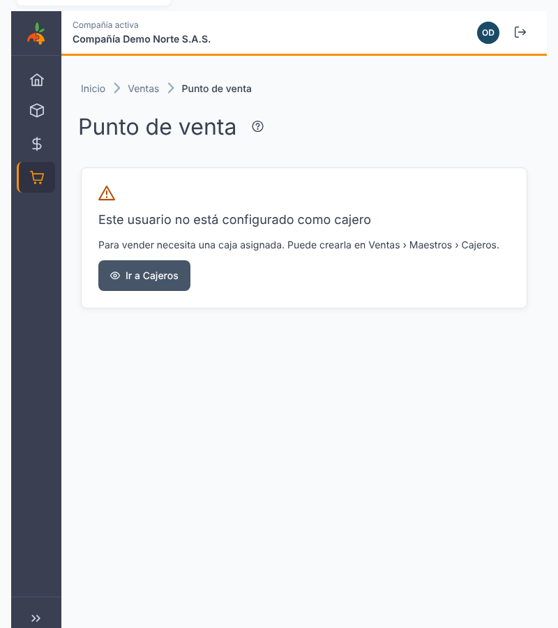

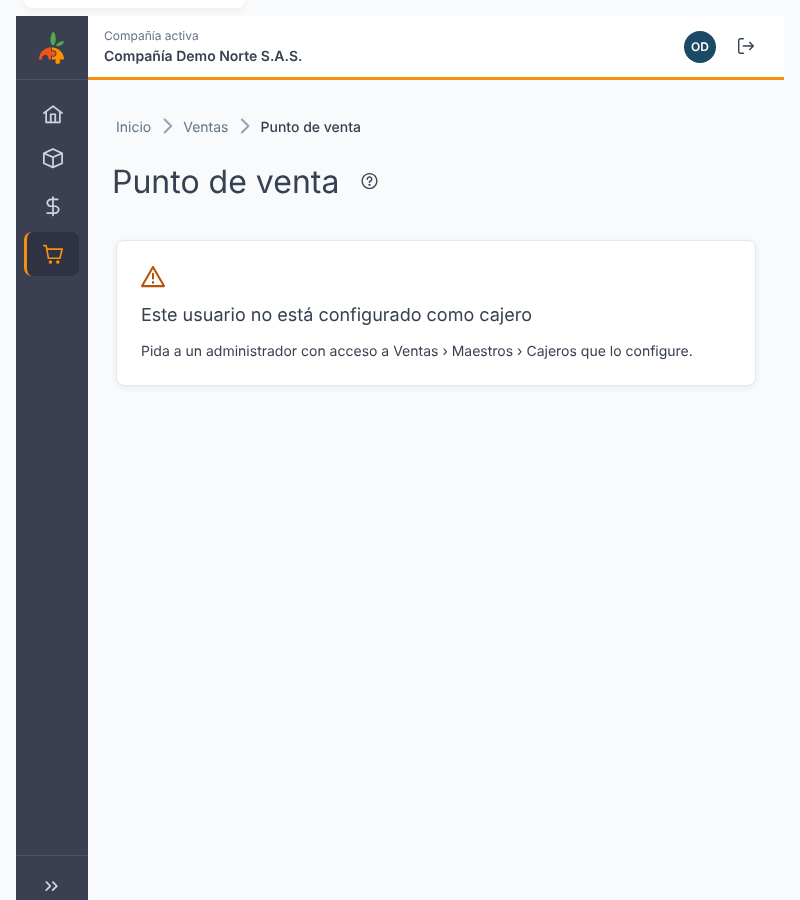

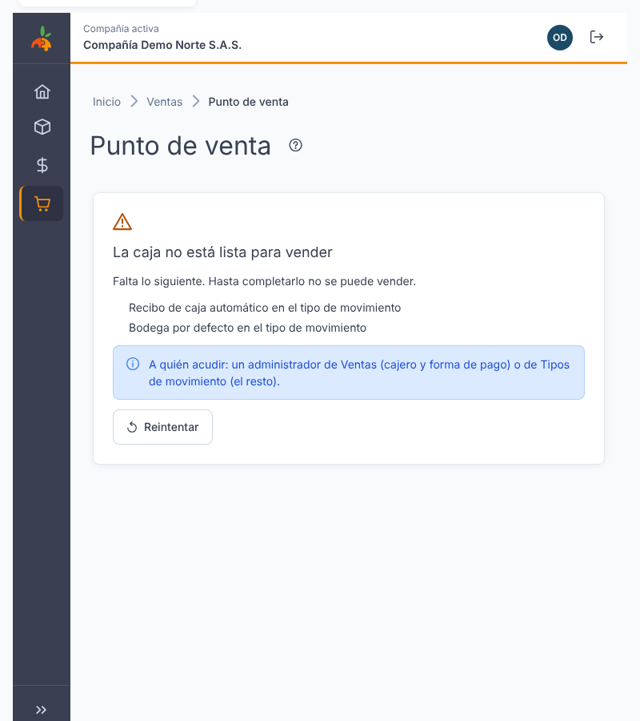

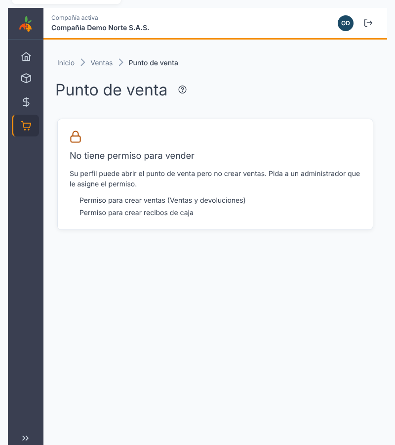

> ℹ️ Si su usuario tiene más de una caja, la pantalla usa la que se registró primero. Un administrador puede revisarlo en [Cajeros](../maestros/cajeros.md).

---

## 🖥️ Pantalla principal

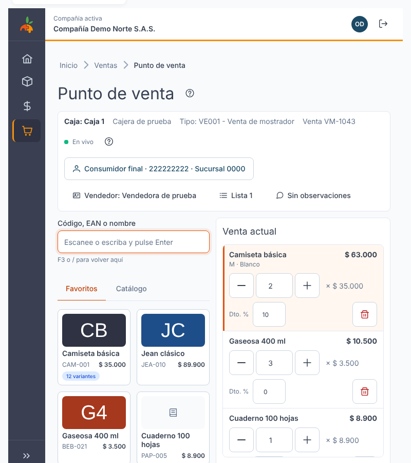

| Elemento | Para qué sirve |
|----------|----------------|
| **Caja**, **Cajera** y **Tipo** | Caja, usuario y tipo de movimiento de venta con el que vende. |
| **En vivo** | La pantalla está conectada: los cambios de otros usuarios aparecen solos. |
| **Cliente** | El cliente y la sucursal de la venta. Un clic (o **F4**) lo cambia. |
| **Vendedor**, **Lista** y **Observaciones** | Datos opcionales de la venta. No son obligatorios para vender. |
| **Atajos** | Abre el panel de teclas rápidas. |
| **Código, EAN o nombre** | El buscador. Siempre queda enfocado. |
| **Favoritos** y **Catálogo** | Las pestañas con los productos para tocar. |
| **Venta actual** | Las líneas de la venta, con los totales y el botón **Cobrar**. |
| **Modo táctil** | Agranda botones y tarjetas. Ver [Modo táctil](#-modo-tactil). |

**¿No ve algún botón?** Cada acción depende de los permisos de su perfil:

| Permiso | Qué habilita |
|---------|--------------|
| Consultar **Puntos de venta** | Entrar a la pantalla. |
| Crear y Actualizar en **Ventas y devoluciones** | Agregar, cambiar y cobrar ventas. |
| Crear en **Recibos de Caja y Egresos** | Que el cobro cree el recibo de caja automáticamente. |
| Eliminar en **Ventas y devoluciones** | Cancelar la venta y borrarla. Sin este permiso, la venta queda guardada como abierta. |
| Imprimir en **Ventas y devoluciones** | El botón **Imprimir tirilla**. |
| Crear en **Puntos de venta** | Crear un cliente nuevo desde la pantalla. |
| Cambiar precio en el punto de venta | El botón **Cambiar precio** (ver más abajo). |

---

## 🔍 Buscar y agregar productos

### Escribir o escanear un código

1. Con el buscador enfocado, escanee el código de barras (EAN) o escriba el código, el código alterno o el nombre.
2. Pulse **Enter**.

- Si el código coincide con **un solo producto**, se agrega **una unidad**.
- Si tiene **varias variantes**, se abre la ventana para elegir (ver *Variantes*).
- Si **no existe**, aparece el aviso *Código no encontrado* y el buscador queda listo para seguir. No bloquea la venta.

Si escribe un nombre **sin pulsar Enter**, aparece una lista de coincidencias con el formato *Código - Nombre*. Elija el producto con un clic.

> 💡 Si escanea el **mismo código otra vez**, no se crea otra línea: se **suma una unidad** a la línea que ya está en la venta.

### Favoritos y catálogo

- **Favoritos** muestra los productos marcados como favoritos para el punto de venta.
- **Catálogo** muestra todos los productos que se pueden vender en el punto de venta.
- Use el filtro de **grupo** y **subgrupo** para encontrar productos del catálogo.
- Un clic en la tarjeta agrega el producto. Si el producto tiene foto, la verá; si no, verá un ícono. Un producto sin existencia aparece como **Agotada**.

> 📸 Los favoritos, el catálogo del punto de venta y la foto se administran en el maestro de [Referencias](../../inventarios/maestros/referencias.md). Un producto sin foto **sigue apareciendo**: se muestra con un ícono.

Para cambiar de pestaña sin tocar la pantalla, use **F7**.

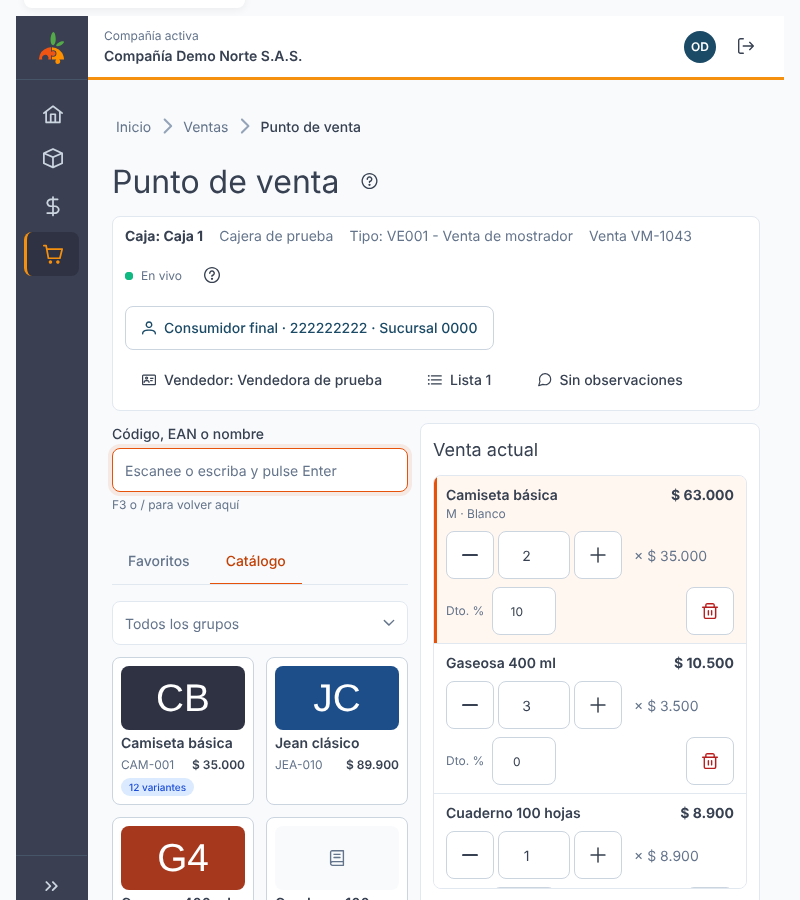

### Búsqueda relacionada

Mientras escribe, la pantalla le muestra las coincidencias. Las listas se cargan por páginas: la pantalla nunca trae todos los productos de una vez.

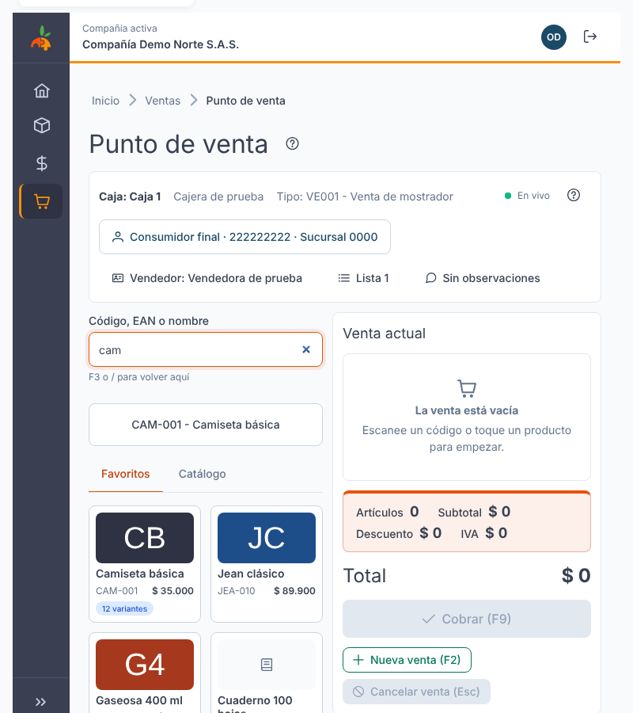

### Código no encontrado

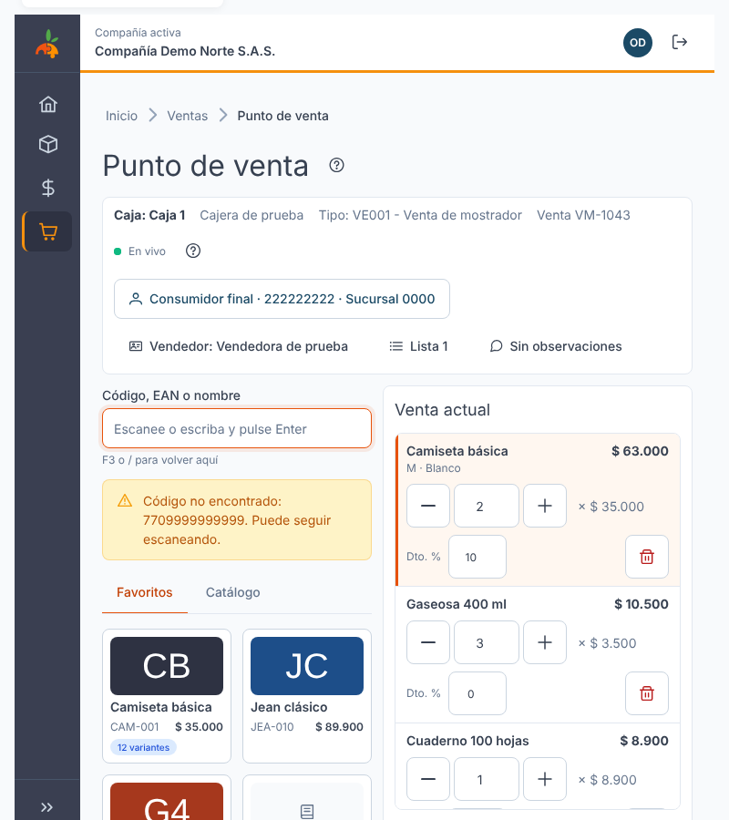

### Variantes

Si el producto tiene tallas, colores u otros atributos, la pantalla le pide elegir:

1. Toque el **atributo principal** (por ejemplo, la talla).
2. Toque el **atributo secundario** (por ejemplo, el color).
3. Revise la **existencia** de cada opción y pulse **Agregar**.

Las opciones que están **agotadas en la bodega** aparecen marcadas y no se pueden elegir, salvo que el tipo de movimiento de venta permita vender sin existencia.

Si el producto tiene **una sola variante**, se agrega directamente, sin preguntar.

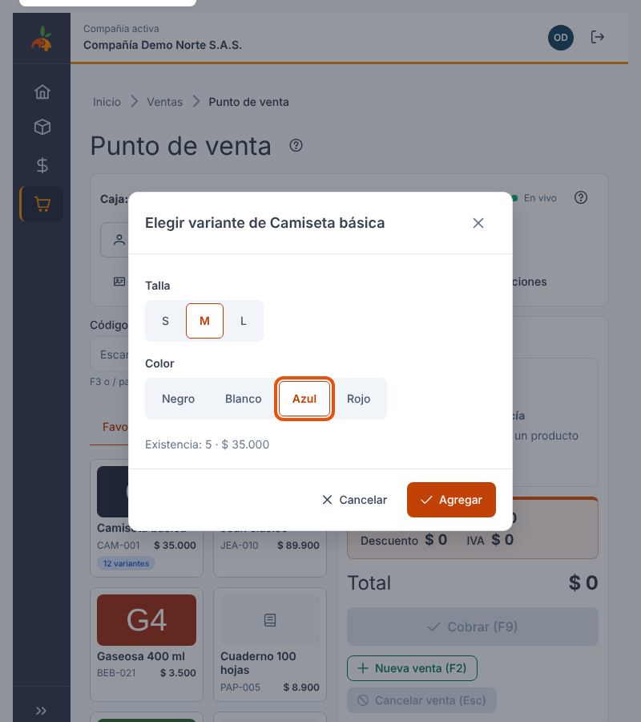

---

## 🧾 La venta actual (carrito)

Cada línea muestra el producto, la variante, la **cantidad**, el valor unitario y el **descuento**.

| Acción | Cómo |
|--------|------|
| **Cambiar cantidad** | Use **+** y **−**, o escriba el número. También **+** y **−** del teclado sobre la línea seleccionada. |
| **Descuento** | Escriba el porcentaje en **Dto. %** (de 0 a 100). Solo se puede si el tipo de venta permite descuentos; si no, el campo aparece deshabilitado. |
| **Quitar una línea** | Toque la **papelera** y confirme con **Quitar**. Con la línea seleccionada, también **Supr**. |
| **Cambiar precio** | Ver *Cambio de precio* más abajo. |

Los **totales** (artículos, subtotal, descuento, IVA y total) los calcula el sistema. Siempre se ven en la parte inferior de la venta.

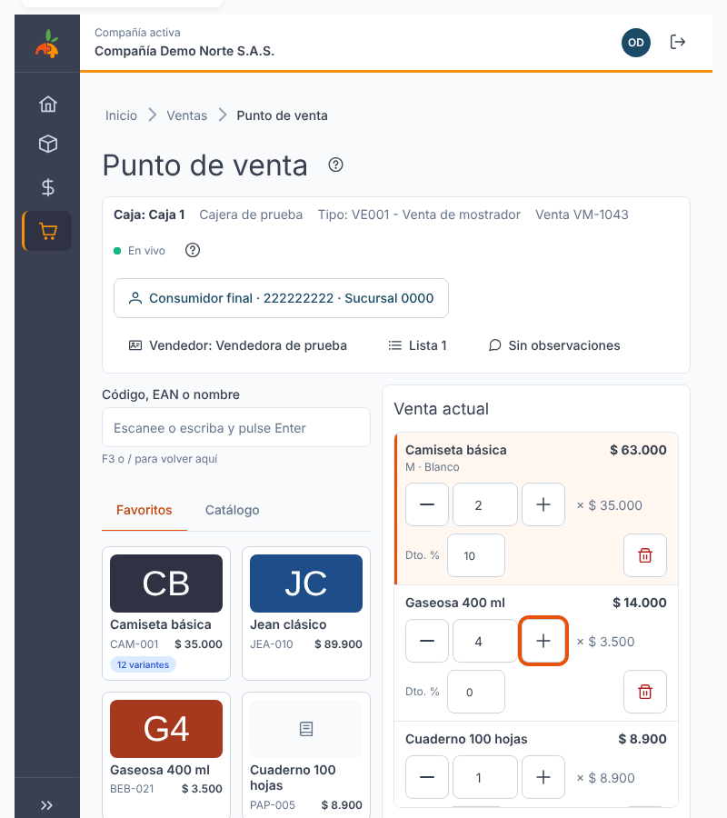

### Cambio de precio

El precio de cada línea es el de la **lista de precios** elegida. Solo se puede cambiar si su usuario tiene autorizado el cambio de precios en el punto de venta.

1. Seleccione la línea y haga clic en **Cambiar precio**.
2. Escriba el nuevo valor unitario y pulse **Aplicar**.

Si el valor está **fuera del rango permitido**, la pantalla le pide la **autorización de un administrador**: el administrador escribe su propio usuario y clave en la ventana de autorización. La clave no se guarda en la pantalla ni en la venta. Si la autorización se vence, vuelva a pedirla.

### Cancelar, nueva venta y retomar

- **Cancelar venta (Esc)** descarta todas las líneas. Se pide confirmación.
  - Si su perfil tiene el permiso de **Eliminar**, la venta se borra.
  - Si **no** lo tiene, la venta queda guardada como **abierta** y la pantalla se lo avisa: un supervisor puede eliminarla.
- **Nueva venta (F2)** empieza una venta limpia. Si hay líneas, pide confirmación.
- **Retomar**: si al entrar hay una venta abierta, la pantalla pregunta **Continuar** o **Descartar**. Con **Continuar** recupera las líneas, el cliente y los datos de la venta.

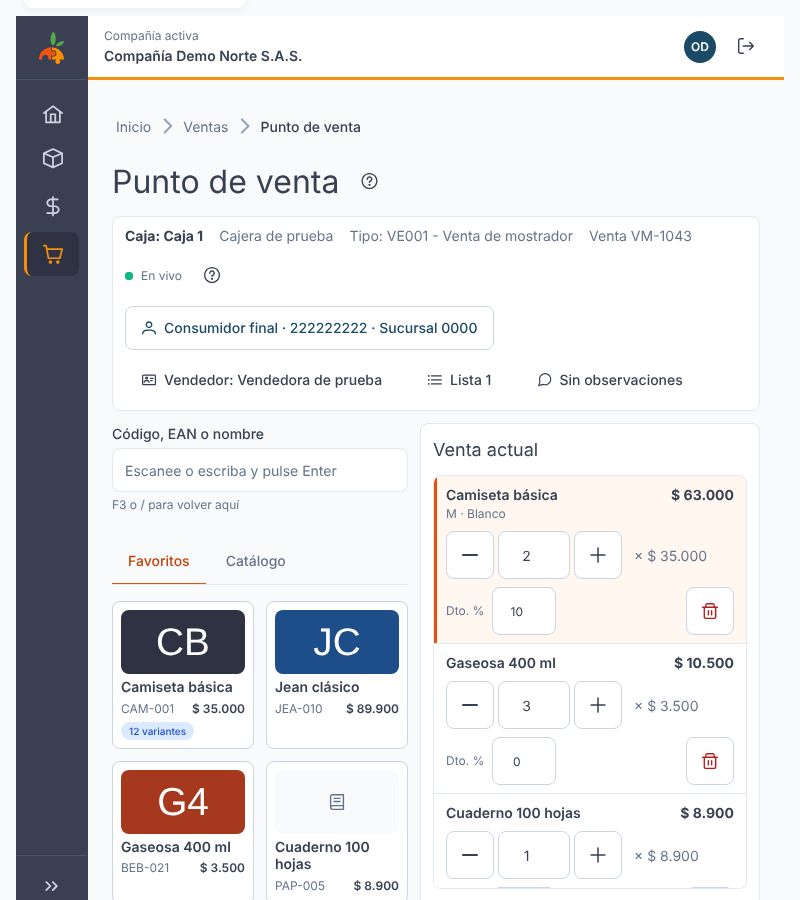

---

## 👤 Cliente

El cliente de la venta viene de la caja (el cliente por defecto del tipo de movimiento). Se muestra en la cabecera con su **sucursal**.

### Cambiar el cliente

1. Haga clic en el cliente o pulse **F4**.
2. Escriba el **documento** y pulse **Enter**, o busque por nombre.
3. Elija la **sucursal** del cliente. Solo aparecen las sucursales de ese cliente.
4. Pulse **Usar este cliente**.

**Cambiar el cliente no borra la venta**: las líneas, las cantidades y los descuentos se conservan.

Si el cliente tiene **mora** o supera su **cupo**, la pantalla lo muestra con el motivo y no deja cerrar la venta hasta corregirlo.

### Crear un cliente nuevo

Si el cliente no existe, cree uno sin salir de la pantalla y sin perder la venta:

1. En la ventana de cliente, pulse **Nuevo cliente**.
2. Complete los campos mínimos:
   - **Tipo y número de documento** (con el dígito de verificación si es NIT).
   - **Tipo de persona**: *Natural* (nombres y apellidos) o *Jurídica* (razón social).
   - **Teléfono**, **Correo**, **Dirección** y **Ciudad** (viene preseleccionada la ciudad de la compañía).
3. Pulse **Crear y usar**.

Al crear el cliente, el sistema también crea su **sucursal 0000** (la sucursal por defecto) con los datos que escribió, la lista de precios de la compañía y el vendedor y la zona por defecto. Esa sucursal queda seleccionada para la venta.

**Qué puede salir mal:**

| Mensaje | Qué hacer |
|---------|-----------|
| Escriba el número de documento / el primer nombre / el primer apellido / elija la ciudad | Complete el campo señalado. |
| El correo no es válido. | Corríjalo. |
| *Ya existe un cliente con ese documento: [nombre]. ¿Quiere usarlo en esta venta?* | Pulse **Usar este cliente**. No se crea uno repetido. |
| *La compañía no tiene vendedor o zona por defecto para crear la sucursal 0000.* | Pida a un administrador que configure esos datos de la compañía. |

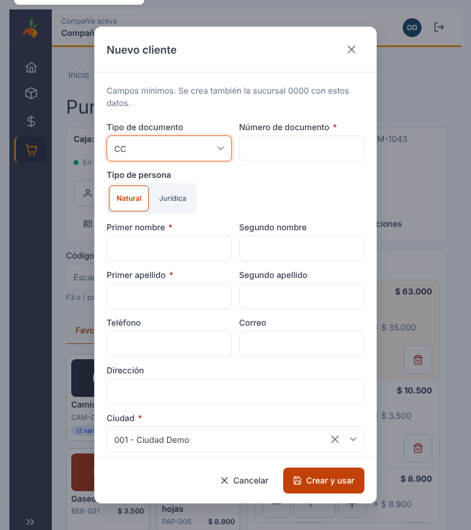

---

## 🧑‍💼 Vendedor, lista de precios y observaciones

En la cabecera hay tres datos opcionales. **No son obligatorios para vender.**

| Dato | Qué hace |
|------|----------|
| **Vendedor** | Viene el vendedor de la sucursal del cliente. Puede cambiarlo buscando otro vendedor. |
| **Lista de precios** | Viene la lista de la sucursal del cliente (de 1 a 5). Cambiarla afecta a las **líneas que agregue después**; las líneas ya agregadas conservan su precio. |
| **Observaciones** | Texto libre de hasta 200 caracteres. No admite comas ni punto y coma. |

---

## 💵 Cobrar la venta

Cobrar es un solo paso: al confirmar, el sistema **cierra la venta** y **crea el recibo de caja automáticamente**. O se hacen las dos cosas, o no se hace ninguna.

1. Pulse **Cobrar (F9)**. Se abre la ventana con el **total a cobrar**.
2. Revise la **forma de pago**. Viene la **forma de pago por defecto** de su caja, marcada. Para usar otra, toque la tarjeta.
3. Si la forma de pago es **efectivo**, escriba el **valor recibido**, o pulse **Exacto**. La pantalla muestra el **cambio** o, si falta dinero, cuánto falta.
4. Si la forma de pago pide un **banco** o un **documento de referencia**, escríbalos en esa misma ventana.
5. Pulse **Confirmar cobro (Enter)**.

Con el teclado: **F9** abre el cobro y **Enter** lo confirma. **Esc** vuelve a la venta sin cobrar.

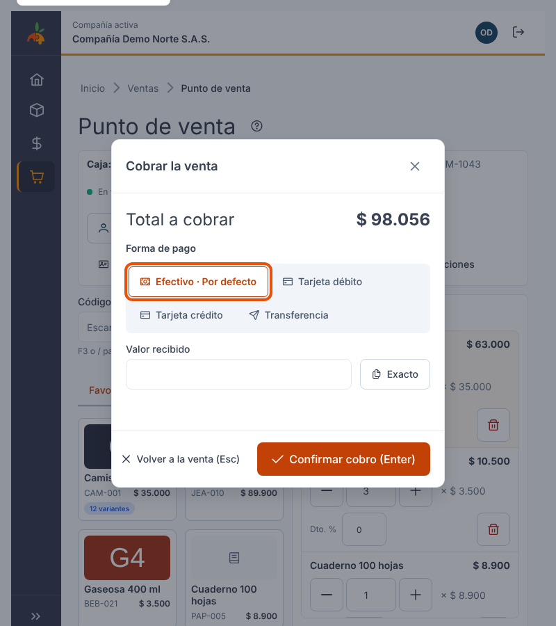

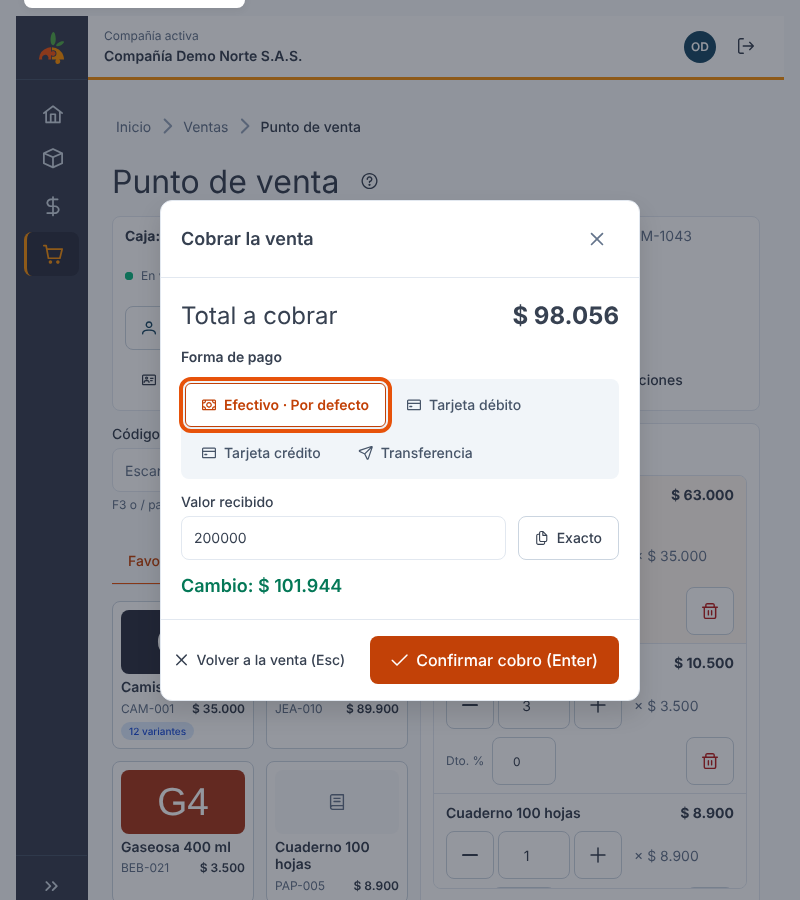

### Venta cerrada

Al cobrar, la pantalla muestra **Venta cerrada** con el número de venta, el **recibo de caja** que se creó, el total cobrado y el cambio.

- **Imprimir tirilla (F8)**: solo aparece si tiene el permiso de imprimir.
- **Nueva venta (F2)**: empieza la siguiente venta.

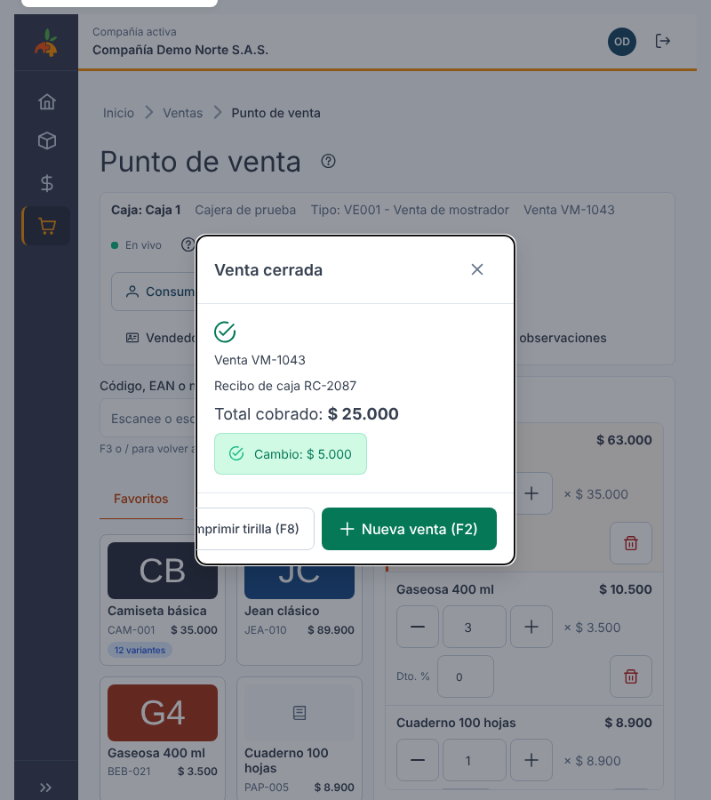

**Qué puede salir mal al cobrar:**

| Mensaje | Qué hacer |
|---------|-----------|
| *No se pudo cobrar: no se cerró la venta ni se creó el recibo. Puede reintentar con los mismos datos.* | Pulse **Reintentar cobro**. No se cobró nada: lo que escribió se conserva. |
| *El periodo del recibo de caja está cerrado. No se cobró nada.* | Pida a un administrador que revise el periodo de recibos de caja. |
| *Faltan $ …* | El valor recibido es menor que el total. Escriba el valor completo. |

---

## ⌨️ Atajos de teclado

Los atajos funcionan con el buscador enfocado. Puede ver esta lista en la pantalla con el botón **Atajos**.

| Tecla | Acción |
|-------|--------|
| **F2** | Nueva venta |
| **F3** o **/** | Enfocar la búsqueda |
| **F4** | Cambiar cliente |
| **F6** | Descuento de la línea seleccionada |
| **F7** | Alternar Favoritos y Catálogo |
| **F8** | Imprimir tirilla (tras cobrar) |
| **F9** | Cobrar y confirmar |
| **Esc** | Cancelar o cerrar el panel |
| **Supr** | Quitar la línea seleccionada |
| **↑** / **↓** | Mover entre líneas |
| **+** / **−** | Cantidad de la línea |

> ℹ️ F1, F5, F10, F11 y F12 los reserva el navegador y no se usan en esta pantalla.

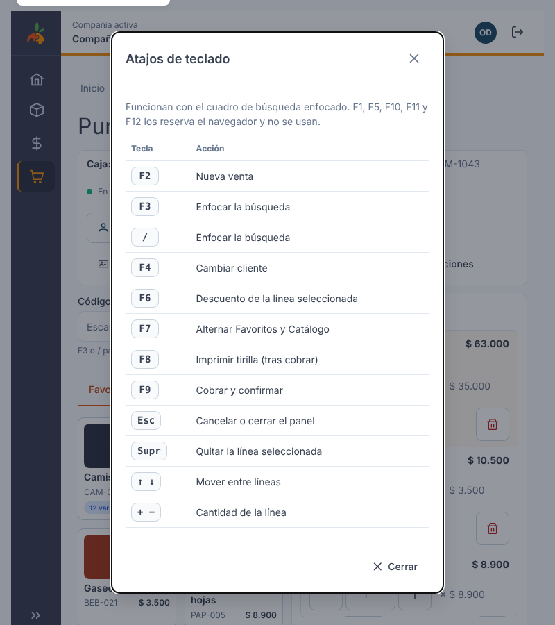

---

## 📱 Modo táctil

El punto de venta está pensado para usarse con pantalla táctil.

- En el encabezado está el botón **Modo táctil**. En un equipo con pantalla táctil se activa solo; puede encenderlo o apagarlo cuando quiera.
- Con el modo táctil activo, las tarjetas de productos, las líneas y los botones son **más grandes**, para tocarlos sin error.
- En **pantallas pequeñas** (por ejemplo, un celular), la pantalla se divide en dos pestañas: **Productos** y **Carrito (n)**. Abajo queda una barra con el **total** y el botón **Cobrar**.

| Productos | Carrito |
|-----------|---------|
| 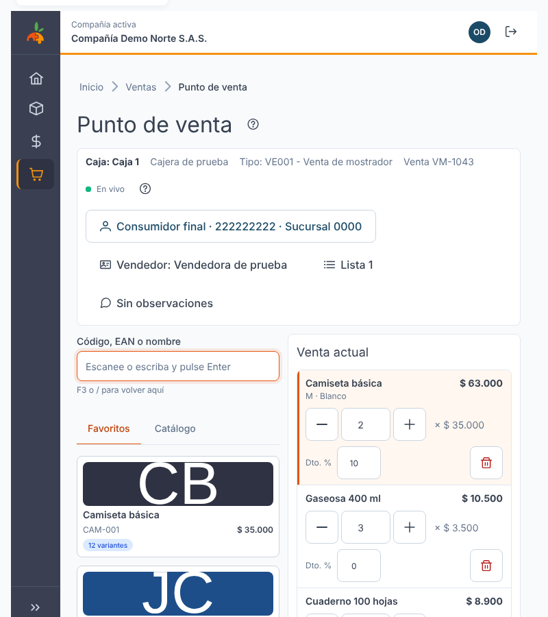 | 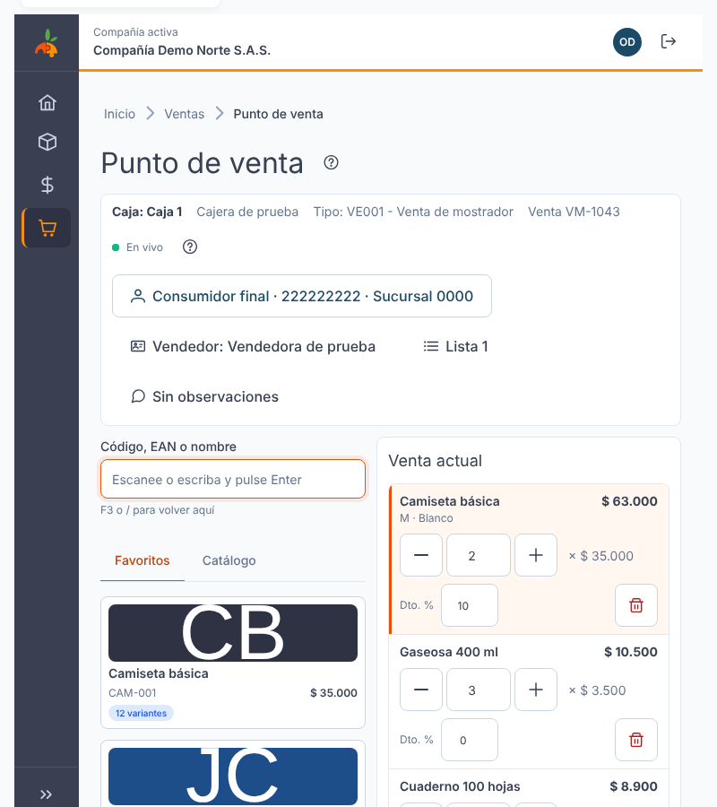 |

---

## 🔄 Cambios de otros usuarios (en vivo)

La pantalla se mantiene conectada: no tiene que recargar para ver cambios importantes.

- Si **otra persona modifica la venta abierta** que usted tiene en pantalla, la pantalla se lo avisa: *Otra persona modificó la venta abierta.* Se recarga la venta con lo que quedó guardado.
- Si **cambia la configuración de su caja** (por ejemplo, el tipo de movimiento o la forma de pago), aparece el aviso: *Su configuración de caja cambió. Pulse Reintentar para recargarla.*
- Junto a la descripción verá **En vivo** mientras la conexión esté activa. Si se interrumpe, la pantalla intenta reconectarse sola.

> ℹ️ Lo que usted hace en esta misma pestaña no genera avisos.

---

## ❓ Preguntas frecuentes

**¿Por qué no aparece el buscador?**
Porque la caja no está lista para vender (no está configurada, está incompleta o su perfil no tiene permiso). Vea *Antes de vender* arriba.

**¿Por qué la venta quedó como abierta y no se eliminó?**
Porque su perfil no tiene el permiso de **Eliminar** en Ventas y devoluciones. Pida a un supervisor que la elimine.

**¿Por qué no puedo cambiar el descuento de una línea?**
Porque el tipo de movimiento de venta de su caja no permite descuentos.

**¿Por qué no puedo cambiar el precio?**
Porque su usuario no tiene autorizado el cambio de precios en el punto de venta. Un administrador puede autorizarlo puntualmente con su propio usuario y clave.

**¿Por qué sale marcada esa forma de pago?**
Es la forma de pago por defecto de su caja. Puede elegir otra en la ventana de cobro, pero la que sale por defecto la define la caja en [Cajeros](../maestros/cajeros.md).

**¿Un producto sin foto aparece en la pantalla?**
Sí. Se muestra con un ícono. La foto se agrega en el maestro de Referencias.

**¿Puedo vender sin cliente?**
La venta siempre tiene el cliente de la caja o el que usted elija. Si no tiene uno, cree un cliente nuevo desde la pantalla.

**¿Dónde veo las ventas que cobré?**
En [Ventas y devoluciones](ventas-devoluciones.md). Cada venta del punto de venta aparece allí como una venta más.

---

## 🧭 Errores frecuentes

| Mensaje | Solución |
|---------|----------|
| *Código no encontrado* | Revise el código o el EAN, o busque por nombre. |
| *Agotada en la bodega* | No hay existencia de esa variante en la bodega de la caja. |
| *Ya existe un cliente con ese documento* | Pulse **Usar este cliente**. |
| *No se pudo cargar la caja* | Pulse **Reintentar**. Si sigue igual, revise su conexión. |
| *No se pudieron cargar los productos.* | Pulse **Reintentar** o cambie de pestaña. |
