[Regresar a Ventas](../readme.md)

---

# 🚚 Remisiones

---

## 📋 Descripción

Una **remisión** es el documento que acompaña la mercancía cuando **sale hacia el cliente**. Dice qué se entregó, en qué bodega salió, cuántas unidades, a qué valor y a qué cliente y sucursal.

Use una remisión cuando la mercancía sale. Si el cliente pidió algo y todavía no ha salido, eso es un **pedido** (ver [Pedidos de venta](pedidos.md)). Las facturas de venta se hacen a partir de las remisiones **cerradas**.

En esta pantalla puede **consultar, crear, editar, cerrar, congelar, anular, eliminar, imprimir, adjuntar documentos** y **ver la bitácora** de cada remisión. Trabaje siempre con la compañía que aparece en la barra superior.

> ⚠️ **Congelar no es anular.** Son dos acciones distintas, con dos estados distintos. Congelar deja la remisión válida y fuera de los saldos; anular la invalida y devuelve las existencias. Lea la sección [Congelar o anular](#congelar-anular) antes de elegir.

> 📘 La búsqueda, el orden, la paginación y la ayuda funcionan igual en todas las tablas: ver [Manejo general de la información](../../Generales/manejo-general-informacion.md).

---

## 🎯 Acceso

1. En el menú principal, haga clic en **Ventas**.
2. En **Movimientos**, haga clic en **Remisiones**.

---

## 🖥️ Pantalla principal: el listado

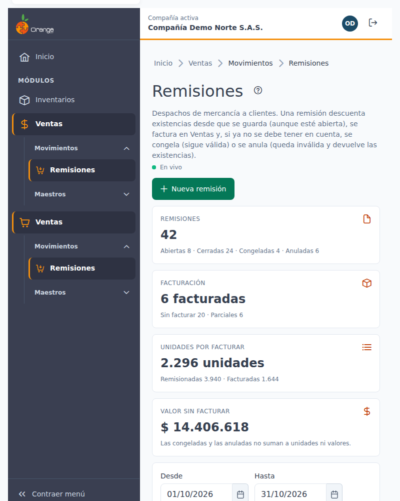

El listado muestra las remisiones de la compañía, de la más reciente a la más antigua. Arriba aparece un resumen del filtro que está aplicado: cuántas remisiones hay **abiertas**, **cerradas**, **congeladas** y **anuladas**.

Cada fila muestra el número de la remisión, la fecha, el documento de referencia, el cliente, la sucursal, el vendedor, la cantidad remisionada, lo facturado, el valor total, la facturación y el **estado**. El estado siempre lleva texto e ícono, no solo color.

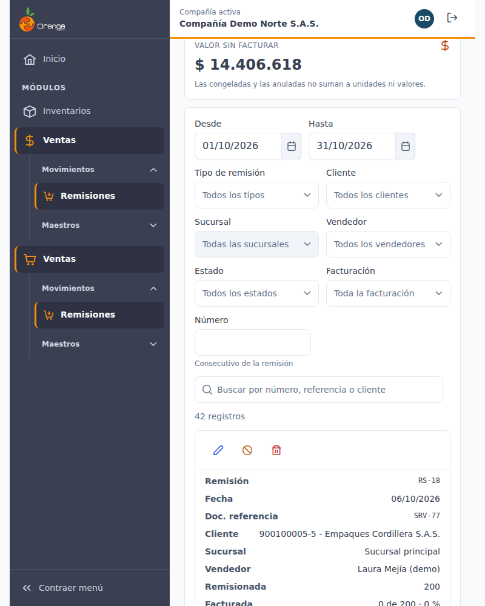

### Filtrar el listado

Los filtros aparecen arriba de la tabla y quedan en la dirección de la página, para que pueda compartir la vista:

- **Fechas**: el rango de la remisión.
- **Cliente** y **Vendedor**.
- **Estado**: *Abierta*, *Cerrada*, *Congelada* o *Anulada*.
- **Facturación**: si la remisión tiene saldo por facturar, está parcial o ya está facturada. Para filtrar por facturación debe elegir un rango de fechas.
- **Buscar**: por número de remisión, documento de referencia o cliente.

Si quiere ver solo las remisiones congeladas, use el filtro de estado.

Si todavía no hay remisiones, el listado aparece vacío. Si el filtro no encuentra nada, la pantalla lo indica: use **Limpiar filtros**. Si el listado no puede cargar, la pantalla muestra el error y ofrece **Reintentar**.

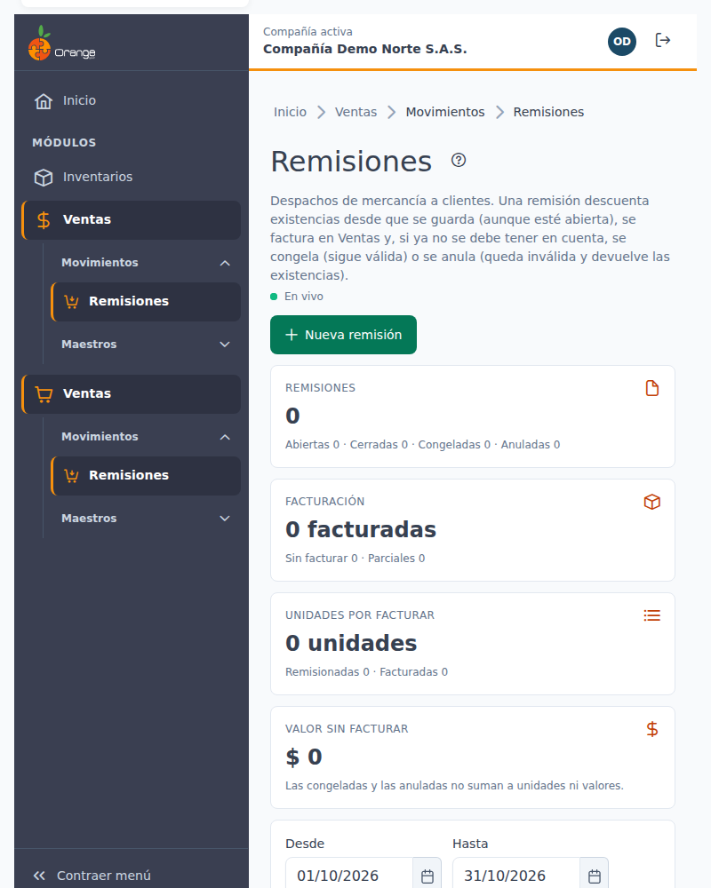

### ¿Qué puedo hacer desde una fila?

Los botones de cada fila dependen del estado de la remisión y de sus permisos:

| Botón | Cuándo aparece |
|-------|----------------|
| **Ver** | Siempre que tenga permiso para consultar. |
| **Editar** | Remisiones abiertas, o cerradas con el permiso especial para editar documentos cerrados. Ver [Editar](#editar). |
| **Imprimir** | Remisiones cerradas o congeladas. Ver [Imprimir](#imprimir). |
| **Congelar** | Remisiones cerradas que no estén congeladas ni anuladas. Ver [Congelar o anular](#congelar-anular). |
| **Anular** | Remisiones que no estén congeladas ni anuladas, y que no tengan facturas ligadas. |
| **Eliminar** | Remisiones sin facturas ligadas que no estén congeladas. |

Si su usuario no tiene permiso para consultar remisiones, la pantalla le muestra el aviso de acceso restringido.

---

## ➕ Crear una remisión

1. En el listado, haga clic en **Nueva remisión**.
2. Elija el **Tipo de remisión**. Sin tipo no se pueden capturar líneas. Solo aparecen los tipos que tiene autorizados su usuario.
3. Elija el **Cliente**. Solo puede elegir clientes activos.
4. Elija la **Sucursal** del cliente. Al elegirla, la pantalla carga su **lista de precios**.
5. Revise el **Vendedor**. Se precarga con el vendedor de la sucursal, si lo tiene, y puede cambiarlo o dejarlo en blanco.
6. Revise los **Días de plazo** y el **descuento**. Se precargan con las condiciones del cliente y puede cambiarlos.
7. Capture las líneas (ver [Captura línea a línea](#captura)).
8. Cuando la remisión tenga líneas guardadas, ciérrela (ver [Cerrar](#cerrar)).

> 💡 El tipo de remisión no se puede cambiar después de crear la remisión: elíjalo bien antes de capturar.

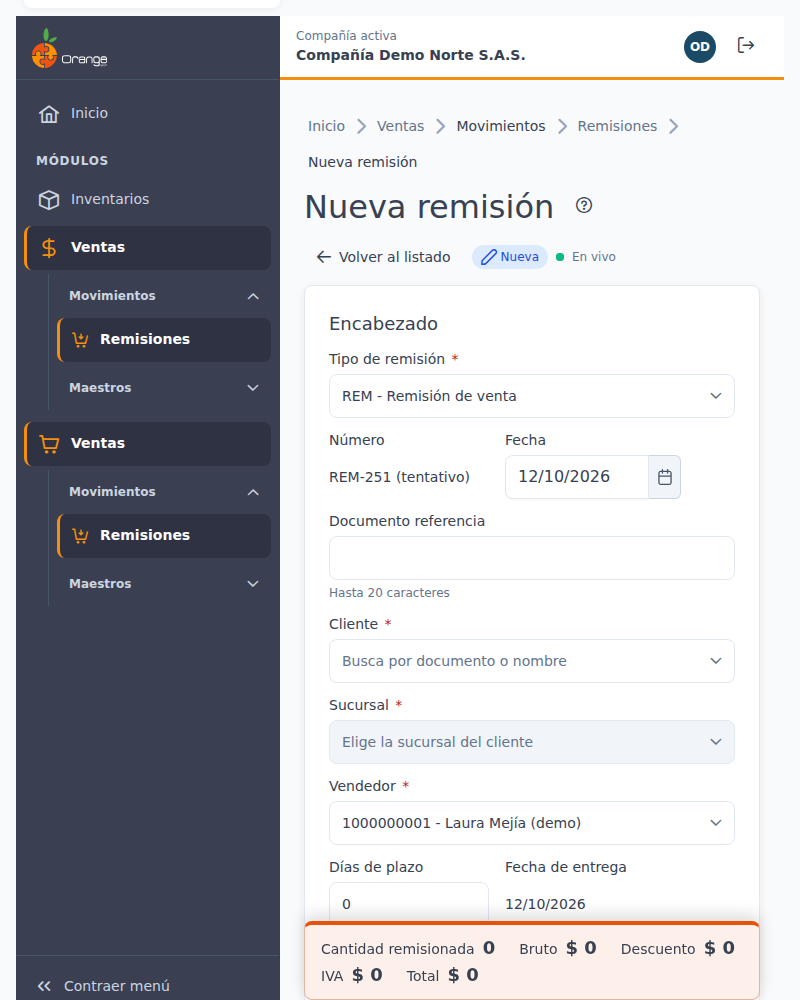

### Datos del encabezado

| Campo | Regla |
|-------|-------|
| **Tipo de remisión** | Obligatorio. No se cambia después de crear la remisión. |
| **Cliente** | Obligatorio. Debe estar activo. Se busca por documento o nombre. |
| **Sucursal** | Obligatoria si el cliente tiene sucursales. Solo muestra las del cliente elegido. |
| **Vendedor** | Opcional. Se precarga desde la sucursal y se puede cambiar. |
| **Fecha** | Obligatoria. Debe estar en un periodo abierto. |
| **Días de plazo** | Número entero de 0 a 365. Se precarga con los días de plazo del cliente. |
| **Documento referencia** | Opcional. Número de referencia que acompaña la remisión. |
| **Observaciones** | Opcional. Hasta 200 caracteres. **No use comas (,) ni punto y coma (;).** |

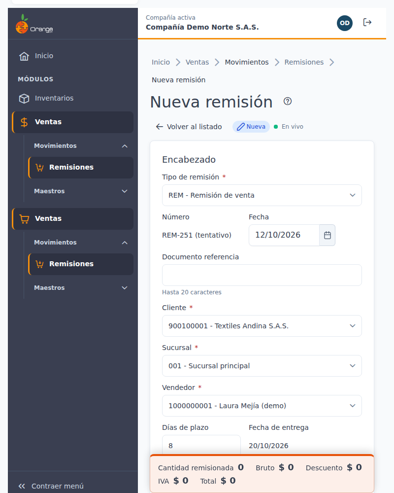

---

## ⌨️ Captura línea a línea

En una remisión no hay botón *Guardar documento*. **Cada línea se guarda en el momento en que la confirma.** Así, si la red falla, solo se pierde la línea que estaba escribiendo.

La fila de captura sigue este orden. Con **Enter** avanza al siguiente campo; en el último campo, guarda la línea:

**Referencia / variante → Bodega → Centro de costos (si el tipo lo exige) → Cantidad → Valor unitario → % Dto. (si el tipo lo liquida)**

| Campo | Regla |
|-------|-------|
| **Referencia / variante** | Obligatorio. Se busca por código o nombre. |
| **Bodega** | Obligatoria. Es la bodega de la que sale la mercancía. |
| **Centro de costos** | Solo si el tipo de remisión lo exige. |
| **Cantidad** | Mayor que 0. Si el tipo descuenta existencias, no puede pasar de la existencia de la bodega (ver [Existencias](#existencias)). |
| **Valor unitario** | Mayor que 0. Se propone el valor de la lista de precios de la sucursal (ver [Valor por lista de precios](#precios)). |
| **% Dto.** | De 0 a 100. Por defecto, el descuento comercial del cliente, si el tipo liquida descuento. |

El **IVA** se toma de la referencia y del tipo de remisión; usted no lo escribe. El **Total** de la línea se calcula solo.

### Estados de cada línea

| Estado | Qué significa | Qué puede hacer |
|--------|---------------|-----------------|
| **En cola** | Se va a guardar. | Espere. |
| **Guardando…** | Se está guardando. | Espere. |
| **Guardada** | Quedó guardada. | Editarla o quitarla. |
| **Error** | El sistema no la aceptó. Se muestra el motivo. | **Corregir** o **Descartar**. |
| **No se guardó** | Se perdió la conexión. | **Reintentar**. |
| **Conflicto** | Otra persona cambió esta línea. | **Usar la versión actual** o **Descartar**. |

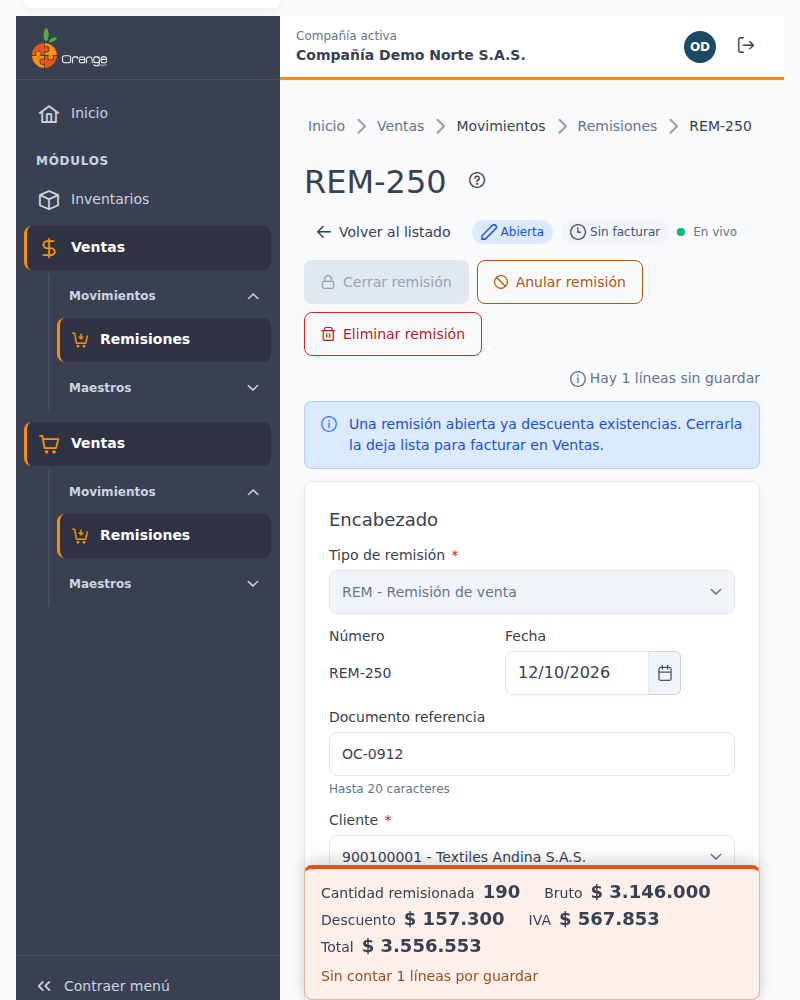

### Valor por lista de precios de la sucursal

Cuando elige la sucursal, la pantalla usa su **lista de precios** (de la 1 a la 5) para sugerir el **valor unitario** de cada variante:

- Si la variante tiene precio en la lista de la sucursal, ese es el valor sugerido.
- Si la variante **no tiene precio** en esa lista, la pantalla propone el **costo sugerido** y muestra el aviso **sin precio en la lista de la sucursal**. Revise ese valor antes de guardar.
- Si usted ya escribió un valor, la pantalla **no lo cambia**.

El valor sugerido se redondea según la configuración del tipo de remisión. Puede cambiarlo en cada línea.

### Existencia y bloqueo

Si el **tipo de remisión mueve inventario** y **no permite existencias negativas**, la pantalla no le deja sacar más unidades de las que hay en la bodega:

- Al escribir la cantidad, la fila muestra la **existencia** de esa variante en la bodega elegida.
- Si la cantidad es mayor que la existencia, la línea **no se guarda** y verá: **«No hay existencia suficiente: disponible N, faltan X. La línea no se guardó.»**
- Si dos personas sacan la misma existencia al mismo tiempo, solo una línea se guarda; la otra recibe el mismo aviso.

Si el tipo **no mueve inventario**, o **sí permite existencias negativas**, la pantalla no bloquea la cantidad. En ese último caso verá el aviso **«esta cantidad dejará la existencia en negativo»** antes de guardar.

> 💡 Con un tipo que mueve inventario, cada línea descuenta existencias al guardarla, aunque la remisión todavía esté abierta. Si el tipo no mueve inventario, la remisión no cambia las existencias.

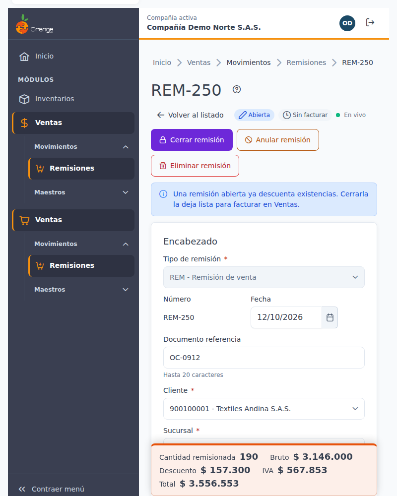

---

## 🧩 Captura por matriz de tallas y colores

Cuando una referencia tiene variantes (por ejemplo, talla y color), no hace falta capturar una línea por cada una:

1. En la fila de captura, elija **Bodega** (y **Centro de costos**, si el tipo lo exige).
2. Pulse **Matriz**.
3. Busque y elija la referencia. Se muestra una cuadrícula con la **talla** en las filas y el **color** en las columnas.

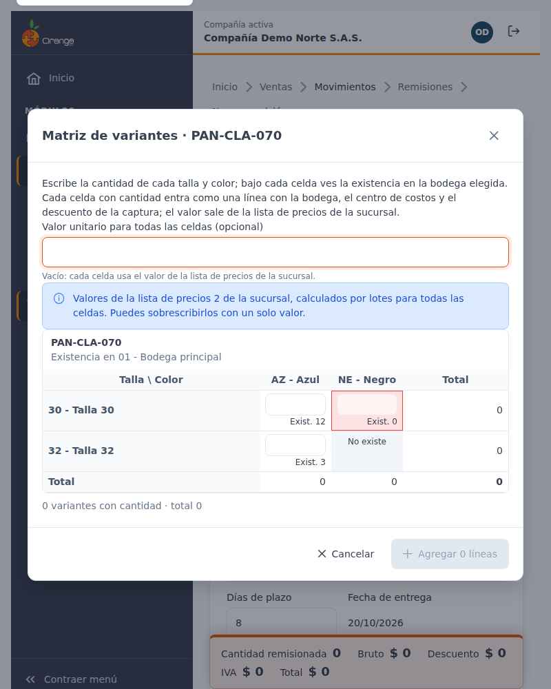

4. Cada celda muestra la **existencia** de esa variante en la bodega. Escriba la **cantidad** en las celdas que quiera despachar. Las celdas vacías no generan línea.
5. Revise el **valor de cada celda**. Si una celda no tiene precio en la lista de la sucursal, verá el aviso de **sin precio** (costo sugerido).

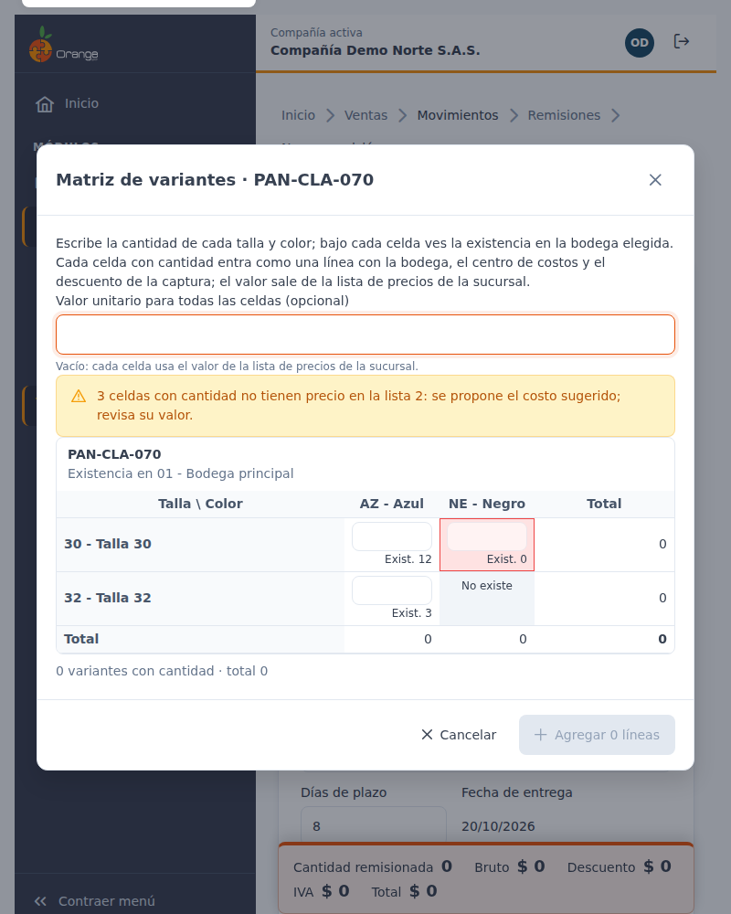

6. Si quiere **un solo valor para todas las celdas**, escríbalo en **Valor unitario para todas las celdas (opcional)**. Ese valor reemplaza el de la lista en todas las celdas con cantidad.
7. Acepte. **Cada celda con cantidad entra como una línea**, con la bodega, el centro de costos y el descuento de la captura.

Reglas de la matriz:

- En un tipo que descuenta existencias sin negativos, una celda con existencia **0** aparece marcada y no admite cantidad. Una celda con existencia **3** no admite más de 3.

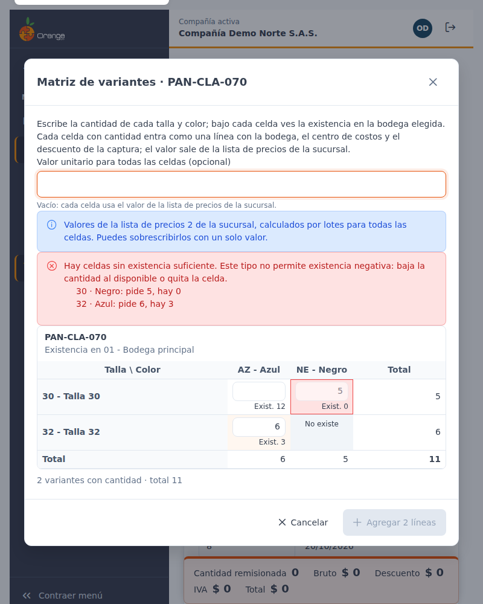

- En un tipo que permite existencias negativas, las celdas no se bloquean por existencia.

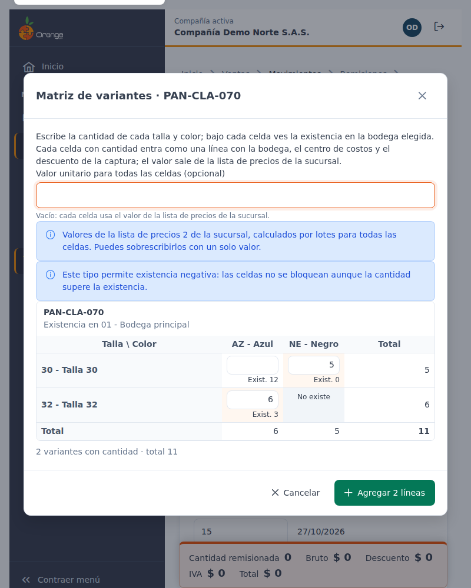

- Si la cantidad total de celdas supera las líneas que admite el tipo de remisión, la pantalla bloquea **Agregar líneas** y le explica el máximo.

> 💡 El botón **Matriz** solo aparece si tiene permiso para crear o actualizar remisiones. Si la referencia no tiene variantes, capture la línea normal.

---

## ✏️ Editar una remisión

- Una remisión **abierta** se edita directamente: encabezado y líneas.
- Una remisión **cerrada** solo se edita si su usuario tiene el permiso especial **Editar documentos cerrados** y la fecha de la remisión está en un periodo abierto. El cambio queda en la bitácora.
- Una remisión **congelada o anulada** no se edita.

Si la fecha de la remisión cae en un periodo cerrado, la pantalla no guarda el cambio y lo indica.

---

## 🔒 Cerrar una remisión

**Cerrar remisión** deja la remisión lista para imprimir, entregar y facturar. Cuando la cierra, la remisión queda **de solo lectura** y pasa a ser elegible para facturarse.

1. Confirme en el diálogo **Cerrar remisión**.
2. La remisión queda cerrada: se ocultan los botones de agregar líneas y adjuntar, y aparece **Imprimir**.

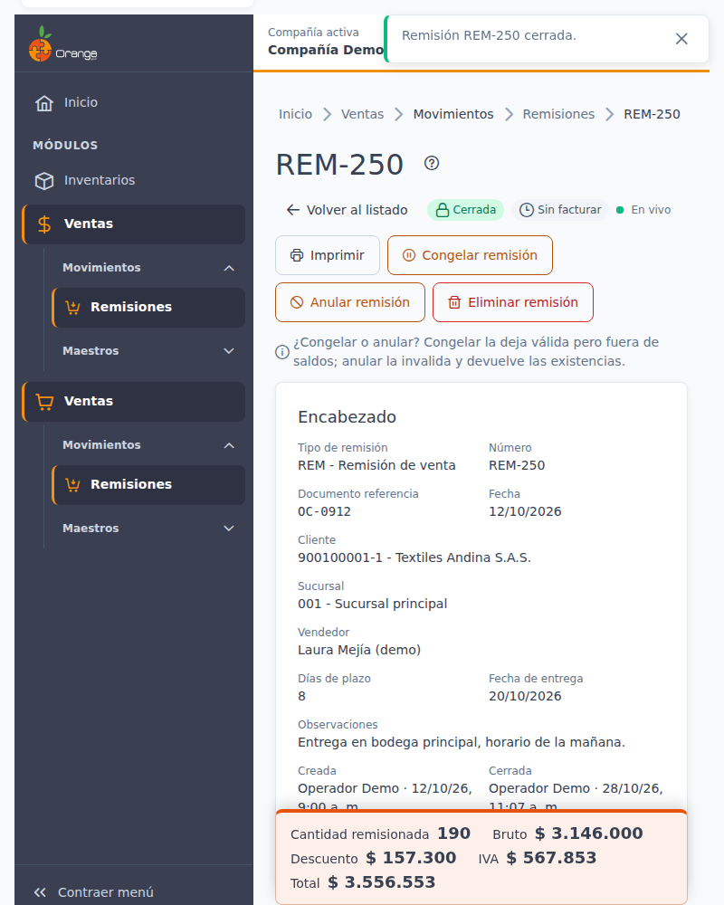

Para cerrar, debe tener permiso para actualizar remisiones y tener al menos una línea guardada. Cerrar una remisión que ya está cerrada no hace nada ni repite el registro.

---

## 🧊 Congelar o anular

Son dos acciones distintas. Antes de elegir, pregúntese: **¿la mercancía salió del inventario?**

| | **Congelar remisión** | **Anular remisión** |
|--|------------------------|----------------------|
| **Cuándo se usa** | La mercancía **sí salió**, pero la remisión ya no se debe tener en cuenta. | La remisión **no debió existir**: el despacho no ocurrió. |
| **Sobre qué remisión** | Solo remisiones **cerradas**. | Remisiones **abiertas o cerradas** que no estén congeladas. |
| **Estado resultante** | **Congelada**: sigue siendo válida. | **Anulada**: deja de ser válida. |
| **Existencias** | **No** se devuelven. | **Sí** vuelven al inventario. |
| **Saldos y facturación** | Deja de contar en saldos y de ofrecerse para facturar. | Deja de contar en saldos y resúmenes. |
| **Con facturas ligadas** | **Se permite.** Las facturas ya emitidas siguen válidas. | **Se bloquea.** Primero deben estar anuladas las facturas ligadas. |
| **Motivo** | Obligatorio: de 1 a 200 caracteres, sin comas ni punto y coma. | Obligatorio: de 1 a 200 caracteres, sin comas ni punto y coma. |
| **Permiso** | **Actualizar** de Remisiones. | **Anular** de Remisiones. |
| **¿Se puede deshacer?** | No. Una congelada no se descongela. | No. |

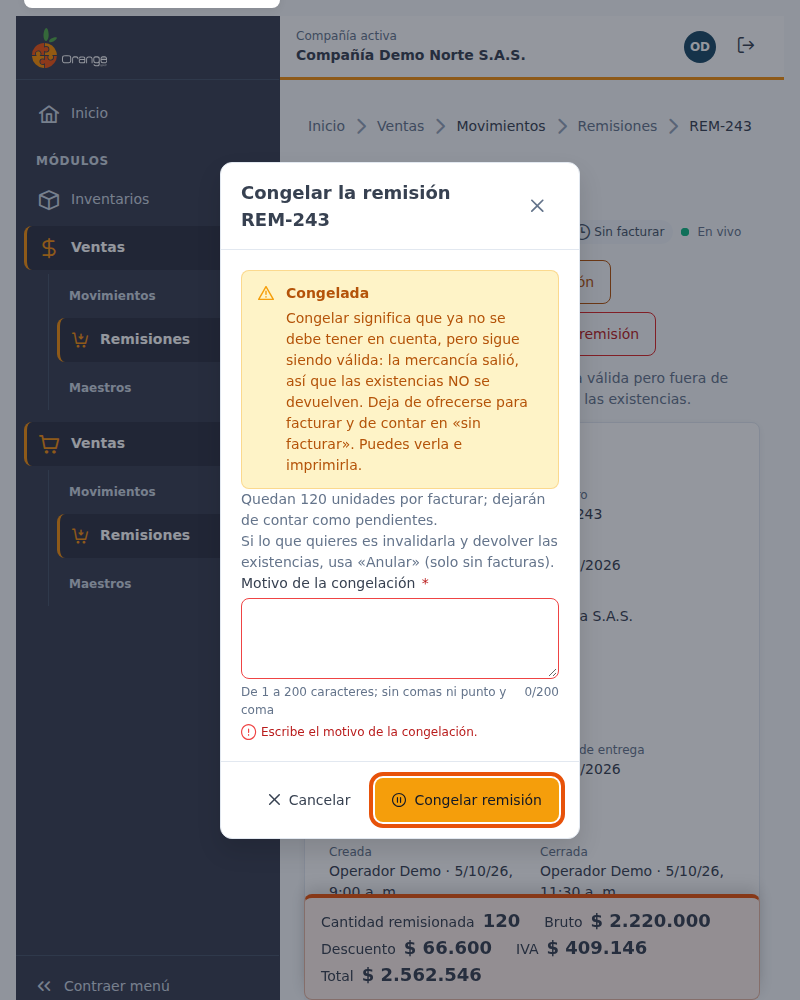

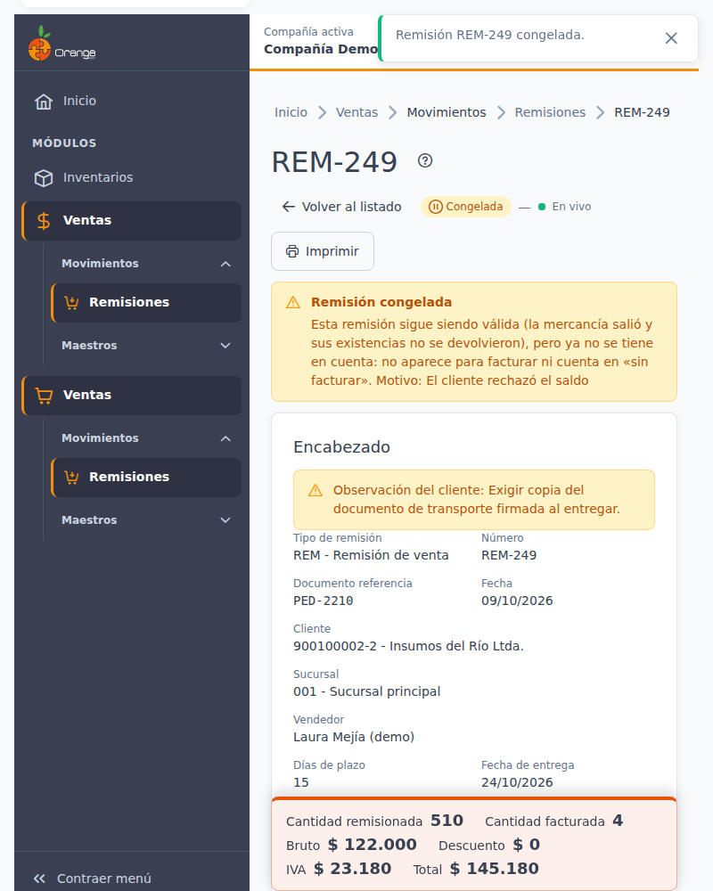

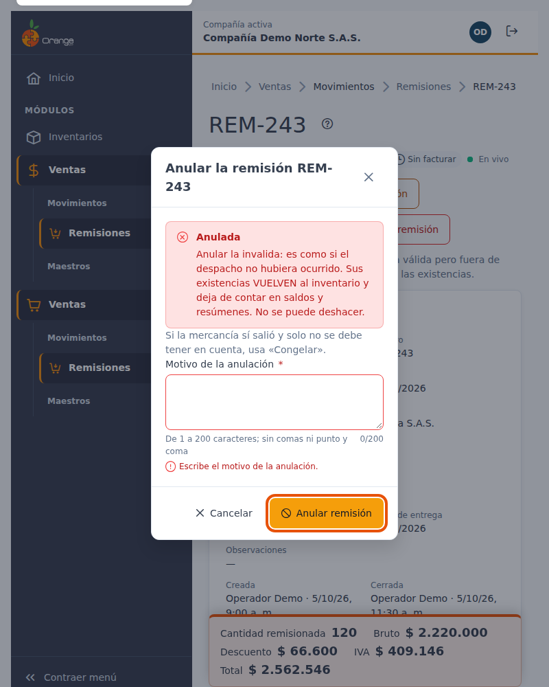

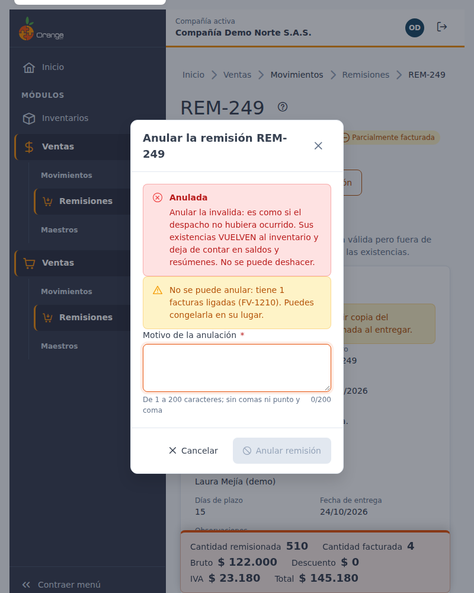

### Cómo se ven en la pantalla

Las dos insignias son distintas, con ícono y texto, para que no se confundan:

- **Congelada**: ícono de pausa y color **ámbar**. Sigue siendo un documento válido.
- **Anulada**: ícono de prohibido y color **rojo**. Ya no es un documento válido.

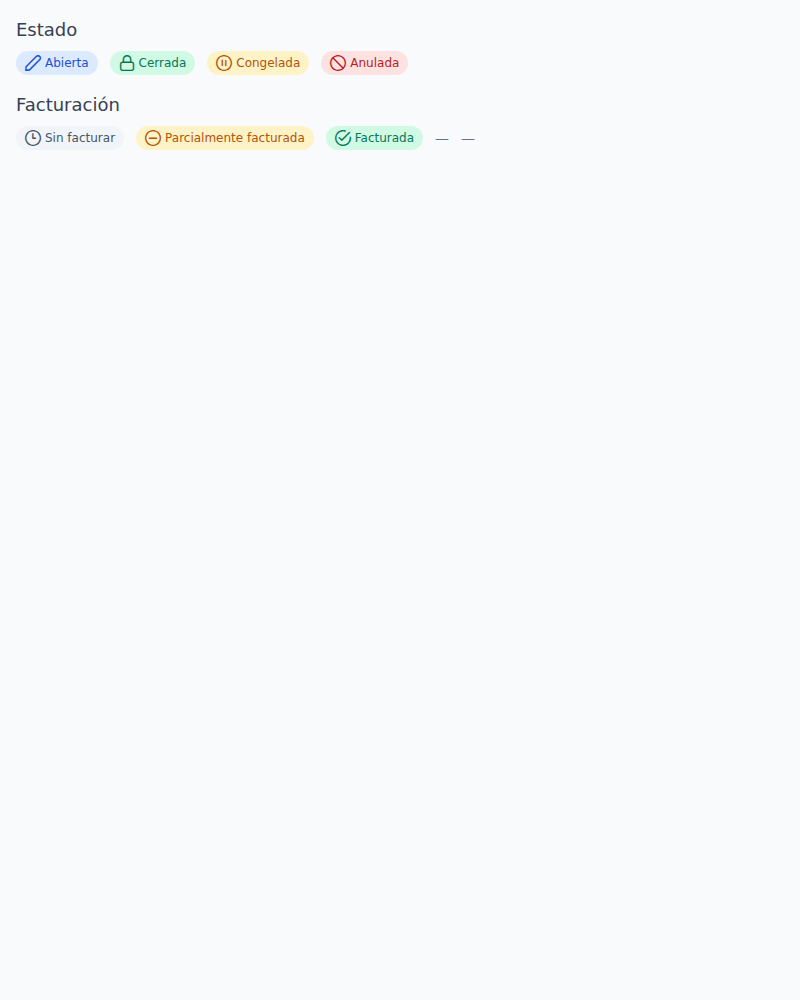

Una remisión **congelada** muestra su motivo, su usuario y su fecha. Su facturación aparece como **—**, porque ya no se factura.

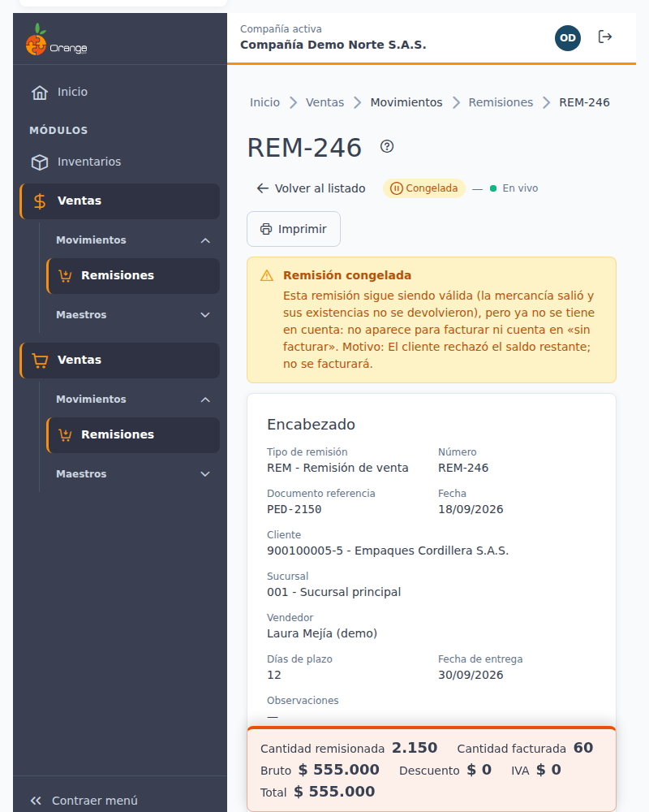

Una remisión **anulada** muestra el motivo, el usuario y la fecha de la anulación. Tampoco tiene facturación.

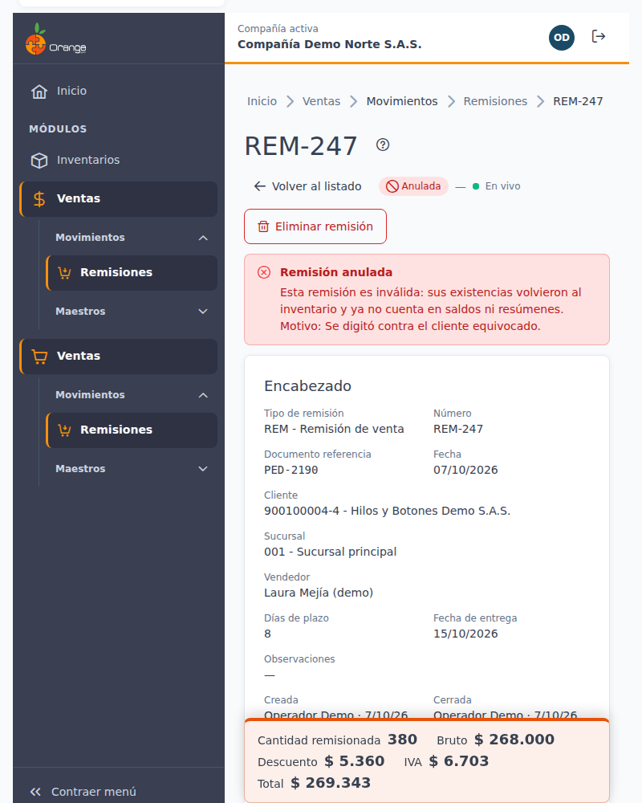

### Una remisión congelada

- No se edita: ni encabezado, ni líneas, ni adjuntos, ni cierre.
- No se anula ni se elimina. Si necesita corregirla, no hay botón para hacerlo desde aquí: consulte con quien administra las ventas.
- Sí se ve, se imprime y se puede consultar su bitácora.

### Eliminar

**Eliminar remisión** borra la remisión de forma definitiva, con sus líneas y sus adjuntos, y sus existencias vuelven al inventario. Pide escribir el número de la remisión para confirmar.

- **No se permite** si la remisión tiene facturas ligadas. Puede congelarla en su lugar.
- **No se permite** en una remisión congelada.

Si solo quiere que deje de contar, **congélela o anúlela**: no la elimine.

> 💡 Ni anular ni eliminar se pueden deshacer. Si la mercancía sí salió y la remisión solo debe dejar de contar, **congélela**.

---

## 🖨️ Imprimir

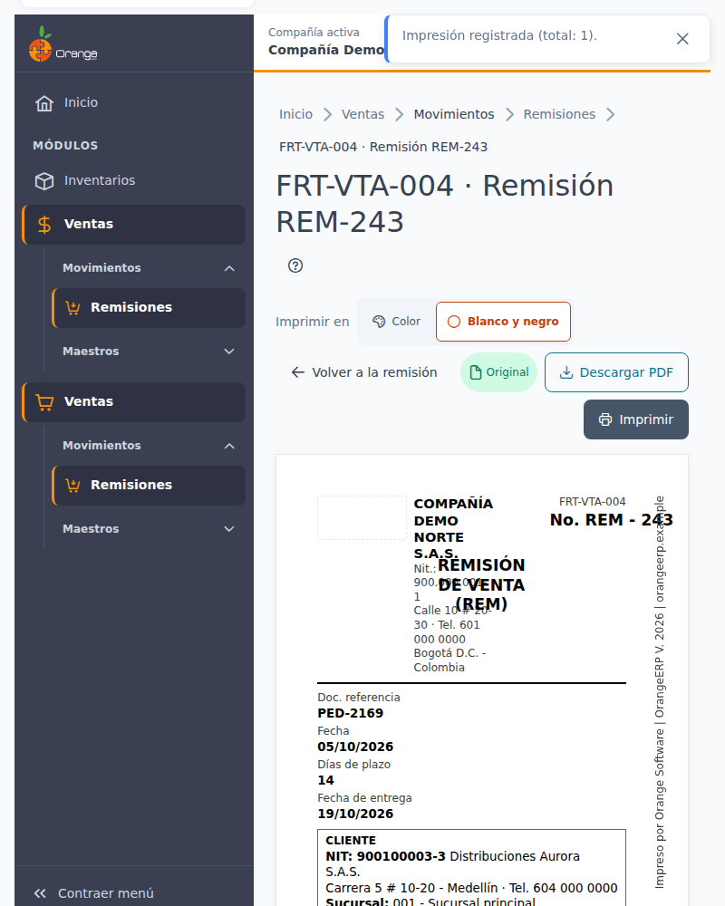

Solo se imprimen remisiones **cerradas** o **congeladas**. Las abiertas y las anuladas no se imprimen. El botón **Imprimir** aparece en el documento y en el listado.

1. Abra la remisión y haga clic en **Imprimir**.
2. Elija el papel.
3. Haga clic en **Imprimir** para mandarla a la impresora, o en **Descargar PDF** para guardarla.

El formato es **FRT-VTA-004**. Incluye la empresa, el número de la remisión, el documento de referencia, las fechas, el cliente con su sucursal, el vendedor, las líneas con sus valores y totales, el valor en letras, la información tributaria, un espacio de **firma de recibido** y el aviso de habeas data.

- La **primera** impresión lleva la marca **Original**. Las siguientes llevan la marca **Copia**.

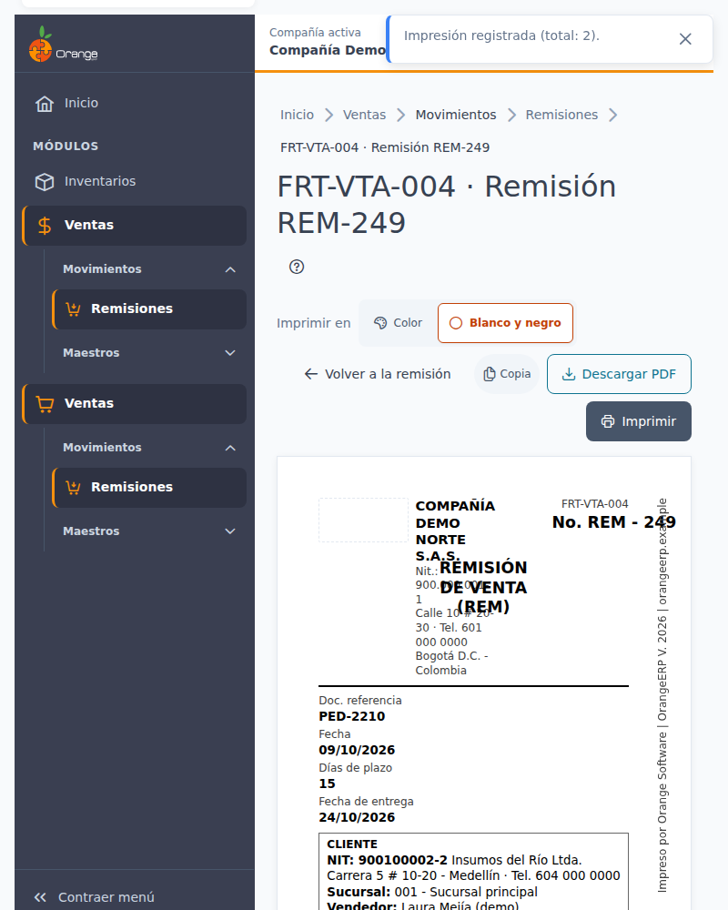

- Una remisión **congelada** se imprime, pero sale con la marca **Remisión congelada: sigue siendo un documento válido**.

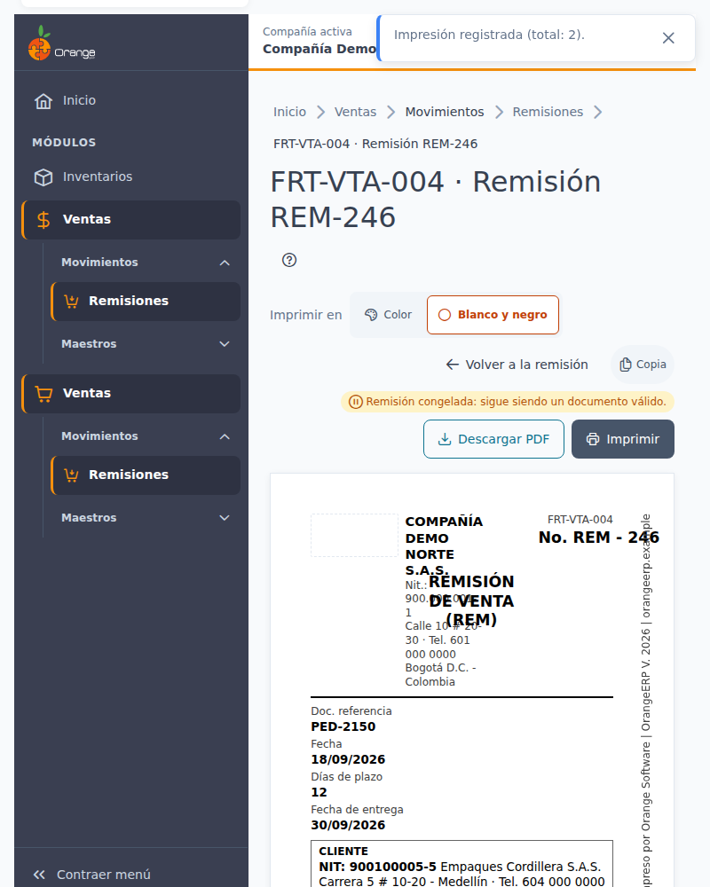

- Cada impresión queda registrada y se cuenta una sola vez, aunque abra la vista varias veces. **Descargar PDF** también cuenta como impresión.
- Para volver a la remisión, use **Volver a la remisión**.

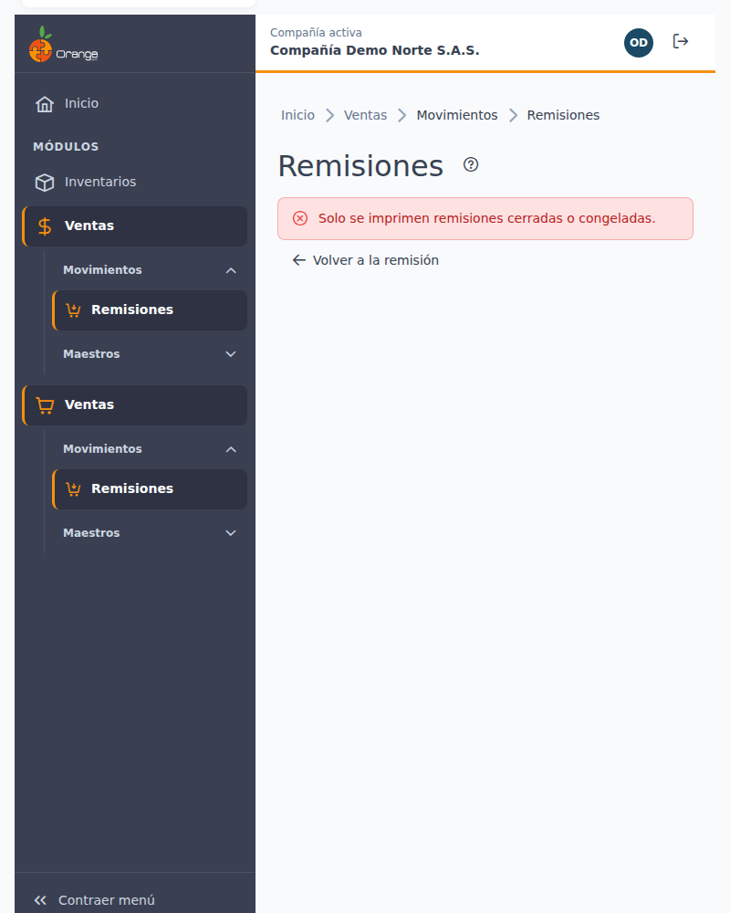

### ¿Qué puede salir mal?

- **«Solo se imprimen remisiones cerradas o congeladas.»**: cierre la remisión primero. Una anulada no se imprime.
- **No ve el botón Imprimir**: su usuario no tiene el permiso **Imprimir** sobre Remisiones.
- **«No se pudo generar el PDF.»**: intente de nuevo o use **Imprimir**.

---

## 📎 Adjuntos

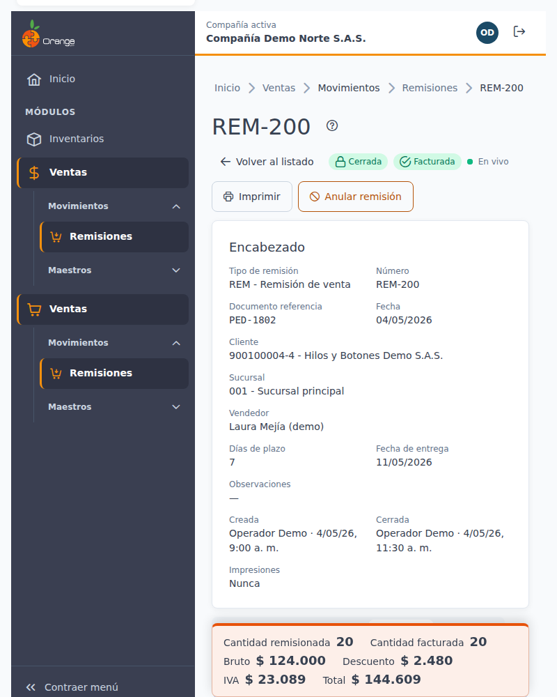

Puede adjuntar archivos a la remisión, por ejemplo la orden firmada del cliente o una foto de la entrega.

- Solo puede **adjuntar y quitar** archivos en una remisión **abierta**.
- Cada adjunto lleva una **descripción** corta.
- El espacio de adjuntos es de **10 MB por remisión**. La pantalla muestra cuánto va usado. Si el archivo no cabe, no se guarda.
- En una remisión **cerrada**, **congelada** o **anulada** los adjuntos solo se consultan.
- Al eliminar la remisión se eliminan también sus adjuntos.

---

## 📜 Bitácora

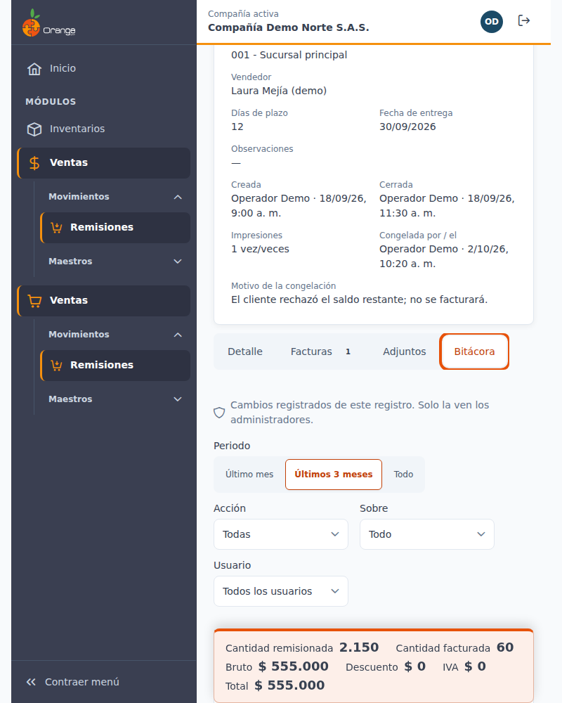

La pestaña **Bitácora** registra quién y cuándo hizo cambios importantes en la remisión: su creación, sus cambios, el cierre, la congelación, la anulación y las impresiones. Cada registro se puede abrir para ver el detalle.

---

## 🔄 Cambios de otros usuarios (en vivo)

La pantalla se actualiza sola cuando otro usuario cambia algo de las remisiones:

- **Otro usuario creó, modificó o eliminó una remisión:** aparece un aviso en el listado. Haga clic en **Actualizar** para ver los cambios.
- **Otro usuario modificó la remisión que tiene abierta:** aparece el aviso de cambios, y debe **Actualizar** para verlos.
- **Otro usuario congeló o anuló la remisión:** aparece el aviso con el estado nuevo. El creador de la remisión también recibe el aviso.
- **Otro usuario eliminó la remisión:** aparece el aviso y debe volver al listado.
- **Conflicto en una línea:** si otra persona cambió la línea que usted editaba, la línea muestra **Conflicto**. Elija **Usar la versión actual** o **Descartar**.
- **Sin conexión:** la pantalla lo indica y reintenta sola cuando vuelve la conexión.

---

## 🔐 Permisos

¿No ve algún botón? Cada acción depende de los permisos de su perfil **en la opción de Remisiones**. Los permisos de Pedidos no cuentan para esta pantalla.

| Permiso | Opción | Qué habilita |
|---------|--------|--------------|
| Consultar | Remisiones | Ver el listado, abrir las remisiones, sus facturas y su bitácora. |
| Crear | Remisiones | **Nueva remisión**, la captura de líneas y la **Matriz**. |
| Actualizar | Remisiones | Agregar, cambiar y quitar líneas; cambiar el encabezado; **Cerrar remisión**; **Congelar remisión**; adjuntar archivos en remisiones abiertas. |
| Anular | Remisiones | **Anular remisión**. |
| Eliminar | Remisiones | **Eliminar remisión**. |
| Imprimir | Remisiones | **Imprimir** y **Descargar PDF**. |
| Editar documentos cerrados (permiso especial del usuario) | Remisiones | Editar una remisión cerrada con periodo abierto. |

Los tipos de remisión que aparecen en la pantalla son solo los que tiene autorizados su usuario.

---

## ⚠️ Mensajes frecuentes

| Mensaje | Qué pasó | Qué hacer |
|---------|----------|-----------|
| **«No hay existencia suficiente: disponible N, faltan X. La línea no se guardó.»** | La cantidad es mayor que la existencia de la bodega. | Baje la cantidad, elija otra bodega o confirme con inventarios. |
| **«La remisión está congelada y es de solo lectura: no se edita, cierra, anula ni elimina.»** | Intentó cambiar una remisión congelada. | Consúltela o imprímala. No se puede cambiar. |
| **«No se puede anular ni eliminar: tiene N facturas ligadas (FV-…). Puedes congelarla en su lugar.»** | Las facturas ligadas bloquean la anulación y la eliminación. | Use **Congelar remisión**, que sí se permite con facturas. |
| **«La remisión no se puede modificar: el periodo de la fecha está cerrado o su estado no lo permite.»** | La fecha está en un periodo cerrado, o la remisión está en un estado que no permite el cambio. | Revise la fecha del periodo con quien administra la contabilidad. |
| **«La fecha está en un periodo cerrado; no se guardó.»** | La fecha de la remisión está en un periodo cerrado. | Cambie la fecha a un periodo abierto. |
| **«Solo se congela una remisión cerrada que no esté anulada.»** | Intentó congelar una remisión abierta, anulada o ya congelada. | Cierre la remisión primero. Si ya está congelada, no hace falta congelarla otra vez. |
| **«Una remisión congelada no se anula desde aquí.»** | Intentó anular una remisión congelada. | Una congelada no se anula. Si la mercancía no salió, consulte con quien administra las ventas. |
| **«La remisión ya estaba anulada.»** o **«La remisión ya estaba congelada.»** | Otra persona ya hizo la acción. | Actualice la pantalla para ver el estado actual. |
| **«Otra persona cambió esta línea. Revisa la versión actual.»** | Otro usuario cambió la misma línea. | Use **Usar la versión actual** o **Descartar**. |
| **«Demasiadas eliminaciones seguidas; espere un minuto.»** | El sistema limita las eliminaciones por minuto. | Espere y vuelva a intentar. |
| **«La remisión ya no existe.»** | Otra persona la eliminó, o el enlace es antiguo. | Vuelva al listado. |

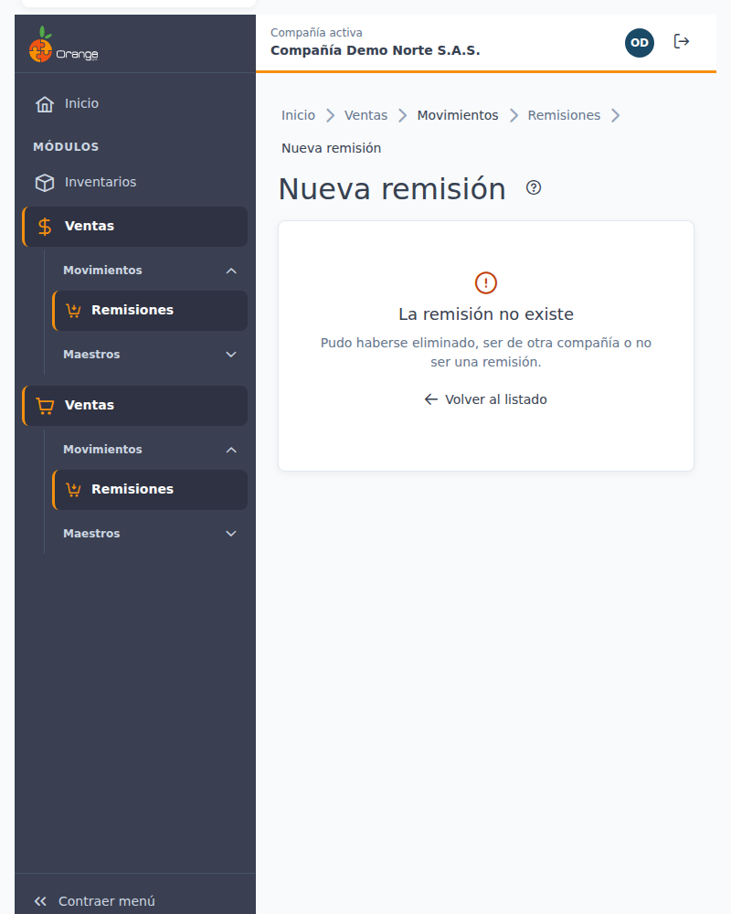

---

## ❓ Preguntas frecuentes

**¿Cuál es la diferencia entre congelar y anular?**
Congelar deja la remisión válida pero fuera de los saldos; la mercancía salió y no se devuelve. Anular la invalida y devuelve las existencias. Consulte la sección [Congelar o anular](#congelar-anular).

**Congelé una remisión por error. ¿Puedo deshacerlo?**
No. Una remisión congelada no se descongela. Consulte con quien administra las ventas.

**Quiero anular una remisión que tiene factura. ¿Qué hago?**
La anulación se bloquea mientras tenga facturas ligadas no anuladas. Si la mercancía sí salió, use **Congelar remisión**, que sí se permite con facturas.

**¿Por qué no puedo congelar una remisión?**
Solo se congela una remisión **cerrada**. Ciérrela primero. Además, su usuario necesita el permiso **Actualizar** de Remisiones.

**¿Por qué no veo el botón Anular?**
Porque su usuario no tiene el permiso **Anular**, o porque la remisión está congelada o ya anulada.

**Antes usaba «Congelar» para anular. ¿Qué uso ahora?**
Use **Anular remisión** cuando la remisión no debió existir y las existencias deben volver. Use **Congelar remisión** cuando la mercancía sí salió.

**¿Por qué una remisión abierta ya descontó existencias?**
Porque el tipo de remisión mueve inventario: cada línea descuenta al guardarla. Si el tipo no mueve inventario, la remisión no cambia las existencias.

**¿Por qué el valor de una línea aparece con el aviso «sin precio en la lista de la sucursal»?**
Porque la variante no tiene precio en la lista de la sucursal. La pantalla propone el costo sugerido; revise el valor antes de guardar.

**¿Por qué no puedo editar una remisión cerrada?**
Su usuario necesita el permiso especial **Editar documentos cerrados**, y la fecha de la remisión debe estar en un periodo abierto.

**¿Por qué no veo el botón Matriz?**
Porque su usuario no tiene permiso para crear o actualizar remisiones.

---

## 📚 Relacionado

- [Ventas](../readme.md): índice del módulo.
- [Pedidos de venta](pedidos.md): lo que el cliente pidió y aún no ha salido.
- [Clientes](../maestros/clientes.md): condiciones, sucursales y lista de precios de cada cliente.
- [Vendedores](../maestros/vendedores.md): quién aparece como vendedor en la remisión.
- [Ficha del cliente · Remisiones](../clientes/ficha-remisiones.md): las remisiones de un cliente.
- [Disponibilidad de Inventarios](../../inventarios/consultas/disponibilidad.md): dónde se ven las existencias.
- [Manejo general de la información](../../Generales/manejo-general-informacion.md): búsqueda, orden, paginación y ayuda.

---

[← Volver al índice de ventas](../readme.md)
