[Regresar a Ventas](../readme.md)

---

# 🧾 Ventas y devoluciones

---

## 📋 Descripción

Esta pantalla sirve para **vender**, **devolver** y **emitir notas crédito** a los clientes de la compañía. Una sola pantalla maneja los tres casos: lo que determina si el documento es una venta, una devolución o una nota crédito es el **tipo de documento** que elija.

Quién la usa:

- **Facturador o cajero**: captura la venta con el teclado o con el lector de código de barras, la cierra e imprime.
- **Jefe de ventas o de cartera**: filtra el listado, revisa el resumen, reenvía a la DIAN las facturas pendientes o con error y anula lo que corresponda.
- **Contabilidad**: confía en que una factura transmitida a la DIAN no se altera. Lo que se corrige se corrige con una nota crédito o una devolución.

En esta pantalla puede **consultar, crear, editar, cerrar, anular, eliminar, imprimir y exportar** documentos, y **seguir la factura electrónica** de cada venta. Trabaje siempre con la compañía que aparece en la barra superior.

> 📘 La búsqueda, el orden y la paginación de las tablas funcionan igual que en el resto de la aplicación: ver [Manejo general de la información](../../Generales/manejo-general-informacion.md).

> ⚠️ **Una factura transmitida a la DIAN no se edita, no se anula y no se elimina.** Para corregirla, cree una **nota crédito** o una **devolución** (ver [Devoluciones y notas crédito](#devoluciones)).

---

## 🎯 Acceso

1. En el menú principal, haga clic en **Ventas**.
2. En **Movimientos**, haga clic en **Ventas y devoluciones**.

Si no ve la opción en el menú, su usuario no tiene permiso para consultar esta pantalla. Pida acceso a un administrador de la compañía.

---

## 🔐 Permisos por acción

Los botones que ve dependen de los permisos de su usuario y del estado del documento. La pantalla solo muestra lo que puede hacer; el servidor vuelve a revisar cada acción antes de guardarla.

| Permiso | Qué le permite |
|---------|----------------|
| **Consultar** | Ver el listado, abrir un documento y ver su estado de factura electrónica. |
| **Crear** | Crear una venta, una devolución o una nota crédito, y facturar desde un pedido o desde remisiones. |
| **Actualizar** | Capturar y cambiar líneas de un documento abierto, cerrarlo y reenviar a la DIAN una factura pendiente o con error. |
| **Editar documento cerrado** | Cambiar una línea existente de un documento cerrado (ver [Editar un documento cerrado](#editar-cerrado)). |
| **Anular** | Anular un documento que aún puede anularse. |
| **Eliminar** | Eliminar un documento que no tiene documentos dependientes. |
| **Imprimir** | Imprimir y ver la vista previa de un documento. |
| **Administrador de la compañía** | Verificar en el proveedor tecnológico y, si hace falta, restablecer o reenviar una factura que ya está transmitida a la DIAN (ver [Facturación electrónica](#fe)). |

> 💡 Si su usuario solo tiene **Consultar**, el listado y los documentos aparecen, pero no verá botones como **Nueva venta**, **Editar**, **Anular** o **Eliminar**.

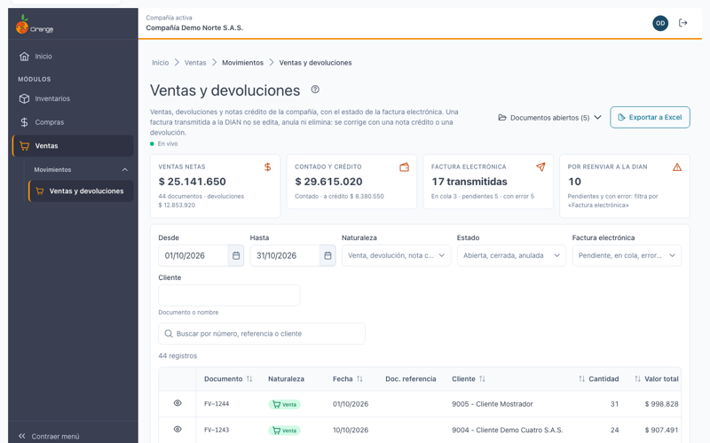

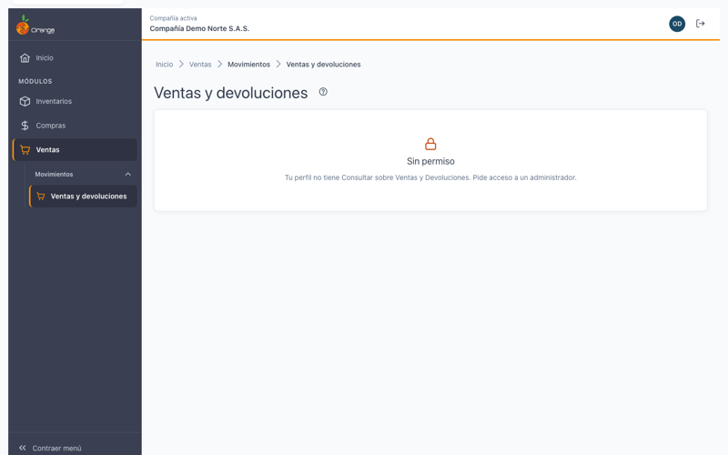

---

## 🖥️ Pantalla principal: el listado

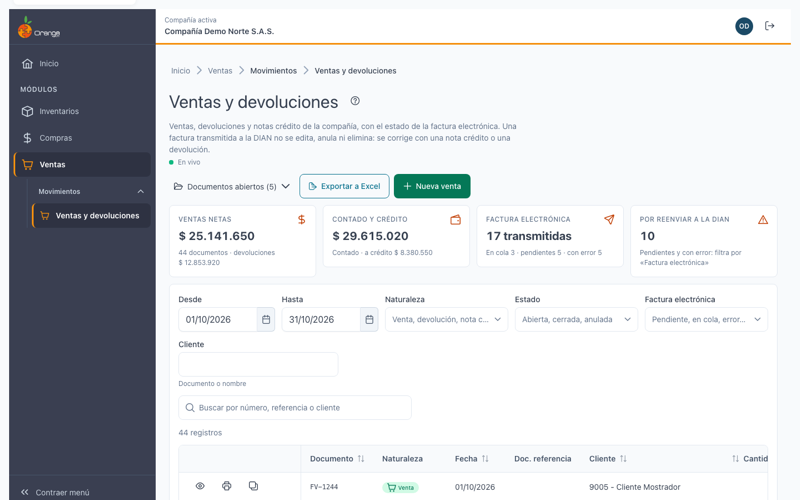

Si todavía no hay documentos en el rango elegido, la tabla aparece vacía. Cambie las fechas para buscar en otro periodo.

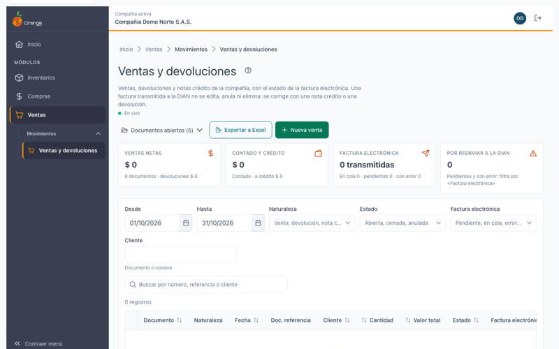

El listado muestra las ventas, devoluciones y notas crédito de la compañía, con el **Resumen del filtro** arriba:

| Tarjeta | Qué muestra |
|---------|-------------|
| **Ventas netas** | Lo vendido menos las devoluciones del filtro. El texto debajo muestra las ventas brutas y las devoluciones. |
| **Contado y crédito** | Cuánto se vendió de contado y cuánto a crédito. |
| **Factura electrónica** | Cuántas facturas están transmitidas a la DIAN, y cuántas están pendientes, en cola o con error. |
| **Por reenviar a la DIAN** | Facturas pendientes de enviar y con error. |

Si el resumen no se puede calcular, la tabla sigue funcionando y el resumen muestra **Reintentar**.

### Filtros

Los filtros están arriba de la tabla y quedan en la dirección de la página, para que pueda compartir la vista:

- **Desde** y **Hasta**: fechas del documento. Por defecto es el mes en curso.
- **Naturaleza**: *Venta*, *Devolución* o *Nota crédito*.
- **Estado**: *Abierta*, *Cerrada* o *Anulada*.
- **Factura electrónica**: *Pendiente de enviar*, *En cola*, *Transmitida a la DIAN* o *Error al enviar*. Para filtrar por factura electrónica debe indicar **Desde** y **Hasta**, con un rango de no más de 366 días.
- **Cliente**: por documento o nombre.
- **Buscar**: por número, documento de referencia o cliente. Escriba al menos 2 caracteres.

Si el rango de fechas está mal (por ejemplo, **Desde** es posterior a **Hasta**), la pantalla lo marca en rojo y no busca.

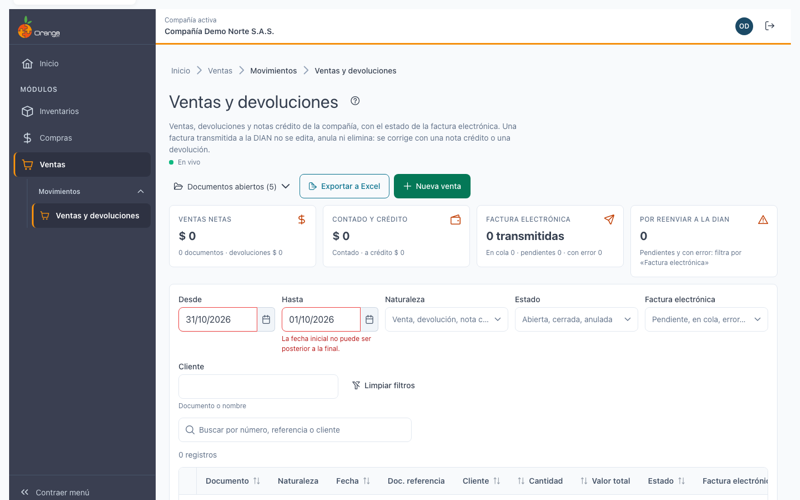

Para quitar todos los filtros, use **Limpiar filtros**.

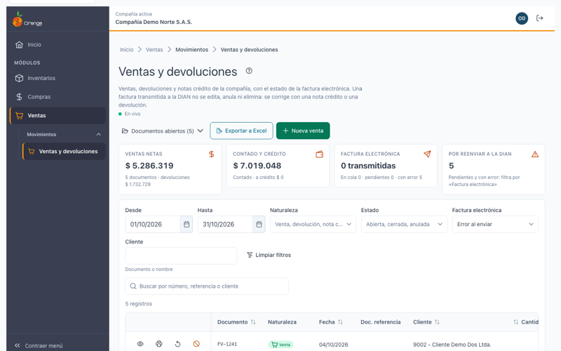

### Columnas

Cada fila muestra el **documento** (por ejemplo, *FV-1205* para una factura o *DV-1204* para una devolución), la **naturaleza**, la **fecha**, el **documento de referencia**, el **cliente**, la **cantidad**, el **valor total**, el **estado** y el **estado de la factura electrónica**. El estado siempre lleva texto además del color.

### Estados del documento

| Estado | Qué significa |
|--------|---------------|
| **Abierta** | Se puede seguir capturando. |
| **Cerrada** | Quedó de solo lectura (ver [Cerrar el documento](#cerrar)). |
| **Anulada** | Se anuló y no afecta inventario, cartera ni contabilidad. Se conserva para consulta. |

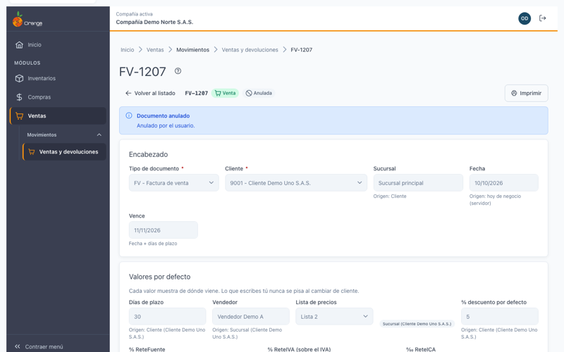

### Estados de la factura electrónica

| Estado | Qué significa |
|--------|---------------|
| **No aplica** | El tipo de documento no es de factura electrónica, o la compañía no tiene proveedor tecnológico configurado. |
| **Pendiente de enviar** | El documento está cerrado, pero la factura todavía no se envió a la DIAN. |
| **En cola** | El envío está en curso, en segundo plano. |
| **Transmitida a la DIAN** | La factura ya se envió. Ya no se puede editar, anular ni eliminar. |
| **Error al enviar** | El último intento falló. Vea el motivo y reenvíe la factura. |

### ¿Qué puedo hacer desde una fila?

Cada fila tiene botones con nombre, por ejemplo **Anular FV-1205**. Aparecen solo si su usuario tiene el permiso y el documento lo permite:

| Botón | Cuándo aparece |
|-------|----------------|
| **Ver** | Siempre que tenga permiso para consultar. |
| **Imprimir** | Con el permiso de imprimir. También para documentos abiertos, como vista previa. |
| **Editar** | Documentos abiertos, con el periodo abierto y sin documentos dependientes. |
| **Reenviar a la DIAN** | Facturas pendientes de enviar o con error. |
| **Crear nota crédito o devolución** | Facturas transmitidas a la DIAN. |
| **Anular** | Documentos que todavía se pueden anular. |
| **Eliminar** | Documentos sin documentos dependientes ni factura transmitida. |

Para ver el detalle de un documento, haga clic en su número o en **Ver**.

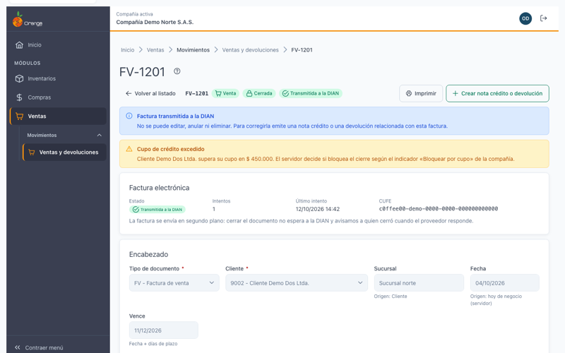

Para exportar el listado a Excel, use **Exportar a Excel**. Se exporta lo que ve con los mismos filtros.

---

## ➕ Crear una venta

1. En el listado, haga clic en **Nueva venta**.
2. Elija el **Tipo de documento**. Solo aparecen los tipos que su usuario puede usar. Sin tipo no se pueden capturar líneas.
3. Escriba el **Cliente** por documento y pulse **Enter** o **Tab**, o búsquelo por documento o nombre. Solo puede elegir clientes activos. Si el cliente no existe, créelo primero en el maestro de [Clientes](../maestros/clientes.md).
4. Revise la **Sucursal**. Si el cliente tiene una sola, se elige sola. Si tiene varias, elija la que corresponde.
5. Revise el **Vendedor**. Es obligatorio para capturar líneas, y se precarga desde la sucursal.
6. Revise la **Fecha** y los **Días de plazo**. La fecha es la de hoy de la compañía, según el servidor. **Vence** es la fecha más los días de plazo.
7. Complete lo que necesite: **Documento de referencia** (hasta 20 caracteres) y **Observaciones** (hasta 200 caracteres, sin comas ni punto y coma).
8. Capture las líneas (ver [Captura de líneas](#captura)).

> 💡 El número del documento aparece como *tentativo* hasta que se guarda la primera línea. Si el tipo permite cambiar el consecutivo, puede escribirlo; si lo deja vacío, se usa el siguiente.

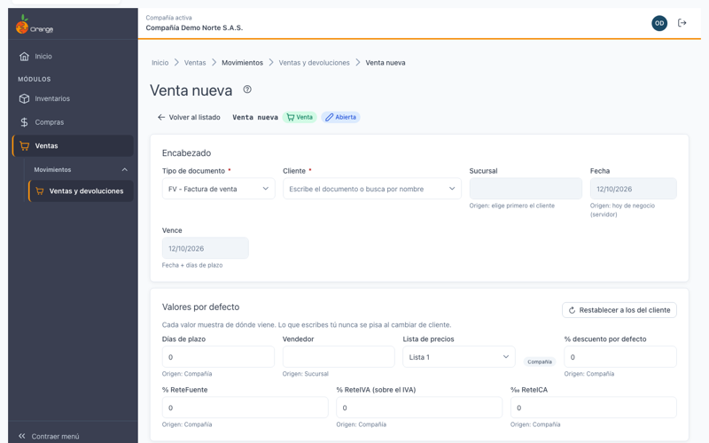

### Valores por defecto y de dónde vienen

Al elegir el tipo, el cliente y la sucursal, la pantalla llena los valores por defecto: **Días de plazo**, **Vendedor**, **Lista de precios**, **% descuento por defecto** y las retenciones del cliente. **Cada valor muestra su origen** debajo del campo:

| Origen | Qué significa |
|--------|---------------|
| **Compañía** | Valor general de la compañía. Es el que queda cuando todavía no hay cliente. |
| **Tipo de documento** | Valor que trae el tipo que eligió. |
| **Cliente** | Valor que trae la ficha del cliente. |
| **Sucursal** | Valor que trae la sucursal del cliente, como el vendedor o la lista de precios. |
| **Lo escribiste tú** | Valor que usted cambió a mano. |

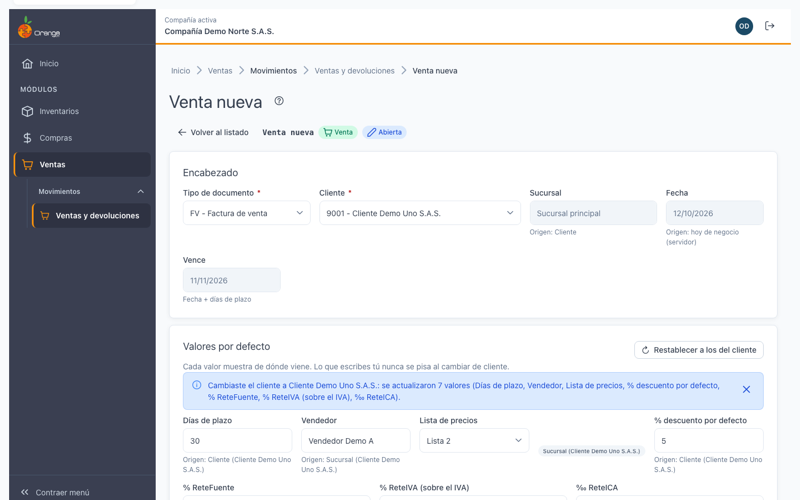

- **Lo que usted escribe nunca se pisa.** Si cambia de cliente, la pantalla actualiza solo los valores que no escribió usted, y un aviso dice qué cambió y qué se conservó.
- **Restablecer a los del cliente** devuelve todos los valores por defecto a los de su origen.
- **Lista de precios**: de la 1 a la 5, o *Costo*. Es la lista que sugiere el valor de cada línea.
- **Retenciones del cliente**: se muestran con su base y su porcentaje, que son de solo lectura. Si el cliente no realiza retenciones, la pantalla lo dice.

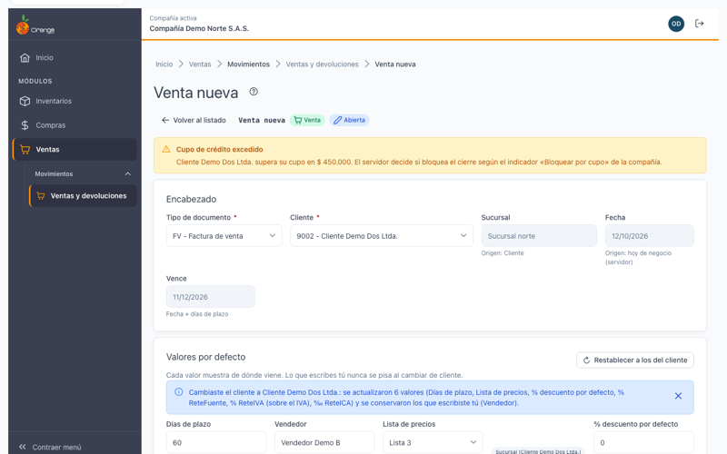

---

## ⌨️ Captura de líneas

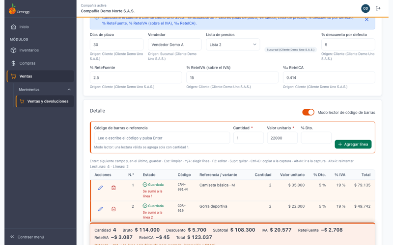

En una venta no hay botón *Guardar documento*. **Cada línea se guarda cuando la confirma.** Así, si la red falla, solo se pierde la línea que estaba escribiendo.

La fila de captura tiene estos campos, en este orden (con **Enter** pasa al siguiente; en el último, guarda la línea):

| Campo | Regla |
|-------|-------|
| **Código de barras o referencia** | Lea el código con el lector o escríbalo y pulse Enter. |
| **Cantidad** | Mayor que 0, con hasta 4 decimales. |
| **Valor unitario** | Mayor que 0. Se sugiere con la lista de precios elegida. |
| **% Dto.** | De 0 a 100. Se precarga con el descuento por defecto. |
| **Agregar línea** | Guarda la línea. |

Para guardar una línea necesita elegir la **bodega** (la pantalla dice *Elige la bodega para agregar la línea*). Si el tipo exige **centro de costos**, también debe elegirlo.

El **IVA** sale de la referencia. El **Total** de la línea se calcula solo.

Debajo del valor unitario, la pantalla le ayuda:

- **Valor sugerido (Lista 2): 22.000 (puedes cambiarlo).** Puedes cambiar el valor sin problema.
- **Sin precio en la lista elegida: escriba el valor.** La referencia no tiene precio en esa lista.
- **Existencia en la bodega: n.** Si no hay existencia, la pantalla avisa, pero el servidor es quien decide.

### Atajos de teclado

| Tecla | Qué hace |
|-------|----------|
| **Enter** | Pasa al siguiente campo; en el último, guarda la línea. |
| **Esc** | Limpia la fila de captura. |
| **↑ / ↓** | Elige una línea de la lista. |
| **F2** | Edita la línea elegida. |
| **Supr** | Quita la línea elegida. |
| **Ctrl+D** | Copia la línea elegida a la fila de captura. |
| **Alt+N** | Va a la fila de captura. |
| **Alt+R** | Reintenta las líneas que no se guardaron. |

### Estados de cada línea

Cada línea muestra su estado con texto e ícono:

| Estado | Qué significa | Qué puede hacer |
|--------|---------------|-----------------|
| **En cola** | Se va a guardar. | Espere. |
| **Guardando…** | Se está guardando. | Espere. |
| **Guardada** | Quedó guardada. | Editarla o quitarla. |
| **Guardada · Se sumó a la línea N** | Una lectura o una línea igual a otra que ya estaba se sumó a esa línea. | Nada, salvo revisar la cantidad. |
| **Error** | El servidor no la aceptó y dice por qué. | **Corregir** o **Descartar**. |
| **No se guardó** | Se perdió la conexión. | **Reintentar**, **Descartar** o **Reintentar todas**. |

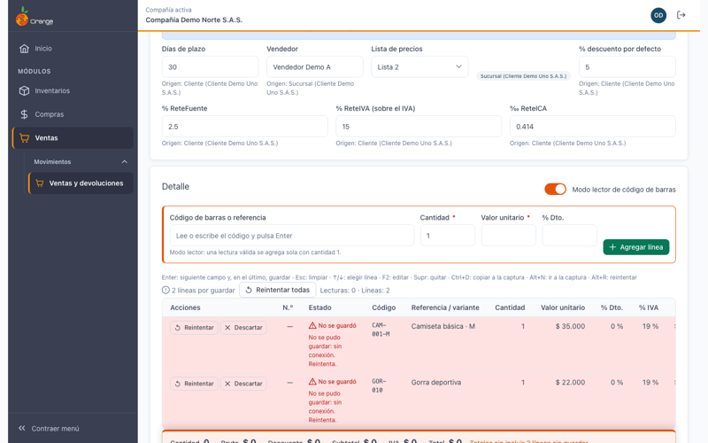

Mientras haya líneas por guardar, la pantalla dice **N líneas por guardar**. **Cerrar documento** no se puede usar hasta que todas estén guardadas o descartadas.

### Lector de código de barras

Con el lector, lea el código del producto y la línea se agrega sola:

1. Active **Modo lector de código de barras**. La pantalla avisa: *Modo lector activo: lee un código para agregar la línea*.
2. Elija la bodega (y el centro de costos, si el tipo lo exige).
3. Lea el código. La lectura válida agrega la línea con cantidad 1, y el cursor vuelve al campo de código para la siguiente lectura.
4. Si lee el mismo producto otra vez, la pantalla **suma 1** a la línea que ya existe y dice *Se sumó a la línea N*.
5. El contador **Lecturas** y **Líneas** le muestra cuántas lecturas hizo y cuántas líneas hay.

Si el código no existe, la pantalla muestra **Código no encontrado** y deja el foco en el campo para que lo corrija.

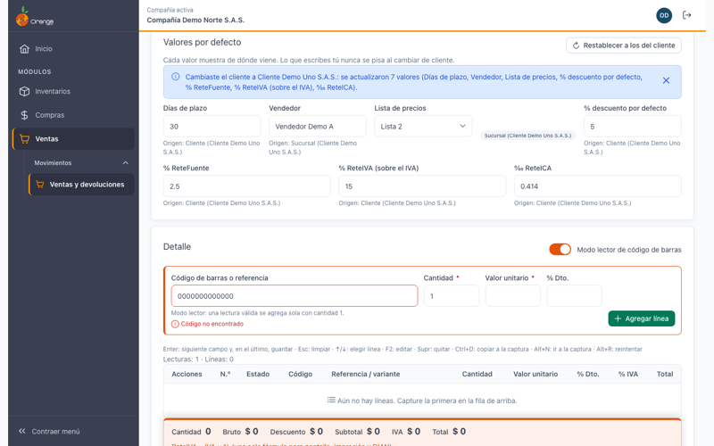

Si el código corresponde a **varias variantes** (por ejemplo, talla o color), la pantalla muestra todas para que elija la que leyó.

### Qué puede salir mal al capturar

| Mensaje | Qué hacer |
|---------|-----------|
| **No hay existencia suficiente en la bodega.** | Corrija la cantidad o descarte la línea. |
| **Elige la bodega para agregar la línea.** | Elija la bodega del documento. |
| **Cantidad mayor que 0 y hasta 4 decimales.** | Corrija la cantidad. |
| **El documento admite N líneas como máximo.** | El tipo tiene un límite de líneas. Use otro documento. |
| **Otra persona modificó esta línea.** | Use la **versión actual** o descarte su cambio. |

---

## 🧮 Totales y retenciones

En la parte de abajo del documento están los **totales**: Cantidad, Bruto, Descuento, Subtotal, IVA, ReteFuente, ReteIVA, ReteICA y Total.

- Los totales se calculan con una sola fórmula, así que la pantalla, la impresión y la factura electrónica dan el mismo valor.
- **ReteIVA se calcula sobre el IVA.** La pantalla lo dice en el rótulo.
- Las retenciones se aplican solo cuando el subtotal llega a la **base** de cada impuesto.
- Los totales **no incluyen las líneas que todavía no se guardaron**, y la pantalla lo dice.

Los campos **Seguro y flete** y **Otros valores** se suman al total. En un tipo de **factura electrónica** no se permiten: quedan en 0 y la pantalla lo avisa con *Este tipo es de facturación electrónica: fletes y otros valores no se permiten y se pusieron en 0.*

---

## 👤 Cliente, cupo, mora y cartera

### Cupo y mora

Cuando un cliente de crédito supera su cupo o tiene vencidos, la pantalla muestra el aviso **Cupo de crédito y mora** con el cupo, la cartera y lo disponible:

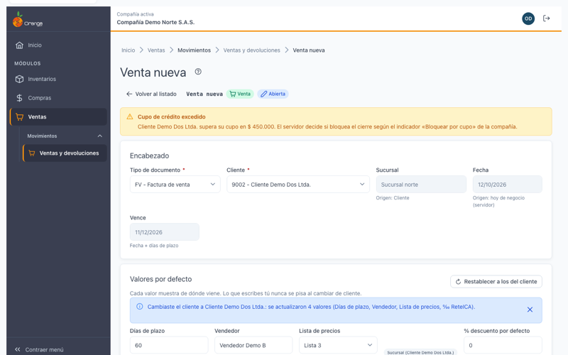

- Si el indicador de la compañía **bloquea por cupo** o **por mora**, el cierre no se puede hacer y el servidor lo dice.
- Si el indicador está apagado, el aviso es solo una advertencia, y el documento se puede guardar.

> 💡 **Cliente de contado.** Un cliente de contado no tiene cupo ni mora, así que la pantalla no los revisa. Tampoco revisa la cartera de las ventas de contado.

### Cartera del documento

En el documento, la pestaña **Cartera** muestra el total del documento, su saldo, la fecha de vencimiento y los recibos aplicados. Si la venta es de contado, la pestaña dice:

> **No aplica: venta de contado**

Esto solo cambia lo que la pantalla muestra y revisa en la venta. El documento sigue registrado en la cartera de la compañía y en los informes de cartera, como antes.

---

## 📦 Facturar desde un pedido

Use esta opción para facturar lo que el cliente ya pidió.

1. En el documento, haga clic en **Facturar desde pedido**.
2. Busque el **Pedido** en *Busca un pedido con saldo*. Solo aparecen pedidos de la misma sucursal del documento, con saldo.
3. Revise las líneas del pedido. Cada una muestra su **Saldo**.
4. Marque las líneas que quiere facturar y ajuste la **Cantidad** (no puede superar el saldo), el **Lote** y el **Detalle**, si lo necesita.
5. Haga clic en **Agregar líneas**.

Las líneas se guardan **todas o ninguna**. Si una de ellas no se puede guardar, la pantalla dice cuál fue y no guarda nada. Cada línea queda ligada a su pedido, y el saldo del pedido baja en la cantidad facturada.

Si el pedido ya no está disponible (es de otra sucursal, está anulado o no tiene saldo), la pantalla lo dice y no lo deja elegir.

---

## 🚚 Facturar desde remisiones

Use esta opción para facturar una o varias remisiones en un solo documento.

1. Complete el **Tipo de documento**, la **Fecha**, el **Cliente** y la **Sucursal**. Sin ellos, el botón **Seleccionar remisiones** no se activa, y la pantalla dice *Completa tipo, fecha, cliente y sucursal para seleccionar remisiones.*
2. Haga clic en **Seleccionar remisiones**.
3. Busque por consecutivo o por documento de referencia, y marque las remisiones que quiere facturar.
4. Haga clic en **Agregar remisiones**.

Reglas:

- Se factura **cada remisión completa**. No hay facturación parcial de una remisión.
- Se pueden elegir **hasta 50 remisiones** por operación. La pantalla cuenta las que marca.
- Todas las líneas se guardan **todas o ninguna**. Si una remisión ya está facturada, anulada o es de otra sucursal, no se guarda nada.
- Cada línea muestra la remisión de la que viene.

Si el documento todavía no existe, la operación lo crea con su consecutivo y agrega las líneas de todas las remisiones.

---

## 🔒 Cerrar el documento

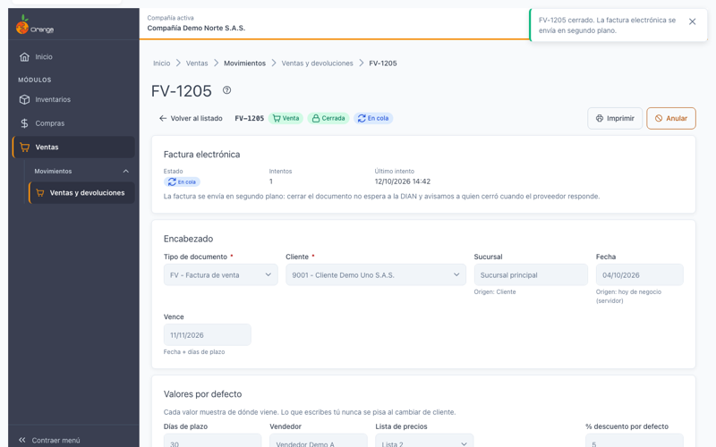

1. Revise el documento y, cuando esté listo, haga clic en **Cerrar documento**.
2. En el diálogo, revise el total: *Vas a cerrar FV-1205 por el total. Quedará de solo lectura.*
3. Confirme con **Cerrar documento**.

El botón **Cerrar documento** solo se activa con al menos una línea y sin líneas pendientes por guardar.

Al cerrar, el servidor revisa:

- que la fecha esté en un **periodo abierto** (si no, dice *La fecha pertenece a un periodo cerrado. Elige otra fecha.*);
- que la **resolución DIAN** del tipo esté vigente y que el consecutivo esté dentro de su rango (si no, dice *La resolución DIAN aún no está vigente* o *está vencida*);
- el **cupo** y la **mora**, según el indicador de la compañía.

Si todo está bien, el documento queda **cerrado** y de solo lectura. Si el tipo es de **factura electrónica**, la pantalla muestra el aviso *Documento FV-1205 cerrado. La factura electrónica se envía en segundo plano.* y el estado pasa a **En cola**.

> 💡 **Cerrar no espera a la DIAN.** Si el proveedor tecnológico no está disponible, el documento se cierra igual. La factura se envía en segundo plano, y cuando termina le avisamos a quien cerró el documento. Si no se envió, puede reenviarla (ver [Facturación electrónica](#fe)).

---

## ✏️ Editar un documento cerrado

Un documento cerrado se puede corregir en una cosa: **el valor o la cantidad de una línea que ya existe**. Para hacerlo, su usuario necesita el permiso de editar documentos cerrados.

- No puede **agregar** ni **quitar** líneas, ni cambiar el encabezado. La pantalla lo dice: *Documento cerrado: solo puedes editar una línea existente.*
- Al guardar, la contabilidad del documento se recalcula, y el cambio queda en la bitácora.
- No se puede editar un documento **anulado**, uno **transmitido a la DIAN**, uno con **periodo cerrado** ni uno con **documentos dependientes** (recibos o pagos sin anular, notas crédito o devoluciones que lo referencian).

### Si alguien más cambió el documento

Dos personas pueden tener el mismo documento abierto. Si otra persona lo cambia mientras usted lo edita, la pantalla le avisa:

- **Otra persona modificó este documento mientras lo editabas.** Use **Ver los cambios** o **Recargar** para ver la versión actual. Lo que escribió se muestra para que lo copie si lo necesita.
- **Otra persona modificó esta línea.** Use **Usar la versión actual** o **Descartar** su cambio.
- **Otra persona eliminó este documento.** Ya no se puede seguir editando.

---

## 🚫 Anular, eliminar o crear una nota crédito

Estas tres acciones tienen efectos distintos. Elija según el caso:

| Acción | Cuándo se usa | Qué pasa |
|--------|---------------|----------|
| **Anular** | El documento se emitió por error y todavía no fue transmitido a la DIAN. | El documento queda **anulado**, con su motivo, su usuario y la fecha. Deja de afectar inventario, cartera y contabilidad. Se conserva para consulta. |
| **Eliminar** | El documento no debe existir y no tiene documentos dependientes. | Se borra de forma definitiva, con sus líneas, sus registros contables y sus adjuntos. **No se puede deshacer.** |
| **Crear nota crédito o devolución** | La factura ya fue transmitida a la DIAN. | Se crea un documento nuevo que corrige o devuelve la venta. La factura original no cambia. |

### Anular

> ⚠️ Si la factura electrónica está **en cola** (el envío está en curso), consulte con su administrador antes de anular el documento.

1. Haga clic en **Anular** (en el documento o en la fila).
2. Escriba el **Motivo de la anulación** (de 1 a 200 caracteres, sin comas ni punto y coma).
3. Haga clic en **Anular documento**.

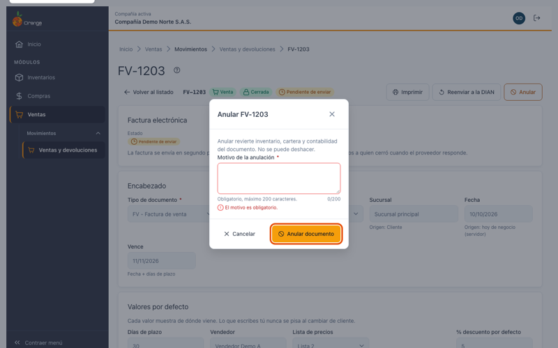

Antes de anular, la pantalla revisa si el documento puede anularse. Si no puede, dice por qué. Por ejemplo, con recibos de caja o pagos sin anular, con notas crédito o devoluciones que lo referencian, o con la fecha en un periodo cerrado.

### Eliminar

1. Haga clic en **Eliminar**.
2. El diálogo dice cuántas líneas, registros contables y adjuntos se borrarán.
3. Escriba el número del documento para confirmar. El botón **Eliminar documento** solo se activa si el número coincide.

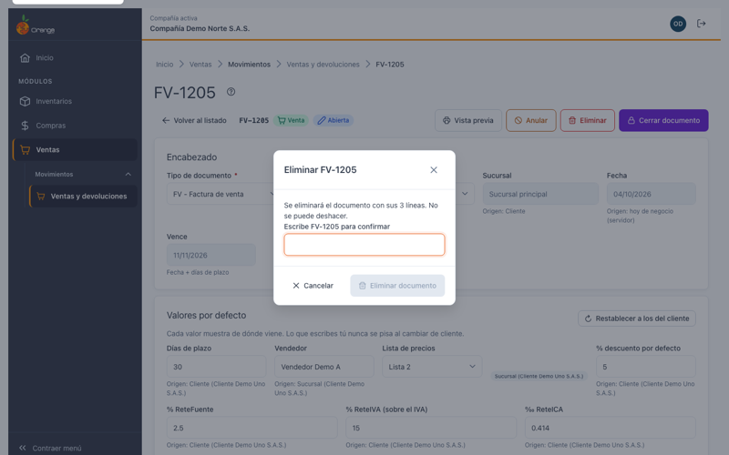

Si el documento ya tiene movimiento contable, la pantalla le recomienda **anularlo** en lugar de eliminarlo.

### Crear nota crédito o devolución

Cuando la factura ya fue transmitida, no se anula ni se edita. Haga clic en **Crear nota crédito o devolución** y elija lo que corresponde (ver [Devoluciones y notas crédito](#devoluciones)).

---

## ↩️ Devoluciones y notas crédito

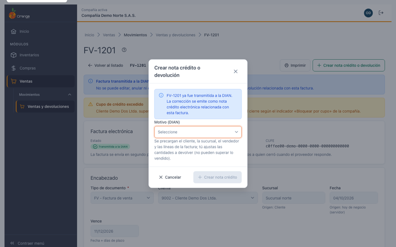

### Devolución

Una **devolución** es cuando el cliente regresa mercancía. Se crea un documento de devolución ligado a la venta original, que **queda abierto** para que lo complete y lo cierre.

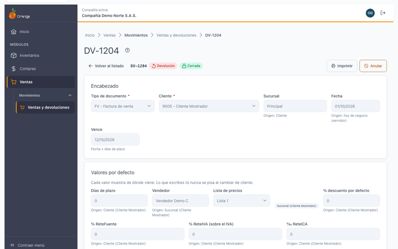

1. Haga clic en **Crear nota crédito o devolución** y elija **Devolver**.
2. Elija el **Tipo de devolución**, la **Fecha** y, si lo necesita, el **Documento de referencia** y las **Observaciones**.
3. En **Líneas a devolver**, elija **Devolver todo lo pendiente** o **Elegir líneas y cantidades**.
4. Para cada línea, revise lo **Vendido**, lo **Ya devuelto** y lo **Pendiente**, y escriba la **Cantidad** que devuelve (mayor que 0, hasta 4 decimales).
5. Haga clic en **Crear devolución**.

Reglas:

- La cantidad no puede superar lo pendiente. En una devolución **no electrónica** la pantalla solo avisa. En una **nota crédito electrónica** el servidor la rechaza.
- Si el precio es distinto del de la venta, la pantalla lo marca con *El precio difiere del de la venta.*

### Nota crédito electrónica

Una **nota crédito** corrige una factura electrónica ya transmitida a la DIAN.

> 💡 Por ahora la nota crédito se crea desde una factura transmitida. Crear una nota crédito desde cero llegará después.

1. Haga clic en **Crear nota crédito o devolución** y elija **Crear nota crédito**.
2. Elija el **Motivo (DIAN)**. Es obligatorio. Los motivos son:
   - Devolución parcial de los bienes
   - Anulación de factura electrónica
   - Rebaja o descuento parcial
   - Ajuste de precio
   - Descuento por pronto pago
   - Descuento por volumen
3. Haga clic en **Crear nota crédito**.

La nota crédito toma el cliente, la sucursal, el vendedor y las líneas de la factura de origen. La **Factura de origen** queda registrada en la nota.

---

## 🧾 Facturación electrónica

La factura electrónica se envía a la DIAN a través del **proveedor tecnológico** de la compañía. El envío se hace **en segundo plano**: ni cerrar, ni imprimir, ni consultar esperan a la DIAN.

### Seguir el estado

En el documento, el bloque **Factura electrónica** muestra:

- el **Estado** (ver la tabla de [estados de la factura electrónica](#listado));
- los **Intentos** y la fecha del **Último intento**;
- el **Motivo**, cuando el envío falló;
- el **CUFE** (código único de la factura), cuando ya está transmitida.

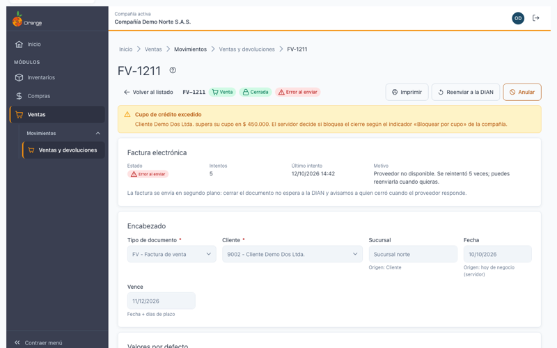

### Reenviar a la DIAN

Use **Reenviar a la DIAN** cuando la factura esté **pendiente de enviar** o **con error**. El diálogo le dice que el envío se hace en segundo plano y que le avisará cuando responda.

Si el sistema reenvía muchas veces seguidas, la pantalla le pide esperar unos segundos.

### Verificar en el proveedor

**Verificar en el proveedor** consulta si la factura ya existe en el proveedor tecnológico. El resultado puede ser:

| Resultado | Qué hacer |
|-----------|-----------|
| **Existe** | La factura ya está en el proveedor. No hace falta reenviarla. |
| **No existe** | Un administrador de la compañía puede reenviarla o restablecerla. |
| **No se pudo comprobar** | Espere un momento y vuelva a verificar. No se puede reenviar por ahora. |

### Factura transmitida: solo lectura

Una factura **transmitida a la DIAN** es de solo lectura. La pantalla lo muestra con el aviso **Documento enviado a la DIAN: no se puede modificar. Para corregirlo cree una nota crédito o una devolución.**

Sobre una factura transmitida puede:

- ver el documento,
- imprimirla,
- crear una nota crédito o una devolución,
- y, si es administrador de la compañía, verificarla en el proveedor y reenviarla o restablecerla, si ya no existe allá.

No puede editarla, cambiar su encabezado, quitar o agregar líneas, anularla ni eliminarla.

### Restablecer (solo administrador)

**Restablecer facturación electrónica** limpia el identificador y el estado de la factura, y la deja **pendiente de enviar**. Solo lo puede hacer un **administrador de la compañía**, y solo si la factura no existe en el proveedor.

> ⚠️ **Riesgo fiscal.** Si la factura **sí** fue aceptada por la DIAN, restablecerla puede producir una **doble emisión**. Hágalo solo si el documento no existe realmente ante la DIAN. Verifique antes en el proveedor.

Para restablecer:

1. Verifique primero en el proveedor. Si la factura **existe**, la pantalla muestra una advertencia.
2. Escriba el **motivo** (de 1 a 200 caracteres, sin comas ni punto y coma).
3. Escriba el número del documento para confirmar.
4. Confirme con **Restablecer**.

Después, la factura queda pendiente y se puede reenviar normalmente.

### CUFE y PDF oficial

- **Ver CUFE** muestra el código de la factura, que puede copiar con **Copiar CUFE**. Si el proveedor no responde a tiempo, la pantalla dice **CUFE no disponible por ahora** y puede reintentar.
- El **PDF oficial de la factura electrónica** solo existe cuando la factura está transmitida. Mientras no lo esté, la pantalla dice *La factura aún no se ha emitido* y le ofrece usar un formato local (ver [Imprimir](#imprimir)).

---

## 🖨️ Imprimir

Haga clic en **Imprimir** en el documento o en la fila del listado.

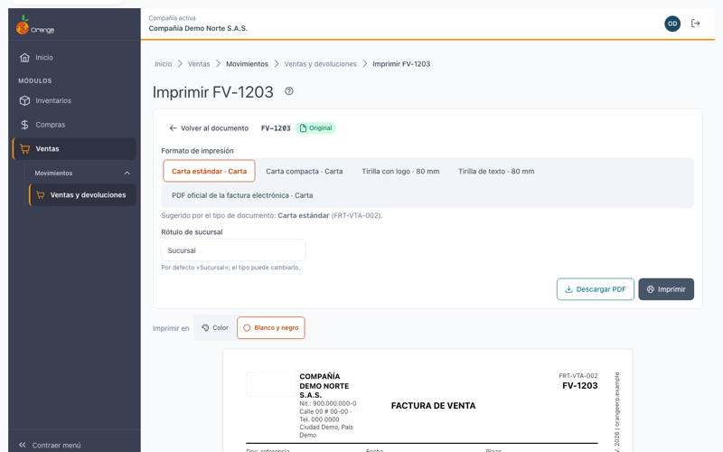

### Formatos

| Formato | Para qué |
|---------|----------|
| **Carta estándar** | Factura o documento completo en hoja carta. |
| **Carta compacta** | Hoja carta con menos espacio. |
| **Tirilla con logo · 80 mm** | Tirilla de 80 mm con el logo de la compañía. |
| **Tirilla de texto · 80 mm** | Tirilla de 80 mm, solo texto. |
| **PDF oficial de la factura electrónica · Carta** | El PDF que entrega el proveedor tecnológico. Solo con la factura transmitida. |

La pantalla **sugiere** un formato según el tipo de documento, y dice cuál es. Puede elegir otro. Si el tipo no tiene un formato propio, la pantalla sugiere **Carta estándar**.

Según el formato, aparecen opciones:

- **Rótulo de sucursal**: el texto que sale como sucursal. Por defecto es *Sucursal*.
- **Mostrar CUFE**: incluye el CUFE en la impresión.
- **Mostrar fecha y hora de creación**: incluye cuándo se creó el documento.
- **Imprimir en Color** o **Blanco y negro**.

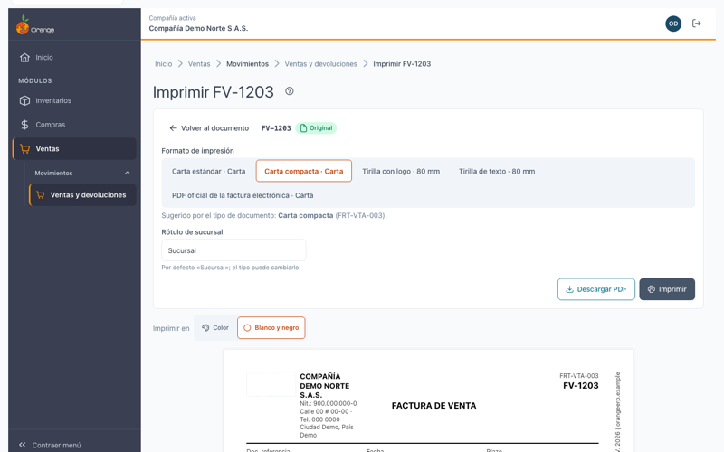

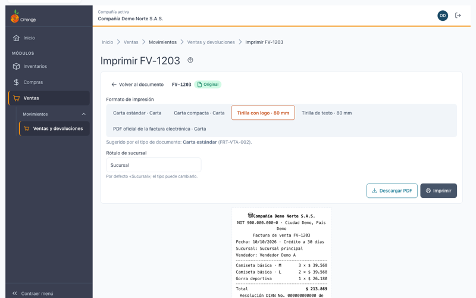

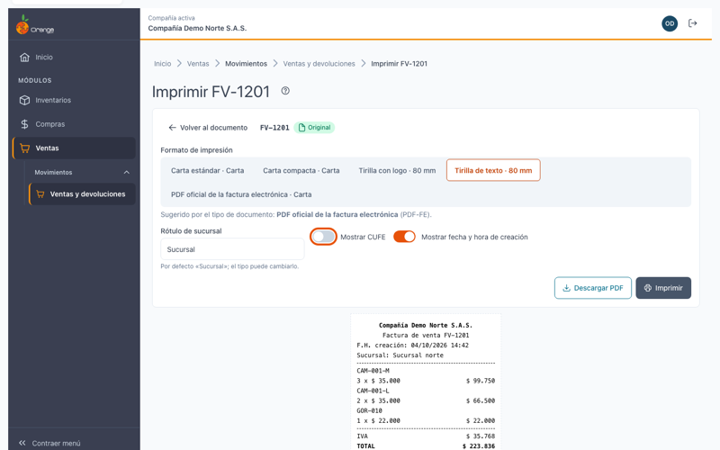

Para ver el resultado sin imprimir, use la **Vista previa (PDF)**. Para guardar el archivo, use **Descargar PDF**. Para imprimir, use **Imprimir**.

### Original y copia

La primera impresión sale como **Original**. Las siguientes salen como **Copia**.

Cada impresión queda registrada con su número, su usuario y la fecha, y la pantalla lo confirma: *Impresión registrada: n.º N (tipo).*

### Documento abierto

Un documento **abierto** solo tiene **vista previa**. La vista sale marcada como **Sin cerrar** y no cuenta como impresión.

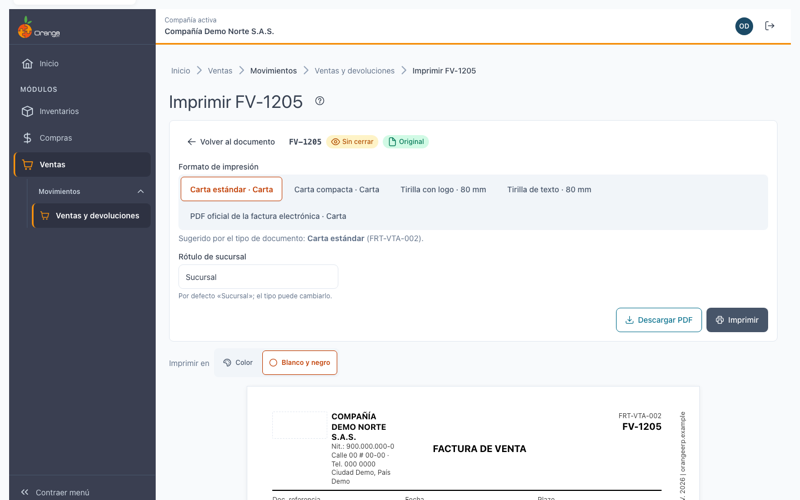

### La factura electrónica y la impresión

**La impresión nunca se frena por la factura electrónica.**

- Si el CUFE no llega en unos 3 segundos, se imprime igual y la pantalla dice **CUFE no disponible por ahora**.
- Si la factura todavía no está transmitida, la impresión sale con un formato local y el aviso **Factura electrónica no disponible: está en proceso de envío.** Si el envío falló, el aviso dice **Factura electrónica sin enviar: se reintentará o puede reenviarse.**
- El **PDF oficial** solo sale con la factura transmitida. Si no, la pantalla dice *Factura electrónica no disponible: está en proceso de envío.*

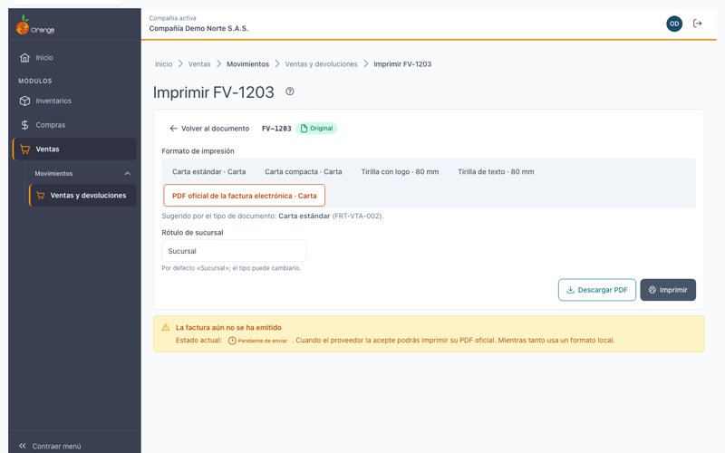

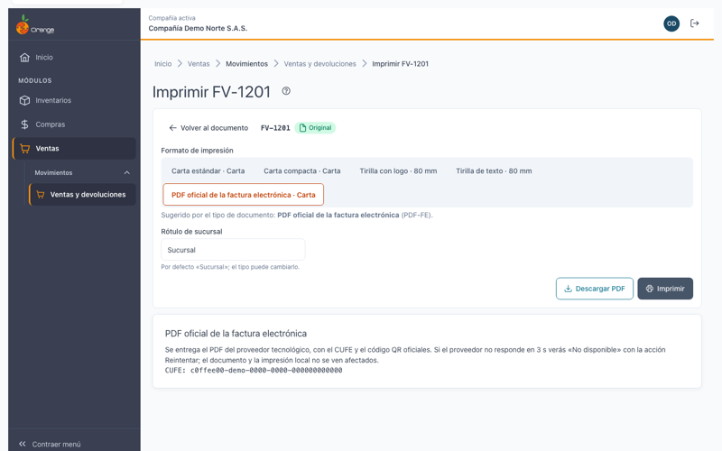

> 💡 Si el navegador bloquea la ventana de la vista previa, la pantalla lo dice: *Permite las ventanas emergentes e intenta de nuevo.*

---

## 📎 Adjuntos

El bloque **Adjuntos** guarda archivos de soporte del documento (PDF, imágenes, Word o Excel). Cada documento tiene un cupo de **10 MB** en total; la pantalla muestra cuánto lleva usado (*n de 10 MB usados*).

### Agregar y quitar

Solo puede **agregar** y **quitar** adjuntos mientras el documento está **abierto**.

1. En la pestaña **Adjuntos** del documento, o en el bloque **Adjuntos** de la captura, elija el archivo.
2. Escriba la **Descripción** (obligatoria, hasta 200 caracteres).
3. Haga clic en **Agregar a la lista** (en la captura) o en **Adjuntar** (en la pestaña).

En la captura, los archivos quedan en la lista **Se subirán al guardar el documento** y se suben al guardar. Lo mismo pasa si el documento se crea con **Seleccionar remisiones**. Mientras espera, el archivo aparece como *Pendiente de subir*.

Para quitar un adjunto, haga clic en **Quitar** junto al archivo. La pantalla pide confirmación: *Vas a quitar «nombre» del documento. No se puede deshacer.* Confirme con **Quitar adjunto**.

Para **ver** o **descargar** un adjunto, use **Ver** junto al archivo. Esto se puede hacer en cualquier estado del documento.

### Solo lectura

Los adjuntos quedan en solo lectura, aunque pueda verlos, cuando el documento está:

- **cerrado**: *Documento cerrado: los adjuntos se pueden ver, pero no agregar ni quitar.*
- **anulado**: *Documento anulado: los adjuntos se pueden ver, pero no agregar ni quitar.*
- **enviado a la DIAN**: *Documento enviado a la DIAN: no se puede modificar. Los adjuntos solo se pueden ver.*

Si su usuario no tiene permiso para cambiar los adjuntos, la pantalla lo dice: *No tienes permiso para cambiar los adjuntos de este documento.*

### Si una subida falla

Si un adjunto no se sube, **el documento no se deshace**: queda guardado. La pantalla avisa *El documento se guardó, pero N adjuntos no se pudieron subir* y ofrece **Reintentar** para cada archivo, o **Descartar** si ya no lo necesita. También puede reintentarlos desde la pestaña **Adjuntos**.

Un archivo que supera el cupo, de un tipo no permitido o con una descripción no válida no se sube, y la pantalla le dice por qué.

### Al eliminar el documento

Si elimina el documento, también se borran sus adjuntos. El diálogo de eliminar le dice cuántos adjuntos se borrarán (ver [Eliminar](#anular)).

<!-- CAPTURA PENDIENTE: adjuntos -->

---

## 🔜 Próximamente

- **Documentos abiertos y varios documentos a la vez**: un menú de documentos abiertos y pestañas para trabajar varias ventas al tiempo. **Todavía no está aprobado.** No lo tome como referencia para trabajar hoy.

Mientras tanto, para retomar un documento abierto, búsquelo en el listado con el filtro **Estado** en *Abierta* y ábralo.

---

## 🔄 Cambios de otros usuarios (en vivo)

La pantalla se actualiza sola cuando otra persona de la compañía crea, cambia o elimina documentos. Lo ve con el indicador **En vivo**, debajo del título.

Si usted está editando un documento que otra persona cambió, la pantalla se lo dice (ver [Si alguien más cambió el documento](#editar-cerrado)).

---

## ❓ Preguntas frecuentes

**¿Por qué un cliente de contado no muestra cartera?**
La venta de contado no tiene saldo por cobrar. La pantalla muestra **No aplica: venta de contado** y no revisa cupo ni mora. El documento sigue en la cartera de la compañía y en los informes, como siempre.

**¿Por qué no puedo editar un documento?**
Revise el estado del documento y sus permisos. Un documento no se puede editar si:

- ya fue **transmitido a la DIAN** (use una nota crédito o una devolución);
- está **anulado**;
- su fecha está en un **periodo cerrado**;
- tiene **documentos dependientes** sin anular;
- el documento está cerrado y su usuario no tiene el permiso de **editar documentos cerrados**.

**¿Qué hago si la factura electrónica falla?**
Abra el documento y lea el **Motivo** del bloque **Factura electrónica**. Si dice que el proveedor no está disponible, espere un poco y use **Reenviar a la DIAN**. Si dice que el proveedor rechazó datos del documento, revíselo antes de reenviar. Si la pantalla dice **Existe** al verificar, no la reenvíe.

**¿Por qué la tirilla sale sin CUFE?**
Porque el CUFE se consulta al proveedor tecnológico, y la impresión no espera. Si el proveedor no respondió a tiempo, o la factura todavía no está transmitida, la tirilla sale igual. Cuando el proveedor responda, use **Ver CUFE** en el documento.

**¿Cuál es la diferencia entre anular y nota crédito?**
- **Anular** deja sin efecto un documento que todavía no fue transmitido a la DIAN. Queda anulado, con su motivo.
- **Nota crédito** es un documento nuevo que corrige una factura ya transmitida. La factura original no cambia, y la nota se envía a la DIAN.

**¿Puedo cambiar fletes o otros valores en una factura electrónica?**
No. En un tipo de factura electrónica quedan en 0.

**¿Por qué no aparece el botón Seleccionar remisiones?**
Falta completar el tipo, la fecha, el cliente o la sucursal.

**¿De dónde sale el valor que trae la línea?**
De la lista de precios de la sucursal del cliente. Si el valor dice **Lo escribiste tú**, usted lo cambió y no se va a pisar.

**¿Por qué la pantalla dice que se sumó a una línea?**
Porque leyó o escribió un producto igual (misma referencia, descuento, IVA y bodega) a una línea que ya estaba. La cantidad se suma y no se crea otra línea.

---

## 🛠️ Errores comunes

| Mensaje | Qué hacer |
|---------|-----------|
| **El documento no se puede editar en su estado actual.** | Revise si está transmitido, anulado o en un periodo cerrado. |
| **La factura ya se transmitió a la DIAN: no se puede cambiar.** | Use una nota crédito o una devolución. |
| **La fecha pertenece a un periodo cerrado.** | Elija otra fecha. |
| **El cliente está inactivo.** / **No hay un cliente activo con ese documento.** | Elija un cliente activo. |
| **El vendedor no existe o está inactivo.** | Elija otro vendedor. |
| **Ese consecutivo ya está en uso.** | Elija otro consecutivo, o déjelo vacío. |
| **El servidor está ocupado. Intenta de nuevo en unos segundos.** | Espere unos segundos e intente de nuevo. |
| **Sin conexión con el servidor. Revise su red e intente de nuevo.** | Las líneas quedan en **No se guardó**: use **Reintentar**. |

---

## 🧷 Relacionado

- [Ventas](../readme.md): índice del módulo.
- [Pedidos](pedidos.md): los pedidos desde los que se factura.
- [Remisiones](remisiones.md): las remisiones que se pueden facturar.
- [Clientes](../maestros/clientes.md): condiciones, sucursales y lista de precios de cada cliente.
- [Vendedores](../maestros/vendedores.md): quién aparece como vendedor del documento.
- [Ficha del cliente · Facturas de Venta y sus Recibos de Caja](../clientes/ficha-facturas.md): las facturas y devoluciones de un cliente.
- [Ficha del cliente · Cartera](../clientes/ficha-cartera.md): lo que debe el cliente, con su saldo.
- [Manejo general de la información](../../Generales/manejo-general-informacion.md): búsqueda, orden, paginación y ayuda.

---

[← Volver al índice de ventas](../readme.md)
