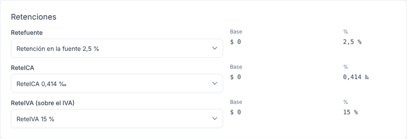
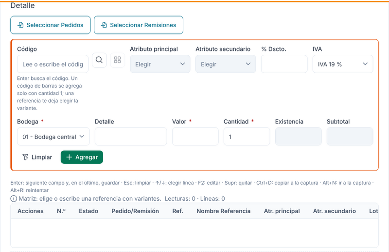
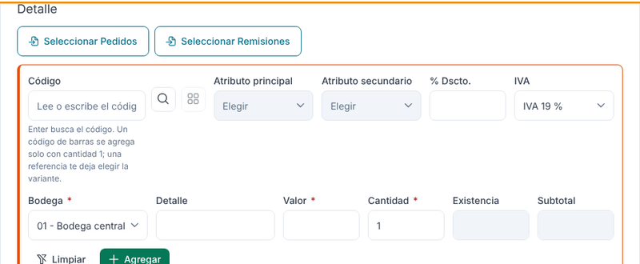
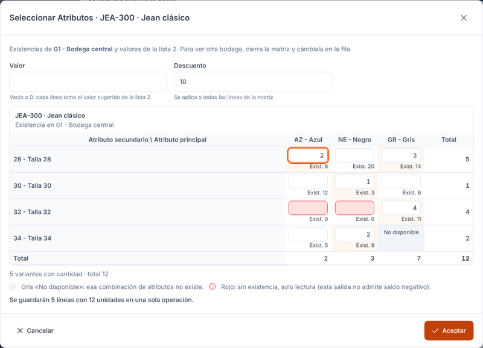
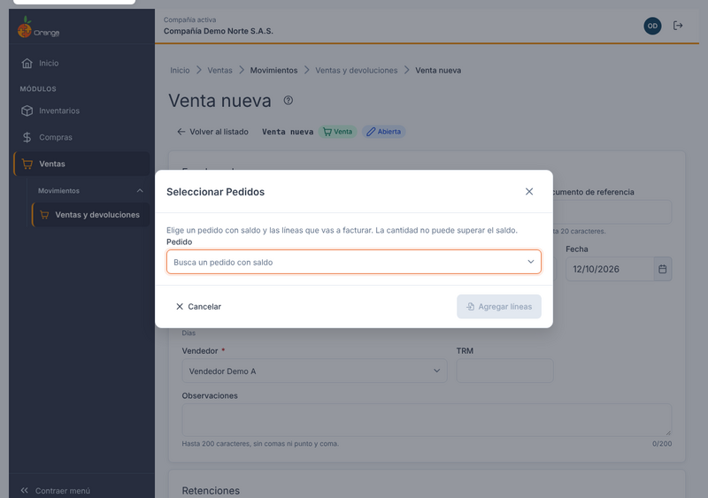
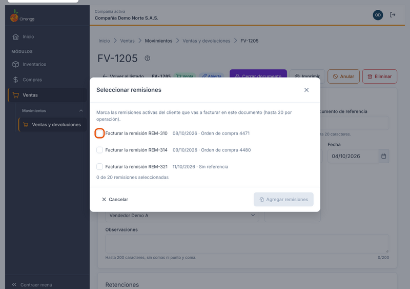
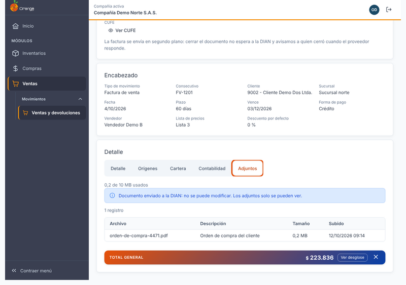
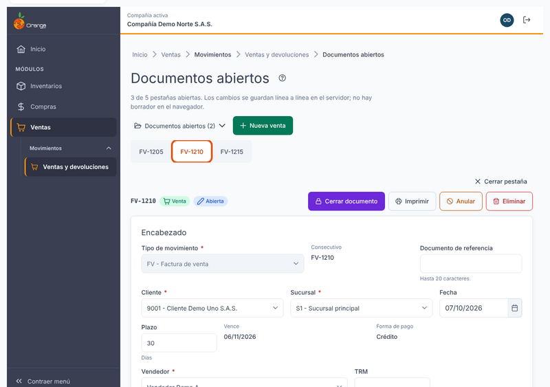

[Regresar a Ventas](../readme.md)

---

# 🧾 Ventas y devoluciones

---

## 📋 Descripción

Esta pantalla sirve para **vender**, **devolver** y **emitir notas crédito** a los clientes de la compañía. Una sola pantalla maneja los tres casos: lo que determina si el documento es una venta, una devolución o una nota crédito es el **tipo de documento** que elija.

Quién la usa:

- **Facturador o cajero**: captura la venta con el teclado o con el lector de código de barras, la cierra e imprime.
- **Jefe de ventas o de cartera**: filtra el listado, revisa el resumen, reenvía a la DIAN las facturas pendientes o con error y anula lo que corresponda.
- **Contabilidad**: confía en que una factura transmitida a la DIAN no se altera. Lo que se corrige se corrige con una nota crédito o una devolución.

En esta pantalla puede **consultar, crear, editar, cerrar, anular, eliminar, imprimir y exportar** documentos, y **seguir la factura electrónica** de cada venta. Puede tener **varios documentos abiertos** a la vez, en pestañas. Trabaje siempre con la compañía que aparece en la barra superior.

> 📘 La búsqueda, el orden y la paginación de las tablas funcionan igual que en el resto de la aplicación: ver [Manejo general de la información](../../Generales/manejo-general-informacion.md).

> ⚠️ **Una factura transmitida a la DIAN no se edita, no se anula y no se elimina.** Para corregirla, cree una **nota crédito** o una **devolución** (ver [Devoluciones y notas crédito](#devoluciones)).

---

## 🎯 Acceso

1. En el menú principal, haga clic en **Ventas**.
2. En **Movimientos**, haga clic en **Ventas y devoluciones**.

Si no ve la opción en el menú, su usuario no tiene permiso para consultar esta pantalla. Pida acceso a un administrador de la compañía.

---

## 🔐 Permisos por acción

Los botones que ve dependen de los permisos de su usuario y del estado del documento. La pantalla solo muestra lo que puede hacer; el servidor vuelve a revisar cada acción antes de guardarla.

| Permiso | Qué le permite |
|---------|----------------|
| **Consultar** | Ver el listado, abrir un documento, ver su estado de factura electrónica y ver su pestaña **Recibo de caja** (ver [Ver el recibo de caja de una venta](#recibo-caja)). |
| **Crear** | Crear una venta, una devolución o una nota crédito, y facturar desde un pedido o desde remisiones. |
| **Actualizar** | Capturar y cambiar líneas de un documento abierto, cerrarlo y reenviar a la DIAN una factura pendiente o con error. |
| **Editar documento cerrado** | Cambiar una línea existente de un documento cerrado (ver [Editar un documento cerrado](#editar-cerrado)). |
| **Anular** | Anular un documento que aún puede anularse. |
| **Eliminar** | Eliminar un documento que no tiene documentos dependientes. |
| **Imprimir** | Imprimir y ver la vista previa de un documento. |
| **Administrador de la compañía** | Verificar en el proveedor tecnológico y, si hace falta, restablecer o reenviar una factura que ya está transmitida a la DIAN (ver [Facturación electrónica](#fe)). |

> 💡 Para cerrar una venta con recibo de caja automático también necesita el permiso **Crear** en **Recibos de caja y egresos**. Vea [Cerrar y cobrar](#cerrar-y-cobrar).

> 💡 Si su usuario solo tiene **Consultar**, el listado y los documentos aparecen, pero no verá botones como **Nueva venta**, **Editar**, **Anular** o **Eliminar**.

---

## 🖥️ Pantalla principal: el listado

*(captura pendiente de actualizar: no muestra el filtro «Tipo de movimiento», ni la columna ni el filtro «Origen»)*

En la parte de arriba están los botones de la pantalla:

- **Documentos abiertos (N)**: abre el menú de sus documentos abiertos (ver [Varios documentos abiertos](#abiertos)).
- **Ocultar filtros y resumen** (o **Mostrar filtros y resumen**): oculta o muestra los filtros y las tarjetas del resumen para ganar espacio.
- **Exportar a Excel**: exporta lo que ve, con los mismos filtros.
- **Nueva venta**: abre un documento nuevo.

Junto al título aparece el indicador **En vivo** (ver [Cambios de otros usuarios](#en-vivo)).

Si todavía no hay documentos en el rango elegido, la tabla aparece vacía. Cambie las fechas para buscar en otro periodo.

El listado muestra las ventas, devoluciones y notas crédito de la compañía, con el **Resumen del filtro** arriba:

| Tarjeta | Qué muestra |
|---------|-------------|
| **Ventas netas** | Lo vendido menos las devoluciones del filtro. El texto debajo muestra las ventas brutas y las devoluciones. |
| **Contado y crédito** | Cuánto se vendió de contado y cuánto a crédito. |
| **Factura electrónica** | Cuántas facturas están transmitidas a la DIAN, y cuántas están en cola, pendientes o con error. |
| **Por reenviar a la DIAN** | Facturas pendientes de enviar y con error. |

Si el resumen no se puede calcular, la tabla sigue funcionando y el resumen muestra **Reintentar**.

### Filtros

Los filtros están arriba de la tabla y quedan en la dirección de la página, para que pueda compartir la vista:

- **Desde** y **Hasta**: fechas del documento. Por defecto es el mes en curso.
- **Naturaleza**: *Venta*, *Devolución* o *Nota crédito*.
- **Tipo de movimiento**: puede elegir **varios tipos a la vez**. Cada tipo aparece como una ficha con su código y nombre (*Código - Nombre*). Se pueden elegir hasta 50 tipos. El filtro se conserva con los demás filtros de la página, y **Limpiar filtros** lo quita.
- **Origen**: *Todos*, *Ventas* o *Punto de venta*. Las ventas del punto de venta se ven en solo lectura (ver [Ventas del punto de venta](#ventas-del-punto-de-venta)).
- **Estado**: *Abierta*, *Cerrada* o *Anulada*.
- **Factura electrónica**: *Pendiente de enviar*, *En cola*, *Transmitida a la DIAN* o *Error al enviar*. Para filtrar por factura electrónica debe indicar **Desde** y **Hasta**, con un rango de no más de 366 días.
- **Cliente**: por documento o nombre.
- **Buscar**: por número, documento de referencia o cliente. Escriba al menos 2 caracteres.

Si el rango de fechas está mal (por ejemplo, **Desde** es posterior a **Hasta**), la pantalla lo marca en rojo y no busca.

Para quitar todos los filtros, use **Limpiar filtros**.

### Columnas

Cada fila muestra el **documento** (por ejemplo, *FV-1205* para una factura o *DV-1204* para una devolución), la **naturaleza**, la **fecha**, el **documento de referencia**, el **cliente**, la **cantidad**, el **valor total**, el **estado** y el **estado de la factura electrónica**. El estado siempre lleva texto además del color.

### Ventas del punto de venta

Las ventas que se hacen en el [Punto de venta](punto-de-venta.md) también aparecen aquí, **en solo lectura**:

- En su fila, la columna **Origen** muestra **Punto de venta**. Las demás filas muestran **Ventas**.
- Puede abrirlas para consultarlas e imprimirlas. No se editan, no se anulan, no se eliminan y no se les crea una devolución desde aquí.
- El documento muestra el aviso *Documento del Punto de venta: solo lectura. Edítelo o gestiónelo desde Punto de venta.* con el botón **Abrir en Punto de venta**.

### Estados del documento

| Estado | Qué significa |
|--------|---------------|
| **Abierta** | Se puede seguir capturando. |
| **Cerrada** | Quedó de solo lectura (ver [Cerrar el documento](#cerrar)). |
| **Anulada** | Se anuló y no afecta inventario, cartera ni contabilidad. Se conserva para consulta. |

### Estados de la factura electrónica

| Estado | Qué significa |
|--------|---------------|
| **No aplica** | El tipo de documento no es de factura electrónica, o la compañía no tiene proveedor tecnológico configurado. |
| **Pendiente de enviar** | El documento está cerrado, pero la factura todavía no se envió a la DIAN. |
| **En cola** | El envío está en curso, en segundo plano. |
| **Transmitida a la DIAN** | La factura ya se envió. Ya no se puede editar, anular ni eliminar. |
| **Error al enviar** | El último intento falló. Vea el motivo y reenvíe la factura. |

### ¿Qué puedo hacer desde una fila?

Cada fila tiene botones con nombre, por ejemplo **Anular FV-1205**. Aparecen solo si su usuario tiene el permiso y el documento lo permite:

| Botón | Cuándo aparece |
|-------|----------------|
| **Ver** | Siempre que tenga permiso para consultar. |
| **Imprimir** | Con el permiso de imprimir. Imprime en **un clic** (ver [Imprimir](#imprimir)). También para documentos abiertos, como vista previa. |
| **Editar** | Documentos abiertos, con el periodo abierto y sin documentos dependientes. |
| **Reenviar a la DIAN** | Facturas pendientes de enviar o con error. |
| **Crear nota crédito o devolución** | Facturas transmitidas a la DIAN. |
| **Anular** | Documentos que todavía se pueden anular, es decir, que no estén transmitidos ni con el envío en cola. |
| **Eliminar** | Documentos sin documentos dependientes, sin factura transmitida y sin envío en cola. |

Para ver el detalle de un documento, haga clic en su número o en **Ver**.

---

## ➕ Crear una venta

1. En el listado, haga clic en **Nueva venta**.
2. Elija el **Tipo**. Solo aparecen los tipos que su usuario puede usar. Sin tipo no se pueden capturar líneas.
3. Escriba el **Cliente** por documento y pulse **Enter** o **Tab**, o búsquelo por documento o nombre. Solo puede elegir clientes activos. Si el cliente no existe, créelo primero en el maestro de [Clientes](../maestros/clientes.md).
4. Revise la **Sucursal**. Si el cliente tiene una sola, se elige sola. Si tiene varias, elija la que corresponde.
5. Revise la **Fecha** y los **Días de plazo**. La fecha es la de hoy de la compañía, según el servidor. **Vence** es la fecha más los días de plazo.
6. Revise el **Vendedor**. Es obligatorio para capturar líneas, y se precarga desde la sucursal.
7. Complete lo que necesite: **Documento de referencia** (hasta 20 caracteres), **TRM** y **Observaciones** (hasta 200 caracteres, sin comas ni punto y coma).
8. Capture las líneas (ver [Captura de líneas](#captura)).

> 💡 El número del documento aparece como *tentativo* hasta que se guarda la primera línea. Si el tipo permite cambiar el consecutivo, puede escribirlo; si lo deja vacío, se usa el siguiente.

### El encabezado, campo por campo

El encabezado sigue este orden. Los campos que no tienen valor no se muestran, y los que dependen del tipo o del cliente aparecen solo cuando hacen falta:

| Campo | Qué hace |
|-------|----------|
| **Tipo** | Tipo de documento. Obligatorio. Después de crear el documento no se puede cambiar. |
| **Consecutivo** | Muestra el número del documento (*tentativo* hasta guardar). Si el tipo lo permite, puede escribirlo; vacío usa el siguiente. |
| **Documento de referencia** | Hasta 20 caracteres. |
| **Cliente** | Por documento (Enter o Tab) o por nombre. Solo clientes activos. |
| **Sucursal** | Sucursales del cliente. Se elige sola si tiene una. |
| **Fecha** | Fecha del documento, según el servidor. |
| **Plazo** | **Días de plazo**. |
| **Vence** | Fecha de vencimiento: la fecha más los días de plazo. |
| **Forma de pago** | Solo lectura: **Contado** si el plazo es 0; **Crédito** si es mayor que 0. |
| **Vendedor** | Obligatorio para capturar líneas. |
| **TRM** | Tasa de cambio. |
| **Seguro y flete** y **Otros valores** | Solo aparecen si el tipo los permite. En una factura electrónica no se permiten (ver [Totales y retenciones](#totales)). |
| **Observaciones** | Hasta 200 caracteres, sin comas ni punto y coma. |
| **Retenciones del cliente** | Tarjeta con una fila por retención (ver abajo). Si el cliente no tiene retenciones, la tarjeta no aparece. |
| **Adjuntos del documento** | Tarjeta de archivos de soporte (ver [Adjuntos](#adjuntos)). |
| **Lista de precios** | De la 1 a la 5, o *Costo*. Es la lista que sugiere el valor de cada línea. |
| **% descuento por defecto** | Descuento que se precarga en cada línea. Aparece solo si el tipo liquida descuento. |

En un documento ya creado, cada cambio en el encabezado se guarda al salir del campo.

### Valores que trae el tipo, el cliente y la sucursal

Al elegir el tipo, el cliente y la sucursal, la pantalla aplica en sus campos los valores que traen: **Días de plazo**, **Vendedor**, **Lista de precios**, **% descuento por defecto** y las retenciones del cliente. **Lo que usted escribe se conserva**: los valores que traen el tipo, el cliente o la sucursal se aplican en los campos y no reemplazan lo que usted ya escribió en ellos.

### Retenciones del cliente

Si el cliente tiene retenciones, la tarjeta **Retenciones del cliente** muestra una fila por cada una (por ejemplo, *Retefuente*, *ReteICA* o *ReteIVA (sobre el IVA)*):

- **Impuesto**: selector precargado con la retención del cliente. Puede cambiarlo.
- **Base** y **%**: son de solo lectura. Los calcula el servidor.

---

## ⌨️ Captura de líneas

En una venta no hay botón *Guardar documento*. **Cada línea se guarda cuando la confirma.** Así, si la red falla, solo se pierde la línea que estaba escribiendo.

> 💡 **Existencias.** Solo los tipos de movimiento con **Inventarios** activo mueven existencias de la bodega. Un tipo sin esa marca (por ejemplo, de factura electrónica o de contado) no descuenta existencias.

La fila de captura está en la tarjeta **Detalle**. Tiene estos campos, en este orden. Con **Enter** pasa al siguiente campo; en el último, guarda la línea: Según el ancho de la pantalla, la fila se acomoda en dos filas (o en tres si hay atributos o lote), sin cambiar el orden de los campos; en una pantalla angosta va un campo por línea.

| Orden | Campo | Regla |
|-------|-------|-------|
| 1 | **Código** | Código de barras, EAN o referencia (el campo dice *Código, EAN o descripción*). Lea el código con el lector o escríbalo y pulse Enter. El campo tiene ancho para leer completo un código EAN-13. A su lado, el botón de **lupa** abre el buscador de referencias y variantes, y el botón de **matriz** (ícono de cuadrícula) aparece cuando la referencia tiene varias variantes. El código digitado se conserva en el campo (ver [Código](#codigo-conservado)). |
| 2 | **Atributo principal** | Aparece cuando la referencia tiene variantes (por ejemplo, talla o color). |
| 3 | **Atributo secundario** | Igual que el principal. |
| 4 | **% Dto.** | De 0 a 100. Aparece si el tipo liquida descuento. Se precarga con el descuento por defecto. |
| 5 | **IVA** | Se precarga con el IVA de la referencia (por ejemplo, *IVA 19 %*). Puede cambiarlo en la fila. Aparece si el tipo liquida IVA. |
| 6 | **Lote** | Aparece si la referencia maneja lote. Si lo exige, la pantalla lo dice. |
| 7 | **Bodega** | Obligatoria para agregar la línea. |
| 8 | **Ubicación** | Aparece si el tipo la usa. |
| 9 | **Centro de costos** | Aparece si el tipo lo exige. |
| 10 | **Detalle** | Texto de la línea. |
| 11 | **Valor** | Mayor que 0. Se sugiere con la lista de precios elegida. |
| 12 | **Cantidad** | Mayor que 0, con hasta 4 decimales. Se precarga en 1. |
| — | **Descripción** | Solo lectura: no recibe el cursor al tabular. Muestra el nombre de la referencia o de la variante encontrada (ver abajo). |
| — | **Existencia** y **Subtotal** | Solo lectura: no reciben el cursor al tabular. |
| — | **Limpiar** | Vacía la fila de captura. |
| — | **Agregar línea** | Guarda la línea. |

*(captura pendiente de actualizar: muestra la lupa sin el texto «Buscar», el texto anterior del campo Código y sin la confirmación «CÓDIGO · Nombre»)*

Para guardar una línea necesita elegir la **bodega** (la pantalla dice *Elige la bodega para agregar la línea*). Si el tipo exige **centro de costos**, también debe elegirlo.

Al lado del código, el campo **Descripción** confirma lo que encontró. Muestra **solo el nombre**: no repite el código ni cuenta las variantes.

- **Una sola variante**: el campo muestra el nombre de la referencia.
- **Varias variantes**: el campo muestra el nombre de la referencia. Elija la variante con los atributos o con la **Matriz**.
- **Código no encontrado: …**: el campo **Descripción** queda vacío; corrija el código.

El campo **Descripción** se vacía al limpiar la fila.

**El código se conserva.** Una referencia (no un EAN) no se agrega sola: el código queda escrito en el campo y la pantalla le deja elegir la variante o completar la línea. El código solo se vacía cuando se agrega un **EAN** (que agrega la línea con cantidad 1), cuando la **Matriz** se guarda bien (ver abajo), o al pulsar **Limpiar** o **Esc**.

El **IVA** de la fila aparece con el de la referencia y puede cambiarlo:

Debajo del valor, la pantalla le ayuda:

- **Valor sugerido (Lista 2): ... (puedes cambiarlo).** Puede cambiar el valor sin problema.
- **Sin precio en la lista elegida: escriba el valor.** La referencia no tiene precio en esa lista.
- **Existencia en la bodega: n.** Si no hay existencia, la pantalla avisa, pero el servidor es quien decide.

Si el valor queda fuera de lo que su usuario puede usar, la pantalla pide la autorización de un administrador (ver [Precio fuera de lo permitido](#autorizacion)).

### Buscar una referencia o una variante

El botón de **lupa**, junto al campo **Código**, abre el buscador **Buscar por descripción o código**. Busque por código o nombre y elija la referencia o la variante de la lista.

### Atajos de teclado

| Tecla | Qué hace |
|-------|----------|
| **Enter** | Pasa al siguiente campo; en el último, guarda la línea. |
| **Esc** | Limpia la fila de captura. |
| **↑ / ↓** | Elige una línea de la lista. |
| **F2** | Edita la línea elegida. |
| **Supr** | Quita la línea elegida. |
| **Ctrl+D** | Copia la línea elegida a la fila de captura. |
| **Alt+N** | Va a la fila de captura. |
| **Alt+R** | Reintenta las líneas que no se guardaron. |

La pantalla muestra estos atajos debajo de la fila de captura.

### Editar una línea

Al editar una línea (**F2** o el botón **Editar** de su fila), la línea queda **resaltada** en el detalle y la fila de captura muestra qué está editando:

- En **Código**, la referencia, y en **Descripción**, su nombre.
- En **Atributo principal** y **Atributo secundario**, los de la línea. Funcionan como al crear: al elegir uno, el otro ofrece solo lo que existe para esa combinación.
- La cantidad, el valor, el descuento y el IVA de la línea, listos para cambiarlos.

En las tablas de líneas (la de la captura y la del documento), la **Referencia**, el **Atributo principal** y el **Atributo secundario** van en columnas separadas.

### Matriz de variantes

Cuando una referencia tiene varias variantes, el botón **Matriz** abre la matriz para capturar varias variantes de una vez. El título es *Seleccionar Atributos*, con la referencia y el nombre.

- **Valor** y **Descuento** son comunes a todas las celdas. El valor se muestra con separador de miles y se digita igual: al escribir *45000* queda **45.000** y no cambia. Si el valor está vacío o es 0, cada línea toma el valor sugerido de su lista.
- El **IVA** que eligió en la fila de captura vale para todas las tallas de la matriz. Si no eligió ninguno, cada línea toma el IVA de su referencia.
- Las **filas** son el atributo secundario y las **columnas** son el atributo principal. Cada celda tiene su cantidad y la existencia de esa variante en la bodega que tiene la fila de captura (*Exist.*).
- Las celdas **grises** (*No disponible*) son combinaciones que no existen. Las celdas **rojas** no tienen existencia y son de solo lectura, porque la salida no admite saldo negativo.
- La cantidad no puede superar la existencia de la celda (*La cantidad supera la existencia*).
- El pie dice cuántas líneas y cuántas unidades se van a guardar, por ejemplo *Se guardarán 5 líneas con 12 unidades en una sola operación*.
- **Aceptar** cierra la matriz y las tallas aparecen de inmediato en el detalle, con estado **Guardando…**. El servidor guarda todas las líneas juntas: **todo o nada**.
  - Si todo sale bien, la captura queda limpia, igual que al agregar una línea normal: el código queda vacío y el cursor va a **Código**.
  - Si algo falla, no se guarda nada: la matriz se vuelve a abrir con lo que digitó, y la celda con el error queda marcada.
- Al abrir la matriz otra vez, las cantidades arrancan en cero.
- **Cancelar** cierra la matriz sin guardar nada.

### Estados de cada línea

Cada línea muestra su estado con texto e ícono:

| Estado | Qué significa | Qué puede hacer |
|--------|---------------|-----------------|
| **En cola** | Se va a guardar. | Espere. |
| **Guardando…** | Se está guardando. | Espere. |
| **Guardada** | Quedó guardada. | Editarla o quitarla. |
| **Guardada · Se sumó a la línea N** | Una lectura o una línea igual a otra que ya estaba se sumó a esa línea. | Nada, salvo revisar la cantidad. |
| **Error** | El servidor no la aceptó y dice por qué. | **Corregir** o **Descartar**. |
| **No se guardó** | Se perdió la conexión. | **Reintentar**, **Descartar** o **Reintentar todas**. |

Mientras haya líneas por guardar, la pantalla dice **N líneas por guardar**. **Cerrar documento** no se puede usar hasta que todas estén guardadas o descartadas.

### Lector de código de barras

No hay un modo aparte para el lector. Con el lector, lea el código del producto en el campo **Código**:

1. Elija la bodega (y el centro de costos, si el tipo lo exige).
2. Lea el código. Un código de barras (EAN) se agrega solo con cantidad 1, y el cursor vuelve al campo de código para la siguiente lectura. Una referencia no se agrega sola: su código queda en el campo. Si el código corresponde a una referencia con variantes, la pantalla le deja elegir la variante.
3. Si lee el mismo producto otra vez, la pantalla **suma 1** a la línea que ya existe y dice *Se sumó a la línea N*.
4. Los contadores **Lecturas** y **Líneas** muestran cuántas lecturas hizo y cuántas líneas hay.

Si el código no existe, la pantalla muestra **Código no encontrado** y deja el foco en el campo para que lo corrija.

Si el código corresponde a **varias variantes** (por ejemplo, talla o color), la pantalla muestra todas para que elija la que leyó.

### Qué puede salir mal al capturar

| Mensaje | Qué hacer |
|---------|-----------|
| **No hay existencia suficiente en la bodega.** | Corrija la cantidad o descarte la línea. |
| **Elige la bodega para agregar la línea.** | Elija la bodega del documento. |
| **Cantidad mayor que 0 y hasta 4 decimales.** | Corrija la cantidad. |
| **El documento admite N líneas como máximo.** | El tipo tiene un límite de líneas. Use otro documento. |
| **Otra persona modificó esta línea.** | Use la **versión actual** o descarte su cambio. |

### Precio fuera de lo permitido (autorización del administrador)

Si el valor que escribe no está permitido para su usuario, la línea no se guarda y la pantalla abre el diálogo **Autorización del administrador**. Dice el valor que intentó y el precio de la lista, por ejemplo: *El valor ... no está permitido para tu usuario. Precio de lista ...; solo se acepta ese valor.* Un usuario que no es administrador solo puede dejar el valor de la lista (sin redondeos), y nunca por debajo del costo. Si el valor viene de un **pedido**, de una **remisión** o de la **factura de origen**, se acepta tal cual, sin pedir autorización.

Para seguir, un administrador escribe **su** usuario y **su** clave en el diálogo, y puede escribir un **Motivo** (hasta 200 caracteres). Después haga clic en **Solicitar autorización**.

- Si la autorización se concede, la línea se guarda con ese valor.
- Si cancela, la línea no se guarda y el valor vuelve al de la lista: *La línea no se guardó: el valor vuelve al de la lista.*
- Si escribe muchas veces seguidas, la pantalla le pide esperar unos segundos.
- Si el servidor no responde, la pantalla dice *No se pudo solicitar la autorización. Inténtalo de nuevo.*

---

## 🧮 Totales y retenciones

En la parte de abajo del documento están los **totales**: Cantidad, Bruto, Descuento, Subtotal, IVA, ReteFuente, ReteIVA, ReteICA y Total.

- Los totales se calculan con una sola fórmula, así que la pantalla, la impresión y la factura electrónica dan el mismo valor.
- **ReteIVA se calcula sobre el IVA.** La pantalla lo dice en el rótulo.
- Las retenciones se aplican solo cuando el subtotal llega a la **base** de cada impuesto.
- Los totales **no incluyen las líneas que todavía no se guardaron**, y la pantalla lo dice.

Mientras captura, los totales están en un **cuadro flotante** llamado **Total General**: una barra compacta, de naranja a azul, que queda pegada al borde inferior de la pantalla mientras se desplaza el documento. Va debajo de las líneas y de su paginador, así que no tapa botones. Es el mismo cuadro en todos los documentos de la aplicación. Desde él puede:

- **Ver desglose**: abre el detalle de los totales. **Ocultar desglose** lo pliega. En el desglose no aparecen las retenciones que están en cero.
- Cerrar el cuadro con su botón de cierre (**Ocultar totales**). Para volver a verlo, use **Mostrar valores**.
- Si hay líneas sin guardar, el cuadro avisa que los totales no las incluyen, aunque el desglose esté plegado.

### Los botones del documento: barra fija abajo

Los botones del documento están en una **barra fija al borde inferior** de la pantalla, justo debajo del cuadro **Total General**. No están arriba: quedan a la vista aunque baje por las líneas. Según el estado del documento y sus permisos, ahí aparecen **Cerrar documento**, **Imprimir**, **Anular**, **Eliminar**, **Editar**, **Seleccionar Pedidos** y **Seleccionar Remisiones**. Si una acción no se puede usar en ese momento, el botón aparece deshabilitado.

Los campos **Seguro y flete** y **Otros valores** se suman al total. En un tipo de **factura electrónica** no existen: no se pueden usar, quedan en 0 y la pantalla lo avisa con *Este tipo es de facturación electrónica: fletes y otros valores no se permiten y se pusieron en 0.*

---

## 👤 Cliente, cupo, mora y cartera

### Cupo y mora

Cuando un cliente de crédito supera su cupo o tiene vencidos, la pantalla muestra el aviso **Cupo de crédito y mora** con el cupo, la cartera y lo disponible:

- Si el indicador de la compañía **bloquea por cupo** o **por mora**, el cierre no se puede hacer y el servidor lo dice.
- Si el indicador está apagado, el aviso es solo una advertencia, y el documento se puede guardar.

> 💡 **Cliente de contado.** Un cliente de contado no tiene cupo ni mora, así que la pantalla no los revisa. Tampoco revisa la cartera de las ventas de contado.

### Cartera del documento

En el documento, la pestaña **Cartera** muestra el total del documento, su saldo, la fecha de vencimiento y los recibos aplicados. Si la venta es de contado, la pestaña dice:

> **No aplica: venta de contado**

Esto solo cambia lo que la pantalla muestra y revisa en la venta. El documento sigue registrado en la cartera de la compañía y en los informes de cartera, como antes.

---

## 📦 Facturar desde un pedido

Use esta opción para facturar lo que el cliente ya pidió. Puede hacerlo desde un documento **nuevo** (con tipo, fecha, cliente y sucursal) o desde un documento **abierto**.

1. Haga clic en **Seleccionar Pedidos**.
2. Busque el **Pedido** en *Busca un pedido con saldo*. Puede escribir el consecutivo (*123*) o el código completo (*PE-123*). Solo aparecen pedidos de la misma sucursal del documento, con saldo.
3. Revise las líneas del pedido. Cada una muestra su **Referencia**, su **Atributo principal** y su **Atributo secundario**, y los valores del pedido: **Pedida**, **Despachada**, **Saldo**, **Valor**, **% Dto.**, **% IVA** y el **Total** de la línea (por su saldo). Ningún valor se parte en dos líneas; si la referencia es larga se recorta con puntos suspensivos y el nombre completo aparece al pasar el cursor.
4. Si el pedido tiene muchas líneas, use **Buscar en el pedido**: escriba parte de la referencia, del nombre, de un atributo o de la bodega (sin importar mayúsculas ni tildes, y puede combinar palabras, por ejemplo *camiseta negro*). Lo que ya marcó no se pierde al filtrar.
5. Marque las líneas que quiere facturar (**Facturar**) y ajuste la **Cantidad** (no puede superar el saldo), el **Lote** y el **Detalle**, si lo necesita.
6. Debajo de la tabla, la pantalla muestra el **Total del pedido (saldo)** y el **Total a facturar (estimado)** de lo que marcó. Es un cálculo con el valor, el descuento y el IVA del pedido; al guardar, el sistema lo recalcula.
7. Haga clic en **Agregar líneas**.

La ventana es ancha para que todo se vea junto. En pantallas pequeñas la tabla se puede desplazar hacia los lados.

*(captura pendiente de actualizar: no muestra las columnas de referencia, atributos y valores, ni el buscador ni los totales)*

Las líneas se guardan **todas o ninguna**. Si una de ellas no se puede guardar, la pantalla dice cuál fue y no guarda nada. Cada línea queda ligada a su pedido, y el saldo del pedido baja en la cantidad facturada.

Si el pedido ya no está disponible (es de otra sucursal, está anulado o no tiene saldo), la pantalla lo dice y no lo deja elegir.

---

## 🚚 Facturar desde remisiones

Use esta opción para facturar una o varias remisiones en un solo documento.

1. Complete el **Tipo**, la **Fecha**, el **Cliente** y la **Sucursal**. Sin ellos, el botón **Seleccionar Remisiones** no se activa, y la pantalla dice *Completa tipo, fecha, cliente y sucursal para seleccionar remisiones.*
2. Haga clic en **Seleccionar Remisiones**.
3. Busque por consecutivo o por documento de referencia, y marque las remisiones que quiere facturar.
4. Haga clic en **Agregar remisiones**.

Reglas:

- Se factura **cada remisión completa**. No hay facturación parcial de una remisión.
- Se pueden elegir **hasta 50 remisiones** por operación. La pantalla cuenta las que marca.
- Todas las líneas se guardan **todas o ninguna**. Si una remisión ya está facturada, anulada o es de otra sucursal, no se guarda nada.
- Cada línea muestra la remisión de la que viene.

Si el documento todavía no existe, la operación lo crea con su consecutivo y agrega las líneas de todas las remisiones.

---

## 🔒 Cerrar el documento

1. Revise el documento y, cuando esté listo, haga clic en **Cerrar documento** (está en la barra fija de abajo, debajo de **Total General**).
2. En el diálogo, revise el total: *Vas a cerrar FV-1205 por el total. Quedará de solo lectura.*
3. Confirme con **Cerrar documento**.

El botón **Cerrar documento** solo se activa con al menos una línea y sin líneas pendientes por guardar.

Al cerrar, el servidor revisa:

- que la fecha esté en un **periodo abierto** (si no, dice *La fecha pertenece a un periodo cerrado. Elige otra fecha.*);
- que la **resolución DIAN** del tipo esté vigente y que el consecutivo esté dentro de su rango (si no, dice *La resolución DIAN aún no está vigente* o *está vencida*);
- el **cupo** y la **mora**, según el indicador de la compañía.

Si todo está bien, el documento queda **cerrado** y de solo lectura. Si el tipo es de **factura electrónica**, la pantalla muestra el aviso *Documento FV-1205 cerrado. La factura electrónica se envía en segundo plano.* y el estado pasa a **En cola**.

> 💡 **Cerrar no espera a la DIAN.** Si el proveedor tecnológico no está disponible, el documento se cierra igual. La factura se envía en segundo plano, y cuando termina le avisamos a quien cerró el documento. Si no se envió, puede reenviarla (ver [Facturación electrónica](#fe)).

### Cerrar y cobrar: venta con recibo de caja automático

Algunos tipos de venta generan su **recibo de caja** al cerrarse. Si el tipo de su documento lo hace, **Cerrar documento** no cierra la venta de inmediato: abre el diálogo **Cerrar y cobrar**. Los demás tipos de venta se cierran como se explicó arriba, sin diálogo.

**Qué pasa al cerrar**

Al confirmar, la pantalla cierra la venta y crea el recibo de caja en un solo paso:

- El documento queda **cerrado** y de solo lectura.
- Se crea un **recibo de caja** por el total de la venta, con la forma de pago que eligió. Si escribió el **valor recibido**, también se guarda con el recibo.
- Los asientos contables del recibo quedan registrados, y el cierre queda en la bitácora de la venta y del recibo.
- Si la venta es factura electrónica, la factura se envía en segundo plano, como siempre. Si ese envío falla, el recibo no se revierte.

Si algo falla antes de terminar, **no queda nada a medias**: la venta sigue abierta, no se crea recibo y el diálogo muestra el error para que pueda reintentar. Si cancela o pulsa **Escape**, no pasa nada.

**Elegir la forma de pago**

1. Revise el **Documento** y el **Total a cobrar**. El total es el de la venta y no se cambia en este diálogo.
2. Toque la tarjeta de la forma de pago: **Efectivo**, **Banco**, **Tarjeta de crédito** u otra. Cada una muestra su icono o, si la compañía la tiene, su imagen.
3. Confirme con **Cerrar y generar recibo**.

Si su usuario tiene una forma de pago por defecto (la de su cajero), la pantalla la marca al abrir el diálogo. Si no tiene ninguna, la pantalla dice *Elija una forma de pago para continuar.* y **Cerrar y generar recibo** queda deshabilitado hasta que elija una.

El recibo cubre el total de la venta con **una sola forma de pago**.

**Banco y documento de referencia**

Algunas formas de pago piden datos extra. Si la forma seleccionada los pide, aparecen dos campos **opcionales**:

- **Banco**: busque y elija el banco. Si no aplica, déjelo vacío.
- **Documento de referencia**: por ejemplo, el número de la transacción. Máximo 20 caracteres, sin comas ni punto y coma.

Si cambia a una forma que no los pide, los campos desaparecen y sus valores se descartan.

**Valor recibido y cambio (solo formas sin banco ni documento)**

Con las formas de pago que no piden banco ni documento de referencia (por ejemplo, **Efectivo**), el diálogo muestra el campo **Valor recibido**. Sirve para ver cuánto debe devolver al cliente.

1. Escriba el valor que le entregó el cliente.
2. Si el valor es igual o mayor al total, aparece la banda verde **Cambio: $X**. Es lo que debe devolver.
3. Si el valor es menor al total, aparece **Faltan $X** en rojo y **Cerrar y generar recibo** queda deshabilitado. Corrija el valor, pulse **Exacto** o deje el campo vacío.

- **Exacto** escribe el total en el campo. El cambio queda en $0.
- Si deja el campo **vacío**, el cobro es exacto: no hay cambio y no bloquea el cierre.
- Si escribe algo que no es un número, la pantalla dice *Escriba un valor numérico válido.* y tampoco deja cerrar.
- Si cambia la forma de pago, el valor recibido se borra.
- El **valor recibido se guarda** con el recibo y se imprime en el bloque **Pago** (ver [El bloque Pago](#bloque-pago)). El **cambio** no se guarda como dato: es el valor recibido menos el total.
- El recibo siempre es por el total de la venta. El valor recibido no cambia el total.

**Sin formas de pago**

Si la compañía no tiene formas de pago vigentes, la pantalla dice *No hay formas de pago vigentes.* y no se puede cerrar con recibo. Pida al administrador que cree una forma de pago.

**Sin permiso para generar el recibo**

Para cerrar con recibo necesita el permiso **Crear** en **Recibos de caja y egresos**, además de **Actualizar** en esta opción. Si no lo tiene, el diálogo se abre con el aviso *No tiene permiso para generar el recibo de caja.* y sin formas de pago. Puede:

- **Cancelar**: el documento sigue abierto y no cambia nada.
- **Cerrar sin recibo**: el documento se cierra, pero **sin recibo de caja**. La pantalla muestra *Documento cerrado sin recibo de caja: no tiene permiso para generarlo.* Use esta opción con cuidado: la venta de contado quedará sin su recibo.

**Errores al cerrar**

| Mensaje | Qué hacer |
|---------|-----------|
| **No pudimos cargar las formas de pago.** | Pulse **Reintentar**. La venta no cambia. |
| **No se pudo generar el recibo. La venta sigue abierta; puede reintentar.** | Pulse **Reintentar**. Su selección se conserva. |
| **Máximo 20 caracteres, sin comas ni punto y coma.** | Corrija el **Documento de referencia**. |
| **Faltan $X** | El valor recibido es menor al total. Corrija el valor, pulse **Exacto** o deje el campo vacío. |
| **Escriba un valor numérico válido.** | Corrija el **Valor recibido**. |
| **La venta cambió mientras cobraba; recargue para ver los cambios.** | Pulse **Recargar**, revise el documento y vuelva a cerrar. |
| **El tipo de este documento tiene mal configurado su recibo de caja; avise al administrador.** | El administrador debe corregir el tipo. Mientras tanto, la venta no se cierra. |
| **El periodo contable de recibos de caja está cerrado para la fecha del documento.** | Elija otra fecha del documento. |

**Cómo se ve en el teléfono**

En pantallas pequeñas las tarjetas se muestran en dos columnas. Si no ve todas, desplácese dentro del diálogo.

> 💡 Si pulsa dos veces **Cerrar y generar recibo**, se crea un solo recibo.

---

## ✏️ Editar un documento cerrado

Un documento cerrado se puede corregir en una cosa: **el valor o la cantidad de una línea que ya existe**. Para hacerlo, su usuario necesita el permiso de editar documentos cerrados.

- No puede **agregar** ni **quitar** líneas, ni cambiar el encabezado. La pantalla lo dice: *Documento cerrado: solo puedes editar una línea existente.*
- Al guardar, la contabilidad del documento se recalcula, y el cambio queda en la bitácora.
- No se puede editar un documento **anulado**, uno **transmitido a la DIAN**, uno con **periodo cerrado** ni uno con **documentos dependientes** (recibos o pagos sin anular, notas crédito o devoluciones que lo referencian).

### Venta con recibo de caja automático

Si la venta generó un recibo de caja automático, **no se puede modificar nada** de ella: ni el total, el cliente, la fecha, el vendedor, las observaciones ni las líneas. La pantalla muestra el número del recibo. Para corregir, anule la venta (si el recibo lo permite) y vuelva a crearla.

### Si alguien más cambió el documento

Dos personas pueden tener el mismo documento abierto. Si otra persona lo cambia mientras usted lo edita, la pantalla le avisa:

- **Otra persona modificó este documento mientras lo editabas.** Use **Ver los cambios** o **Recargar** para ver la versión actual. Lo que escribió se muestra para que lo copie si lo necesita.
- **Otra persona modificó esta línea.** Use **Usar la versión actual** o **Descartar** su cambio.
- **Otra persona eliminó este documento.** Ya no se puede seguir editando.

---

## 🚫 Anular, eliminar o crear una nota crédito

Estas tres acciones tienen efectos distintos. Elija según el caso:

| Acción | Cuándo se usa | Qué pasa |
|--------|---------------|----------|
| **Anular** | El documento se emitió por error y todavía no fue transmitido a la DIAN ni tiene el envío en cola. | El documento queda **anulado**, con su motivo, su usuario y la fecha. Deja de afectar inventario, cartera y contabilidad. Se conserva para consulta. |
| **Eliminar** | El documento no debe existir y no tiene documentos dependientes. | Se borra de forma definitiva, con sus líneas, sus registros contables y sus adjuntos. **No se puede deshacer.** |
| **Crear nota crédito o devolución** | La factura ya fue transmitida a la DIAN. | Se crea un documento nuevo que corrige o devuelve la venta. La factura original no cambia. |

### Anular

> ⚠️ **Factura electrónica en cola.** Mientras la factura está **en cola**, no se puede anular ni eliminar: la pantalla oculta esos botones y muestra *El envío de la factura electrónica está en curso; espere a que termine o falle para anular.* Cuando el envío termina o falla, los botones reaparecen según el estado del documento.

1. Haga clic en **Anular** (en el documento o en la fila).
2. Escriba el **Motivo de la anulación** (de 1 a 200 caracteres, sin comas ni punto y coma).
3. Haga clic en **Anular documento**.

Antes de anular, la pantalla revisa si el documento puede anularse. Si no puede, dice por qué. Por ejemplo, con recibos de caja o pagos sin anular, con notas crédito o devoluciones que lo referencian, o con la fecha en un periodo cerrado. En ese caso, la pantalla le propone las alternativas: **Crear una nota crédito** o **Registrar una devolución**.

**Venta con recibo de caja automático.** Al anular la venta, también se anula su recibo de caja automático, en el mismo paso. Esto solo se permite si el recibo es **anulable**: tiene un solo pago y una sola línea, no se modificó después de crearse, no tiene otros documentos y el periodo de recibos de caja sigue abierto. Si no lo es, la pantalla dice el número del recibo y el motivo, y no cambia nada. Los recibos de caja que se crearon a mano siguen bloqueando la anulación, como antes.

### Eliminar

1. Haga clic en **Eliminar**.
2. El diálogo dice cuántas líneas, registros contables y adjuntos se borrarán.
3. Escriba el número del documento para confirmar. El botón de eliminar del diálogo solo se activa si el número coincide.

Si el documento ya tiene movimiento contable, la pantalla le recomienda **anularlo** en lugar de eliminarlo.

Si la venta tiene un recibo de caja automático, primero **anule** la venta: la eliminación no se permite hasta entonces.

> ⚠️ **Factura electrónica en cola.** Mientras la factura está **en cola**, no se puede anular ni eliminar: la pantalla oculta esos botones y muestra *El envío de la factura electrónica está en curso; espere a que termine o falle para eliminar.* Cuando el envío termina o falla, los botones reaparecen según el estado del documento.

### Crear nota crédito o devolución

Cuando la factura ya fue transmitida, no se anula ni se edita. Haga clic en **Crear nota crédito o devolución** y elija lo que corresponde (ver [Devoluciones y notas crédito](#devoluciones)).

---

## ↩️ Devoluciones y notas crédito

### Devolución

Una **devolución** es cuando el cliente regresa mercancía. Se crea un documento de devolución ligado a la venta original, que **queda abierto** para que lo complete y lo cierre.

1. Haga clic en **Crear nota crédito o devolución** y elija **Devolver**.
2. Elija el **Tipo de devolución**, la **Fecha** y, si lo necesita, el **Documento de referencia** y las **Observaciones**.
3. En **Líneas a devolver**, elija **Devolver todo lo pendiente** o **Elegir líneas y cantidades**.
4. Para cada línea, revise lo **Vendido**, lo **Ya devuelto** y lo **Pendiente**, y escriba la **Cantidad** que devuelve (mayor que 0, hasta 4 decimales).
5. Haga clic en **Crear devolución**.

Reglas:

- La cantidad no puede superar lo pendiente. En una devolución **no electrónica** la pantalla solo avisa. En una **nota crédito electrónica** el servidor la rechaza.
- Si el precio es distinto del de la venta, la pantalla lo marca con *El precio difiere del de la venta.*

### Nota crédito electrónica

Una **nota crédito** corrige una factura electrónica ya transmitida a la DIAN.

> 💡 Por ahora la nota crédito se crea desde una factura transmitida. Crear una nota crédito desde cero llegará después.

1. Haga clic en **Crear nota crédito o devolución** y elija **Crear nota crédito**.
2. Elija el **Motivo (DIAN)**. Es obligatorio. Los motivos son:
   - Devolución parcial de los bienes
   - Anulación de factura electrónica
   - Rebaja o descuento parcial
   - Ajuste de precio
   - Descuento por pronto pago
   - Descuento por volumen
3. Haga clic en **Crear nota crédito**.

La nota crédito toma el cliente, la sucursal, el vendedor y las líneas de la factura de origen. La **Factura de origen** queda registrada en la nota.

---

## 🧾 Facturación electrónica

La factura electrónica se envía a la DIAN a través del **proveedor tecnológico** de la compañía. Cuando el tipo de documento es de factura electrónica y la compañía tiene su proveedor configurado, **al cerrar el documento el envío queda en cola**. El envío se hace **en segundo plano**: ni cerrar, ni imprimir, ni consultar esperan a la DIAN.

### Seguir el estado

En el documento, el bloque **Factura electrónica** muestra:

- el **Estado** (ver la tabla de [estados de la factura electrónica](#listado));
- los **Intentos** y la fecha del **Último intento**;
- el **Motivo**, cuando el envío falló;
- el **CUFE** (código único de la factura), cuando ya está transmitida.

### Reenviar a la DIAN

Use **Reenviar a la DIAN** cuando la factura esté **pendiente de enviar** o **con error**. El diálogo le dice que el envío se hace en segundo plano y que le avisará cuando responda.

Si la factura ya está **transmitida a la DIAN**, solo un **administrador de la compañía** puede verificarla en el proveedor y reenviarla (ver [Verificar en el proveedor](#fe)).

Si el sistema reenvía muchas veces seguidas, la pantalla le pide esperar unos segundos.

### Verificar en el proveedor

**Verificar en el proveedor** consulta si la factura ya existe en el proveedor tecnológico. El resultado puede ser:

| Resultado | Qué hacer |
|-----------|-----------|
| **Existe** | La factura ya está en el proveedor. No hace falta reenviarla. |
| **No existe** | Un administrador de la compañía puede reenviarla o restablecerla. |
| **No se pudo comprobar** | Espere un momento y vuelva a verificar. No se puede reenviar por ahora. |

### Factura transmitida: solo lectura

Una factura **transmitida a la DIAN** es de solo lectura. La pantalla lo muestra con el aviso **Documento enviado a la DIAN: no se puede modificar. Para corregirlo cree una nota crédito o una devolución.**

Sobre una factura transmitida puede:

- ver el documento,
- imprimirla,
- crear una nota crédito o una devolución,
- y, si es administrador de la compañía, verificarla en el proveedor y reenviarla o restablecerla, si ya no existe allá.

No puede editarla, cambiar su encabezado, quitar o agregar líneas, anularla ni eliminarla.

### Restablecer (solo administrador)

**Restablecer facturación electrónica** limpia el identificador y el estado de la factura, y la deja **pendiente de enviar**. Solo lo puede hacer un **administrador de la compañía**, y solo si la factura no existe en el proveedor.

> ⚠️ **Riesgo fiscal.** Si la factura **sí** fue aceptada por la DIAN, restablecerla puede producir una **doble emisión**. Hágalo solo si el documento no existe realmente ante la DIAN. Verifique antes en el proveedor.

Para restablecer:

1. Verifique primero en el proveedor. Si la factura **existe**, la pantalla muestra una advertencia.
2. Escriba el **motivo** (de 1 a 200 caracteres, sin comas ni punto y coma).
3. Escriba el número del documento para confirmar.
4. Confirme con **Restablecer**.

Después, la factura queda pendiente y se puede reenviar normalmente.

### CUFE y PDF oficial

- **Ver CUFE** muestra el código de la factura, que puede copiar con **Copiar CUFE**. Si el proveedor no responde a tiempo, la pantalla dice **CUFE no disponible por ahora** y puede reintentar.
- El **PDF oficial de la factura electrónica** solo existe cuando la factura está transmitida. Mientras no lo esté, la pantalla dice *La factura aún no se ha emitido* y le ofrece usar un formato local (ver [Imprimir](#imprimir)).

---

## 💵 Ver el recibo de caja de una venta

Una venta con recibo de caja automático tiene su recibo a la vista, sin salir del documento.

1. En el listado, pulse **Ver** en la fila de la venta (o su número).
2. Pulse la pestaña **Recibo de caja**. Está después de **Contabilidad**.

- La pestaña aparece solo cuando el documento está **cerrado** o **anulado**. Un documento abierto todavía no tiene recibo.
- Es solo de consulta: no tiene botones para cambiar, anular ni imprimir el recibo.
- Necesita el permiso **Consultar** de esta opción.
- Si el recibo cambia (por ejemplo, se anula), la pestaña se actualiza sola.

Lo que ve:

- El **número** del recibo, su **tipo**, la **fecha**, el **estado** (**Vigente** o **Anulado**) y el **valor total**.
- La tabla de pagos: **forma de pago**, **banco**, **documento de referencia** y **valor**.
- **Valor recibido** y **Cambio**, solo si se registraron al cobrar. El cambio sale destacado.

Si la venta no tiene recibo, la pestaña dice *Esta venta no tiene recibo de caja automático.*

Si la pestaña no pudo cargar el recibo, muestra el aviso y el botón **Reintentar**.

---

## 🖨️ Imprimir

Haga clic en **Imprimir** en el documento o en la fila del listado. **Imprime en un clic**: el documento se abre en una **pestaña nueva** como PDF, con el **formato que corresponde al tipo de movimiento**. No se abre ningún diálogo.

Si el navegador bloquea la pestaña nueva, la pantalla lo dice: *El navegador bloqueó la pestaña nueva. El PDF está listo:* y ofrece el botón **Abrir PDF**.

### Otras opciones

Para elegir otro formato o papel, use **Otras opciones** en el documento. Se abre el diálogo **Imprimir** con estas opciones:

- **Formato**: el formato que sugiere el tipo. Puede elegir otro.
- **Papel**: el papel del formato (por ejemplo, *Carta* o *80 mm*).
- **Vista previa (PDF)**: muestra el resultado sin imprimir. No cuenta como impresión.
- **Descargar PDF**: guarda el archivo.
- **Imprimir**: envía el documento a la impresora.

### Formatos

| Formato | Para qué |
|---------|----------|
| **Carta estándar** | Factura o documento completo en hoja carta, con todas las columnas de la línea, los totales con retenciones y la firma de recibido. |
| **Carta compacta** | Hoja carta con una fila por referencia (agrupa las tallas). |
| **Tirilla con logo** | Papel de 80 mm, con el logo de la compañía, la forma de pago y las líneas con su valor con IVA. |
| **Tirilla de texto** | Papel de 80 mm, solo texto, con la fecha y hora de creación, y el CUFE si existe. |
| **PDF oficial de la factura electrónica** | El PDF que entrega el proveedor tecnológico, con CUFE y QR. Solo con la factura transmitida. |

Si el tipo de documento no tiene un formato propio, la pantalla usa **Carta estándar**. En un tipo de factura electrónica sin formato propio, la impresión sigue otra regla (ver [PDF del proveedor](#pdf-proveedor)).

### Factura electrónica sin formato propio: PDF del proveedor

Si el tipo es de **factura electrónica** y **no tiene un formato propio** configurado, **Imprimir** usa el PDF oficial que entrega el proveedor tecnológico, siempre que la factura ya esté transmitida:

- **PDF del proveedor disponible**: se abre en una pestaña nueva y la pantalla dice *PDF oficial del proveedor abierto en otra pestaña.* Esta impresión no cuenta como impresión local.
- **PDF del proveedor todavía no disponible** (por ejemplo, la factura no se ha enviado), o el proveedor no responde: se imprime el formato propio del tipo (o **Carta estándar**, si el tipo no tiene uno).

La impresión nunca espera al proveedor tecnológico. Si el tipo tiene un formato propio, **Imprimir** siempre usa ese formato.

### El bloque Pago

Si la venta tiene recibo de caja, la impresión incluye el bloque **Pago**, después de los totales, con:

- **Forma de pago** de cada pago.
- **Banco** y **Documento**, solo si la forma de pago los tiene.
- **Valor pagado**.
- **Recibido** y **Cambio**, solo si al cobrar se registró el valor recibido y cubre el valor pagado.

El bloque sale en las impresiones en carta y en las tirillas. Si la venta no tiene recibo, no sale. Al reimprimir, sale igual.

### Original y copia

La primera impresión sale como **Original**. Las siguientes salen como **Copia**.

Cada impresión queda registrada con su número, su usuario y la fecha, y la pantalla lo confirma: *Documento abierto en otra pestaña. Impresión n.º N (tipo).*

### Documento abierto

Un documento **abierto** solo tiene **vista previa**. La vista sale marcada como **Sin cerrar** y no cuenta como impresión.

### La factura electrónica y la impresión

**La impresión nunca espera a la DIAN ni al proveedor tecnológico.**

- Si el CUFE no está disponible en ese momento, se imprime igual y la pantalla dice **CUFE no disponible por ahora**.
- Si la factura todavía no está transmitida, la impresión sale con un formato local y el aviso **Factura electrónica no disponible: está en proceso de envío.** Si el envío falló, el aviso dice **Factura electrónica sin enviar: se reintentará o puede reenviarse.**
- El **PDF oficial** solo sale con la factura transmitida. Si no, la pantalla dice *Factura electrónica no disponible: está en proceso de envío.*

---

## 📎 Adjuntos

La tarjeta **Adjuntos del documento** guarda archivos de soporte del documento (PDF, imágenes, Word o Excel). Cada documento tiene un cupo de **10 MB** en total; la pantalla muestra cuánto lleva usado (*n de 10 MB usados*).

En el documento, los adjuntos están en la pestaña **Adjuntos**. En la captura, están en la tarjeta del encabezado.

### Agregar y quitar

Solo puede **agregar** y **quitar** adjuntos mientras el documento está **abierto**.

1. Elija el archivo y escriba la **Descripción**.
2. Haga clic en **Adjuntar** (documento ya creado) o en **Agregar a la lista** (documento nuevo).

En un documento nuevo, los archivos quedan en la lista **Se subirán al guardar el documento** y se suben al guardar el documento. Lo mismo pasa si el documento se crea con **Seleccionar Remisiones**. Mientras espera, el archivo aparece como *Pendiente de subir*.

Para quitar un adjunto, haga clic en **Quitar** junto al archivo. La pantalla pide confirmación: *Vas a quitar «nombre» del documento. No se puede deshacer.* Confirme con **Quitar adjunto**.

Para **ver** o **descargar** un adjunto, use **Ver** junto al archivo. Esto se puede hacer en cualquier estado del documento.

### Solo lectura

Los adjuntos quedan en solo lectura, aunque pueda verlos, cuando el documento está:

- **cerrado**: *Documento cerrado: los adjuntos se pueden ver, pero no agregar ni quitar.*
- **anulado**: *Documento anulado: los adjuntos se pueden ver, pero no agregar ni quitar.*
- **enviado a la DIAN**: *Documento enviado a la DIAN: no se puede modificar. Los adjuntos solo se pueden ver.*

Si su usuario no tiene permiso para cambiar los adjuntos, la pantalla lo dice: *No tienes permiso para cambiar los adjuntos de este documento.*

### Si una subida falla

Si un adjunto no se sube, **el documento no se deshace**: queda guardado. La pantalla avisa *El documento se guardó, pero N adjuntos no se pudieron subir* y ofrece **Reintentar** para cada archivo, o **Descartar** si ya no lo necesita. También puede reintentarlos desde la pestaña **Adjuntos**.

Un archivo que supera el cupo, de un tipo no permitido o con una descripción no válida no se sube, y la pantalla le dice por qué.

### Al eliminar el documento

Si elimina el documento, también se borran sus adjuntos. El diálogo de eliminar le dice cuántos adjuntos se borrarán (ver [Eliminar](#anular)).

---

## 🗂️ Varios documentos abiertos

Puede trabajar con varias ventas a la vez, cada una en su **pestaña**. Puede tener hasta **5 pestañas** abiertas. La pantalla lo indica arriba, por ejemplo: *3 de 5 pestañas abiertas.*

- **Nueva venta** abre un documento nuevo en una pestaña.
- **Documentos abiertos (N)** es el menú de sus documentos abiertos que todavía no están en una pestaña. Elija uno para abrirlo.
- Para cerrar una pestaña, use **Cerrar pestaña**.

Si quiere abrir otro documento con las 5 pestañas ocupadas, la pantalla dice *Ya tienes 5 documentos abiertos* y le pide cerrar una pestaña.

Los cambios se guardan **línea a línea en el servidor**; no hay un borrador en el navegador. Si cierra una pestaña con líneas sin guardar, la pantalla le pregunta: *Hay líneas sin guardar.* Puede elegir **Quedarme** o **Descartar y cerrar**.

---

## 🔄 Cambios de otros usuarios (en vivo)

La pantalla se actualiza sola cuando otra persona de la compañía crea, cambia o elimina documentos. Lo ve con el indicador **En vivo**, debajo del título.

Si usted está editando un documento que otra persona cambió, la pantalla se lo dice (ver [Si alguien más cambió el documento](#editar-cerrado)).

---

## ❓ Preguntas frecuentes

**¿Por qué al cerrar aparece «Cerrar y cobrar» y no se cierra directo?**
Ese tipo de venta genera un recibo de caja automático al cerrarse. Elija la forma de pago y confirme con **Cerrar y generar recibo**. Los demás tipos de venta se cierran directo, como antes.

**¿Puedo cambiar el total desde el diálogo Cerrar y cobrar?**
No. El diálogo muestra el total de la venta. Si el total no es el que espera, cancele, revise las líneas del documento y vuelva a cerrar.

**¿Se guarda el valor recibido?**
Sí, con el recibo. Sale en el bloque **Pago** de la impresión y en la pestaña **Recibo de caja**. El recibo siempre es por el total de la venta.

**¿Por qué no veo el campo Valor recibido?**
Solo aparece con las formas de pago que no piden banco ni documento de referencia, como **Efectivo**. Con las formas que sí los piden, el diálogo no lo muestra.

**¿Por qué un cliente de contado no muestra cartera?**
La venta de contado no tiene saldo por cobrar. La pantalla muestra **No aplica: venta de contado** y no revisa cupo ni mora. El documento sigue en la cartera de la compañía y en los informes, como siempre.

**¿Por qué no puedo editar un documento?**
Revise el estado del documento y sus permisos. Un documento no se puede editar si:

- ya fue **transmitido a la DIAN** (use una nota crédito o una devolución);
- está **anulado**;
- su fecha está en un **periodo cerrado**;
- tiene **documentos dependientes** sin anular;
- el documento está cerrado y su usuario no tiene el permiso de **editar documentos cerrados**.

**¿Qué hago si la factura electrónica falla?**
Abra el documento y lea el **Motivo** del bloque **Factura electrónica**. Si dice que el proveedor no está disponible, espere un poco y use **Reenviar a la DIAN**. Si dice que el proveedor rechazó datos del documento, revíselo antes de reenviar. Si la pantalla dice **Existe** al verificar, no la reenvíe.

**¿Por qué la tirilla sale sin CUFE?**
Porque el CUFE se consulta al proveedor tecnológico, y la impresión no espera. Si el proveedor no respondió a tiempo, o la factura todavía no está transmitida, la tirilla sale igual. Cuando el proveedor responda, use **Ver CUFE** en el documento.

**¿Por qué no aparece el botón Anular o Eliminar?**
Si la factura electrónica está **en cola**, el envío está en curso y no se puede anular ni eliminar: espere a que termine o falle. Cuando el envío termina o falla, los botones reaparecen según el estado del documento. Si la factura está **transmitida a la DIAN**, use una nota crédito o una devolución.

**¿Cuál es la diferencia entre anular y nota crédito?**
- **Anular** deja sin efecto un documento que todavía no fue transmitido a la DIAN. Queda anulado, con su motivo.
- **Nota crédito** es un documento nuevo que corrige una factura ya transmitida. La factura original no cambia, y la nota se envía a la DIAN.

**¿Puedo cambiar fletes o otros valores en una factura electrónica?**
No. En un tipo de factura electrónica estos valores no existen y quedan en 0.

**¿Por qué no aparecen los campos Seguro y flete o Otros valores?**
Solo aparecen si el tipo de documento los permite.

**¿Por qué no aparece el campo % descuento por defecto?**
Solo aparece si el tipo de documento liquida descuento.

**¿Por qué no aparece el botón Seleccionar Remisiones?**
Falta completar el tipo, la fecha, el cliente o la sucursal.

**¿De dónde sale el valor que trae la línea?**
De la lista de precios de la sucursal del cliente. Si usted escribe otro valor, la pantalla no lo reemplaza. Si el valor está fuera de lo que su usuario puede usar, pide la autorización de un administrador (ver [Precio fuera de lo permitido](#autorizacion)).

**¿Por qué la pantalla dice que se sumó a una línea?**
Porque leyó o escribió un producto igual (misma referencia, descuento, IVA y bodega) a una línea que ya estaba. La cantidad se suma y no se crea otra línea.

**¿Por qué no puedo abrir más documentos?**
Puede tener hasta 5 pestañas abiertas. Cierre una con **Cerrar pestaña** para abrir otro.

---

## 🛠️ Errores comunes

| Mensaje | Qué hacer |
|---------|-----------|
| **El documento no se puede editar en su estado actual.** | Revise si está transmitido, anulado o en un periodo cerrado. |
| **La factura ya se transmitió a la DIAN: no se puede cambiar.** | Use una nota crédito o una devolución. |
| **La fecha pertenece a un periodo cerrado.** | Elija otra fecha. |
| **El cliente está inactivo.** / **No hay un cliente activo con ese documento.** | Elija un cliente activo. |
| **El vendedor no existe o está inactivo.** | Elija otro vendedor. |
| **Ese consecutivo ya está en uso.** | Elija otro consecutivo, o déjelo vacío. |
| **El servidor está ocupado. Intenta de nuevo en unos segundos.** | Espere unos segundos e intente de nuevo. |
| **No tiene permiso para generar el recibo de caja.** | Cancele, o use **Cerrar sin recibo** si así lo decide. Para tener el permiso, pida al administrador. |
| **No hay formas de pago vigentes.** | Pida al administrador que cree una forma de pago. |
| **Sin conexión con el servidor. Revise su red e intente de nuevo.** | Las líneas quedan en **No se guardó**: use **Reintentar**. |

---

## 🧷 Relacionado

- [Ventas](../readme.md): índice del módulo.
- [Pedidos](pedidos.md): los pedidos desde los que se factura.
- [Remisiones](remisiones.md): las remisiones que se pueden facturar.
- [Clientes](../maestros/clientes.md): condiciones, sucursales y lista de precios de cada cliente.
- [Vendedores](../maestros/vendedores.md): quién aparece como vendedor del documento.
- [Ficha del cliente · Facturas de Venta y sus Recibos de Caja](../clientes/ficha-facturas.md): las facturas y devoluciones de un cliente.
- [Ficha del cliente · Cartera](../clientes/ficha-cartera.md): lo que debe el cliente, con su saldo.
- [Manejo general de la información](../../Generales/manejo-general-informacion.md): búsqueda, orden, paginación y ayuda.

---

[← Volver al índice de ventas](../readme.md)
